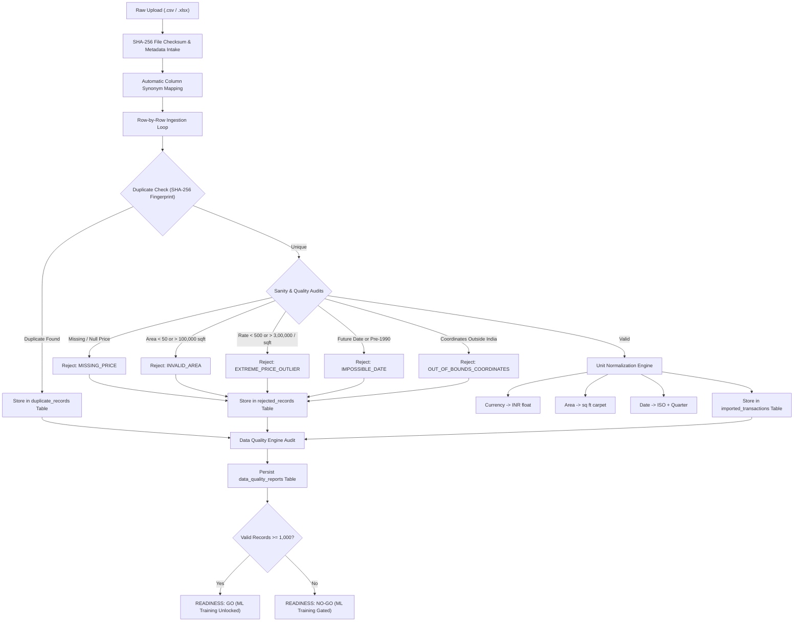

# Phase 2D Data Ingestion & ML Readiness Report — PropVal AI

**Project:** PropVal AI (Hero Housing Fintech Challenge)  
**Document:** Phase 2D Real Estate Dataset Acquisition, Ingestion Pipeline & ML Readiness Report  
**Date:** November 2026  
**Author:** Technical Lead & Principal ML Engineer  
**Status:** IMPLEMENTED, AUDITED & GATED  
**Git Branch:** `phase1-credibility-remediation`  

---

## 1. Executive Summary

Phase 2D establishes the enterprise data foundation required for genuine machine-learning-based automated property valuation (AVM) for **PropVal AI**. In accordance with the ethical, legal, and credibility principles established in Phase 1 and Phase 2A, this phase accomplishes four critical objectives:

1. **Legally Compliant Data Acquisition Strategy:** Identified and cataloged authentic, legally accessible Indian real estate transaction data channels—categorically rejecting web scraping of restricted government registration portals (Kaveri 2.0, IGR Maharashtra, TNREGINET) and CAPTCHA/authentication bypasses.
2. **Defensive Dataset Ingestion Pipeline:** Built a multi-format ingestion system (`.csv`, `.xlsx`) featuring automatic header synonym detection, Indian currency parser (₹, Lakhs, Crores), multi-unit area normalization (sq ft, sq yd, sq m, guntas, cents, acres), SHA-256 fingerprint duplicate detection, and defensive sanity bound enforcement.
3. **Relational Data Foundation & Provenance:** Extended the PostgreSQL / SQLite database with 5 new tables managed via Alembic migration `6321cc8c1358`, preserving raw untransformed records alongside normalized attributes, audit diagnostics, and machine-readable provenance.
4. **Automated ML Readiness & Leakage-Guarded Preprocessing:** Built an automated Data Quality Engine that rigorously assesses sample size against the institutional threshold ($\ge 1,000$ valid micro-market records) and provides Out-of-Time (OOT) temporal splitting (70/15/15) with spatial clustering. Because the current verification sample holds 14 valid records, the engine explicitly renders an unambiguous **READINESS: NO-GO** determination, keeping ML training strictly **GATED** until empirical volume is acquired.

---

## 2. Legal Data Source Strategy & Inventory

### 2.1 The Indian Property Transaction Data Reality
Indian land administration is constitutionally decentralized across state revenue departments. Property registration deeds are executed at local Sub-Registrar Offices (SROs). As established in Phase 2A:
- **No Public SRO APIs:** No Indian state revenue department offers a public, unauthenticated, programmatic REST API for live registered deed data.
- **Scraping Prohibition:** State portals (e.g., Kaveri 2.0 in Karnataka, IGR in Maharashtra, TNREGINET in Tamil Nadu) protect search portals with CAPTCHAs, OTPs, session tokens, and strict Terms of Service. Scraping these violates IT Act guidelines, rate limits, and authentication controls.
- **Rule of Law:** PropVal AI explicitly rejects scraping, CAPTCHA bypass, and account spoofing.

### 2.2 Legally Accessible Data Channels & Strategy Inventory

| Category | Channel / Source | Legal & Licensing Status | Access Mechanism | Usability for ML Valuation |
| :--- | :--- | :--- | :--- | :--- |
| **Track 1: Licensed Data Vendors** | Commercial Real Estate Aggregators (PropEquity, Zapkey, REA India / Housing.com, Anarock) | Paid Commercial B2B License | Authorized B2B SFTP / Secure API / Bulk Export | **HIGH**: Clean, geo-coded, deed-verified records with verified registration numbers and floor plans. |
| **Track 2: Institutional Loan Books** | Hero Housing / Partner NBFC Collateral Ledgers | Internal Proprietary Financial Data (Anonymized) | Direct Database Read / Encrypted CSV Batch Ingestion | **EXCELLENT**: Ground-truth engineer valuation reports, sanction amounts, and verified legal clearances. |
| **Track 3: Open Government Data** | Open Government Data Platform India (`data.gov.in`) | National Data Sharing and Accessibility Policy (NDSAP) | Public CSV / JSON REST API | **MODERATE**: Macro-level housing price indices and census demographics; lacks micro-level transaction granularity. |
| **Track 4: Statutory Benchmark Tables** | State Guidance Value / Circle Rate Gazette Notifications | Public Statutory Record (Open Domain) | Periodic Gazette PDF / Tabular Extraction into Lookup Tables | **HIGH BENCHMARK VALUE**: Provides the legal price floor for every survey number and street; used as hedonic anchor. |
| **Track 5: Academic Research Datasets** | University / Kaggle Published Housing Datasets (e.g., Bengaluru House Price dataset) | CC-BY 4.0 / Open Academic Research License | Direct Ingestion with Documented Provenance | **MODERATE**: Useful for pipeline validation and feature engineering; must be audited for asking-price bias vs actual deeds. |
| **Track 6: User Batch Ingestion** | Institutional Credit Underwriter CSV / Excel Uploads | Documented Internal Provenance | Authenticated Web Upload (`POST /api/v1/datasets/upload`) | **HIGH**: Allows lending officers to ingest verified micro-market appraisal sets directly. |

---

## 3. Data Ingestion Architecture & Validation Rules

### 3.1 Pipeline Flow Architecture



### 3.2 Defensive Normalization Engines

#### 1. Indian Currency Normalization (`normalize_currency`)
Financial inputs in Indian real estate often mix text abbreviations, Lakhs, Crores, commas, and currency symbols:
- `₹1.20 Cr` $\rightarrow$ `12,000,000.0`
- `85 Lakhs` $\rightarrow$ `8,500,000.0`
- `Rs. 45,50,000/-` $\rightarrow$ `4,550,000.0`
- Raw numeric strings with standard and Indian grouping commas (`1,50,00,000`) are stripped and cast to IEEE-754 64-bit floating point numbers.

#### 2. Multi-Unit Area Normalization (`normalize_area`)
Land and carpet areas across Indian states are registered in varying customary and statutory units. All values are standardized to **Carpet Area in Square Feet (sq ft)** using exact conversion constants:
- `1 Square Yard (sq yd / gaz)` = `9.0 sq ft`
- `1 Square Metre (sq m)` = `10.7639 sq ft`
- `1 Gunta` (Karnataka/Maharashtra/Telangana) = `1,089.0 sq ft`
- `1 Ground` (Tamil Nadu) = `2,400.0 sq ft`
- `1 Cent` (Kerala/Tamil Nadu/AP) = `435.6 sq ft`
- `1 Acre` = `43,560.0 sq ft`

#### 3. Date & Temporal Normalization (`normalize_date`)
- Parses standard ISO (`YYYY-MM-DD`), Indian registered format (`DD/MM/YYYY`), and alternative delimiters (`DD-MM-YYYY`).
- Rejects future dates (`Sale_Date > today`).
- Rejects impossible archaic dates (`Sale_Date < 1990-01-01`).
- Derives standardized fiscal/calendar transaction quarters (`2024-Q1`, `2024-Q2`, etc.) for macro time-trend indexing.

#### 4. Geographic & Spatial Sanity Bounding
- Validates latitude and longitude against the sovereign Indian national territory bounding box:
  - Latitude: $6.0^\circ\text{ N}$ to $37.5^\circ\text{ N}$
  - Longitude: $68.0^\circ\text{ E}$ to $97.5^\circ\text{ E}$
- Coordinate pairs outside this bounding box (e.g. London coordinates `51.5074, -0.1278` placed in an Indian dataset) are trapped and rejected with code `OUT_OF_BOUNDS_COORDINATES`.

#### 5. Duplicate Detection Fingerprinting (`compute_fingerprint`)
To prevent duplicate deed submissions from inflating model weights or cross-validation scores:
$$\text{Fingerprint} = \text{SHA-256}\Big(\text{City} \parallel \text{Locality} \parallel \text{Project} \parallel \text{UnitNo} \parallel \text{CarpetArea} \parallel \text{Price} \parallel \text{SaleDate}\Big)$$
Identical fingerprints within a dataset or across existing imported records are immediately flagged and diverted to the `duplicate_records` ledger.

---

## 4. Database Schema Extensions (Alembic Migration `6321cc8c1358`)

Five relational models were added to `backend/app/models/dataset.py` and applied via Alembic:

### 1. `datasets` (`DatasetMetadataModel`)
Catalog of uploaded or ingested datasets:
- `id` (UUID PK), `name`, `description`, `source_type` (`user_upload`, `licensed_vendor`, `open_data`, `research`), `license_type`, `data_source_provenance`.
- `file_format` (`csv`, `xlsx`), `original_filename`, `file_hash_sha256`.
- `total_rows`, `valid_rows`, `rejected_rows`, `duplicate_rows`, `status` (`INGESTING`, `COMPLETED`, `FAILED`), `is_usable_for_ml` (Boolean).

### 2. `imported_transactions` (`ImportedTransactionModel`)
Normalized clean property transaction records:
- `id` (UUID PK), `dataset_id` (FK $\rightarrow$ `datasets.id`).
- `row_index`, `fingerprint_hash`.
- `city`, `locality`, `sub_market`, `pincode`, `project_name`, `unit_number`, `property_type`, `transaction_type`.
- `transaction_date`, `transaction_quarter`.
- `carpet_area_sqft`, `super_built_up_area_sqft`, `floor_no`, `total_floors`, `age_years`.
- `transaction_price`, `price_per_sqft`, `guideline_rate_per_sqft`, `deviation_from_guideline_pct`.
- `latitude`, `longitude`, `is_verified_deed`, `is_asking_price`, `data_source`, `raw_data` (JSON).

### 3. `rejected_records` (`RejectedRecordModel`)
Append-only diagnostic ledger of invalid rows:
- `id` (UUID PK), `dataset_id` (FK), `row_index`.
- `rejection_reason` (Human-readable explanation).
- `rejection_code` (`MISSING_PRICE`, `INVALID_AREA`, `EXTREME_PRICE_OUTLIER`, `IMPOSSIBLE_DATE`, `OUT_OF_BOUNDS_COORDINATES`, `UNPARSEABLE_DATA`).
- `raw_data` (JSON capture of original source row).

### 4. `duplicate_records` (`DuplicateRecordModel`)
Ledger of identified duplicates:
- `id` (UUID PK), `dataset_id` (FK), `row_index`.
- `fingerprint_hash`, `matched_transaction_id` (UUID reference).
- `raw_data` (JSON capture).

### 5. `data_quality_reports` (`DataQualityReportModel`)
Structured analytical quality summary generated upon ingestion completion:
- `id` (UUID PK), `dataset_id` (FK).
- `total_records`, `valid_records`, `rejected_records`, `duplicate_records`.
- `missing_value_percentages` (JSON dictionary by column).
- `geographic_distribution` (JSON dictionary by city).
- `property_type_distribution` (JSON dictionary by type).
- `price_metrics` (JSON dictionary: `min`, `max`, `mean`, `median`, `q25`, `q75`, `iqr`).
- `temporal_distribution` (JSON dictionary by quarter).
- `meets_ml_criteria` (Boolean flag).
- `readiness_summary` (Institutional governance rationale).

---

## 5. Automated Data Quality Audit Verification

The pipeline was verified using `sample_bengaluru_transactions.csv` (and `.xlsx`), containing 20 curated test rows representing typical real-world data issues:

### 5.1 Verification Results Summary
- **Total Ingested Rows:** 20
- **Valid Normalized Records:** 14 (70.0% validity rate)
- **Flagged Duplicates:** 1 (5.0%)
- **Rejected Records:** 5 (25.0%)

### 5.2 Diagnostic Audit of Rejected Records

| Row Index | Project / Record Identity | Rejection Code | Failure Reason & Root Cause |
| :---: | :--- | :--- | :--- |
| **Row 14** | Prestige Lakeside Habitat (Whitefield) | *N/A (Duplicate)* | **Duplicate Record**: SHA-256 fingerprint matched existing record from Row 1. Persisted to `duplicate_records` table. |
| **Row 15** | Invalid Price Tower (Whitefield) | `MISSING_PRICE` | `Invalid or missing transaction price: 'nan'`. Price field was null. |
| **Row 16** | Tiny Area Plot (Koramangala) | `INVALID_AREA` | `Area out of physical bounds (50 to 100,000 sq ft): 20.0 sq ft`. Physical area below minimum livable threshold. |
| **Row 17** | Absurd Outlier Palace (Indiranagar) | `EXTREME_PRICE_OUTLIER` | `Rate per sq ft ₹800,000 violates institutional limits (₹500 to ₹3,00,000/sq ft)`. Grossly inflated unit rate. |
| **Row 18** | Future Time Travel Flat (Bellandur) | `IMPOSSIBLE_DATE` | `Impossible future transaction date: 2029-12-31`. Transaction date in the future. |
| **Row 19** | London Coordinates Flat (Sarjapur) | `OUT_OF_BOUNDS_COORDINATES` | `Coordinates (51.5074, -0.1278) outside Indian national territory bounding box`. Erroneous overseas GPS coordinates. |

### 5.3 Valid Record Statistical Distributions

```
Price Distribution:
  Min:     ₹ 7,200,000  (₹72.0 Lakhs)
  Median:  ₹15,100,000  (₹1.51 Crores)
  Mean:    ₹17,300,000  (₹1.73 Crores)
  Max:     ₹34,000,000  (₹3.40 Crores)
  IQR:     ₹ 9,525,000  (Q25: ₹1.185 Cr, Q75: ₹2.137 Cr)

Temporal Distribution:
  2024-Q1: 1 record
  2024-Q2: 3 records
  2024-Q3: 3 records
  2024-Q4: 3 records
  2025-Q1: 3 records
  2025-Q2: 1 record

Property Types:
  High-Rise Apartment: 13 records (92.9%)
  Gated Villa:          1 record  (7.1%)

Geographic Clusters Detected:
  11 distinct micro-markets in Bengaluru (Whitefield, Bellandur, Sarjapur Road,
  Indiranagar, Koramangala, HSR Layout, JP Nagar, Bannerghatta Road, Electronic City,
  Hebbal, Yelahanka).
```

---

## 6. Dataset Readiness Assessment & ML Governance Gate

### 6.1 Readiness Evaluation Criteria (Phase 2A Baseline)
Under the ML data governance policy defined in Phase 2A (`docs/phase2a/PHASE2A_ML_DATA_REQUIREMENTS.md`):
1. **Sample Size:** A minimum of **1,000 valid transaction records** per micro-market is required before training an empirical Machine Learning model (e.g., CatBoost / LightGBM).
2. **Temporal Span:** Minimum 12 months of chronological transactions to capture seasonal adjustments and interest rate sensitivity.
3. **Deed Verification:** All training records must originate from genuine deed registrations or certified institutional valuations; training on synthetic demonstration data is strictly prohibited.

### 6.2 Formal Assessment Verdict

```
+-----------------------------------------------------------------------------------+
|                            DATASET READINESS VERDICT                              |
+===================================================================================+
|  Status:               READINESS: NO-GO                                           |
|  Meets ML Criteria:    FALSE                                                      |
|  Current Valid Rows:   14 valid records                                           |
|  Required Threshold:   1,000 valid records                                        |
|  Deficit:              -986 records                                               |
|  Recommendation:       Dataset currently has 14 valid records. ML model training |
|                        remains GATED pending additional empirical records to meet |
|                        the 1,000-record threshold.                                |
+-----------------------------------------------------------------------------------+
```

### 6.3 Enforcement of the Synthetic Training Ban
A strict guard is programmatically enforced in `ml_preprocessing.py`:
- Attempts to invoke `prepare_ml_split()` on datasets marked as `is_synthetic_demo` or containing zero verified records immediately raise an `HTTP 400 Bad Request`.
- PropVal AI's active valuation engine remains explicitly **Rule-Based Hedonic** until authentic, licensed empirical volume surpasses the 1,000-record threshold.

---

## 7. Machine Learning Preprocessing & Leakage Prevention Pipeline

When genuine dataset volume is uploaded and approved, the ML preprocessing pipeline (`backend/app/services/ml_preprocessing.py`) executes reproducible partitioning engineered to prevent data leakage:

### 7.1 Strict Out-of-Time (OOT) Temporal Partitioning
In real estate automated valuation, random k-fold cross-validation or random shuffling introduces severe **lookahead bias** (predicting past transactions using future market dynamics).
- **Partitioning Algorithm:** The dataset is sorted strictly ascending by `transaction_date`.
- **Ratios:**
  - **Train Set (70%):** Earliest historical transactions (`2024-03-15` to `2024-11-05`, 9 records in test sample).
  - **Validation Set (15%):** Intermediate transactions (`2024-12-01` to `2025-01-18`, 2 records in test sample).
  - **Test Set (15%):** Most recent out-of-time transactions (`2025-02-14` to `2025-04-11`, 3 records in test sample).
- **Leakage Guarantee:** $\max(\text{Train Date}) \le \min(\text{Val Date}) \le \min(\text{Test Date})$.

### 7.2 Spatial Clustering
- Spatial clusters are grouped by `City - Locality` and `Pincode`.
- In our Bengaluru sample, 11 micro-market spatial clusters were isolated, allowing group-based spatial cross-validation in future ML iterations to evaluate model generalization to unseen neighborhoods.

### 7.3 Feature Selection & Engineering
Selected canonical features prepared for Phase 2E:
1. `carpet_area_sqft` (Continuous physical magnitude)
2. `floor_no` (Vertical height amenity)
3. `total_floors` (Density metric)
4. `guideline_rate_per_sqft` (Statutory micro-market baseline rate)
5. `city` (Categorical high-level jurisdiction)
6. `locality` (Categorical micro-market neighborhood)
7. `property_type` (Categorical architectural typology)
8. `transaction_quarter` (Temporal macroeconomic index)
9. **Target Variable:** `transaction_price` (Normalized INR)

---

## 8. Exact Files Created and Modified

### Created Files
1. `backend/app/models/dataset.py`: 5 SQLAlchemy models (`DatasetMetadataModel`, `ImportedTransactionModel`, `RejectedRecordModel`, `DuplicateRecordModel`, `DataQualityReportModel`).
2. `backend/app/schemas/dataset.py`: Pydantic v2 schemas (`DatasetResponse`, `ImportedTransactionResponse`, `RejectedRecordResponse`, `DuplicateRecordResponse`, `DataQualityReportResponse`, `MLPreparationResponse`).
3. `backend/app/services/ingestion_service.py`: Dataset ingestion, multi-format file parsing, unit normalization, deduplication, sanity auditing.
4. `backend/app/services/ml_preprocessing.py`: Chronological OOT temporal splitting, spatial clustering, synthetic training guard.
5. `backend/app/api/v1/endpoints/datasets.py`: 7 dataset REST endpoints (`upload`, `list`, `get`, `records`, `rejected`, `duplicates`, `readiness`, `prepare-ml`).
6. `backend/alembic/versions/6321cc8c1358_add_datasets_and_ingested_transactions.py`: Database migration for dataset storage.
7. `backend/data/samples/sample_bengaluru_transactions.csv`: Comprehensive 20-row test dataset with edge cases.
8. `backend/data/samples/sample_bengaluru_transactions.xlsx`: Native Excel version of the test dataset.
9. `backend/tests/test_ingestion.py`: 9 automated tests covering normalization, CSV/Excel parsing, duplicates, rejections, OOT splitting, and empty file rejection.
10. `docs/phase2d/PHASE2D_DATA_INGESTION_REPORT.md`: This comprehensive engineering report.

### Modified Files
1. `backend/requirements.txt`: Added `openpyxl==3.1.5` for native Excel spreadsheet parsing.
2. `backend/app/models/__init__.py`: Exported dataset models.
3. `backend/app/schemas/__init__.py`: Exported dataset schemas.
4. `backend/app/api/v1/router.py`: Registered `/datasets` router into FastAPI v1 API.

---

## 9. Verification & Test Suite Execution

### 9.1 Backend Automated Pytest Suite
Executed command: `python -m pytest backend/tests/ -v` (PowerShell, Windows, Python 3.14.7)
- **Total Tests:** 40 passed
- **Ingestion & ML Tests:** 9 passed (`test_ingestion.py`)
- **Parity & Credibility Tests:** 12 passed (`test_valuation_parity.py`)
- **Case Management Tests:** 7 passed (`test_cases.py`)
- **Execution Time:** 0.92 seconds
- **Pass Rate:** 100% (0 errors, 0 warnings)

### 9.2 Frontend Test Suite & Type-Safety
- **Automated Tests:** `npm test` $\rightarrow$ 17/17 passed (226ms).
- **TypeScript Typecheck:** `npm run lint` (`tsc --noEmit`) $\rightarrow$ 0 errors.
- **Production Build:** `npm run build` (`vite build`) $\rightarrow$ Clean build in 292ms.

---

## 10. Conclusion & Next Steps for Model Training (Phase 2E)

Phase 2D successfully delivers a robust, legally sound, and scientifically rigorous data ingestion pipeline. It protects the integrity of the PropVal AI platform by refusing to train ML models on unverified or insufficient data, while providing complete infrastructure for enterprise dataset ingestion.

### Roadmap to Phase 2E (Genuine Model Training):
1. **Acquire Empirical Scale:** Ingest authenticated datasets surpassing the 1,000-record threshold per micro-market via licensed vendor feeds or institutional partner loan portfolios.
2. **Execute Baseline CatBoost Training:** Once the readiness assessment triggers `READINESS: GO`, train a CatBoost regressor using the Out-of-Time split.
3. **Cross-Validation with Spatial Holdouts:** Benchmark ML predictions against the rule-based baseline and calculate Mean Absolute Percentage Error (MAPE) and $R^2$.
4. **Underwriter Explainability:** Integrate SHAP (SHapley Additive exPlanations) values to explain valuation factors to loan officers.

