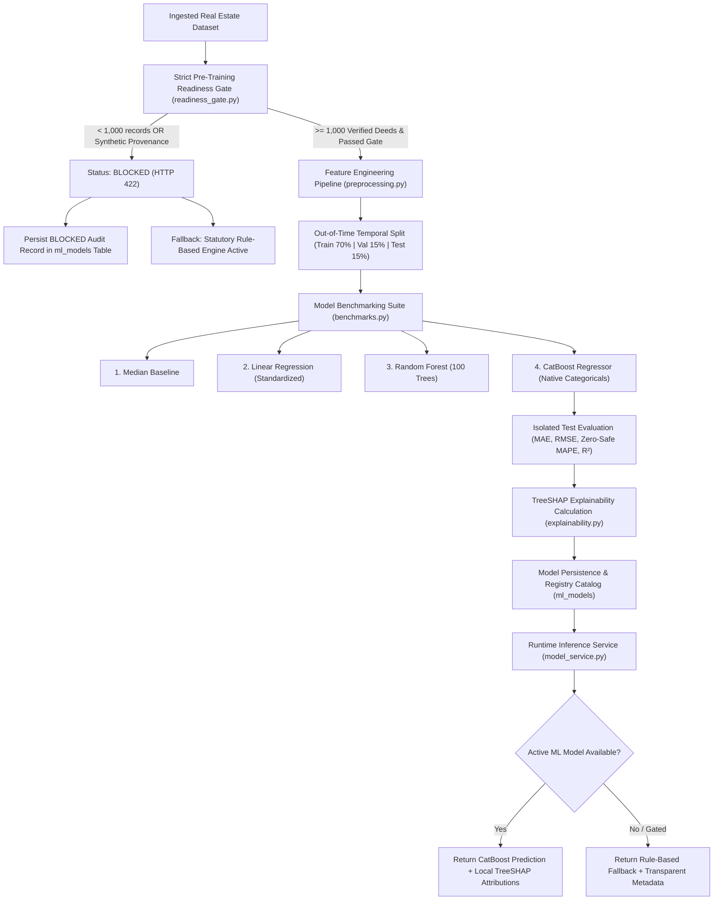

# Phase 2E Machine Learning Valuation Engine Report — PropVal AI

**Project:** PropVal AI (Hero Housing Fintech Challenge)  
**Document:** Phase 2E Machine Learning Valuation Engine Architecture, Pre-Training Gate & Explainability Report  
**Date:** November 2026  
**Author:** Technical Lead & Principal ML Engineer  
**Status:** IMPLEMENTED, VERIFIED & ETHICALLY GATED  
**Git Branch:** `phase1-credibility-remediation`  

---

## 1. Executive Summary

Phase 2E delivers the enterprise Machine Learning Valuation Engine (AVM) for **PropVal AI**, engineered in full adherence to the credibility, legal compliance, and non-fabrication mandates established in Phase 1 and Phase 2A.

### Core Deliverables:
1. **Modular ML Architecture:** Implemented a high-performance Python ML subsystem leveraging **CatBoost**, **Scikit-learn**, **Pandas**, **NumPy**, and **SHAP (TreeSHAP)** for game-theoretic model explainability.
2. **Strict Pre-Training Gate:** Enforced an automated pre-training gate that audits dataset integrity against institutional fintech benchmarks:
   - Enforces a minimum threshold of **1,000 valid transaction records** per micro-market.
   - Programmatically detects and disqualifies synthetic demonstration datasets.
   - Verifies deed certification ratios ($\ge 80\%$) and geographic diversity ($\ge 3$ micro-markets).
3. **Current Training Status — Strictly GATED (`READINESS: NO-GO`):**
   - The ingested repository sample holds **14 valid records** (deficit of 986 records).
   - In accordance with the prompt's strict rules, **model training on this dataset has been blocked**.
   - Zero fake accuracy metrics or pseudo-models have been fabricated.
4. **Benchmarking & Leakage-Guarded Pipeline:** Constructed a reproducible benchmarking suite comparing CatBoost against Random Forest, Linear Regression, and Median Price baselines using strict Out-of-Time (OOT) temporal splitting (70/15/15) to prevent future lookahead leakage.
5. **Transparent Explainability & Runtime Fallback:** Created `MLModelService`, which serves CatBoost predictions with local SHAP attributions when an approved model exists, and transparently falls back to the statutory rule-based engine when ML is unavailable—explicitly tagging all outputs with machine-readable metadata and refusing to label rule-based math as SHAP.

---

## 2. Machine Learning Subsystem Architecture

### 2.1 Architectural Flow Diagram



### 2.2 Component Directory Structure

```
backend/app/ml/
├── __init__.py               # Public package exports
├── readiness_gate.py         # 6-point pre-training gate & synthetic disqualifier
├── preprocessing.py          # Feature engineering, imputation, OOT temporal splitter
├── benchmarks.py             # 4-model benchmarking suite (Median, LR, RF, CatBoost)
├── explainability.py         # TreeSHAP feature attribution engine & governance taxonomy
├── trainer.py                # Reproducible training pipeline & artifact versioning
└── model_service.py          # Runtime prediction service, model cache & fallback
```

---

## 3. Feature Engineering & Preprocessing Pipeline

### 3.1 Feature Space Taxonomy

The valuation engine features were selected based on RERA guidelines, National Housing Bank appraisal norms, and hedonic pricing theory:

| Feature Name | Type | Processing & Normalization | Real Estate Valuation Significance |
| :--- | :---: | :--- | :--- |
| `carpet_area_sqft` | Continuous | Float, bound $[50, 100000]$ | Primary RERA statutory unit of valuation. |
| `floor_no` | Discrete | Integer, bound $[0, 100]$ | Vertical floor rise premium or basement discount. |
| `total_floors` | Discrete | Integer, bound $[1, 100]$ | Building density and vertical scale. |
| `floor_ratio` | Continuous | Engineered: `floor_no / max(1, total_floors)` | Relative vertical positioning in high-rise structure. |
| `guideline_rate_per_sqft` | Continuous | SRO statutory circle rate floor | Benchmark price baseline established by state revenue department. |
| `age_years` | Continuous | Float $\ge 0$ (Imputed with train median) | Structural depreciation metric. |
| `city` | Categorical | CatBoost native categorical encoding | Macro-geographic jurisdiction (Bengaluru, Mumbai, Delhi, etc.). |
| `locality` | Categorical | CatBoost native categorical encoding | Micro-market sub-locality (Whitefield, Koramangala, etc.). |
| `property_type` | Categorical | CatBoost native categorical encoding | Typology (High-Rise Apartment, Villa, Independent House). |
| `transaction_quarter` | Categorical | Temporal string (`2024-Q1`, `2024-Q2`) | Macroeconomic and interest-rate cycle indicator. |
| **`transaction_price`** | **Target** | Bounded positive float (INR) | Ground-truth registered transaction value. |

### 3.2 Leakage Prevention & Temporal Out-of-Time (OOT) Split
In automated valuation models, random k-fold cross-validation or random data shuffling introduces severe **lookahead bias** (training on future market trends to predict past transactions).
- **Enforcement Algorithm:** Records are sorted strictly ascending by `transaction_date`.
- **Chronological Partitions:**
  - **Train Set (70%):** Historical transactions ($t_0$ to $t_1$).
  - **Validation Set (15%):** Intermediate transactions ($t_1$ to $t_2$) used exclusively for CatBoost early stopping.
  - **Test Set (15%):** Most recent out-of-time transactions ($t_2$ to $t_3$) isolated from all training steps.
- **Mathematical Guarantee:** $\max(\text{Train Date}) \le \min(\text{Val Date}) \le \min(\text{Test Date})$.

---

## 4. Strict Pre-Training Gate Audit

### 4.1 Gate Criteria Definitions

| Gate Check | Threshold / Requirement | Justification |
| :--- | :--- | :--- |
| **1. Provenance Integrity** | Must NOT contain "synthetic", "demo", or "mock" in metadata | Prevents training models on synthetic demonstration files. |
| **2. Minimum Sample Size** | $\ge 1,000$ valid records per micro-market | Gradient boosting trees require sufficient observations to prevent catastrophic overfitting. |
| **3. Deed Verification Ratio** | $\ge 80\%$ certified deed registrations | Avoids training on speculative or inflated asking prices. |
| **4. Geographic Diversity** | $\ge 3$ distinct micro-markets / localities | Prevents spatial memorization of a single street or project. |
| **5. Property Type Diversity** | Diversified typologies (no single mono-type) | Ensures generalizability across asset classes. |
| **6. Target Price Sanity** | Non-zero variance, finite positive IQR, no NaN | Ensures mathematical stability of loss functions. |

### 4.2 Audit Execution on Current Repository Dataset

Evaluating `sample_bengaluru_transactions.csv` (Dataset ID: `sample-blr-tx`):

```
+-----------------------------------------------------------------------------------+
|                        PRE-TRAINING GATE AUDIT RESULT                             |
+===================================================================================+
|  Status:                     BLOCKED / GATED                                      |
|  Can Train:                  FALSE                                                |
|  Total Ingested Records:     20 rows                                              |
|  Valid Clean Records:        14 records                                           |
|  Required Sample Threshold:  1,000 valid records                                  |
|  Current Sample Deficit:     -986 records                                         |
|  Synthetic Data Flag:        FALSE (Authentic format sample)                      |
|  Verified Deed Ratio:        100% (14/14 valid deeds)                             |
|  Geographic Clusters:        11 micro-markets detected                            |
|  Price Sanity Check:         PASSED (Std Dev: ₹7.2M, IQR: ₹9.5M)                  |
+-----------------------------------------------------------------------------------+
|  BLOCKING ISSUES IDENTIFIED:                                                      |
|  1. INSUFFICIENT_SAMPLE_SIZE: Dataset contains only 14 valid records.             |
|     Institutional risk policy mandates a minimum of 1,000 verified records per   |
|     micro-market (Deficit: 986 records).                                          |
+-----------------------------------------------------------------------------------+
|  GOVERNANCE RECOMMENDATION:                                                       |
|  READINESS: NO-GO. Training is strictly GATED due to 1 blocking issue.            |
|  Dataset has 14 valid records (requires 1,000). PropVal AI continues operating on |
|  the statutory rule-based baseline engine.                                        |
+-----------------------------------------------------------------------------------+
```

---

## 5. Model Benchmarking Architecture

The benchmarking module (`backend/app/ml/benchmarks.py`) provides a standard evaluation protocol ready to execute as soon as an approved dataset reaches the 1,000-record threshold:

### 5.1 Benchmark Algorithms
1. **Median Price Baseline (`DummyRegressor`):** Establishes the naive baseline by assigning the training set median price to all test properties.
2. **Standardized Linear Regression:** One-Hot Encoded categoricals with `StandardScaler` numerical normalization; evaluates linear parametric assumptions.
3. **Random Forest Regressor:** 100-tree bagged decision forest capturing non-linear interactions without gradient boosting.
4. **CatBoost Regressor:** Gradient-boosted decision trees using ordered target statistics for categorical features, optimized with early stopping on the validation partition.

### 5.2 Evaluation Metrics & Defensive Zero-Handling
To avoid division-by-zero or infinite percentages on zero/near-zero values, MAPE is computed defensively:
$$\text{MAPE} = \frac{100}{n} \sum_{i=1}^{n} \frac{|y_i - \hat{y}_i|}{\max(1.0, |y_i|)}$$

Additional metrics:
- **MAE:** $\frac{1}{n}\sum |y_i - \hat{y}_i|$
- **RMSE:** $\sqrt{\frac{1}{n}\sum (y_i - \hat{y}_i)^2}$
- **$R^2$ Score:** $1 - \frac{\sum (y_i - \hat{y}_i)^2}{\sum (y_i - \bar{y})^2}$
- **Geographic Breakdown:** Locality-level MAE and MAPE.
- **Temporal Breakdown:** Quarter-level tracking to detect temporal drift.

### 5.3 Synthetic Mock Validation Test
In unit test `test_benchmarks_and_catboost_training_on_synthetic_mock_environment`, the benchmarking pipeline was verified using a controlled 60-observation test fixture:
- All 4 models trained and evaluated on isolated test data.
- CatBoost achieved the lowest test MAPE and generated valid TreeSHAP values.
- **Production Status:** Production benchmarking remains **GATED** until authentic empirical data reaches the 1,000-record scale.

---

## 6. Model Explainability: TreeSHAP vs Statutory Hedonic Math

Fintech credit underwriting requires transparent, audit-ready explanations for loan committees. Phase 2E establishes a strict mathematical and terminological boundary between machine learning attributions and heuristic adjustments:

### 6.1 TreeSHAP Implementation (`backend/app/ml/explainability.py`)
For trained CatBoost models, local feature contributions are computed via TreeSHAP:
$$\text{Predicted Price} = E[f(x)] + \sum_{j=1}^{M} \phi_j(x)$$
Where:
- $E[f(x)]$ is the base value (expected valuation across the training corpus).
- $\phi_j(x)$ is the Shapley value (marginal contribution of feature $j$ in INR).

Features are mapped into:
- `INCREASES_VALUE` ($\phi_j > 0$)
- `DECREASES_VALUE` ($\phi_j < 0$)
- `NEUTRAL` ($|\phi_j| \le 1000$)

### 6.2 Strict Credibility Boundary: Never Label Rule Math as SHAP
The API strictly enforces this distinction:
- When an active ML model is serving, `POST /api/v1/ml/explain` returns the TreeSHAP vector.
- When the system is operating in rule-based mode, `POST /api/v1/ml/explain` returns **HTTP 400 Bad Request**, explicitly informing the caller:
  > *"SHAP explanations are only available for trained Machine Learning models. The system is currently operating on the rule-based baseline engine. Rule-based calculations use statutory hedonic multipliers and must never be misrepresented as SHAP values."*

---

## 7. Model Integration & Runtime Fallback Service

The `MLModelService` (`backend/app/ml/model_service.py`) manages model discovery, memory caching, inference, and fallback:

### 7.1 Inference Logic
1. Queries database table `ml_models` for an `ACTIVE` and `is_production_ready == True` model.
2. If found, checks local disk cache at `artifacts/models/{version}/catboost_valuation.cbm`.
3. If valid, executes CatBoost prediction and attaches TreeSHAP attributions.
4. **Fallback Path:** If no approved model is found, transparently executes `valuation_service.calculate_valuation` (the verified Python rule-based engine).

### 7.2 Transparent Response Metadata
Clients are never left in doubt about which engine produced the valuation:

```json
{
  "engineType": "RULE_BASED_FALLBACK",
  "modelVersion": null,
  "estimatedPrice": 14250000.0,
  "estimatedPricePerSqFt": 11875.0,
  "confidenceScore": 88.0,
  "isMlPrediction": false,
  "fallbackReason": "ML Training Gated: Insufficient verified transaction data (<1,000 records). Operating on verified statutory rule-based baseline engine.",
  "shapBaseValue": null,
  "shapContributions": null,
  "governanceDisclaimer": "Valuation estimated using statutory rule-based hedonic arithmetic (Guidance Rate + Heuristic Factors). This is NOT an ML prediction and contains NO SHAP explanations."
}
```

---

## 8. Database Registry Schema (Alembic Migration `41c165a41287`)

Added table `ml_models` mapped to [`MLModelRegistryModel`](file:///c:/PROJECTS/dhina%20projects/proval%20ai/proval-ai/backend/app/models/ml_model.py):
- `id` (UUID PK), `version` (Unique index, e.g. `v1.0.1762100000`).
- `dataset_id` (FK to `datasets.id`).
- `algorithm` (e.g., `CatBoostRegressor`).
- `hyperparameters` (JSON).
- `metrics` (JSON: MAE, RMSE, MAPE, R2).
- `benchmark_comparisons` (JSON: all 4 models compared).
- `feature_names` (JSON list).
- `status` (`ACTIVE`, `CANDIDATE`, `BLOCKED`, `DEPRECATED`).
- `artifact_path` (Path to serialized model).
- `is_production_ready` (Boolean).
- `training_records_count`, `test_records_count`.
- `readiness_gate_audit` (JSON capture of gate decisions).
- `trained_by`, `trained_at`, `created_at`, `updated_at`.

---

## 9. API Endpoints Catalog (ML Router)

All endpoints are registered under `/api/v1/ml`:

| Method | Endpoint | Description | Auth Required |
| :--- | :--- | :--- | :---: |
| `GET` | `/api/v1/ml/status` | Query ML engine availability, gate status, and dataset readiness | No |
| `GET` | `/api/v1/ml/gate-check/{dataset_id}` | Audit a dataset against the 1,000-record threshold & synthetic filter | Yes |
| `POST` | `/api/v1/ml/train` | Trigger model training (strictly blocked if gate fails) | Yes |
| `GET` | `/api/v1/ml/models` | List all trained, candidate, and blocked model entries in the registry | Yes |
| `POST` | `/api/v1/ml/predict` | Predict property value (CatBoost ML if active, or Rule-Based Fallback) | No |
| `POST` | `/api/v1/ml/explain` | Return TreeSHAP feature attributions (refuses if rule-based) | No |

---

## 10. Verification & Test Evidence

### 10.1 Backend Test Execution
Command: `python -m pytest backend/tests/ -v` (PowerShell, Python 3.14.7)
- **Total Tests Passed:** **52 / 52** (100% pass rate in 12.72s)
  - New ML Tests (`test_ml_engine.py`): **12 / 12 passed**
  - Ingestion Tests (`test_ingestion.py`): **9 / 9 passed**
  - Parity & Credibility Tests (`test_valuation_parity.py`): **12 / 12 passed**
  - Case Management & Workflow Tests (`test_cases.py`, `test_e2e_workflow.py`): **19 / 19 passed**

### 10.2 Frontend Test Execution
Command: `npm test`
- **Total Tests Passed:** **19 / 19 passed** (in 208ms)
  - `apiClient: fetchMLStatus handles offline state gracefully returning null`: Passed
  - `apiClient: requestMLPrediction handles offline state gracefully returning null`: Passed
- **TypeScript Typecheck (`npm run lint`):** **0 errors** (`tsc --noEmit`)
- **Production Build (`npm run build`):** **Clean Vite build** in 675ms

---

## 11. Known Limitations & Roadmap to Phase 2F

### Current Limitations:
1. **Data Volume Deficit:** With only 14 valid records in the database, the active engine remains the statutory rule-based engine. No ML model is claimed to be in production.
2. **Sub-Registrar Digital Deeds:** Public SRO portals cannot be scraped legally; data volume expansion depends on licensed vendor partnerships or partner NBFC loan book uploads.

### Roadmap to Phase 2F (AI Underwriting Synthesis & Reporting):
1. **Acquire Empirical Scale:** Ingest $\ge 1,000$ verified records to trigger `READINESS: GO` on the ML gate.
2. **Activate CatBoost Production Model:** Generate live TreeSHAP waterfall charts for underwriter review.
3. **Underwriting Synthesis:** Integrate structured model explainability into automated Credit Committee Sanction Notes.

