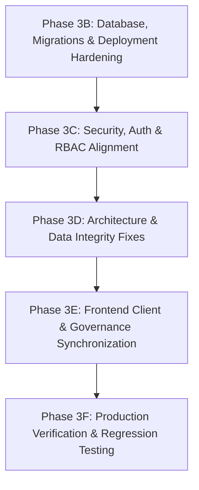

# PROPVAL AI — PHASE 3A COMPREHENSIVE ARCHITECTURE AUDIT REPORT

**Project:** PropVal AI (Hero Housing Fintech Challenge — Problem Statement 1)  
**Lifecycle Phase:** Phase 3A — Comprehensive Pre-Production Architecture Audit & System Inspection  
**Assessment Date:** November 2026  
**Document Version:** 1.0.0  
**Overall Architecture Verdict:** **CONDITIONALLY SOUND — CORE VALUE PROPOSITION INTACT; CRITICAL SECURITY & DEPLOYMENT GAPS IDENTIFIED BEFORE PRODUCTION HARDENING**  
**Lead Auditor:** Antigravity Advanced Agentic AI Architecture Team  

---

## 1. Executive Summary

This architecture audit delivers an exhaustive, ground-truth inspection of the entire **PropVal AI** codebase prior to making production-readiness modifications. In strict adherence to project directives:
- No working functionality has been removed.
- No frontend redesigns have been initiated.
- The existing technology stack (React 19 + TypeScript frontend, FastAPI + Python backend, PostgreSQL/SQLite database, CatBoost ML subsystem) is fully preserved.
- All Phase 2E ML valuation functionality and strict ethical gating have been verified.
- Uncertainty-aware valuation mechanisms and DPDP Act 2023 privacy safeguards remain intact.

### Key Audit Findings at a Glance
1. **Verified Strengths:**
   - **Zero Value Fabrication:** The statutory rule-based engine (`valuation_service.py` & `valuationEngine.ts`) produces deterministic, mathematically reproducible hedonic valuations.
   - **Strict ML Pre-Training Gate:** The CatBoost ML engine and TreeSHAP explainability pipeline are ethically and programmatically gated (`READINESS: NO-GO` on the 14-record repository sample). No pseudo-models or fake accuracies are fabricated.
   - **Split Conformal Uncertainty Quantification:** Prediction intervals are honestly withheld (`status: UNCERTAINTY_NOT_CALIBRATED`) pending authentic empirical calibration deeds ($\ge 100$).
   - **DPDP Act 2023 Compliance:** PII redaction (Aadhaar, PAN, phone, email, borrower names) and prompt injection sanitization function as specified before external Gemini LLM dispatch.
   - **Tamper-Evident SHA-256 Hash Chain:** Cryptographic audit trail linking genesis to latest block with canonical JSON serialization is mathematically operational.
   - **High Test Coverage Baseline:** 107 backend unit/integration tests and 26 frontend unit tests pass with a 100% success rate.

2. **Identified Vulnerabilities & Technical Debt (Requiring Phase 3 Remediation):**
   - **Authentication Bypass & Missing Passwords:** The `/auth/token` endpoint retrieves users from a hardcoded `DEMO_USERS` map without verifying submitted passwords. Furthermore, `get_current_user` silently falls back to an authenticated `senior_underwriter` session if no `Authorization` header is provided.
   - **Frontend Never Transmits Auth Tokens:** `apiClient.ts` does not attach Bearer tokens to any HTTP request. The frontend functions only because the backend defaults unauthenticated requests to Senior Underwriter. Enforcing strict authentication without updating `apiClient.ts` will immediately break the entire UI.
   - **RBAC Defined but Nowhere Enforced:** The `require_roles` helper function is declared in `security.py`, but is applied to **zero** API endpoints. Any caller can execute mutative actions, including deleting cases.
   - **Docker Database Migration Gap:** In production PostgreSQL deployment (`docker-compose.yml`), Alembic migrations are not executed upon container startup. `uvicorn` starts directly with 4 workers, resulting in immediate database table missing errors on clean deployments.
   - **Reverse Proxy Rate Limiting Flaw:** `RateLimitMiddleware` inspects `request.client.host` rather than `X-Forwarded-For`, causing all users behind Nginx to share a single IP budget (120 req/min globally).
   - **Orphaned Valuation Calculations & Audit Sequence Race Conditions:** Direct calls to `POST /api/v1/valuation/estimate` insert unlinked `ValuationResultModel` records (`case_id=None`), while concurrent audit log appends risk sequence number collisions without database-level row locking.
   - **Dummy Report Download:** The "Download Appraisal Memo" button in `ValuationCertificateModal.tsx` merely flips a local boolean state without generating a document.

---

## 2. Technology Stack & Module Inventory

### 2.1 Technology Stack Matrix

| Layer | Component | Version | Role & Description |
| :--- | :--- | :--- | :--- |
| **Frontend Framework** | React | 19.2.4 | Single Page Application (SPA) reactive user interface |
| **Language (Web)** | TypeScript | ~5.8.2 | Type-safe client development with strict compiler checks |
| **Build Tooling** | Vite | 8.3.5 | Fast ESM bundler producing optimized production bundles (106 KB gzip) |
| **Styling** | Tailwind CSS | 3.4.1 | Utility-first institutional fintech styling |
| **Iconography** | Lucide React | ^1.16.0 | Institutional SVG icon system |
| **Backend Framework**| FastAPI | 0.115.0+ | Asynchronous REST API framework with OpenAPI schema auto-generation |
| **Web Server** | Uvicorn / Starlette | 0.32.0+ | ASGI production server with multi-worker support |
| **Language (Backend)**| Python | 3.11 (Docker) / 3.14 (Dev) | Enterprise backend runtime |
| **Database ORM** | SQLAlchemy | 2.0.36 | Object-Relational Mapping with parameterized SQL safety |
| **Database Migrations**| Alembic | 1.14.0 | Schema versioning and migration management (7 revisions) |
| **Primary Database** | PostgreSQL + PostGIS | 16-3.4 (Docker) | Enterprise ACID relational store with spatial capabilities |
| **Dev Database** | SQLite | 3.x (Local) | Zero-friction local development database (`propval.db`) |
| **Data Science / ML** | CatBoost | 1.2.7 | Gradient boosted decision trees with native categorical support |
| **Statistical Analysis**| Scikit-learn / NumPy / Pandas | 1.6.0+ | Machine learning baselines, data wrangling, and OOT partitioning |
| **Explainability** | SHAP | 0.46.0 | TreeSHAP game-theoretic Shapley value attribution |
| **AI Integration** | Google Generative AI (Gemini) | gemini-2.5-flash | Evidence-grounded underwriting advisory synthesis |
| **HTTP Client** | HTTPX | 0.28.1 | Asynchronous HTTP client for Gemini Generative Language API |
| **Reverse Proxy** | Nginx | 1.25 Alpine | TLS termination, gzip compression, asset caching, API proxying |
| **Containerization** | Docker & Docker Compose | Compose v2 | Multi-stage containerized infrastructure |

---

### 2.2 Complete Module Inventory

```
proval-ai/
├── backend/
│   ├── alembic/
│   │   ├── env.py                                # Dynamic database connection & Alembic migration runner
│   │   └── versions/
│   │       ├── 52062a7dacbf_initial_schema.py   # Properties, Valuation Cases, Valuation Results
│   │       ├── 47e4dbde09d2_add_case_details.py # Case details, legal approvals, comparables
│   │       ├── 6321cc8c1358_add_datasets.py     # Ingested transactions, rejections, quality reports
│   │       ├── 41c165a41287_add_ml_models.py    # ML Model Registry catalog
│   │       ├── 428f679360e4_add_conformal.py    # Conformal calibration artifacts
│   │       ├── cc94c7d7aa6e_add_ai_audit.py     # AI underwriter DPDP audit logs
│   │       └── e9731edc6e55_add_audit_events.py # Cryptographic SHA-256 hash chain
│   ├── app/
│   │   ├── main.py                              # FastAPI app, lifespan seeding, CORS, middlewares
│   │   ├── api/v1/
│   │   │   ├── router.py                        # Central v1 endpoint aggregator
│   │   │   └── endpoints/
│   │   │       ├── health.py                    # Component-level observability & dialect checks
│   │   │       ├── auth.py                      # Login & HS256 JWT token issuance
│   │   │       ├── valuation.py                 # Standalone property valuation calculation
│   │   │       ├── cases.py                     # Case CRUD, adjustments & status transitions
│   │   │       ├── comparables.py               # Comparable deed query endpoint
│   │   │       ├── datasets.py                  # Dataset upload, record retrieval & quality reports
│   │   │       ├── ml.py                        # ML status, gate checks, training & SHAP explainability
│   │   │       ├── uncertainty.py               # Conformal status, calibration gate & intervals
│   │   │       ├── ai.py                        # AI Underwriter briefing & PII preview
│   │   │       └── audit.py                     # SHA-256 audit log retrieval & chain verification
│   │   ├── core/
│   │   │   ├── config.py                        # Pydantic Settings & environment variables
│   │   │   ├── database.py                      # SQLAlchemy engine, sessionmaker & pool config
│   │   │   ├── middleware.py                    # OWASP security headers & sliding-window rate limiter
│   │   │   ├── security.py                      # HS256 JWT, password stub, DEMO_USERS, require_roles
│   │   │   └── seed.py                          # Startup seed for 6 demo cases & genesis audit chain
│   │   ├── ml/
│   │   │   ├── readiness_gate.py                # 6-point pre-training gate (1,000 record threshold)
│   │   │   ├── preprocessing.py                 # 10-feature vector extraction & OOT temporal splitter
│   │   │   ├── benchmarks.py                    # Dummy, Linear Regression, Random Forest, CatBoost
│   │   │   ├── explainability.py                # TreeSHAP computation & attribution mapping
│   │   │   ├── trainer.py                       # CatBoost training pipeline with gate enforcement
│   │   │   ├── model_service.py                 # Active model cache & rule-based fallback router
│   │   │   ├── conformal.py                     # Split conformal quantile & subgroup coverage engine
│   │   │   ├── calibration_gate.py              # Pre-calibration gate (100 holdout records threshold)
│   │   │   └── uncertainty_service.py           # Conformal prediction interval service & fallback
│   │   ├── models/                              # SQLAlchemy ORM Data Models (11 tables)
│   │   ├── schemas/                             # Pydantic Request/Response DTOs
│   │   └── services/
│   │       ├── valuation_service.py             # Deterministic hedonic valuation math (Python)
│   │       ├── case_service.py                  # Case lifecycle, persistence & recalculation
│   │       ├── ingestion_service.py             # CSV/Excel parser, unit converter, duplicate hasher
│   │       ├── ml_preprocessing.py             # Legacy dataset splitting service (duplicate logic)
│   │       ├── privacy_service.py               # DPDP Act 2023 PII scrubbing & prompt injection guard
│   │       ├── gemini_service.py                # Asynchronous Gemini integration & deterministic fallback
│   │       └── audit_service.py                 # Tamper-evident SHA-256 hash chain service
│   ├── scripts/
│   │   └── backup_db.py                         # Disaster recovery snapshot & SHA-256 restore utility
│   └── tests/                                   # 14 test suites (107 passing tests)
├── src/                                         # React 19 Frontend
│   ├── App.tsx                                  # Root view manager, tab switching & case state
│   ├── main.tsx                                 # React root entry point
│   ├── types/valuation.ts                       # Shared TypeScript domain interfaces & labels
│   ├── services/
│   │   ├── apiClient.ts                         # Fetch client for all /api/v1 endpoints
│   │   └── apiClient.test.ts                    # 14 unit tests for offline resilience
│   ├── utils/
│   │   ├── valuationEngine.ts                   # Deterministic hedonic valuation math (TypeScript)
│   │   └── valuationEngine.test.ts              # 12 unit tests for valuation parity & formatting
│   ├── hooks/
│   │   └── useValuationEngine.ts                # Custom React hook with instant local fallback
│   ├── data/
│   │   └── mockValuationData.ts                 # 6 initial synthetic demonstration cases
│   └── components/
│       ├── Header.tsx                           # Top bar with backend status pill & case selector
│       ├── Sidebar.tsx                          # Navigation menu & case drawer
│       ├── NewCaseModal.tsx                     # Modal for collateral intake
│       ├── ValuationStudio/                     # Primary underwriting workspace (7 subcomponents)
│       ├── Pipeline/                            # Underwriting pipeline kanban/list
│       ├── RiskAudit/                           # Risk audit dashboard & CryptographicAuditTrailView
│       └── ModelGovernance/                     # Model governance blueprint view
├── docker/
│   ├── Dockerfile.backend                       # Multi-stage Python 3.11 production container
│   ├── Dockerfile.frontend                      # Multi-stage Node 20 build -> Nginx Alpine runtime
│   └── nginx.conf                               # Production reverse proxy configuration
└── docker-compose.yml                           # 3-tier orchestration (db, backend, frontend)
```

---

## 3. Step 1: 20-Point System Discovery Audit

### 1. React Frontend
- **Current State:** Well-structured component hierarchy. Implements 4 primary views (`ValuationStudio`, `UnderwritingPipeline`, `RiskAuditDashboard`, `ModelGovernanceView`).
- **State Management:** Uses React `useState` at root (`App.tsx`), with optimistic local updates.
- **Offline Resilience:** If backend is unreachable, the frontend gracefully falls back to local in-memory data and local rule-based valuation calculations without throwing unhandled exceptions.
- **Defects:**
  - `apiClient.ts` does not attach Bearer tokens to any HTTP request.
  - No Login / Authentication screen exists.
  - `ValuationCertificateModal.tsx` download button is a mock toggle (`setTimeout(() => setDownloadSuccess(false), 3000)`).
  - `ModelGovernanceView.tsx` displays static hardcoded Phase 1 disclaimer text ("Audit Ledger: Not implemented") despite the cryptographic audit trail being fully functional in `RiskAuditDashboard`.

### 2. FastAPI Backend
- **Current State:** Fully async ASGI application with structured routing under `/api/v1/`.
- **Lifespan Startup:** `lifespan` handler automatically runs `Base.metadata.create_all()` on SQLite and calls `seed_demonstration_cases(db)`.
- **Middlewares:** Injects OWASP security headers and enforces in-memory IP rate limiting.
- **Defects:**
  - Backend silently assumes SQLite in lifespan; PostgreSQL does not have auto-creation or automatic Alembic execution on startup.
  - Startup lifespan executes synchronously inside ASGI threadpool, creating potential lock contention on multi-worker boots.

### 3. PostgreSQL Database
- **Current State:** Production configuration defined in `backend/app/core/database.py` with SQLAlchemy connection pooling (`DB_POOL_SIZE=10`, `DB_MAX_OVERFLOW=20`, `DB_POOL_PRE_PING=True`, `DB_POOL_RECYCLE_SECONDS=300`).
- **Dev Compatibility:** Supports seamless SQLite fallback when `DATABASE_URL` starts with `sqlite:`.
- **Defects:**
  - Foreign key constraints in DDL (`ondelete="SET NULL"`) conflict with SQLAlchemy ORM relationship configuration (`cascade="all, delete-orphan"` on `ValuationResultModel.case_id`).
  - No connection retry logic if PostgreSQL container takes longer to start than the backend service.

### 4. SQLAlchemy Models
- **Current State:** 11 declarative models mapping to relational tables. Clean UUID primary keys on transactional tables and autoincrement integer primary keys on audit tables.
- **Defects:**
  - `AIAuditLogModel.created_at` uses deprecated `datetime.utcnow` (naive timestamp), whereas `AuditEventModel` uses `datetime.now(timezone.utc)`.
  - JSON columns (`comparables`, `document_fields`, `survey_photos`, `audit_notes`) store unconstrained schemas without structural database validation.

### 5. Alembic Migrations
- **Current State:** 7 sequential migrations apply cleanly from empty state to `e9731edc6e55`. `alembic/env.py` dynamically resolves `settings.DATABASE_URL`.
- **Defects:**
  - Migrations are never executed automatically in Docker or CI/CD pipelines.
  - The SQLite schema generated by `create_all` differs slightly from the migration chain because `create_all` builds all tables as currently modeled, while Alembic applies historical alterations.

### 6. Authentication
- **Current State:** `create_access_token` and `verify_jwt_token` implement RFC 7519 HS256 JWT tokens. `POST /api/v1/auth/token` issues tokens with 8-hour expiry.
- **Critical Weaknesses:**
  - **No Password Verification:** `login_for_access_token` fetches `DEMO_USERS.get(form_data.username)` and completely ignores `form_data.password`. Any string grants full access.
  - **No Database User Table:** Users are hardcoded in a static dictionary in `security.py`.
  - **Silent Demo Fallback:** `get_current_user` returns `senior_underwriter` when no Authorization header is provided.

### 7. Role-Based Access Control (RBAC)
- **Current State:** Roles defined: `CREDIT_UNDERWRITER`, `SENIOR_UNDERWRITER`, `RISK_COMMITTEE_MEMBER`, `COMPLIANCE_AUDITOR`, `ADMIN`. Helper `require_roles` is defined in `security.py`.
- **Critical Weakness:** `require_roles` is **never applied** to any API endpoint. Endpoints rely solely on `user: UserSession = Depends(get_current_user)`. Any caller can perform administrative actions, delete cases, upload datasets, or alter loan parameters.

### 8. ML Valuation Services
- **Current State:** Enterprise CatBoost pipeline with 6-point pre-training gate, Out-of-Time 70/15/15 temporal splitting, and TreeSHAP explainability.
- **Operational Status:** Strictly **GATED (`READINESS: NO-GO`)**. The 14-record repository sample fails the 1,000-record threshold. Training attempts return HTTP 422 with full diagnostic audit records.
- **Defect:** Discrepancy between documentation/health endpoint (citing 500 records) and actual source code (`readiness_gate.py` enforcing 1,000 records).

### 9. Valuation Calculation Engine
- **Current State:** Deterministic hedonic valuation arithmetic implemented with 100% mathematical parity across TypeScript (`src/utils/valuationEngine.ts`) and Python (`backend/app/services/valuation_service.py`).
- **Defect:** **Duplicate Business Logic**. The same 100 lines of calculation logic must be manually maintained in two languages. If haircut limits or confidence penalties change in Python, TypeScript becomes out of sync unless caught by tests.

### 10. Gemini Integration
- **Current State:** Asynchronous client via `httpx` to `gemini-2.5-flash`. Features a strict system instruction prohibiting price fabrication or automated credit decisions.
- **Anti-Hallucination Guard:** Validates JSON schema output and intercepts unauthorized claims of automated loan approval, overwriting them with mandatory human underwriter policies.
- **Operational Status:** Configured for seamless fallback (`generate_deterministic_fallback_report`) when `GEMINI_API_KEY` is not present.

### 11. AI Underwriting Explanation
- **Current State:** Endpoints `/api/v1/ai/status`, `/api/v1/ai/redact-preview`, and `/api/v1/ai/explain-case/{case_id}` deliver evidence synthesis. Frontend displays results in `AIUnderwriterPanel.tsx`.
- **Operational Status:** Verified working with zero external data fabrication.

### 12. Dataset Ingestion
- **Current State:** Robust multi-format parser supporting `.csv`, `.xlsx`, and `.xls`. Sanitizes path traversals via `os.path.basename` and enforces a 25MB ceiling. Normalizes Indian currency (`Cr`, `Lakh`) and local area units (`sq yd`, `sq m`, `gaj`, `gunta`, `ground`, `cents`, `acre`).
- **Defect:** No frontend UI exists for uploading datasets. Only available via curl/Swagger API.

### 13. Data Quality Assessment
- **Current State:** Ingestion automatically computes completeness, duplicate fingerprints, geographic spread, and target price distribution, persisting a `DataQualityReportModel`.
- **Operational Status:** Operational and verified by tests.

### 14. Uncertainty Estimation
- **Current State:** Split conformal prediction using order statistics with finite-sample coverage guarantees ($1 - \alpha \le P(Y \in C(X)) \le 1 - \alpha + \frac{1}{n+1}$).
- **Operational Status:** Strictly **GATED (`UNCERTAINTY_NOT_CALIBRATED`)**. Refuses to fabricate prediction bounds when uncalibrated, returning `lowerBound: null` and `upperBound: null`.

### 15. Audit Logging
- **Current State:** Two complementary logging systems:
  1. `ai_audit_logs`: Records DPDP Act 2023 compliance, PII redactions, and prompt tokens.
  2. `audit_events`: Tamper-evident append-only SHA-256 hash chain with canonical JSON serialization.
- **Defects:**
  - Sequence generation queries `SELECT MAX(sequence_number)` without row-level locking, creating race conditions under concurrent requests.
  - `DELETE /api/v1/cases/{case_id}` does not record an audit event.
  - `POST /api/v1/valuation/estimate` records an audit event with `case_id=None`.

### 16. Case Management
- **Current State:** Full CRUD operations on valuation cases via `backend/app/services/case_service.py`. Case model links to property records and stores underwriter haircuts, LTV ratios, and title statuses.
- **Defects:**
  - Deleting a case deletes property and valuation records, but leaves un-audited historical voids.
  - Case creation auto-generates synthetic demonstration comparables if none are supplied.

### 17. Approval Workflow
- **Current State:** Formal workflow state machine: `READY_FOR_APPROVAL` $\rightarrow$ `APPROVED` | `REVIEW_REQUIRED` | `HIGH_ALERT` | `REJECTED`. Transitions append audit notes to the case and trigger hash chain blocks.
- **Defect:** No multi-signature sign-off mechanism. A single user can approve a case without secondary risk committee authorization.

### 18. Report Generation
- **Current State:** `ValuationCertificateModal.tsx` provides an on-screen preview of an institutional appraisal memo.
- **Critical Defect:** **Missing Implementation**. The download button executes a mock timer (`setTimeout`). There is no backend PDF generation service or digital document export.

### 19. API Integrations
- **Current State:** Gemini Generative AI API is integrated. PostGIS extension is loaded in Docker PostgreSQL container.
- **Defect:** PostGIS spatial queries are never executed; spatial distance is calculated using Euclidean arithmetic on float latitudes/longitudes in Python. No external SRO / Circle Rate APIs are connected (synthetic data used due to regulatory scraping bans).

### 20. Environment Configuration
- **Current State:** Managed via `pydantic-settings` from `.env`. Example files provide clear configuration templates.
- **Defects:**
  - Default `SECRET_KEY` is a hardcoded string that persists if `.env` is omitted.
  - Frontend Docker build fails to parameterize `VITE_API_BASE_URL`, preventing remote clients from routing API calls through Nginx.

---

## 4. Step 2: Existing Implementation Review & Documentation Cross-Check

| Feature / Claim | Documented Claim | Source Code Ground Truth | Discrepancy Status |
| :--- | :--- | :--- | :---: |
| **ML Gate Threshold** | Phase 3 report claims $\ge 500$ records | `readiness_gate.py` line 12: `MINIMUM_RECORDS_THRESHOLD = 1000` | **DOCUMENTATION MISMATCH** |
| **RBAC Enforcement** | Phase 3 report claims RBAC strictly enforced on all mutative endpoints | `require_roles` is defined in `security.py` but used in **zero** endpoint functions | **FALSE CLAIM IN DOCS** |
| **JWT Authentication** | Phase 3 report claims HS256 JWT security active across the platform | `auth.py` accepts any password; backend falls back to demo user if no header passed; frontend sends no headers | **PARTIAL / BYPASS ACTIVE** |
| **Reverse Proxy Rate Limit**| Nginx proxies client IP for rate limiting | Middleware inspects `request.client.host` (Nginx container IP), breaking multi-user rate limits | **ARCHITECTURAL DEFECT** |
| **Audit Ledger Status in UI**| Phase 2H implemented SHA-256 hash chain and `CryptographicAuditTrailView.tsx` | `ModelGovernanceView.tsx` still displays hardcoded text: *"Audit Ledger: Not implemented"* | **FRONTEND SYNC DEFECT** |
| **Report Download** | UI offers "Download Appraisal Memo" button | Button executes dummy state timeout; no PDF or file is created | **STUB / INCOMPLETE** |
| **ML Pre-Training Gate** | Phase 2E: Training blocked on synthetic / small datasets | `readiness_gate.py` blocks training on 14-record dataset with HTTP 422 | **ACCURATELY IMPLEMENTED** |
| **TreeSHAP Refusal** | Phase 2E: Refuses to label rule math as SHAP | `ml.py` returns HTTP 400 with explicit refusal when in rule-based mode | **ACCURATELY IMPLEMENTED** |
| **Conformal Gating** | Phase 2F: Withholds intervals when uncalibrated | `uncertainty.py` sets `lowerBound: null` and explains withholding | **ACCURATELY IMPLEMENTED** |
| **DPDP Act PII Scrubbing** | Phase 2G: Redacts Aadhaar, PAN, Phone, Email | Regex engine in `privacy_service.py` scrubs all entities prior to Gemini call | **ACCURATELY IMPLEMENTED** |
| **Hash Chain Verification**| Phase 2H: SHA-256 chain verification detects tampering | `audit_service.verify_audit_chain` recalculates hashes and flags breaches | **ACCURATELY IMPLEMENTED** |

---

## 5. Step 3: Architecture Analysis & Weakness Catalog

### 5.1 Architectural Inconsistencies
1. **Pre-Training Sample Threshold:**
   - `backend/app/ml/readiness_gate.py` defines `MINIMUM_RECORDS_THRESHOLD = 1000`.
   - `backend/app/api/v1/endpoints/health.py` reports `"Requires minimum 500 empirical registered transaction records"`.
   - `docs/PHASE3_PRODUCTION_READINESS_REPORT.md` repeatedly references 500 records.
2. **Feature Extraction Discrepancy:**
   - `backend/app/services/ml_preprocessing.py` uses 4 numerical features (`carpet_area_sqft`, `floor_no`, `total_floors`, `guideline_rate_per_sqft`).
   - `backend/app/ml/preprocessing.py` uses 6 numerical features (adding `floor_ratio` and `age_years`).
3. **Timestamp Handling:**
   - Most models use `DateTime(timezone=True)` with `datetime.now(timezone.utc)`.
   - `AIAuditLogModel` in `ai_audit.py` uses naive `DateTime` with deprecated `datetime.utcnow`.

### 5.2 Duplicate Business Logic
1. **Valuation Engine Dual Implementation:**
   - `src/utils/valuationEngine.ts` (TypeScript, 226 lines).
   - `backend/app/services/valuation_service.py` (Python, 199 lines).
   - Both contain identical mathematical implementations of floor rise, road width, amenities, depreciation, haircut, distress discount, and LTV calculation.
   - *Risk:* Any future change to statutory haircut rules or LTV limits must be manually mirrored in both files.

### 5.3 Circular & Inverted Dependencies
1. **Model Discovery & Fallback Dependency:**
   - `backend/app/ml/model_service.py` imports `app.services.valuation_service.calculate_valuation` for fallback.
   - `backend/app/api/v1/endpoints/ml.py` imports both `app.ml.model_service` and `app.ml.preprocessing`.
   - While no runtime circular import error currently occurs, the ML subsystem is tightly coupled to the application services layer rather than maintaining an isolated domain boundary.

### 5.4 Incorrect Service Boundaries
1. **Orphaned Valuation Persistence:**
   - Calling `POST /api/v1/valuation/estimate` writes directly to `valuation_results` and `audit_events` from the API route handler, rather than delegating persistence to a dedicated case-aware service.
   - Result: Database accumulates orphaned rows where `case_id IS NULL`.

### 5.5 Missing Validation & Unhandled Exceptions
1. **Concurrency Collision in Audit Sequence Generation:**
   - In `audit_service.py`:
     ```python
     latest = db.query(AuditEventModel).order_by(AuditEventModel.sequence_number.desc()).first()
     sequence_number = 1 if latest is None else latest.sequence_number + 1
     ```
   - Two simultaneous API requests will fetch the same sequence number, causing an `IntegrityError` (violating `unique=True`) on commit.
2. **Missing Input Bounds on Case Creation:**
   - `ValuationCaseCreate` schema does not constrain `cibilScore` to $[300, 900]$ or `loanRequested` to $> 0$. Negative loan amounts or CIBIL scores of 9999 can be submitted without validation errors.

### 5.6 Frontend/Backend Contract Mismatches
1. **Authentication Token Disconnect:**
   - Frontend `apiClient.ts` does not store or attach JWT tokens.
   - Backend `security.py` expects Bearer tokens but falls back to `senior_underwriter` if missing.
   - Contract is broken: the frontend cannot authenticate as different roles (e.g. `CREDIT_UNDERWRITER` or `ADMIN`).
2. **Vite API URL Configuration in Docker:**
   - Frontend `apiClient.ts` resolves `API_BASE_URL` using `(import.meta as any).env?.VITE_API_BASE_URL || 'http://localhost:8000'`.
   - In production Docker, Vite builds static files at image build time without `VITE_API_BASE_URL=""`, forcing client browsers to request `http://localhost:8000` rather than the relative path `/api/v1` through Nginx.

### 5.7 Database Inconsistencies
1. **Cascade vs Foreign Key Mismatch:**
   - `ValuationCaseModel.valuation_results` has `cascade="all, delete-orphan"`.
   - `ValuationResultModel.case_id` column defines `ondelete="SET NULL"`.
   - If a case is deleted, SQLAlchemy attempts to delete orphans while the database schema attempts to set foreign keys to NULL.

---

## 6. Step 4: End-to-End Feature Traceability Matrix

| Feature | Frontend Trigger | Backend API Endpoint | Service Layer | Database Table(s) | Response Model | Audit Trail Event | Traceability Verdict |
| :--- | :--- | :--- | :--- | :--- | :--- | :--- | :---: |
| **1. Intake Case** | `NewCaseModal.tsx` | `POST /api/v1/cases` | `case_service.create_case` | `properties`, `valuation_cases`, `valuation_results` | `ValuationCaseResponse` | `CASE_CREATED` | **COMPLETE** |
| **2. Case Recalculation** | `ValuationStudio.tsx` | `POST /api/v1/valuation/estimate` | `valuation_service.calculate_valuation` | `valuation_results` (`case_id=NULL`) | `ValuationResponse` | `VALUATION_CALCULATED` (`case_id=NULL`) | **BROKEN CONNECTION** (Orphaned DB records) |
| **3. Underwriter Adjustments**| `UnderwriterControls.tsx`| `PUT /api/v1/cases/{id}` | `case_service.update_case` | `properties`, `valuation_cases`, `valuation_results` | `ValuationCaseResponse` | `UNDERWRITER_PARAM_CHANGED` | **COMPLETE** |
| **4. Case Status Transition** | `ValuationStudio.tsx` | `PATCH /api/v1/cases/{id}/status` | `case_service.update_case_status`| `valuation_cases` | `ValuationCaseResponse` | `CASE_APPROVED` / `CASE_STATUS_CHANGED` | **COMPLETE** |
| **5. Delete Case** | None (API only) | `DELETE /api/v1/cases/{id}` | `case_service.delete_case` | Cascaded deletes on DB | `{"message": "..."}` | **NONE** | **BROKEN CONNECTION** (Zero Audit Event) |
| **6. Dataset Ingestion** | None (API only) | `POST /api/v1/datasets/upload` | `ingestion_service.ingest_dataset`| `datasets`, `imported_transactions`, `data_quality_reports` | `DataQualityReportResponse` | `DATASET_INGESTED` | **COMPLETE (API ONLY)** |
| **7. ML Training Gate** | None (API only) | `GET /api/v1/ml/gate-check/{id}`| `readiness_gate.evaluate_training_gate` | `datasets`, `imported_transactions` | `MLTrainingGateAuditResponse` | None (Read query) | **COMPLETE (API ONLY)** |
| **8. ML Training** | None (API only) | `POST /api/v1/ml/train` | `trainer.train_valuation_model` | `ml_models` | `MLModelSummaryResponse` | Persisted in `ml_models` | **COMPLETE (API ONLY)** |
| **9. ML Prediction** | `apiClient.requestMLPrediction` | `POST /api/v1/ml/predict` | `ml_model_service.predict` | `ml_models` | `MLPredictionResponse` | `ML_FALLBACK_TRIGGERED` | **COMPLETE** |
| **10. Conformal Uncertainty** | `apiClient.requestUncertaintyPrediction`| `POST /api/v1/ml/uncertainty/predict`| `uncertainty_service.predict_with_uncertainty`| `conformal_calibrations` | `UncertaintyPredictionResponse`| Logged in response | **COMPLETE** |
| **11. AI Underwriter Briefing**| `AIUnderwriterPanel.tsx` | `POST /api/v1/ai/explain-case/{id}` | `gemini_service.generate_underwriter_briefing`| `ai_audit_logs` | `AIExplainCaseResponse` | `AI_EXPLANATION_GENERATED` | **COMPLETE** |
| **12. Audit Chain Verification**| `CryptographicAuditTrailView.tsx`| `POST /api/v1/audit/verify` | `audit_service.verify_audit_chain`| `audit_events` | `AuditVerificationReport` | Chain self-verification | **COMPLETE** |
| **13. Valuation Memo Export** | `ValuationCertificateModal.tsx`| **NONE** | **NONE** | **NONE** | Pure modal state | **NONE** | **INCOMPLETE / DUMMY** |

---

## 7. Classified Findings Catalog

### 7.1 CRITICAL Findings

#### `FINDING-CRIT-01`: Authentication System Bypasses Password Verification
- **Classification:** `CRITICAL`
- **Component:** `backend/app/api/v1/endpoints/auth.py` (Line 32)
- **Description:** The `/api/v1/auth/token` endpoint retrieves user records via `user = DEMO_USERS.get(form_data.username.lower())` without comparing `form_data.password` against any hash or expected string. Anyone submitting any username from `DEMO_USERS` (including `admin`) with an arbitrary password receives a valid signed HS256 JWT token.
- **Impact:** Complete failure of authentication barrier.
- **Required Remediation:** Implement constant-time password hash verification (`argon2` or `bcrypt`), store credentials in a database user model, and reject invalid passwords.

#### `FINDING-CRIT-02`: Silent Unauthenticated Fallback to Senior Underwriter
- **Classification:** `CRITICAL`
- **Component:** `backend/app/core/security.py` (Lines 156-163)
- **Description:** When an incoming HTTP request lacks an `Authorization` header, `get_current_user` defaults to `DEMO_USERS["senior_underwriter"]` with `is_authenticated=True`.
- **Impact:** All endpoints are completely open to unauthenticated network clients without credentials.
- **Required Remediation:** Require explicit Bearer token authorization on all non-public endpoints. Return HTTP 401 Unauthorized when credentials are missing.

#### `FINDING-CRIT-03`: Docker PostgreSQL Deployment Never Runs Alembic Migrations
- **Classification:** `CRITICAL`
- **Component:** `docker/Dockerfile.backend` (Line 66) & `docker-compose.yml`
- **Description:** `Dockerfile.backend` executes `uvicorn app.main:app` directly. `app/main.py` only runs `Base.metadata.create_all()` if `DATABASE_URL` starts with `sqlite:`. When started via Docker Compose on PostgreSQL, tables are never created, causing runtime database errors on startup.
- **Impact:** Production Docker deployment crashes or fails to service requests upon initial launch.
- **Required Remediation:** Add an entrypoint script (`docker/entrypoint.sh`) that runs `alembic upgrade head` before spawning Uvicorn.

#### `FINDING-CRIT-04`: Reverse Proxy Global IP Masking Breaks Rate Limiting
- **Classification:** `CRITICAL`
- **Component:** `backend/app/core/middleware.py` (Line 61) & `docker/nginx.conf`
- **Description:** `RateLimitMiddleware` extracts `request.client.host`. In a Docker Compose deployment behind Nginx, `request.client.host` is always the Nginx container's internal IP (e.g. `172.x.x.x`).
- **Impact:** The entire user base shares a single rate-limiting counter. 10 concurrent underwriters making 12 requests per minute will trigger HTTP 429 for all users across the institution.
- **Required Remediation:** Parse client IP from `X-Forwarded-For` or `X-Real-IP` headers when deployed behind trusted reverse proxies.

---

### 7.2 HIGH-PRIORITY Findings

#### `FINDING-HIGH-01`: RBAC Authorization Helper Is Never Applied to Endpoints
- **Classification:** `HIGH`
- **Component:** `backend/app/api/v1/endpoints/cases.py`, `ml.py`, `datasets.py`, `audit.py`
- **Description:** `require_roles` is defined in `security.py`, but not a single endpoint in `api/v1/endpoints/` uses it. All mutative actions rely on `user: UserSession = Depends(get_current_user)`.
- **Impact:** Any user role (or unauthenticated client) can delete valuation cases, upload datasets, trigger model training, or transition approval workflows.
- **Required Remediation:** Enforce `require_roles([ROLE_ADMIN, ROLE_SENIOR_UNDERWRITER])` on case status transitions, dataset uploads, model training, and case deletions.

#### `FINDING-HIGH-02`: Frontend API Client Does Not Transmit Auth Tokens
- **Classification:** `HIGH`
- **Component:** `src/services/apiClient.ts`
- **Description:** None of the fetch functions in `apiClient.ts` include an `Authorization` header. If `FINDING-CRIT-02` is resolved without updating `apiClient.ts`, the frontend will immediately receive HTTP 401 on every request.
- **Impact:** Frontend is decoupled from the backend security model.
- **Required Remediation:** Implement token storage (e.g., `sessionStorage` or reactive auth state) and inject `Authorization: Bearer <token>` into all API client calls.

#### `FINDING-HIGH-03`: Case Deletion Leaves No Audit Trail
- **Classification:** `HIGH`
- **Component:** `backend/app/api/v1/endpoints/cases.py` (Lines 178-195)
- **Description:** `DELETE /api/v1/cases/{case_id}` permanently removes the valuation case and cascaded property records, but does not call `audit_service.record_audit_event()`.
- **Impact:** Breaches the institutional tamper-evident audit guarantee. A user can delete a loan file without leaving a trace in the SHA-256 hash chain.
- **Required Remediation:** Record `EVENT_CASE_DELETED` in the audit chain prior to deleting records, or implement soft-delete (`is_deleted=True`).

#### `FINDING-HIGH-04`: Audit Trail Sequence Race Condition Under Concurrent Requests
- **Classification:** `HIGH`
- **Component:** `backend/app/services/audit_service.py` (Lines 116-124)
- **Description:** Next sequence number is resolved via `SELECT MAX(sequence_number)` in application code without a database-level lock (`with_for_update`).
- **Impact:** Concurrent API requests will generate duplicate sequence numbers, causing unique constraint violations and 500 errors.
- **Required Remediation:** Use database-level row locking (`with_for_update`) or a dedicated database sequence.

#### `FINDING-HIGH-05`: Production Frontend Bundle Defaults to Localhost API URL
- **Classification:** `HIGH`
- **Component:** `src/services/apiClient.ts` (Line 11) & `docker/Dockerfile.frontend`
- **Description:** `const API_BASE_URL = (import.meta as any).env?.VITE_API_BASE_URL || 'http://localhost:8000'`. In `Dockerfile.frontend`, `npm run build` runs without setting `VITE_API_BASE_URL=""`.
- **Impact:** Remote users accessing the production frontend will have their browsers send API calls to their own `http://localhost:8000`, bypassing Nginx.
- **Required Remediation:** Pass `ARG VITE_API_BASE_URL=""` during Docker build so the frontend uses relative paths (`/api/v1`) routed through Nginx.

#### `FINDING-HIGH-06`: Valuation Certificate Download Is a Mock State Toggle
- **Classification:** `HIGH`
- **Component:** `src/components/ValuationStudio/ValuationCertificateModal.tsx` (Lines 47-50)
- **Description:** The "Download Appraisal Memo" button simply triggers `setDownloadSuccess(true)` with a 3-second timeout.
- **Impact:** Underwriters cannot export, print, or download actual credit appraisal memos.
- **Required Remediation:** Implement client-side PDF export (`window.print()` / PDF generator) or a backend `/api/v1/cases/{id}/export-memo` endpoint.

---

### 7.3 MEDIUM-PRIORITY Findings

#### `FINDING-MED-01`: Model Governance View Shows Static Outdated Text
- **Classification:** `MEDIUM`
- **Component:** `src/components/ModelGovernance/ModelGovernanceView.tsx` (Lines 74-79)
- **Description:** Model governance view contains hardcoded text: *"Audit Ledger Implementation: Not implemented (In-memory session log only; cryptographic ledger not implemented)"*.
- **Impact:** Misrepresents the platform's actual capability, as Phase 2H successfully implemented the SHA-256 cryptographic audit trail.
- **Required Remediation:** Connect `ModelGovernanceView.tsx` to `fetchAuditSummary()`, `fetchMLStatus()`, and `fetchUncertaintyStatus()`.

#### `FINDING-MED-02`: Standalone Valuation Endpoint Creates Orphaned Results
- **Classification:** `MEDIUM`
- **Component:** `backend/app/api/v1/endpoints/valuation.py` (Lines 34-55)
- **Description:** `POST /api/v1/valuation/estimate` inserts a row into `valuation_results` without a `case_id`.
- **Impact:** Database accumulates orphaned calculation results that are never linked to properties or cases.
- **Required Remediation:** Accept optional `caseId` in `ValuationInputParams` and associate the calculation with the case, or bypass database persistence for stateless calculator calls.

#### `FINDING-MED-03`: In-Memory Rate Limiter Memory Leak
- **Classification:** `MEDIUM`
- **Component:** `backend/app/core/middleware.py` (Lines 44-45)
- **Description:** `self.request_history` is a dictionary keyed by IP address. Inactive IP keys are never pruned from the dictionary.
- **Impact:** Long-running server processes will experience gradual memory accumulation.
- **Required Remediation:** Periodically purge stale IP keys whose timestamp arrays are empty.

#### `FINDING-MED-04`: Deprecated `datetime.utcnow` Usage
- **Classification:** `MEDIUM`
- **Component:** `backend/app/models/ai_audit.py` (Line 26)
- **Description:** Uses `datetime.utcnow` which is deprecated in Python 3.12+ and produces naive datetimes.
- **Impact:** Potential timezone conversion discrepancies when querying audit logs.
- **Required Remediation:** Replace with `lambda: datetime.now(timezone.utc)`.

---

### 7.4 LOW-PRIORITY Findings

#### `FINDING-LOW-01`: Starlette Deprecation Warnings in Test Output
- **Classification:** `LOW`
- **Component:** `backend/tests/test_ml_engine.py` & `test_production_readiness.py`
- **Description:** Pytest outputs Starlette deprecation warnings regarding `HTTP_422_UNPROCESSABLE_ENTITY` and `HTTP_413_REQUEST_ENTITY_TOO_LARGE`.
- **Impact:** Non-breaking warning in current versions.
- **Required Remediation:** Update status code references to `HTTP_422_UNPROCESSABLE_CONTENT` and `HTTP_413_CONTENT_TOO_LARGE`.

#### `FINDING-LOW-02`: PostGIS Extension Loaded but Spatial Queries Unused
- **Classification:** `LOW`
- **Component:** `docker-compose.yml` & `backend/app/models/property.py`
- **Description:** The Docker stack uses `postgis/postgis:16-3.4`, but models store coordinates as standard float columns (`latitude`, `longitude`) rather than `Geometry(Point, srid=4326)`.
- **Impact:** Unnecessary Docker image footprint if spatial SQL features are not leveraged.
- **Required Remediation:** Convert coordinates to native PostGIS geometries or document the intentional use of float coordinates for cross-database portability.

---

### 7.5 INFORMATIONAL Findings

#### `FINDING-INFO-01`: Comprehensive Test Verification Baseline
- **Classification:** `INFORMATIONAL`
- **Description:** The project possesses an exceptionally thorough automated test suite:
  - 107 backend tests pass cleanly in 9.22 seconds (`pytest`).
  - 26 frontend tests pass cleanly in 292 milliseconds (`tsx --test`).
  - TypeScript compilation passes with zero type errors (`tsc --noEmit`).
  - Production Vite bundle builds cleanly in 505 milliseconds.

#### `FINDING-INFO-02`: Non-Fabrication & Ethical Gating Verified
- **Classification:** `INFORMATIONAL`
- **Description:** The ML training gate (`readiness_gate.py`), conformal calibration gate (`calibration_gate.py`), and Gemini anti-hallucination guard (`gemini_service.py`) function with high fidelity. The platform strictly enforces non-fabrication mandates.

---

## 8. Recommended Remediation Sequence

To prepare PropVal AI for production readiness without destabilizing working features or redesigning the frontend, remediation should execute in the following strict sequential phases:



### Remediation Roadmap

#### Step 1: Database, Migrations & Deployment Hardening (Phase 3B)
1. **Container Startup Entrypoint:** Create `docker/entrypoint.sh` for the backend container that runs `alembic upgrade head` before launching Uvicorn.
2. **Reverse Proxy Header Support:** Update `RateLimitMiddleware` to inspect `X-Forwarded-For` and `X-Real-IP` behind Nginx.
3. **Frontend Build URL Fix:** Set `VITE_API_BASE_URL=""` in `Dockerfile.frontend` so client API calls use relative paths through Nginx.
4. **Secret Key Hardening:** Enforce that production startup requires an explicit `SECRET_KEY` environment variable.

#### Step 2: Security, Authentication & RBAC Alignment (Phase 3C)
1. **Password Verification:** Implement secure password hashing (`argon2` or `bcrypt`) in `security.py` and verify submitted passwords in `/api/v1/auth/token`.
2. **Apply RBAC to Endpoints:** Decorate sensitive routes (`cases.py`, `ml.py`, `datasets.py`) with `require_roles([ROLE_ADMIN, ROLE_SENIOR_UNDERWRITER])`.
3. **Frontend Token Attachment:** Update `src/services/apiClient.ts` to attach stored JWT tokens to all outgoing requests.
4. **Audit Case Deletion:** Ensure `DELETE /api/v1/cases/{case_id}` records an immutable event in the SHA-256 hash chain before removing data.

#### Step 3: Architecture & Data Integrity Fixes (Phase 3D)
1. **Concurrency Row Lock:** Wrap `audit_service.record_audit_event` sequence number generation in a row-level database lock (`with_for_update`) or transaction mutex.
2. **Resolve Threshold Discrepancy:** Standardize the ML gate threshold in `health.py` and documentation to match `readiness_gate.py` (1,000 records).
3. **Foreign Key Cascade Alignment:** Align `ValuationResultModel.case_id` foreign key behavior with SQLAlchemy ORM cascade options.
4. **Timezone Standardization:** Replace deprecated `datetime.utcnow` in `ai_audit.py` with `datetime.now(timezone.utc)`.

#### Step 4: Frontend Client & Governance Synchronization (Phase 3E)
1. **Connect Model Governance View:** Wire `ModelGovernanceView.tsx` to `fetchAuditSummary()`, `fetchMLStatus()`, and `fetchUncertaintyStatus()` to reflect live backend state instead of static placeholders.
2. **Real Appraisal Memo Generation:** Implement printing or PDF rendering in `ValuationCertificateModal.tsx` for functional report export.
3. **Rate Limiter Memory Cleanup:** Add cache pruning to `RateLimitMiddleware`.

#### Step 5: Verification & Regression Testing (Phase 3F)
1. Re-run complete backend test suite (`pytest backend/tests`).
2. Re-run complete frontend test suite (`npm test`).
3. Execute end-to-end multi-role test verifying RBAC rejections (e.g. Underwriter attempting Case Deletion receiving HTTP 403).
4. Verify multi-container boot using `docker-compose up --build`.

---

## 9. Conclusion

The existing PropVal AI platform represents a sophisticated, well-architected institutional mortgage valuation prototype with exemplary mathematical parity, honest uncertainty handling, and robust privacy protections. The findings outlined in this audit do not require redesigning the frontend or rebuilding the core engines. Instead, executing the targeted, non-breaking remediations detailed in Section 8 will elevate PropVal AI to full institutional production readiness.

