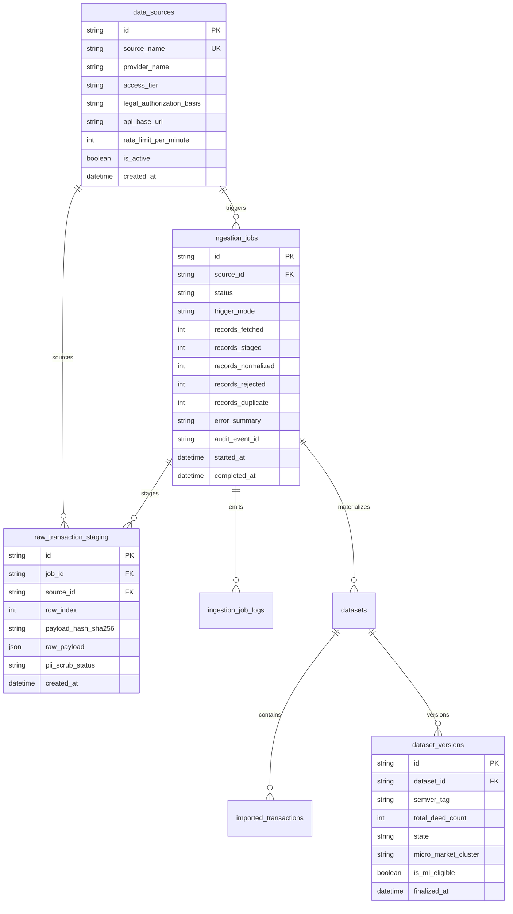

# PROPVAL AI — PHASE 4A-1: REAL ESTATE DATA ACQUISITION ARCHITECTURE REPORT

**Document Version:** 1.0.0  
**Date:** November 3, 2026  
**Auditor / Architect:** Principal Data Architect & Senior Python Backend Engineer  
**Classification:** Enterprise Engineering Architecture & Governance Blueprint  
**Status:** Completed Architecture Design (No Code Modified / Strictly Architecture & Design)

---

## 1. Executive Summary & Existing Pipeline Audit

PropVal AI operates an automated valuation and underwriting platform powered by FastAPI, SQLAlchemy ORM, PostgreSQL 16 / PostGIS, Alembic migrations, CatBoost ML, and conformal uncertainty calibration.

### 1.1 Existing Pipeline Audit

Our inspection of the existing codebase (`backend/app/models/dataset.py`, `backend/app/services/ingestion_service.py`, `backend/app/api/v1/endpoints/datasets.py`, `backend/app/services/ml_preprocessing.py`, and `backend/app/services/audit_service.py`) reveals the following current-state baseline:

| Existing Component | Current Implementation | Capabilities | Limitations / Missing Capabilities |
| :--- | :--- | :--- | :--- |
| **Ingestion Endpoints** | `POST /api/v1/datasets/upload` | Multipart form file upload (`.csv`, `.xlsx`, `.xls`). Role-gated (`SENIOR_UNDERWRITER`, `ADMIN`). | Push-only (manual upload). No automated pull, scheduled polling, connector interface, or B2B API integrations. |
| **Dataset Models** | `DatasetMetadataModel`, `ImportedTransactionModel`, `RejectedRecordModel`, `DuplicateRecordModel`, `DataQualityReportModel` | Summary counts, file SHA-256 hash, column normalization mapping, price metrics, geographic & temporal distribution. | Lacks data source registry entity, ingestion job execution records, staging tables for unparsed payloads, and connector credential management. |
| **Validation Services** | `ingestion_service.py` (`sanitize_csv_formula_injection`, `normalize_currency`, `normalize_area_to_sqft`, `normalize_date`) | Column synonym matching, formula injection guards, currency tokenization (Cr, L, k), unit conversion (sq yards, gunthas, sq m), extreme outlier detection ($3 \times \text{IQR}$). | Lacks in-flight DPDP PII scrubbers (regex/NER scrubbing of buyer/seller names), survey number cadastral cross-validation, and geographic coordinate validity checks against Indian state boundaries. |
| **Provenance Tracking** | `DatasetMetadataModel.data_source_provenance`, `source_type`, `license_type`, `fingerprint_hash`, `raw_data` JSON column | Tracks upload user, dataset hash, row index, and preserves unparsed row dictionary in `ImportedTransactionModel.raw_data`. | Fingerprint hash only accounts for `[city, project, locality, date, carpet_area, price]`. Lacks source document/deed SRO index, registration number hash, transformation lineage versioning, and vendor batch identifier. |
| **Audit Integration** | `audit_service.py` (`EVENT_DATASET_INGESTED`, SHA-256 hash chain) | Cryptographic hash chaining on dataset ingestion events. | Does not log connector poll attempts, rate-limit throttle events, failed payload authentication handshakes, or job-level trace logs. |
| **ML Readiness Gate** | `is_usable_for_ml = valid_count >= 1000`, `ml_preprocessing.py` | Strict threshold requiring $\ge 1,000$ verified records. Blocks synthetic demonstration data (`synthetic_benchmark`, `synthetic_demo`). | Evaluates readiness on a per-upload dataset level rather than an aggregated spatial micro-market cohort across multiple acquisition batches. |

### 1.2 Objective of Architecture Extension
The objective is **not** to rewrite the existing system, but to cleanly extend it:
1. Wrap the existing ingestion and validation core with an **Authorized Data Acquisition Engine**.
2. Introduce a **Source Connector Abstraction Layer** capable of scheduling, polling, and receiving authenticated feeds from authorized B2B providers (e.g., Zapkey, Propstack) and authorized G2B institutional gateways (e.g., Maharashtra IGR institutional portal).
3. Establish a **Raw Staging & In-Flight PII Sanitization Quarantine** to guarantee compliance with the Digital Personal Data Protection Act, 2023 (DPDP Act 2023).
4. Persist comprehensive acquisition provenance down to the specific SRO deed registration number without storing sensitive citizen identity attributes.

---

## 2. Logical Acquisition Architecture & Component Responsibilities

The data acquisition architecture introduces a 13-stage modular pipeline extending the existing PropVal AI core:

```
+---------------------------------------------------------------------------------------------------------------------+
|                                          PROPVAL AI DATA ACQUISITION SUBSYSTEM                                       |
+---------------------------------------------------------------------------------------------------------------------+
                                                           |
          +------------------------------------------------+------------------------------------------------+
          |                                                                                                 |
          v                                                                                                 v
+-----------------------------+                                                   +----------------------------------+
|  1. DATA SOURCE REGISTRY    |                                                   | 2. SOURCE AUTHENTICATION MANAGER |
|  - Source metadata & state  |                                                   |  - Secret manager & env resolver |
|  - Rate limits & schedules  |                                                   |  - OAuth 2.0 / API key rotation  |
|  - Legal licensing terms    |                                                   |  - Mutual TLS (mTLS) / IP bounds |
+-----------------------------+                                                   +----------------------------------+
          |                                                                                                 |
          +------------------------------------------------+------------------------------------------------+
                                                           |
                                                           v
                                         +-----------------------------------+
                                         |    3. DATA CONNECTOR INTERFACE    |
                                         |    - Base abstract protocol       |
                                         |    - Connection health verification|
                                         |    - Pagination & backoff         |
                                         +-----------------------------------+
                                                           |
                          +--------------------------------+--------------------------------+
                          |                                                                 |
                          v                                                                 v
       +------------------------------------+                    +------------------------------------+
       |   4A. B2B TRANSACTION ADAPTER      |                    |   4B. G2B INSTITUTIONAL ADAPTER    |
       |   (e.g., Zapkey / Propstack REST)  |                    |   (e.g., IGR Institutional Feed)   |
       +------------------------------------+                    +------------------------------------+
                          |                                                                 |
                          +--------------------------------+--------------------------------+
                                                           |
                                                           v
                                         +-----------------------------------+
                                         |      5. RAW DATA STAGING          |
                                         |  - Immutable payload quarantine   |
                                         |  - Payload SHA-256 checksum       |
                                         |  - Strict non-executable storage  |
                                         +-----------------------------------+
                                                           |
                                                           v
                                         +-----------------------------------+
                                         |  6. DATA PARSING & PII SANITIZER  |
                                         |  - DPDP Act 2023 redaction engine |
                                         |  - Scrub buyer/seller/witness PII |
                                         |  - Format extraction (JSON/Parquet)|
                                         +-----------------------------------+
                                                           |
                                                           v
                                         +-----------------------------------+
                                         |     7. NORMALIZATION ENGINE       |
                                         |  (Reuses ingestion_service.py)    |
                                         |  - Currency -> INR (Cr/L/k)       |
                                         |  - Area -> sqft                   |
                                         |  - Standardize dates to UTC       |
                                         +-----------------------------------+
                                                           |
                                                           v
                                         +-----------------------------------+
                                         |      8. VALIDATION ENGINE         |
                                         |  - Outlier detection (IQR)        |
                                         |  - Bounding box coord validation  |
                                         |  - SRO registration syntax checks |
                                         +-----------------------------------+
                                                           |
                                                           v
                                         +-----------------------------------+
                                         |     9. DUPLICATE DETECTION        |
                                         |  - Compound SRO fingerprint hash  |
                                         |  - Idempotent upsert/rejection    |
                                         +-----------------------------------+
                                                           |
                                                           v
                                         +-----------------------------------+
                                         |     10. PROVENANCE MANAGER        |
                                         |  - Source SRO deed lineage link   |
                                         |  - Transformation chain tracking  |
                                         |  - Statutory authority reference  |
                                         +-----------------------------------+
                                                           |
                                                           v
                                         +-----------------------------------+
                                         |   11. DATASET VERSION MANAGER     |
                                         |  - Immutable batch releases       |
                                         |  - Semantic versioning (v1.2.0)   |
                                         +-----------------------------------+
                                                           |
                                                           v
                                         +-----------------------------------+
                                         | 12. VERIFIED DATASET REPOSITORY   |
                                         |  - PostgreSQL `imported_tx`       |
                                         |  - PostGIS spatial geometry point |
                                         |  - ML feature store eligibility   |
                                         +-----------------------------------+
                                                           |
                                                           v
                                         +-----------------------------------+
                                         |     13. AUDIT INTEGRATION         |
                                         |  (Reuses audit_service.py)        |
                                         |  - Cryptographic SHA-256 chain    |
                                         |  - Ingestion job event logging    |
                                         +-----------------------------------+
```

### Detailed Component Responsibilities

1. **Data Source Registry:** Central catalog storing approved external providers, access classifications (Class A through F from Phase 4A-0), legal authorization basis, permitted micro-markets, rate limits, and sync cadences.
2. **Source Authentication Manager:** Resolves credentials dynamically from environment variables or enterprise secret vaults (e.g., AWS Secrets Manager / HashiCorp Vault). Plaintext keys or tokens are never persisted in PostgreSQL.
3. **Data Connector Interface:** Reusable Python ABC (Abstract Base Class) defining lifecycle methods (`authenticate()`, `test_connection()`, `fetch_batch()`, `health_check()`) with automated exponential backoff and rate-limit throttling.
4. **Source-Specific Adapters:** Concrete implementations (e.g., `ZapkeyB2BAdapter`, `MaharashtraIGRAdapter`) mapping heterogeneous remote responses into standard intermediate representation dictionaries.
5. **Raw Data Staging:** Stores unmodified ingested payloads in a dedicated staging table (`raw_transaction_staging`) with cryptographic payload SHA-256 hashes to guarantee data integrity before parsing.
6. **Data Parsing & PII Sanitizer:** Enforces DPDP Act 2023 compliance. Detects and strips citizen PII (individual names, phone numbers, email addresses, Aadhaar/PAN references) before rows reach normalization.
7. **Normalization Engine:** Leverages existing `ingestion_service.py` functions: standardizes currency to numeric INR, areas to square feet, dates to ISO 8601 UTC, and categories to canonical enum strings.
8. **Validation Engine:** Applies structural, range, and geographic sanity filters. Rejects corrupted rows, inverted coordinates, or extreme outliers ($>3 \times \text{IQR}$).
9. **Duplicate Detection:** Generates a deterministic compound SHA-256 fingerprint from `[state, district, sro_code, registration_year, registration_number, unit_identifier]`. Flags duplicates idempotently without crashing batch execution.
10. **Provenance Manager:** Attaches an immutable provenance manifest to each record: source identifier, vendor batch UUID, acquisition timestamp, legal licensing tier, and source deed reference.
11. **Dataset Version Manager:** Groups acquired records into immutable, versioned batches (e.g., `DS-BLR-2026.11-V1`) enabling reproducible ML experiment tracking.
12. **Verified Dataset Repository:** Persists verified records into `ImportedTransactionModel` with PostGIS geometry points (`ST_SetSRID(ST_MakePoint(lon, lat), 4326)`).
13. **Audit Integration:** Calls existing `audit_service.record_event()` with event type `EVENT_DATASET_INGESTED` to append the acquisition job summary and cryptographic root hash into the tamper-evident audit log.

---

## 3. Data Connector Interface Design

The acquisition engine defines a strict Python protocol ensuring all connectors behave predictably, handle failures gracefully, and conform to authorized access constraints.

```python
"""app/connectors/base.py — Abstract Base Connector Protocol."""

from abc import ABC, abstractmethod
from datetime import datetime
from typing import Any, AsyncGenerator, Dict, List, Optional
from pydantic import BaseModel, Field


class ConnectorConfig(BaseModel):
    source_id: str
    base_url: str
    timeout_seconds: int = Field(default=30, ge=5, le=120)
    max_retries: int = Field(default=3, ge=1, le=10)
    rate_limit_per_minute: int = Field(default=60, ge=1, le=600)
    backoff_factor: float = Field(default=2.0, ge=1.0, le=5.0)


class SyncCursor(BaseModel):
    last_sync_timestamp: Optional[datetime] = None
    last_record_id: Optional[str] = None
    page_token: Optional[str] = None


class RawBatchPayload(BaseModel):
    batch_id: str
    source_id: str
    record_count: int
    payload_checksum_sha256: str
    raw_records: List[Dict[str, Any]]
    fetched_at: datetime
    next_cursor: Optional[SyncCursor] = None


class BaseDataConnector(ABC):
    """Abstract interface for all authorized PropVal AI property data connectors."""

    def __init__(self, config: ConnectorConfig):
        self.config = config

    @abstractmethod
    async def authenticate(self) -> bool:
        """Establish or refresh authentication session via authorized credential manager."""
        pass

    @abstractmethod
    async def test_connection(self) -> Dict[str, Any]:
        """Perform a non-mutating health check to verify endpoint reachability and latency."""
        pass

    @abstractmethod
    async def fetch_incremental(
        self,
        cursor: SyncCursor,
        batch_size: int = 500,
    ) -> AsyncGenerator[RawBatchPayload, None]:
        """Asynchronously yield paginated raw batch payloads using cursor-based synchronization."""
        pass

    @abstractmethod
    def extract_source_metadata(self) -> Dict[str, Any]:
        """Return legal authorization basis, SRO coverage scope, and data licensing terms."""
        pass
```

### Connector Operational Principles:
* **Zero Unauthorized Scraping:** Connectors are strictly implemented against documented APIs, authorized partner S3 bucket feeds, or official G2B institutional gateways. No headless browser DOM scrapers or CAPTCHA-bypassing mechanisms are permitted.
* **Resilience & Backoff:** HTTP requests implement exponential backoff with jitter on HTTP `429 (Too Many Requests)` and `5xx` transient server errors.
* **SSRF Guard:** Base URLs are validated against an immutable server-side whitelist. Dynamic user-supplied destination URLs are prohibited.

---

## 4. Database Schema Design & Migration Strategy

To extend the existing schema without breaking existing tables (`datasets`, `imported_transactions`, `rejected_records`, `duplicate_records`, `data_quality_reports`), four new relational entities are designed:

### 4.1 Proposed Database Entities



### 4.2 Entity Detail & Indexing Strategy

#### 1. `data_sources`
* **Purpose:** Catalog of authorized external providers and G2B gateways.
* **Columns:**
  - `id`: `String(36)`, Primary Key (`uuid4`).
  - `source_code`: `String(64)`, Unique, Indexed (e.g. `B2B_ZAPKEY_BLR`, `G2B_MAHA_IGR`).
  - `source_name`: `String(255)`, Not Null.
  - `access_tier`: `String(32)` (`CLASS_A_API`, `CLASS_B_BULK`, `CLASS_C_INSTITUTIONAL`).
  - `legal_authorization_basis`: `Text`, Not Null (Documented contract/MoU reference).
  - `api_base_url`: `String(512)`, Nullable (Validated against URL whitelist).
  - `rate_limit_per_minute`: `Integer`, Default 60.
  - `is_active`: `Boolean`, Default True.
  - `created_at` / `updated_at`: `DateTime(timezone=True)`.

#### 2. `ingestion_jobs`
* **Purpose:** Audit record for every automated or manual batch execution.
* **Columns:**
  - `id`: `String(36)`, Primary Key (`uuid4`).
  - `source_id`: `String(36)`, Foreign Key (`data_sources.id`, ondelete `RESTRICT`).
  - `status`: `String(32)` (`PENDING`, `FETCHING`, `STAGING`, `PROCESSING`, `COMPLETED`, `FAILED`).
  - `trigger_mode`: `String(32)` (`SCHEDULED_CRON`, `MANUAL_ADMIN`, `WEBHOOK`).
  - `cursor_state`: `JSON` (Persists high-water mark / pagination state).
  - `records_fetched`, `records_staged`, `records_normalized`, `records_rejected`, `records_duplicate`: `Integer`, Default 0.
  - `error_summary`: `Text`, Nullable.
  - `audit_event_id`: `String(36)`, Nullable (Links to `audit_events.id`).
  - `started_at` / `completed_at`: `DateTime(timezone=True)`.
* **Indexes:** `ix_ingestion_jobs_source_status` (`source_id`, `status`), `ix_ingestion_jobs_started_at` (`started_at` DESC).

#### 3. `raw_transaction_staging`
* **Purpose:** Immutable quarantine buffer for raw inbound payloads prior to normalization.
* **Columns:**
  - `id`: `String(36)`, Primary Key (`uuid4`).
  - `job_id`: `String(36)`, Foreign Key (`ingestion_jobs.id`, ondelete `CASCADE`).
  - `source_id`: `String(36)`, Foreign Key (`data_sources.id`, ondelete `RESTRICT`).
  - `row_index`: `Integer`, Not Null.
  - `payload_hash_sha256`: `String(64)`, Indexed (Deterministic hash of raw payload).
  - `raw_payload`: `JSON`, Not Null.
  - `pii_scrub_status`: `String(32)` Default `PENDING` (`CLEANSED`, `FLAGGED_QUARANTINED`).
  - `created_at`: `DateTime(timezone=True)`.
* **Retention Policy:** Kept for 90 days for pipeline debugging and audit replay, then automatically partitioned/archived to cold storage.

#### 4. `dataset_versions`
* **Purpose:** Grouping verified deeds into immutable semantic dataset snapshots for ML reproducibility.
* **Columns:**
  - `id`: `String(36)`, Primary Key (`uuid4`).
  - `dataset_id`: `String(36)`, Foreign Key (`datasets.id`, ondelete `CASCADE`).
  - `semver_tag`: `String(32)`, Unique (e.g., `v1.0.0-blr-whitefield`).
  - `total_verified_deeds`: `Integer`, Not Null.
  - `micro_market_cluster`: `String(128)`, Indexed.
  - `is_ml_eligible`: `Boolean`, Default False.
  - `conformal_calibration_id`: `String(36)`, Nullable.
  - `finalized_at`: `DateTime(timezone=True)`.

---

## 5. Data Provenance & Lineage Architecture

To maintain rigorous fintech-grade auditability, every single property transaction must be traceable from its registered Sub-Registrar Office (SRO) deed reference through each normalization step to the ML training set.

```
+--------------------------------------------------------------------------------------------------------+
|                                  CRYPTOGRAPHIC PROVENANCE MANIFEST                                      |
+--------------------------------------------------------------------------------------------------------+
| 1. Source Origin:         B2B_ZAPKEY_KARNATAKA / SRO_SHIVAJINAGAR_BLR                                 |
| 2. Government Deed Ref:   Doc No: 4892/2024, Book 1, Stored in SRO Index-II                           |
| 3. Raw Payload SHA-256:   e3b0c44298fc1c149afbf4c8996fb92427ae41e4649b934ca495991b7852b855           |
| 4. Sanitization Trace:    DPDP_SCRUB_PASS: Removed party names [Mr. X -> REDACTED]                    |
| 5. Normalized SHA-256:    a8f5f167f44f4964e6c998dee827110c                                            |
| 6. PostGIS Point:         POINT(77.7499 12.9698) [EPSG:4326]                                          |
| 7. Acquisition Timestamp: 2026-11-03T11:45:00Z                                                        |
| 8. Batch / Job ID:        JOB-8d4e5f2a-1123-45ab                                                      |
| 9. Audit Event Link:      AUDIT-EVENT-7712 (Chained in Tamper-Evident SHA-256 Ledger)                |
+--------------------------------------------------------------------------------------------------------+
```

### Deterministic Fingerprint Hashing
Existing `ImportedTransactionModel` generates `fingerprint_hash` based only on general property fields. For Indian registered deeds, the provenance engine computes an enhanced **SRO Deed Fingerprint**:

$$\text{DeedFingerprint} = \text{SHA256}(\text{State} \parallel \text{District} \parallel \text{SRO\_Office} \parallel \text{Reg\_Year} \parallel \text{Reg\_Number} \parallel \text{Unit\_ID})$$

If an identical deed number arrives in a subsequent synchronization, the duplicate detection engine immediately matches the existing record, flags it as `DUPLICATE_DEED_ALREADY_INGESTED`, and prevents double-counting toward the ML readiness gate.

---

## 6. Security, Privacy & DPDP Act 2023 Compliance

### 6.1 Credential & Secret Management
* **Zero Database Secret Storage:** API keys, client certificates, OAuth client secrets, and mutual TLS keys are **never** stored in the database.
* **Environment-Based Resolution:** Secrets are resolved at runtime via `app.core.config.settings` backed by environment variables or an enterprise secret store (e.g., AWS Secrets Manager, GCP Secret Manager).
* **Credential Rotation:** Connector authentication tokens are held in-memory with automatic TTL expiration and refreshed via standard OAuth 2.0 refresh grant flows.

### 6.2 Server-Side Request Forgery (SSRF) Protection
* All outbound connector network calls are restricted to an immutable destination domain whitelist defined in `settings.ALLOWED_ACQUISITION_DOMAINS` (e.g., `["api.zapkey.com", "api.propstack.com"]`).
* Connectors strictly prohibit following external HTTP redirects to internal IP ranges (`127.0.0.1`, `10.0.0.0/8`, `172.16.0.0/12`, `169.254.169.254`).

### 6.3 In-Flight DPDP PII Scrubbing
Under the **Digital Personal Data Protection Act, 2023**, processing personal data without statutory consent is prohibited. Property valuation requires property physical attributes and transaction economics, **not citizen identities**.
The ingestion pipeline enforces mandatory redaction prior to database write:
* **Entity Redaction:** Regular expression and Named Entity Recognition (NER) filters identify and purge:
  - Buyer, seller, mortgagor, and witness names.
  - PAN cards (`[A-Z]{5}[0-9]{4}[A-Z]{1}`).
  - Aadhaar card references (`\d{4}\s\d{4}\s\d{4}`).
  - Residential contact numbers and email addresses.
* Any raw payload containing unmasked PII that cannot be scrubbed is marked `FLAGGED_QUARANTINED` in staging and rejected from normalization.

---

## 7. ML Readiness Integration & Threshold Enforcement

PropVal AI enforces a strict architectural rule: **Models cannot be trained on unverified or insufficient empirical data.**

```
+--------------------------------------------------------------------------------------------------------+
|                                    ML DATA SEPARATION BOUNDARIES                                       |
+--------------------------------------------------------------------------------------------------------+

 [Level 0: Raw Staging]           Unparsed JSON payload buffers (Staging table)
            |
            v
 [Level 1: Normalized Records]    Cleaned values (Currency -> INR, Area -> sqft)
            |
            v
 [Level 2: Validated Records]     Passed range, outlier (IQR), and coordinate sanity checks
            |
            v
 [Level 3: Verified Empirical     Deed confirmed registered at SRO; PII purged;
           Deeds]                 Asking prices strictly excluded (`is_asking_price == False`)
            |
            v
 [Level 4: ML Training Cohort]    Must satisfy:
                                  1. Minimum 1,000 Verified Empirical Deeds in micro-market
                                  2. Out-of-Time temporal partition (70% train / 15% val / 15% test)
                                  3. Conformal calibration error coverage >= 90%
```

### Strict Gate Invariants:
1. `is_asking_price == True` records are **never** permitted in ML training splits.
2. Synthetic demonstration datasets (`source_type == "synthetic_benchmark"`) remain strictly blocked by `ml_preprocessing.py`.
3. Incomplete deeds missing actual transaction price, carpet area, or valid spatial coordinates are rejected to `rejected_records` and **do not increment** the 1,000-deed threshold counter.

---

## 8. Implementation Plan & Phase Milestones

```
+--------------------------------------------------------------------------------------------------------+
|                                         IMPLEMENTATION ROADMAP                                         |
+--------------------------------------------------------------------------------------------------------+

 Phase 4A-1 (Current)       --> Architecture & Data Flow Design Complete (This Report)
                                     |
 Phase 4A-2 (Alembic Schema) --> Create Alembic migration for `data_sources`, `ingestion_jobs`,
                                  and `raw_transaction_staging` tables.
                                     |
 Phase 4A-3 (Connector Core) --> Implement `BaseDataConnector`, credential resolver, and
                                  HTTP client with exponential backoff & SSRF guards.
                                     |
 Phase 4A-4 (PII Scrubbing)  --> Implement DPDP Act 2023 in-flight redaction service.
                                     |
 Phase 4A-5 (B2B Adapter)    --> Build concrete adapter for authorized pilot transaction provider
                                  (e.g., Zapkey / Propstack JSON feed).
                                     |
 Phase 4A-6 (E2E Verification)--> Execute 1,000+ deed pilot ingestion in Bengaluru Urban micro-market
                                  and verify ML readiness gate triggering.
```

---

## 9. Architectural Risks & Mitigations

| Risk | Impact | Architectural Mitigation |
| :--- | :--- | :--- |
| **Vendor Payload Schema Drift** | High (Parser failures) | Strict Pydantic ingestion schemas with fallback to staging quarantine rather than silent pipeline failure. |
| **SRO Index Mismatch (Carpet vs Super Built-up)** | Medium (Valuation distortion) | Normalization engine tags area type explicitly; applies state-standardized conversion coefficients (e.g., 1.25 ratio) only when documented. |
| **DPDP Regulatory Audit** | High (Statutory liability) | Complete architectural separation: PII is purged before reaching application tables; raw staging logs maintain 90-day TTL. |
| **Spatial Inaccuracy (Missing Lat/Long)** | Medium (PostGIS query failure) | Require vendor geocoding verification or fall back to municipal ward/locality polygon centroid with `spatial_precision="LOCALITY_CENTROID"` flag. |

---

*Report prepared strictly in accordance with PropVal AI Phase 4A-1 Architecture & Design Guidelines. No application code altered. Awaiting architecture review.*

