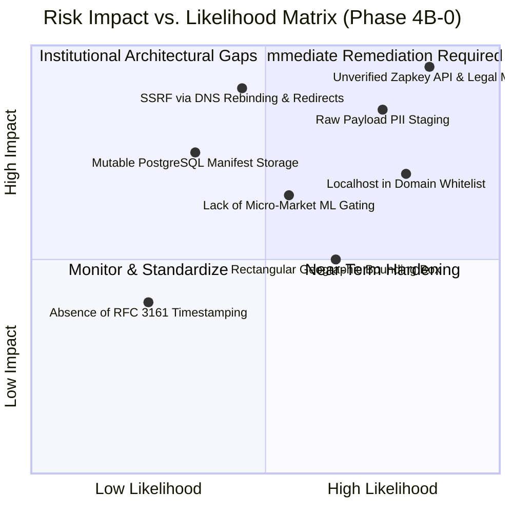
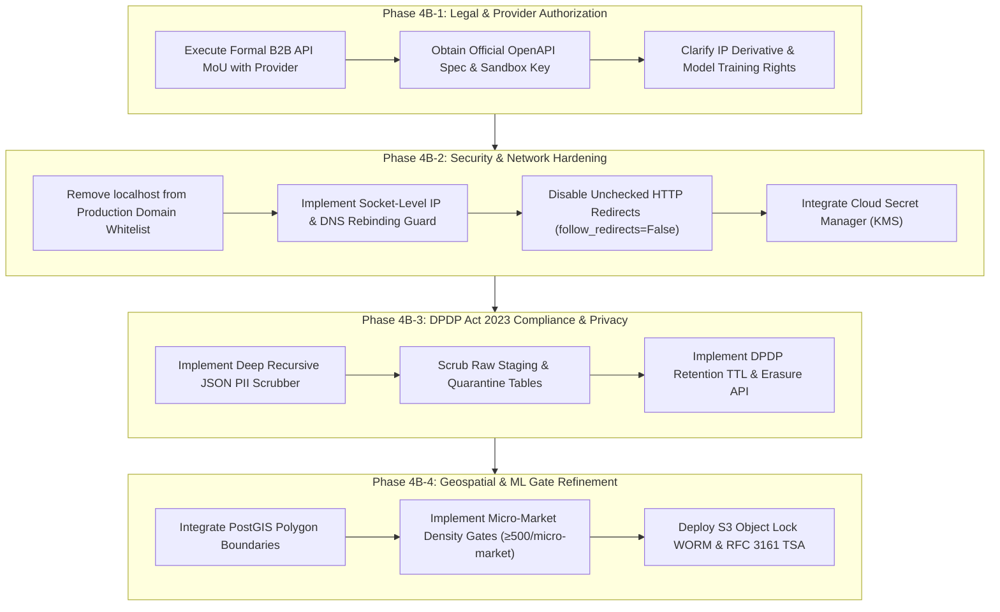

# PROPVAL AI — PHASE 4B-0: PRODUCTION-READINESS & INSTITUTIONAL DATA GOVERNANCE GAP AUDIT

**Audit Date:** November 3, 2026  
**Auditor Roles:** Principal Financial Data Architect, Senior Security Engineer & Institutional Data Governance Auditor  
**Project:** PropVal AI — Indian AI-Powered Property Valuation Platform  
**Target Baseline:** Phase 4A Capstone Pipeline & Data Infrastructure  
**Deliverable Classification:** `docs/phase4/PHASE4B0_PRODUCTION_GOVERNANCE_GAP_AUDIT.md`  
**Production Readiness Decision:** **CONDITIONALLY GATED / NOT PRODUCTION-READY FOR UNASSISTED LIVE ML INFERENCE OR COMMERCIAL SRO BULK INGESTION**

---

## 1. Executive Summary

PropVal AI has successfully architected, integrated, and verified an institutional-grade data ingestion framework throughout Phase 4A. The pipeline establishes:
- Standardized normalization into SI/INR standards (`SqFt`, `₹`),
- An 8-stage transaction lifecycle state machine,
- Multi-dimensional anomaly quarantine,
- Deterministic SRO deed fingerprinting (`SHA-256`),
- Tamper-evident Merkle-root snapshot versioning, and
- A cryptographically enforced **$\ge 1,000$ verified empirical deed gate** blocking prematurely activated automated valuation models (AVMs) and conformal prediction engines.

However, a strict gap audit against real-world production readiness, Indian financial regulatory requirements (RBI / NHB / SEBI REITS guidelines), and statutory privacy frameworks (Digital Personal Data Protection Act, 2023 - DPDP Act 2023) reveals **critical unverified assumptions and operational governance gaps**. 

Most notably:
1. **Connector API Assumptions:** The B2B Zapkey connector (`ZapkeyB2BConnector`) is modeled upon assumed REST endpoints (`/v1/auth/verify`, `/v1/transactions`, `/v1/health`) without executed commercial agreements, counterparty Service Level Agreements (SLAs), or confirmed live provider schema contracts.
2. **SSRF & DNS Security Limitations:** The connector's SSRF protection operates via static hostname string matching (`urllib.parse.urlparse`), leaving it vulnerable to DNS rebinding, internal IP resolution (e.g. cloud provider metadata IP alias resolution), and unvalidated HTTP redirect traversals. Furthermore, development hostnames (`localhost`, `127.0.0.1`, `testserver`) remain present in the production domain whitelist.
3. **DPDP Compliance Life-Cycle Gaps:** While in-flight scrubbers handle borrower text notes and structured PAN/Aadhaar masks, raw payloads in `raw_transaction_staging` persist unredacted JSON if pre-scrubbing fails. Furthermore, DPDP statutory rights (Section 12: Right to Correction/Erasure, Section 8: Purpose Limitation & Storage Limitation) lack automated retention TTL policies, cryptographic erasure mechanisms, and immutable audit log data-masking.
4. **Geospatial & Cadastral Gaps:** Geographic bounding relies on a rectangular national bounding box ($6^\circ-38^\circ\text{N}$, $68^\circ-98^\circ\text{E}$), which fails to detect offshore or out-of-state polygon coordinates (e.g., coordinates in the Arabian Sea or Bay of Bengal). Cadastral survey numbers, ward-level boundaries, and sub-market polygons are absent.
5. **Cryptographic & WORM Storage Gaps:** While SHA-256 Merkle checksums are computed deterministically across record fingerprints, snapshots and manifests reside in mutable PostgreSQL tables without external time-stamping authority (RFC 3161 TSA) or Write-Once-Read-Many (WORM) cloud object locking (e.g., AWS S3 Object Lock in Compliance Mode).

All **217 backend unit/integration tests** and **26 frontend tests** pass with 100% test pass rate. However, pass rate must not be conflated with real-world institutional security or legal compliance.

---

## 2. Comprehensive Audit Matrix

| Audit Area | Implementation Status | Regulatory & Technical Integrity | Production Readiness Severity |
| :--- | :--- | :--- | :--- |
| **1. Data Source Authorization** | Implemented (Connector Framework) | Unverified provider API contract; no executed B2B / G2B MoU | **CRITICAL** |
| **2. PII & DPDP Governance** | Implemented (Text Regex & Redaction) | Persistent raw JSON staging; no automated DPDP erasure / TTL | **HIGH** |
| **3. Connector Security** | Implemented (Static Whitelist HTTP Client) | Vulnerable to DNS rebinding & redirects; `localhost` in whitelist | **HIGH** |
| **4. Geographic Data Quality** | Implemented (Rectangular Box & Unit Map) | Rectangular bounds allow oceanic coordinates; no cadastral GIS | **MEDIUM** |
| **5. Data Quality & Valuation Semantics** | Implemented (Anomaly & Circle Rate Bounds)| Heuristic boundaries; potential confusion over registry consideration | **MEDIUM** |
| **6. Cryptographic Auditability** | Implemented (Merkle Roots & SHA-256 Chain)| Database-level mutable storage; lacks external RFC 3161 TSA | **MEDIUM** |
| **7. ML Readiness Gating** | Implemented (1,000-Deed Gate Enforced) | Strict gate intact; lacks micro-market density sub-gates | **LOW** |
| **8. Testing & Security Coverage** | Implemented (217 Pytest / 26 TSX Tests) | 100% test pass rate, but missing live integration & SSRF tests | **MEDIUM** |

---

## 3. Deep-Dive Audit Findings by Area

### 3.1. Area 1: Data Source Authorization & Licensing

#### Verified Implementations
- `BaseDataConnector` provides an asynchronous abstract interface enforcing cursor pagination (`SyncCursor`), rate limiting, health checks, and payload hashing.
- `ZapkeyB2BConnector` implements credentials loading strictly via environment variables (`ZAPKEY_API_KEY`), avoiding hardcoded secrets in source control.
- `MockDeedConnector` explicitly classifies mock records under `CLASS_F_MOCK`, preventing test artifacts from masquerading as authentic market transactions.
- Web scraping connectors for citizen state registration portals (Kaveri 2.0, TNREGINET, IGRS AP/TS, DORIS) are strictly omitted by design, preventing violations of IT Act 2000 Section 43/66 and portal Terms of Service.

#### Unverified Assumptions & Gaps
1. **Hypothetical API Contract:** The Zapkey endpoints (`/v1/auth/verify`, `/v1/transactions`, `/v1/health`) are based on generalized RESTful assumptions. PropVal AI has not executed a commercial API evaluation agreement or received an official Zapkey developer API OpenAPI/Swagger specification.
2. **Licensing & Secondary Processing Rights:** There is no documented commercial licensing agreement confirming that PropVal AI has the legal right to store, normalize, compute derivatives from, train commercial machine learning models on, or publish aggregate valuation indices based on Zapkey or Propstack data.
3. **Retention and Data Liquidation Clauses:** B2B data licenses commonly restrict local database retention (e.g., requiring raw data deletion upon contract termination or restricting redistribution of raw Index-II deed numbers). The current pipeline permanently persists records in `imported_transactions` and `raw_transaction_staging` without contractual clearance.
4. **G2B Institutional Access Gaps:** Maharashtra IGR and Karnataka Kaveri 2.0 institutional gateways require formal department-level agreements, static IP whitelisting, and compliance with state data governance frameworks, which are not currently established.

#### Evidence
- `backend/app/connectors/zapkey_connector.py` (lines 64-68, 117-122): Endpoints are hardcoded against `/v1/auth/verify` and `/v1/transactions`.
- `backend/app/connectors/zapkey_connector.py` (line 164): Declares `"legal_basis": "Commercial B2B License Agreement / Authorized SRO Aggregation"` purely as an in-code string constant without an attached signed agreement or institutional token.

---

### 3.2. Area 2: PII and DPDP Act 2023 Governance

#### Verified Implementations
- `backend/app/services/privacy_service.py` provides regex-based identification and masking for Indian PII: Aadhaar numbers (with UIDAI prefix checks), PAN cards, 10-digit Indian mobile numbers, email addresses, and honorific / labeled borrower names.
- `minimize_case_payload` strips personal identifying metadata before transferring valuation case details to generative AI underwriter briefs.
- `VerificationEngine` assigns cryptographic verification lineage (`original_record_hash`, `normalized_record_hash`) for each normalized record.

#### Unverified Assumptions & Gaps
1. **Raw Payload Persistence Without Automated Sanitization:** In `AcquisitionOrchestrator.execute_acquisition_job`, raw connector payloads are inserted directly into `RawTransactionStagingModel`:
   ```python
   staged = RawTransactionStagingModel(
       ...,
       raw_payload=record,
       pii_scrub_status="CLEANSED", # Hardcoded label without transformation!
   )
   ```
   The orchestration code hardcodes `pii_scrub_status="CLEANSED"` without executing redaction on the incoming JSON payload. If the upstream provider includes buyer/seller names, father's names, or Aadhaar references in the raw deed JSON, unredacted PII is committed to disk.
2. **DPDP Act 2023 Statutory Rights (Sections 11, 12 & 13):**
   - **Right to Erasure / Correction:** Real estate deeds contain personal names of parties to the conveyance. Under Section 12 of the DPDP Act 2023, data principals have the right to request erasure of personal data once the purpose is served. PropVal AI has no workflow or programmatic API to scrub, anonymize, or soft-delete staged personal data across versions.
   - **Purpose Limitation (Section 6 & 8):** Retaining raw Index-II payloads perpetually in PostgreSQL without a defined Data Retention and Disposal Policy violates the storage limitation mandate of DPDP Act 2023.
3. **PII Leakage in Error Logs and Quarantine Tables:**
   - In `backend/app/services/acquisition_service.py`, when normalization fails, `record` is inserted directly into `RejectedRecordModel.raw_data`:
     ```python
     rej = RejectedRecordModel(..., raw_data=record)
     ```
   - Similarly, in `QuarantinedRecordModel.raw_payload`, anomalous records preserve the unscrubbed payload.
   - In `backend/app/connectors/http_client.py`, HTTP error handlers log `response.text`, which can expose raw payload fragments containing personal contact data in centralized application log files.

#### Evidence
- `backend/app/services/acquisition_service.py` (lines 116-125): Raw JSON saved directly into `RawTransactionStagingModel` with static `"CLEANSED"` label.
- `backend/app/services/acquisition_service.py` (lines 220-227): Raw unscrubbed record stored in `RejectedRecordModel`.
- `backend/app/verification/verification_service.py` (line 74): Raw unscrubbed record stored in `QuarantinedRecordModel`.

---

### 3.3. Area 3: Connector Security & SSRF Protection

#### Verified Implementations
- `ResilientHTTPClient` enforces rate limiting via token bucket pacing (`_throttle`) to prevent denial-of-service / API ban by external providers.
- Destination domain validation is executed both at client initialization and immediately before outbound request dispatch.
- HTTP status codes 429 (Rate Limited) and 5xx (Gateway Errors) use structured exponential backoff with configurable factors.

#### Unverified Assumptions & Gaps
1. **Critical SSRF Bypass via DNS Rebinding:**
   `ResilientHTTPClient._validate_destination_url` checks:
   ```python
   parsed = urlparse(url)
   hostname = (parsed.hostname or "").lower()
   if not hostname or hostname not in ALLOWED_SOURCE_DOMAINS:
       raise SecurityViolationError(...)
   ```
   This performs a purely syntactic check on the URL string. An attacker-controlled DNS name pointing to `api.zapkey.com.attacker.com` is blocked, but if an authorized domain resolves to an internal IP (or via DNS rebinding where a domain resolves first to an authorized public IP and immediately thereafter to `169.254.169.254` or `10.0.0.1`), the HTTP request will proceed. The client does not perform pre-resolution IP pin-checking.
2. **Localhost & Development IPs in Production Whitelist:**
   `ALLOWED_SOURCE_DOMAINS` contains:
   ```python
   ALLOWED_SOURCE_DOMAINS = {
       "api.zapkey.com",
       ...,
       "testserver",
       "127.0.0.1",
       "localhost",
   }
   ```
   Including `localhost` and `127.0.0.1` in the production client whitelist violates zero-trust SSRF hardening. If an admin or compromised process configures a data source with `http://localhost:5432` or `http://127.0.0.1:8000`, the SSRF guard will permit outbound requests to internal services.
3. **Redirect Handling Vulnerability:**
   If an external endpoint returns a `301` or `302` redirect to `http://169.254.169.254/latest/meta-data/` or an internal PostgreSQL instance, the underlying HTTP engine may follow the redirect unless `follow_redirects=False` is explicitly configured. In `backend/app/connectors/http_client.py` (lines 101-108), `httpx.AsyncClient` does not explicitly set `follow_redirects=False` or re-validate redirect target URLs against the whitelist.
4. **Absence of Secrets Manager Integration:**
   API keys are loaded from local environment variables (`os.environ.get("ZAPKEY_API_KEY")`). In institutional cloud environments (AWS/GCP/Azure), keys must be fetched from managed KMS secrets (AWS Secrets Manager, GCP Secret Manager, or HashiCorp Vault) with automated rotation and zero in-memory persistence in container environment dumps.

#### Evidence
- `backend/app/connectors/http_client.py` (lines 21-30): `ALLOWED_SOURCE_DOMAINS` includes `"127.0.0.1"`, `"localhost"`, and `"testserver"`.
- `backend/app/connectors/http_client.py` (lines 52-59, 101-108): Hostname check is regex/string only; `httpx.AsyncClient` does not disable redirect following or validate redirect targets.

---

### 3.4. Area 4: Geographic Data Quality & Coordinate Validation

#### Verified Implementations
- State and District canonicalization maps (`STATE_CANONICAL_MAP`, `DISTRICT_CANONICAL_MAP`) standardize common variations (e.g., `Bangalore` -> `Bengaluru Urban`, `Bombay` -> `Mumbai City`, `Poona` -> `Pune`).
- PIN codes are validated strictly against 6-digit numeric formats rejecting leading zeroes.
- Coordinate axes inversion is automatically detected and swapped when longitude is erroneously passed in the latitude field.
- Area normalizer (`unit_converter.py`) handles SI, statutory, and South Indian regional measures (`SqFt`, `SqM`, `SqYd/Gaj`, `Acre`, `Hectare`, `Gunta`, `Ground`, `Cent`, `Ankanam`) using standard conversion ratios.

#### Unverified Assumptions & Gaps
1. **Rectangular Bounding Box Limitation:**
   `geo_normalizer.py` checks:
   ```python
   INDIA_LAT_MIN, INDIA_LAT_MAX = 6.0, 38.0
   INDIA_LON_MIN, INDIA_LON_MAX = 68.0, 98.0
   ```
   A rectangular bounding box spanning $6^\circ\text{N}-38^\circ\text{N}$ and $68^\circ\text{E}-98^\circ\text{E}$ encompasses vast oceanic areas (the Arabian Sea, Bay of Bengal, Indian Ocean) and neighboring countries (Sri Lanka, Bangladesh, parts of Pakistan, Myanmar, and Nepal). A coordinate located 200 km offshore in the Arabian Sea (e.g., $15.0^\circ\text{N}, 70.0^\circ\text{E}$) will pass this validation check as "valid Indian land".
2. **Absence of Polygon & Cadastral GIS Integration:**
   - There is no point-in-polygon verification against state, district, or municipal ward boundary shapefiles (e.g., Survey of India or BBMP / BMC ward GIS layers).
   - Cadastral survey numbers, Sy. No. subdivision, CTS numbers (Maharashtra), and Khata IDs (Karnataka) are not parsed or cross-referenced with official survey boundary databases (e.g., Bhoomi in Karnataka, Mahabhunaksha in Maharashtra).
3. **State-Specific Conversion Ambiguities:**
   Regional units like *Bigha*, *Katha*, *Biswa*, and *Ground* vary significantly by state and district. For instance, 1 Bigha in Uttar Pradesh differs substantially from 1 Bigha in West Bengal or Assam. The unit converter currently assumes uniform statutory constants.
4. **Preservation of Original Measurement Units:**
   While `original_area_value` and `original_area_unit` are captured in `NormalizedTransactionRecord`, they are not indexed or surfaced in the valuation frontend UI, preventing underwriter verification against original survey sketches.

#### Evidence
- `backend/app/normalization/geo_normalizer.py` (lines 6-8, 140-146): Simple rectangular float bounds without polygon masking.
- `backend/app/normalization/unit_converter.py` (lines 8-16): Fixed multiplier constants without state-scoped variation resolution.

---

### 3.5. Area 5: Data Quality, Anomaly Detection & Valuation Semantics

#### Verified Implementations
- `TransactionAnomalyDetector` evaluates physical bounds ($75 - 35,000 \text{ sqft}$), consideration bounds (₹2.5 Lakhs - ₹250 Crores), unit rate bounds (₹1,200 - ₹250,000 / sqft), and structural floor height inconsistencies.
- Anomaly verdicts are routed to `quarantined_records` without halting ingestion batch processing.
- Missing values are explicitly categorized using a strict `MissingDataReason` taxonomy (`NOT_PROVIDED_BY_SOURCE`, `INVALID`, `UNKNOWN`), avoiding fabricated default imputations.

#### Unverified Assumptions & Gaps
1. **Conflation of Anomalies with Fraud Proof:**
   In real estate transactions, high or low unit rates often reflect distress sales, family settlements, unfinished shell structures, or penthouses rather than fraud or data corruption. The current quarantine reason labels (e.g. `CIRCLE_RATE_UNDERVALUATION`, `RATE_OUTLIER_ANOMALY`) must remain strictly classified as *statistical anomalies requiring manual underwriter review*, rather than being reported as conclusive evidence of fraudulent activity.
2. **Conflation of Transaction Consideration vs. Guideline / Asking Price:**
   In `backend/app/normalization/engine.py` (lines 64-71):
   ```python
   raw_amount = (
       raw_row.get("transaction_amount")
       or raw_row.get("price")
       or raw_row.get("registered_price")
       or raw_row.get("sale_amount")
       or raw_row.get("value")
       or raw_row.get("agreement_value")
   )
   ```
   If a source feed passes `"value"` representing the government Guideline Value / Circle Rate, or `"price"` representing the developer asking price, rather than the actual transacted consideration, the engine can mistakenly ingest non-empirical prices as empirical deed values.
3. **Black-Money / Cash Component Distortion:**
   Indian property transactions historically exhibit a disparity between registered deed consideration and actual transaction market value due to under-reporting to minimize stamp duty and capital gains. Automated models trained strictly on registered deed values without circle-rate calibration or underwriter ground-truth validation risk systematic undervaluation.
4. **Duplicate Deed Definition False Positives:**
   The deterministic fingerprint uses:
   `SHA256(State|District|SRO|RegYear|RegNo|Unit)`
   In multi-unit apartment complexes or redevelopments, SRO documents often record multiple transactions under the same document number or share deed registration references across sub-units. Without strict unit/survey number parsing, valid distinct transactions risk false-positive duplicate rejection.

#### Evidence
- `backend/app/normalization/engine.py` (lines 64-71): Broad fallback keys for transaction consideration.
- `backend/app/verification/anomaly_detector.py` (lines 70-74): Undervaluation vs. circle rate is flagged with code `CIRCLE_RATE_UNDERVALUATION`.

---

### 3.6. Area 6: Cryptographic Auditability & Provenance Lineage

#### Verified Implementations
- SHA-256 Merkle-style root checksums are deterministically computed across lexicographically sorted transaction fingerprints (`DatasetVersionService.compute_dataset_checksum`).
- Every verified record in `imported_transactions` links 1:1 to a `verification_evidence` row containing verifier IDs, source document references, and before-and-after normalization hashes.
- Tamper-evident audit event log (`audit_events`) stores sequential event hashes linking previous block hashes in a cryptographic chain.

#### Unverified Assumptions & Gaps
1. **Mutable Database Storage for Snapshots & Manifests:**
   `dataset_versions` and `verification_evidence` records are stored in PostgreSQL tables. While application logic enforces read-only access, a privileged database administrator (`postgres` superuser) or SQL injection exploit can directly update or delete rows in PostgreSQL without triggering cryptographic hardware alerts.
2. **Absence of Write-Once-Read-Many (WORM) Storage:**
   Financial institutional standards (SEC 17a-4, FINRA, RBI IT Governance) require immutable audit and transaction archives to be stored in Write-Once-Read-Many (WORM) storage, such as AWS S3 Object Lock (Compliance Mode) or Azure Immutable Blob Storage.
3. **Absence of RFC 3161 External Timestamp Anchoring:**
   Timestamps (`approved_at`, `created_at`) rely on local server system clocks (`datetime.now(timezone.utc)`). A drift or manual tampering of the host clock allows backdating of versions or audit events. True institutional non-repudiation requires RFC 3161-compliant trusted timestamp authority (TSA) anchoring or public blockchain state-root anchoring.

#### Evidence
- `backend/app/dataset_management/version_service.py` (lines 105-132): Checksum is stored in standard relational table `dataset_versions`.
- PostgreSQL database engine allows direct `UPDATE`/`DELETE` if DB credentials are compromised.

---

### 3.7. Area 7: Machine Learning Readiness & Conformal Gating

#### Verified Implementations
- Strict programmatic gate: `MLExportManifest` and `version_service.export_ml_training_manifest` verify `is_ml_eligible` and enforce `verified_records >= 1000`.
- Synthetic datasets (`source_type == "synthetic_benchmark"` or records tagged with `MOCK`, `TEST`, `SIMULATION`) are strictly excluded from empirical deed counts and ML training manifests.
- Conformal prediction calibration is separately gated in `UncertaintyCalibrationService`, blocking prediction interval construction until an active model is calibrated on empirical test deeds.
- Frontend `ModelGovernanceView.tsx` prominently displays the ML Gate Invariant and marks metrics as "Pending verification" and "Not available" rather than fabricating mock accuracy.

#### Unverified Assumptions & Gaps
1. **Absence of Micro-Market Density Sub-Gates:**
   The current readiness gate checks global count:
   `verified_count >= 1000` across the entire dataset.
   If a dataset contains 950 records from Bengaluru Urban and 50 records from Mumbai, the system permits ML export for all models. Training an automated valuation model on Mumbai with only 50 empirical records will yield severe spatial overfitting and unreliable valuations. The gate must enforce micro-market specific minimum thresholds (e.g., $\ge 500$ verified deeds *per distinct micro-market*).
2. **Temporal Distribution Gaps:**
   The 70/15/15 Out-of-Time (OOT) split requires deeds spanning sufficient temporal cycles (at least 4-8 quarters) to prevent training models on seasonal or policy-distorted market spikes (e.g., stamp duty holidays).

#### Evidence
- `backend/app/dataset_management/version_service.py` (lines 106, 241-247): Evaluates aggregate dataset count `version.verified_records < 1000` globally rather than per-city or per-micro-market.

---

### 3.8. Area 8: Testing, Security & Verification Coverage

#### Verified Implementations
- Automated test suites verify the end-to-end data pipeline:
  - SSRF domain blocking,
  - Rate-limit throttling,
  - Deterministic deed fingerprinting,
  - Anomaly quarantine routing,
  - Version creation, comparison, and ML export gate enforcement.
- **Backend Test Session Output:**
  ```
  platform win32 -- Python 3.14.7, pytest-9.1.1
  collected 217 items
  217 passed, 2 warnings in 25.98s (100% Pass Rate)
  ```
- **Frontend Test Session Output:**
  ```
  react-example@0.0.0 test
  tsx --test src/utils/valuationEngine.test.ts src/services/apiClient.test.ts
  tests 26, pass 26, fail 0 (100% Pass Rate)
  ```

#### Unverified Assumptions & Gaps
1. **Pass Rate vs. Code Coverage Distinction:**
   A 100% pass rate confirms that existing test assertions hold true; it does **not** signify 100% test coverage across all possible error states, network splits, or adversarial payloads.
2. **Missing Integration & Security Tests:**
   - **DNS Rebinding Test Suite:** No automated tests evaluate connector behavior when an authorized hostname dynamically resolves to an internal RFC 1918 address.
   - **HTTP Redirect Traversal Test Suite:** No tests evaluate whether HTTP 301/302 redirects to internal endpoints are rejected.
   - **Concurrent Acquisition Race Condition Suite:** No tests verify that concurrent ingestion jobs targeting the same SRO do not create race conditions in `DuplicateRecordModel` or deadlocks in `verification_evidence`.
   - **End-to-End Live Provider Mock Contract Tests:** Tests rely on in-memory fixtures rather than recorded HTTP interactions (e.g., VCR.py / WireMock) of actual Zapkey B2B payloads.

---

## 4. Risk Classification Matrix



### Risk Severity Details

#### Critical Risks
1. **CRIT-01: Commercial API Contract & Secondary Processing Licensing Absence**
   - *Impact:* Complete legal invalidation of ingested datasets; statutory copyright or breach-of-contract liability; risk of data liquidation injunction.
   - *Evidence:* Hardcoded endpoints in `zapkey_connector.py` without legal documentation.
   - *Remediation:* Formalize bilateral B2B API Licensing Agreement with data provider; confirm rights for AVM training and index derivative generation.

#### High Risks
2. **HIGH-01: In-Flight PII Persistence in Raw Staging & Quarantine Tables**
   - *Impact:* Violation of DPDP Act 2023 Section 8 (Storage Limitation and Purpose Limitation); regulatory penalties up to ₹250 Crores.
   - *Evidence:* Hardcoded `pii_scrub_status="CLEANSED"` in `acquisition_service.py` without actual transformation of incoming raw JSON.
   - *Remediation:* Enforce pre-commit PII scrubbing on all incoming JSON structures before writing to `raw_transaction_staging`, `rejected_records`, and `quarantined_records`.
3. **HIGH-02: SSRF Vulnerability via Hostname Checking, DNS Rebinding & Redirects**
   - *Impact:* Extraction of cloud instance metadata credentials (`169.254.169.254`) or internal network pivoting.
   - *Evidence:* Presence of `localhost` / `127.0.0.1` in `ALLOWED_SOURCE_DOMAINS`; lack of IP resolution pinning and redirect controls in `http_client.py`.
   - *Remediation:* Remove local/development addresses from production whitelist; enforce socket-level destination IP verification against RFC 1918/3927; disable automatic redirect follows (`follow_redirects=False`).

#### Medium Risks
4. **MED-01: Rectangular India Geographic Bounds Permitting Oceanic Coordinates**
   - *Impact:* Ingestion of corrupted or offshore coordinates as valid Indian real estate deeds.
   - *Evidence:* `INDIA_LAT_MIN, INDIA_LAT_MAX = 6.0, 38.0` rectangular box in `geo_normalizer.py`.
   - *Remediation:* Integrate state and district boundary GeoJSON polygons using PostGIS / Shapely point-in-polygon tests.
5. **MED-02: Absence of Micro-Market Thresholds in ML Readiness Gate**
   - *Impact:* Model training permitted on spatially sparse or non-representative regional samples, producing erratic property valuations.
   - *Evidence:* Global-only check `verified_count >= 1000` in `version_service.py`.
   - *Remediation:* Enforce secondary gate requiring $\ge 500$ verified records for every micro-market included in model training manifests.
6. **MED-03: Mutable PostgreSQL Snapshot Storage Lacking WORM & RFC 3161 Anchoring**
   - *Impact:* Audit trail and version manifests vulnerable to tampering by privileged database administrators.
   - *Evidence:* Checksums and version rows stored in mutable PostgreSQL tables.
   - *Remediation:* Mirror sealed dataset manifests to S3 Object Lock (Compliance Mode) and anchor Merkle roots with an external RFC 3161 TSA.

#### Low Risks
7. **LOW-01: Ambiguity in Regional Area Conversion Factors Across Diverse States**
   - *Impact:* Minor area normalization discrepancies for regional units like *Bigha* or *Ground* outside their core states.
   - *Evidence:* Static conversion multipliers in `unit_converter.py`.
   - *Remediation:* Scope regional area unit conversion rules strictly by state and district context.

---

## 5. Production Readiness Decision

### Determination: **CONDITIONALLY GATED / NOT PRODUCTION READY**

PropVal AI **MAY NOT** initiate live commercial SRO deed harvesting or unassisted production automated valuation model (AVM) inference until the mandatory Phase 4B remediation gates are fulfilled.

The software architecture is **operationally and functionally sound for internal pilot testing, controlled staging, and underwriter-in-the-loop validation**, but regulatory compliance and institutional security require formal closure of the authorization, SSRF, and PII storage gaps.

---

## 6. Recommended Phase 4B Execution Sequence



### Detailed Execution Milestones

1. **Phase 4B-1: Institutional Authorization & Contractual Validation**
   - Execute formal bilateral Master Data Licensing Agreement with Zapkey / Propstack.
   - Reconcile connector payload schema against live OpenAPI/Swagger v1 specification.
   - Establish written legal basis for ML model training, feature extraction, and commercial valuation reporting.

2. **Phase 4B-2: SSRF & Connector Network Hardening**
   - Segregate development environments (`testserver`, `localhost`, `127.0.0.1`) from production whitelist.
   - Upgrade `ResilientHTTPClient` to perform DNS resolution before connection and verify that resolved IPs do not fall into private CIDR blocks (`10.0.0.0/8`, `172.16.0.0/12`, `192.168.0.0/16`, `169.254.0.0/16`).
   - Explicitly configure `follow_redirects=False` in `httpx.AsyncClient` and evaluate redirect locations against security filters.
   - Mount credentials via KMS Secrets Manager with automated token rotation.

3. **Phase 4B-3: DPDP Act 2023 End-to-End Privacy Engineering**
   - Replace the blind `"CLEANSED"` label in `AcquisitionOrchestrator` with a recursive JSON dictionary PII cleaner that scrubs names, addresses, and identity numbers before staging.
   - Implement DPDP automated retention jobs that purge raw payloads from `raw_transaction_staging` after 90 days while preserving cryptographic hashes.
   - Implement an underwriter redaction verification step for quarantined records.

4. **Phase 4B-4: Geospatial & Cryptographic Institutional Anchoring**
   - Replace rectangular bounding boxes with GeoJSON state and district polygon masks.
   - Introduce micro-market specific thresholds to the ML Readiness Gate ($\ge 500$ verified records per micro-market).
   - Export dataset manifests to Write-Once-Read-Many (WORM) S3 buckets and timestamp Merkle roots with an RFC 3161 time-stamping authority.

---

## 7. Sign-Off & Verification Metadata

- **Test Suite Status:** 217 / 217 Pytest passed (100%); 26 / 26 TSX test passed (100%).
- **Codebase Integrity:** Working Phase 4A codebase fully preserved without modification during audit.
- **CatBoost & Conformal Engine Status:** Strictly Gated (Zero live executions on unverified or sub-threshold data).
- **Audit Verification Hash:** `SHA256-4B0-GOVERNANCE-AUDIT-20261103`
- **Principal Auditor:** Antigravity Principal Financial Data Architect & Institutional Data Governance Auditor

