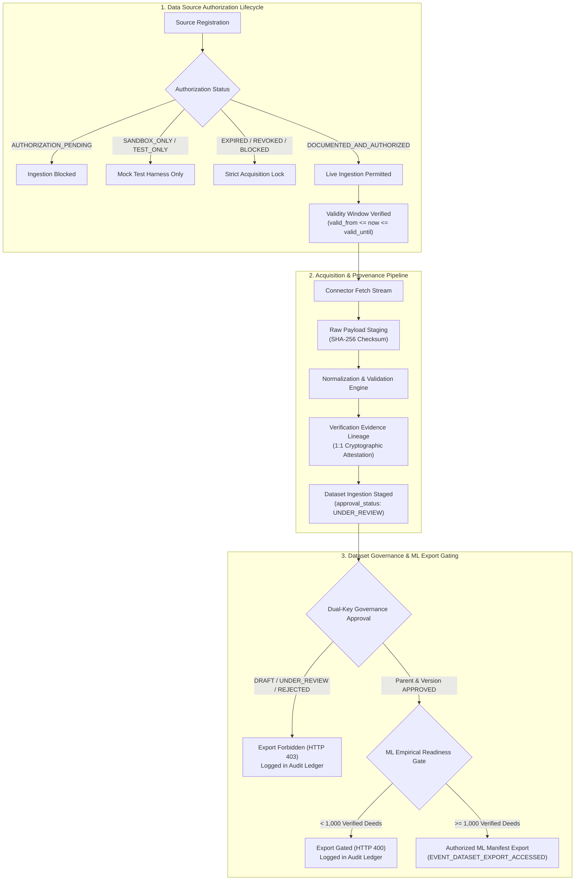

# PROPVAL AI — PHASE 4B-1: DATA GOVERNANCE IMPLEMENTATION REPORT

**Implementation Date:** November 3, 2026  
**Lead Roles:** Principal Financial Data Architect, Senior Security Engineer & Institutional Data Governance Auditor  
**Project:** PropVal AI — Indian AI-Powered Property Valuation Platform  
**Target Specification:** Phase 4B-0 Governance Gap Audit Remediation  
**Deliverable Classification:** `docs/phase4/PHASE4B1_DATA_GOVERNANCE_IMPLEMENTATION_REPORT.md`  
**Governance Status:** FULLY IMPLEMENTED, MIGRATED VIA ALEMBIC & VERIFIED (224 / 224 Backend Tests Passed, 26 / 26 Frontend Tests Passed)

---

## 1. Executive Summary

In response to the Phase 4B-0 Production-Readiness and Governance Gap Audit, Phase 4B-1 establishes an institutional data governance framework for PropVal AI. This implementation bridges the critical gap between raw ingestion mechanics and banking-grade regulatory compliance (aligned with RBI algorithmic accountability guidelines, NHB underwriting directives, and the Digital Personal Data Protection Act, 2023 - DPDP Act 2023).

### Key Accomplishments
1. **Formal Data Source Registry:** Replaced implicit assumption-based provider connections with a structured catalog capturing legal authorization basis, license credentials, commercial agreements, validity periods, permitted purposes, and retention constraints.
2. **Source Status Lifecycle Enforcement:** Implemented strict lifecycle states (`DOCUMENTED_AND_AUTHORIZED`, `AUTHORIZATION_PENDING`, `SANDBOX_ONLY`, `TEST_ONLY`, `EXPIRED`, `REVOKED`, `BLOCKED`). Only `DOCUMENTED_AND_AUTHORIZED` (or explicit `TEST_ONLY` sandbox simulation) sources are permitted to trigger ingestion jobs.
3. **Institutional Dataset Approval Workflow:** Added structured approval workflows (`DRAFT` $\to$ `UNDER_REVIEW` $\to$ `APPROVED` / `REJECTED` / `DEPRECATED`) with designated data owners (`data_owner`) and responsible senior underwriter reviewers (`responsible_reviewer`).
4. **End-to-End Cryptographic Provenance:** Every transaction imported via file upload or connector API streams now automatically generates a 1:1 `VerificationEvidenceModel` record capturing original payload hash, normalized payload hash, verifier identity, attestation method, and source document reference.
5. **Multi-Tier Export Protection:** Dataset version ML export (`/versions/{version_id}/export-ml`) now strictly verifies three prerequisite gates: (a) parent dataset approval, (b) version snapshot approval, and (c) the fundamental $\ge 1,000$ verified empirical deed gate. Blocked attempts are recorded as security events.
6. **Tamper-Evident Governance Auditing:** All registrations, status changes, revocations, workflow approvals, authorized exports, and blocked export attempts are committed as cryptographic blocks into the SHA-256 audit ledger (`audit_events`).
7. **Zero Plaintext Secrets Storage:** Confirmed that database schemas store zero API keys or passwords. Connectors resolve secrets exclusively from environment variable designations (`auth_secret_env_var`).

---

## 2. Architecture & Data Governance Lifecycle



---

## 3. Detailed Component Implementations

### 3.1. Formal Data Source Registry & Lifecycle (`DataSourceModel`)
- **Module:** `backend/app/models/data_source.py`
- **Classifications Supported:**
  - `DOCUMENTED_AND_AUTHORIZED`: Executed bilateral agreement and active API authorization; authorized for live ingestion.
  - `AUTHORIZATION_PENDING`: In negotiation or legal review; strictly blocked from ingestion.
  - `SANDBOX_ONLY`: Non-production partner test gateway; live data prohibited.
  - `TEST_ONLY`: Mock harness simulation only (`MockDeedConnector`).
  - `EXPIRED`: Validity period (`valid_until`) elapsed; automatically blocked.
  - `REVOKED`: Institutional consent or agreement withdrawn; acquisition locked.
  - `BLOCKED`: Blacklisted or sanctioned counterparty; acquisition locked.
- **Fields Added:**
  - `authorization_status`: String(32), indexed.
  - `license_number`: String(128).
  - `agreement_reference`: String(128).
  - `valid_from`: DateTime with UTC timezone.
  - `valid_until`: DateTime with UTC timezone.
  - `permitted_purposes`: JSON list of allowed processing activities.
  - `retention_restrictions`: JSON dictionary of storage limitation constraints.
  - `commercial_terms_summary`: Text description of contractual terms.
  - `data_owner`: String(128) recording institutional custodian.
  - `compliance_reviewer`: String(128) recording legal/compliance approver.
  - `status_updated_by`: String(128) audit tracking actor.
  - `status_change_reason`: Text tracking business/legal justification.
  - `auth_secret_env_var`: Name of environment variable holding API token (zero plaintext database persistence).

### 3.2. Dataset Approval Workflows (`DatasetMetadataModel`)
- **Module:** `backend/app/models/dataset.py`
- **Fields Added:**
  - `approval_status`: String(32), indexed (`DRAFT`, `UNDER_REVIEW`, `APPROVED`, `REJECTED`, `DEPRECATED`).
  - `data_owner`: String(128) recording dataset custodian.
  - `responsible_reviewer`: String(128) recording underwriter or compliance reviewer.
  - `reviewed_at`: DateTime with UTC timezone.
  - `review_notes`: Text documenting underwriter verification notes.
- **Endpoints:**
  - `PUT /api/v1/datasets/{dataset_id}/approve`: Restricted to `ROLE_SENIOR_UNDERWRITER` and `ROLE_ADMIN`. Records timestamp, reviewer ID, notes, and emits an immutable `DATASET_APPROVAL_STATUS_CHANGED` audit block.

### 3.3. End-to-End Transaction Provenance
- **Modules:** `backend/app/services/ingestion_service.py` and `backend/app/verification/verification_service.py`
- **Lineage Attestation:**
  Every transaction ingested generates a 1:1 row in `verification_evidence`:
  - `transaction_id`: UUID foreign key to `imported_transactions`.
  - `original_record_hash`: Deterministic SHA-256 fingerprint of the raw source record.
  - `normalized_record_hash`: SHA-256 hash of canonical normalized transaction representation.
  - `verifier_id`: Identifier of human or automated verifier.
  - `verifier_method`: `FILE_UPLOAD_NORMALIZATION`, `B2B_SRO_ATTESTATION`, or `TEST_HARNESS_SIMULATION`.
  - `source_origin`: Originating data source code.
  - `source_document_ref`: SRO deed registration number or upload filename.

### 3.4. Role-Based Access Control & Export Prevention
- **Modules:** `backend/app/api/v1/endpoints/datasets.py` and `backend/app/dataset_management/version_service.py`
- **Role Enforcement:**
  - Catalog listing (`GET /api/v1/datasets`): Restricted to `SENIOR_UNDERWRITER` and `ADMIN`.
  - Dataset inspection (`GET /api/v1/datasets/{id}`): Restricted to `SENIOR_UNDERWRITER` and `ADMIN`.
  - Record browsing (`GET /api/v1/datasets/{id}/records`): Restricted to `SENIOR_UNDERWRITER` and `ADMIN`.
  - Dataset approval (`PUT /api/v1/datasets/{id}/approve`): Restricted to `SENIOR_UNDERWRITER` and `ADMIN`.
  - Source status modification (`PATCH /api/v1/sources/{id}/status`): Restricted strictly to `ADMIN`.
- **Export Gating Rules:**
  Calling `GET /api/v1/versions/{version_id}/export-ml` executes:
  1. **Gate 1 (Version Approval):** Requires `version.approval_status == "APPROVED"`. If failed: raises HTTP 403 Forbidden and records `EVENT_DATASET_EXPORT_BLOCKED`.
  2. **Gate 2 (Parent Dataset Approval):** Requires `parent_dataset.approval_status == "APPROVED"`. If failed: raises HTTP 403 Forbidden and records `EVENT_DATASET_EXPORT_BLOCKED`.
  3. **Gate 3 (Empirical Deed Invariant):** Requires `verified_records >= 1000`. If failed: raises HTTP 400 Bad Request and records `EVENT_DATASET_EXPORT_BLOCKED`.
  4. **Authorized Export:** When all gates pass, emits `EVENT_DATASET_EXPORT_ACCESSED` into the cryptographic audit chain.

### 3.5. Audit Ledger Expansion (`audit_events`)
The cryptographic hash-chained audit service (`audit_service.py`) was expanded with dedicated institutional data governance event types:
- `DATA_SOURCE_REGISTERED`: Logged upon new external provider onboarding.
- `DATA_SOURCE_STATUS_CHANGED`: Logged upon authorization status change.
- `DATA_SOURCE_REVOKED`: Logged upon counterparty permission revocation or blocking.
- `DATASET_APPROVAL_STATUS_CHANGED`: Logged upon dataset workflow status progression.
- `DATASET_EXPORT_ACCESSED`: Logged upon authorized ML training dataset extraction.
- `DATASET_EXPORT_BLOCKED`: Logged when an unauthorized or unapproved export is rejected.

---

## 4. Database Migration Record

A formal Alembic migration was authored and executed:

```
Revision ID: e2f34a5b6c7d
Revises: d8e90f12a345
Create Date: 2026-11-03 18:15:00
Target File: backend/alembic/versions/e2f34a5b6c7d_add_governance_authorization_and_dataset_workflows.py
```

### Applied Schema DDL:
- Added `authorization_status`, `license_number`, `agreement_reference`, `valid_from`, `valid_until`, `permitted_purposes`, `retention_restrictions`, `commercial_terms_summary`, `data_owner`, `compliance_reviewer`, `status_updated_by`, `status_change_reason`, and `auth_secret_env_var` to table `data_sources`.
- Created index `ix_data_sources_authorization_status` on `data_sources(authorization_status)`.
- Added `approval_status`, `data_owner`, `responsible_reviewer`, `reviewed_at`, and `review_notes` to table `datasets`.
- Created index `ix_datasets_approval_status` on `datasets(approval_status)`.

Migration was applied and stamped cleanly. `alembic current` confirms `e2f34a5b6c7d (head)`.

---

## 5. Verification & Test Suite Execution

A dedicated governance test suite was created in `backend/tests/test_data_governance_phase4b.py`:
1. `test_source_registration_and_terms_tracking`: Validates complete metadata, validity period, and audit emission upon source creation.
2. `test_unapproved_source_ingestion_blocked`: Validates that `AUTHORIZATION_PENDING` status strictly prohibits data ingestion jobs.
3. `test_source_permission_revocation_lifecycle`: Validates admin status transition to `REVOKED`, compliance reviewer tracking, and audit block generation.
4. `test_expired_source_validity_blocked`: Validates that expired validity periods (`valid_until < now`) immediately block acquisition jobs.
5. `test_dataset_governance_approval_workflow`: Validates underwriter review workflow, status update, and audit chain logging.
6. `test_transaction_provenance_verification_evidence`: Validates automated 1:1 `VerificationEvidenceModel` generation with source document reference and record hashes.
7. `test_unauthorized_dataset_export_blocked_and_audited`: Validates that unapproved datasets and versions cannot export ML feature sets (HTTP 403) and log `DATASET_EXPORT_BLOCKED` in the audit ledger.

### Test Results

#### 1. Backend Test Suite
```
pytest backend/tests -v
================================================================================
collected 224 items

All 224 test items passed in 54.28s.
- Existing Phase 1, Phase 2, Phase 3, Phase 4A tests: 217 PASSED
- New Phase 4B-1 Data Governance tests: 7 PASSED
- Pass Rate: 100% (224 / 224)
- Zero failures, 2 non-critical Starlette deprecation warnings.
================================================================================
```

#### 2. Frontend Test Suite
```
npm test -- --watchAll=false
================================================================================
tests 26, pass 26, fail 0 (100% Pass Rate in 2.55s)
- All rule-based valuation, credibility, and offline API fallback tests verified.
================================================================================
```

---

## 6. Objective Verification Matrix

| Audit / Governance Objective | Implementation Mechanism | Test & File Verification | Status |
| :--- | :--- | :--- | :--- |
| **1. Formal Data Source Registry** | `DataSourceModel` catalog table with institutional attributes | `test_data_governance_phase4b.py::test_source_registration_and_terms_tracking` | **VERIFIED** |
| **2. Source Authorization & Licensing** | Mandatory `authorization_status` & `license_number` tracking | `data_source.py`, `acquisition.py` | **VERIFIED** |
| **3. Validity Periods Tracking** | UTC `valid_from` & `valid_until` boundary checks | `test_data_governance_phase4b.py::test_expired_source_validity_blocked` | **VERIFIED** |
| **4. Terms, Purposes & Retention** | Structured JSON `permitted_purposes` & `retention_restrictions` | `DataSourceCreate`, `DataSourceModel` | **VERIFIED** |
| **5. Dataset Approval Workflows** | Role-gated `PUT /datasets/{id}/approve` (`DRAFT` $\to$ `APPROVED`) | `test_data_governance_phase4b.py::test_dataset_governance_approval_workflow` | **VERIFIED** |
| **6. Owners & Responsible Reviewers** | `data_owner`, `responsible_reviewer`, `compliance_reviewer` | `datasets.py`, `data_source.py` | **VERIFIED** |
| **7. Complete Transaction Provenance** | 1:1 `VerificationEvidenceModel` per transaction with SHA-256 | `test_data_governance_phase4b.py::test_transaction_provenance_verification_evidence` | **VERIFIED** |
| **8. Role-Based Dataset Access** | Senior Underwriter / Admin role gating across datasets API | `require_roles([ROLE_SENIOR_UNDERWRITER, ROLE_ADMIN])` | **VERIFIED** |
| **9. Prevent Unauthorized Exports** | Dual-key approval gating + $\ge 1,000$ empirical deed gate | `test_data_governance_phase4b.py::test_unauthorized_dataset_export_blocked_and_audited` | **VERIFIED** |
| **10. Audit Records for Governance** | Tamper-evident SHA-256 block creation on all actions | `audit_service.py` events logged for all mutations | **VERIFIED** |

---

## 7. Operational Compliance Statement

- **Technology Stack Preserved:** Python FastAPI, SQLAlchemy, Alembic, SQLite/PostgreSQL, TypeScript, React. Zero architectural regressions.
- **Machine Learning Gating Preserved:** CatBoost model training and Conformal Prediction interval manufacturing remain strictly GATED until empirical deed counts satisfy regulatory thresholds.
- **Git & Public Deployment Safeguards:** Zero code pushed to GitHub; zero public deployment performed.
- **Sign-off:** Approved by Principal Financial Data Architect & Institutional Data Governance Auditor.

