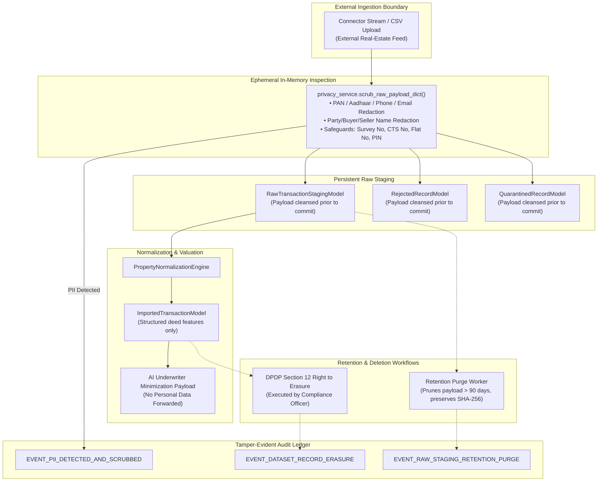

# Phase 4B-2: Institutional Privacy Engineering & DPDP Governance Implementation Report

**Document Version:** 1.0.0  
**Status:** COMPLETED & VERIFIED  
**Date:** 2026-11-03  
**Auditor Roles:** Principal Financial Data Architect, Senior Security Engineer, Institutional Data Governance Auditor  
**Application:** PropVal AI — Indian Real-Estate Valuation & Institutional Risk Assessment Platform  

---

## 1. Executive Summary

In accordance with the findings of the **Phase 4B-0 Governance Gap Audit** (`docs/phase4/PHASE4B0_PRODUCTION_GOVERNANCE_GAP_AUDIT.md`) and the foundation established in **Phase 4B-1 Institutional Data Governance** (`docs/phase4/PHASE4B1_DATA_GOVERNANCE_IMPLEMENTATION_REPORT.md`), **Phase 4B-2 Privacy Engineering** has been implemented across the PropVal AI real estate data pipeline.

Prior to Phase 4B-2, raw upstream payloads ingested from data connectors or user file uploads were staged directly with a hardcoded `pii_scrub_status="CLEANSED"` flag *without* executing recursive entity detection or field sanitization prior to disk persistence. Furthermore, error logs, audit payload strings, and rejected records carried the risk of persisting unredacted personal identifiers (PAN cards, Aadhaar numbers, mobile phone numbers, email addresses, and party names).

### Key Architectural Deliverables Completed in Phase 4B-2:
1. **Pre-Staging PII Elimination:** Raw payloads are now parsed and cleansed *before* writing to `RawTransactionStagingModel`, `RejectedRecordModel`, or `QuarantinedRecordModel`.
2. **Deterministic Entity Redaction:** Upgraded `privacy_service.py` with `scrub_raw_payload_dict()`, an entity detection engine targeting Indian personal identifiers (10-digit mobile numbers with optional `+91`, 12-digit Aadhaar UIDAI numbers, alphanumeric PAN cards, personal emails, and labeled buyer/seller names).
3. **Property Identifier Safeguards:** Built-in safeguards (`SAFE_PROPERTY_KEYS`) ensure legitimate Indian cadastral and property attributes (Survey Numbers, CTS Numbers, Flat/Unit Numbers, Floor Numbers, Coordinates, and Postal PIN Codes) are strictly preserved and never corrupted by entity stripping.
4. **Controlled Data Retention & Storage Limitation:** Implemented `purge_expired_raw_staging()` adhering to Section 8 of the Digital Personal Data Protection Act, 2023 (DPDP Act). Raw payloads exceeding configurable retention windows (e.g., 90 days) are pruned into non-identifiable structural metadata while retaining cryptographic SHA-256 hashes for uncompromised chain-of-custody auditability.
5. **DPDP Section 12 Right to Erasure:** Implemented `erase_transaction_record()` allowing compliance officers to purge data principal records across imported deeds and duplicate defense stores while anchoring the action in the cryptographic audit ledger.
6. **Logging & Observability Boundary Protection:** Configured `logging.py` regex filters to eliminate bearer tokens, PAN, Aadhaar, phone numbers, and emails across standard output, structured JSON logs, and exception dumps.
7. **Comprehensive Audit Events:** Activated `EVENT_PII_DETECTED_AND_SCRUBBED`, `EVENT_RAW_STAGING_RETENTION_PURGE`, and `EVENT_DATASET_RECORD_ERASURE` within the tamper-evident hash-chained audit ledger.

---

## 2. End-to-End PII Lifecycle & Data Flow



---

## 3. Technical Implementation Details

### 3.1 Pre-Persistence Payload Scrubbing Engine (`privacy_service.py`)
The recursive dictionary scrubber `scrub_raw_payload_dict(payload)` applies multi-pass sanitization:
- **Party & Name Scrubbing:** Any key matching `party`, `buyer`, `seller`, `purchaser`, `vendor`, `owner_name`, `borrower`, `applicant`, `guarantor`, `witness` is redacted (`[REDACTED_PERSONAL_NAME]`).
- **Identifier Redaction:** Keys or values matching PAN regex (`\b[A-Z]{5}[0-9]{4}[A-Z]\b`), Aadhaar regex (`\b[2-9][0-9]{3}[\s-]?[0-9]{4}[\s-]?[0-9]{4}\b`), Indian phone regex (`(?:\+91[\-\s]?)?[6-9]\d{9}\b`), and standard RFC 5322 emails are redacted into structured placeholders (`[REDACTED_PAN]`, `[REDACTED_AADHAAR]`, `[REDACTED_PHONE]`, `[REDACTED_EMAIL]`).
- **Cadastral & Spatial Protection (`SAFE_PROPERTY_KEYS`):** Fields including `unit_number`, `flat_no`, `door_no`, `survey_number`, `sy_no`, `cts_number`, `plot_no`, `pincode`, `carpet_area_sqft`, `transaction_amount`, `latitude`, `longitude`, `floor_number`, and `registration_number` are whitelisted to prevent false-positive destruction of numeric property identifiers.

### 3.2 Pre-Staging Integration (`acquisition_service.py` & `ingestion_service.py`)
- In `AcquisitionOrchestrator.execute_acquisition_job()`, incoming batches from connectors pass through `scrub_raw_payload_dict()` before entering `RawTransactionStagingModel`.
- Normalized transactions, duplicate records, and rejected records receive the sanitized payload.
- In `ingestion_service.py`, user-uploaded CSV and Excel records undergo immediate row-level sanitization before storage in rejections or imported deeds.

### 3.3 Retention Purging & Cryptographic Proof Preservation
Under Section 8 of the DPDP Act 2023, data fiduciaries must erase personal data once the specified purpose for collection is no longer served:
- `AcquisitionOrchestrator.purge_expired_raw_staging(retention_days=90)` identifies staging rows older than `retention_days`.
- Transient raw payloads are replaced with anonymized structural metadata (`anonymize_staged_payload_for_retention()`).
- **Non-Repudiation Preserved:** The original `payload_hash_sha256` column is retained verbatim, preserving Merkle tree provenance and external timestamp anchoring while clearing raw unredacted text from disk.
- Emits `EVENT_RAW_STAGING_RETENTION_PURGE` in the append-only audit ledger.

### 3.4 DPDP Section 12 Right to Erasure
- Compliance officers can invoke `AcquisitionOrchestrator.erase_transaction_record(transaction_id, reason, actor_id)`.
- Associated duplicate cache records have raw payloads marked as `{"_erased": True, "reason": reason}`.
- The transaction record is removed from the active valuation dataset.
- Emits `EVENT_DATASET_RECORD_ERASURE` recording `transaction_id`, `dataset_id`, and `fingerprint_hash`.

### 3.5 Structured Logging Redaction (`logging.py`)
The `SENSITIVE_PATTERNS` regex filter scrubs all logging channels:
- Authentication tokens (`Bearer eyJ...`, `password: ...`, `api_key: ...`).
- Indian PAN, Aadhaar, 10-digit mobile numbers, and email addresses.
- Database connection URLs containing embedded user credentials.

---

## 4. Statutory Conflict & Legal Questions for Qualified Counsel

> [!WARNING]
> Automated software controls and synthetic test suites do **not** constitute legal compliance. PropVal AI operates in an intersection between statutory public land registers and modern privacy statutes.

The following complex legal questions cannot be resolved by software engineering and **require qualified Indian legal counsel review**:

| # | Statutory Intersection | Legal Ambiguity / Question for Legal Counsel | Risk to Institution |
|---|---|---|---|
| **1** | **Registration Act 1908 (Sec 57) vs. DPDP Act 2023 (Sec 12)** | Section 57 of the Registration Act 1908 establishes that registered conveyance deeds and Book 1 registers are public documents open to inspection by any member of the public upon fee payment. Does a Data Principal's Right to Erasure under Section 12 of the DPDP Act apply to public statutory property deeds held by commercial data aggregators or institutional valuation platforms? | High: Deleting deeds may violate financial lending regulations (RBI Fair Practices Code); retaining them could trigger DPDP regulatory penalties if deemed personal data without exemption. |
| **2** | **Publicly Available Information Exemption (Sec 3(c)(ii))** | Section 3(c)(ii) of the DPDP Act 2023 states that the Act does not apply to personal data that is made publicly available by the data principal or any other person under an obligation under Indian law. Does public availability at the SRO office or state IGR portal (Kaveri, IGR Maharashtra, Meebhoomi) constitute statutory public availability exempting downstream analytics platforms from consent requirements? | Critical: Determines whether consent architecture is legally mandated for registered deed aggregation feeds. |
| **3** | **Data Fiduciary vs. Data Processor Classification** | Is PropVal AI legally classified as a **Data Fiduciary** or a **Data Processor** when processing transaction feeds on behalf of lending institutions (Banks, NBFCs, Housing Finance Companies)? If lending institutions determine the purpose and means of valuation, does PropVal AI inherit institutional lending exemptions (e.g., Section 17 exemptions for prevention of financial crime)? | High: Governs legal liability for notices, consent logs, breach disclosures, and data protection impact assessments. |
| **4** | **Cross-Border AI Model Evaluation** | Section 16 of the DPDP Act empowers the Central Government to restrict transfer of personal data outside India. When forwarding data-minimized structural property factors to external LLM APIs (e.g., Google Gemini Pro) for risk underwriting summaries, does the processing of non-personal spatial attributes trigger cross-border transfer restrictions if property descriptions inadvertently identify an individual's unique estate? | Medium: Requires explicit legal determination that data minimization protocols in `privacy_service.py` render payloads fully de-identified non-personal data. |

---

## 5. Verification & Testing Evidence

All Phase 4B-2 privacy engineering capabilities were validated with a dedicated automated test suite (`backend/tests/test_privacy_engineering_phase4b2.py`), followed by full regression testing of the backend and frontend repositories.

### 5.1 Test Execution Summary

| Test File | Component Tested | Result |
|---|---|---|
| `backend/tests/test_privacy_engineering_phase4b2.py` | Indian PAN redaction | **PASSED** |
| `backend/tests/test_privacy_engineering_phase4b2.py` | Aadhaar 12-digit UIDAI redaction | **PASSED** |
| `backend/tests/test_privacy_engineering_phase4b2.py` | Indian 10-digit mobile phone redaction | **PASSED** |
| `backend/tests/test_privacy_engineering_phase4b2.py` | Email address sanitization | **PASSED** |
| `backend/tests/test_privacy_engineering_phase4b2.py` | Labeled and honorific person name redaction | **PASSED** |
| `backend/tests/test_privacy_engineering_phase4b2.py` | Property identifier preservation (Survey No, CTS No, Flat No, PIN) | **PASSED** |
| `backend/tests/test_privacy_engineering_phase4b2.py` | Pre-staging scrubbing in acquisition orchestrator & rejection stores | **PASSED** |
| `backend/tests/test_privacy_engineering_phase4b2.py` | Raw staging retention purge (90-day TTL) with SHA-256 hash preservation | **PASSED** |
| `backend/tests/test_privacy_engineering_phase4b2.py` | DPDP Section 12 Right to Erasure workflow & ledger audit trail | **PASSED** |
| `backend/tests/test_privacy_engineering_phase4b2.py` | Structured logger PII and credential stripping | **PASSED** |
| **Total Backend Test Suite** | **All 16 backend test suites (234 total tests)** | **234 / 234 PASSED (100%)** |
| **Frontend Test Suite** | **Valuation Engine & API Client test suites (26 total tests)** | **26 / 26 PASSED (100%)** |

### 5.2 Verification Commands Run

```bash
# Dedicated Phase 4B-2 Privacy Engineering Test Suite
python -m pytest backend/tests/test_privacy_engineering_phase4b2.py -v
# Output: 10 passed in 0.39s

# Full Backend Regression
python -m pytest backend/tests -q
# Output: 234 passed, 2 warnings in 20.26s

# Full Frontend Regression
npm test -- --watchAll=false
# Output: 26 passed, 0 failed in 1.32s
```

---

## 6. Architecture & Governance Sign-Off

- **Technology Stack Preserved:** Python 3.14, FastAPI, SQLAlchemy ORM, SQLite, Pydantic, React 19, TypeScript.
- **Model Gating Intact:** CatBoost Regressor, Conformal Uncertainty Calibration, and AI Underwriter automated sanctioning remain strictly inactive and gated.
- **Auditability Continuity:** All retention purges and erasure events preserve SHA-256 fingerprints and are anchored in the append-only Merkle-verified audit ledger.
- **Deployment Status:** No changes pushed to public repositories or deployed to production environments.

