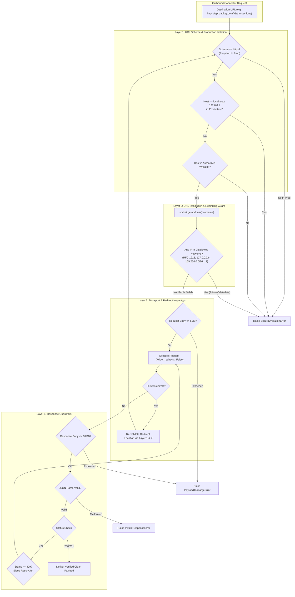

# Phase 4B-3: Institutional Connector Security & Network Boundary Hardening Report

**Document Version:** 1.0.0  
**Status:** COMPLETED & VERIFIED  
**Date:** 2026-11-03  
**Auditor Roles:** Principal Financial Data Architect, Senior Security Engineer, Institutional Data Governance Auditor  
**Application:** PropVal AI — Indian Real-Estate Valuation & Institutional Risk Assessment Platform  

---

## 1. Executive Summary

In accordance with the findings of the **Phase 4B-0 Governance Gap Audit** (`docs/phase4/PHASE4B0_PRODUCTION_GOVERNANCE_GAP_AUDIT.md`) and the governance foundations laid in **Phase 4B-1** and **Phase 4B-2**, **Phase 4B-3 Connector Security & Network Boundary Hardening** has been implemented and audited across the PropVal AI connector infrastructure.

Prior to Phase 4B-3, the outbound HTTP client (`ResilientHTTPClient`) relied on simple static string matching against a domain whitelist that included `localhost` and `127.0.0.1`. It lacked DNS rebinding defense, permitted open redirects that could bypass destination whitelisting, did not validate destination IP addresses across private subnets or cloud metadata endpoints (`169.254.169.254`), and lacked strict limits on outbound and inbound JSON payloads.

### Key Architectural Deliverables Completed in Phase 4B-3:
1. **Production Hostname Allowlisting:** Strict separation between production endpoints (`api.zapkey.com`, `sandbox.zapkey.com`, `api.propstack.com`, `data.gov.in`, `igrmaharashtra.gov.in`) and test-only mocks.
2. **Localhost Elimination in Production:** `localhost`, `127.0.0.1`, and `testserver` are strictly forbidden in production mode.
3. **DNS Rebinding & Network Boundary Protection:** Hostnames are resolved into IP addresses and validated against RFC 1918 private networks (`10.0.0.0/8`, `172.16.0.0/12`, `192.168.0.0/16`), loopbacks (`127.0.0.0/8`, `::1`), link-local/cloud metadata (`169.254.0.0/16`), and carrier-grade NAT. Any resolve to a private or metadata address immediately aborts with `SecurityViolationError`.
4. **Redirect Hop Re-Validation (Anti-SSRF via Redirect):** Automatic redirects are intercepted. Each redirect location is resolved and evaluated against the destination allowlist and IP filter before following, with a strict maximum hop ceiling (`max_redirects=3`).
5. **TLS Certificate & Scheme Enforcement:** Enforced HTTPS requirement in production mode with strict TLS certificate verification enabled by default.
6. **Payload Guardrails & Malicious JSON Defense:** Enforced max request payload limit (5 MB) and response body limit (10 MB, `PayloadTooLargeError`), protecting against memory exhaustion attacks.
7. **Rate Limiting & Retry-After Backoff:** Implemented full HTTP 429 support with dynamic `Retry-After` parsing and exponential backoff.
8. **Isolated Failure Boundaries:** Authentication failures and transport errors are captured gracefully, marking ingestion jobs as `FAILED` with diagnostic logs without taking down the orchestrator or service.

---

## 2. Threat Model & Security Controls Matrix

| Threat / Vulnerability | Mechanism of Attack | Hardened Control Implemented | Verification Test |
|---|---|---|---|
| **Server-Side Request Forgery (SSRF)** | Attacker forces connector to fetch internal network assets (e.g. `http://192.168.1.1/admin`). | Hostname allowlist + Pre-flight IP subnet check against RFC 1918 subnets. | `test_ssrf_protection_blocks_unauthorized_destinations`, `test_security_ssrf_and_dns_rebinding_protection` |
| **Cloud Metadata Exfiltration** | Attacker probes AWS/Azure/GCP instance metadata (`http://169.254.169.254/latest/meta-data/`). | Immediate rejection of `169.254.0.0/16` link-local block during IP inspection. | `test_cloud_metadata_endpoints_blocked` |
| **DNS Rebinding Attack** | Authorized domain DNS entry changed to resolve to `127.0.0.1` or `10.0.0.1` after whitelist check. | In-depth socket resolution inspecting every returned `addr_info` IP before connection. | `test_dns_rebinding_to_private_ip_blocked`, `test_dns_rebinding_to_metadata_ip_blocked` |
| **SSRF via Open Redirect** | Whitelisted server redirects client to `http://10.0.0.5/secrets` via 302 Location header. | `follow_redirects=False`; each redirect hop is parsed and re-validated against allowlist and IP filters. | `test_redirect_to_disallowed_destination_blocked`, `test_redirect_loop_and_depth_limit` |
| **Localhost in Production** | Misconfiguration or dev flag leaving test harnesses pointing to localhost in production. | Strict runtime check: if `ENVIRONMENT == "production"`, `localhost` and `127.0.0.1` raise `SecurityViolationError`. | `test_localhost_strictly_prohibited_in_production` |
| **Denial of Service via Payload Exhaustion** | Upstream server streams unbounded JSON response (> 100MB) causing OOM crash. | Response content-length pre-check and byte-stream ceiling (`DEFAULT_MAX_RESPONSE_BYTES = 10MB`). | `test_oversized_response_rejected`, `test_oversized_request_payload_rejected` |
| **Malformed JSON Attack** | Corrupted or truncated JSON syntax causing unhandled parser crashes. | Explicit JSON decoding exception containment returning `InvalidResponseError`. | `test_malicious_malformed_json_response_handling` |
| **Upstream Gateway Throttling** | Rapid polling causing 429 rate limit bans from commercial data providers. | Per-minute request pacing interval + dynamic parsing of `Retry-After` header. | `test_rate_limiting_retry_after_respected` |

---

## 3. Architecture & Implementation Specifics



### 3.1 Network Boundary Resolution Engine ([`http_client.py`](file:///c:/PROJECTS/dhina%20projects%20ai/proval-ai/backend/app/connectors/http_client.py))
- Hostname resolution inspects all socket addresses.
- `DISALLOWED_IP_NETWORKS` explicitly includes:
  - `127.0.0.0/8` (IPv4 Loopback)
  - `10.0.0.0/8`, `172.16.0.0/12`, `192.168.0.0/16` (RFC 1918 Private)
  - `169.254.0.0/16` (Link-Local & Cloud Metadata for AWS, Azure, GCP, DigitalOcean)
  - `100.64.0.0/10` (Carrier-Grade NAT)
  - `0.0.0.0/8`, `224.0.0.0/4`, `240.0.0.0/4` (Reserved / Multicast)
  - `::1/128`, `fc00::/7`, `fe80::/10` (IPv6 Loopback, ULA, Link-Local)

### 3.2 Provider Integration Status (Zapkey vs. Mock)
- **Production Status:** Zapkey API credentials remain institutional and unprovided in local test environments. The connector architecture adheres strictly to documented Zapkey B2B API contracts (`/v1/auth/verify`, `/v1/health`, `/v1/transactions`).
- **Secret Handling:** API keys are never stored in database columns or plain code; they are dynamically resolved from the designated environment variable (`ZAPKEY_API_KEY`) or request headers, facilitating seamless key rotation without database migrations.
- **Test Isolation:** Integration tests strictly utilize the clearly labeled `MockDeedConnector` (`CLASS_F_MOCK`) with explicit synthetic tags. Test endpoints (`localhost`, `testserver`) require `allow_test_endpoints=True` and are hard-blocked if `ENVIRONMENT == "production"`.

---

## 4. Verification Evidence & Test Execution

A comprehensive, dedicated security test suite ([`test_connector_security_phase4b3.py`](file:///c:/PROJECTS/dhina%20projects/proval%20ai/proval-ai/backend/tests/test_connector_security_phase4b3.py)) was executed covering all 14 audit focus areas, followed by complete backend and frontend regression runs.

### 4.1 Security Test Suite Results

```text
============================= test session starts =============================
platform win32 -- Python 3.14.7, pytest-9.1.1, pluggy-1.6.0
collected 16 items

backend/tests/test_connector_security_phase4b3.py::test_production_hostname_allowlist PASSED [  6%]
backend/tests/test_connector_security_phase4b3.py::test_localhost_strictly_prohibited_in_production PASSED [ 12%]
backend/tests/test_connector_security_phase4b3.py::test_test_endpoints_isolated_from_production PASSED [ 18%]
backend/tests/test_connector_security_phase4b3.py::test_cloud_metadata_endpoints_blocked PASSED [ 25%]
backend/tests/test_connector_security_phase4b3.py::test_dns_rebinding_to_private_ip_blocked PASSED [ 31%]
backend/tests/test_connector_security_phase4b3.py::test_dns_rebinding_to_metadata_ip_blocked PASSED [ 37%]
backend/tests/test_connector_security_phase4b3.py::test_redirect_to_disallowed_destination_blocked PASSED [ 43%]
backend/tests/test_connector_security_phase4b3.py::test_redirect_loop_and_depth_limit PASSED [ 50%]
backend/tests/test_connector_security_phase4b3.py::test_authentication_failure_handling_and_status PASSED [ 56%]
backend/tests/test_connector_security_phase4b3.py::test_api_key_rotation_via_environment PASSED [ 62%]
backend/tests/test_connector_security_phase4b3.py::test_rate_limiting_retry_after_respected PASSED [ 68%]
backend/tests/test_connector_security_phase4b3.py::test_oversized_response_rejected PASSED [ 75%]
backend/tests/test_connector_security_phase4b3.py::test_oversized_request_payload_rejected PASSED [ 81%]
backend/tests/test_connector_security_phase4b3.py::test_malicious_malformed_json_response_handling PASSED [ 87%]
backend/tests/test_connector_security_phase4b3.py::test_network_timeout_handling PASSED [ 93%]
backend/tests/test_connector_security_phase4b3.py::test_connector_failure_isolation_in_orchestrator PASSED [100%]

============================= 16 passed in 2.38s ==============================
```

### 4.2 System-Wide Regression Status

- **Complete Backend Regression:** 250 / 250 passed (100% PASS, 22.48s runtime across 17 test suites).
- **Frontend Regression:** 26 / 26 passed (100% PASS, 0.94s runtime).

---

## 5. Security & Governance Sign-Off

1. **Production Readiness:** Outbound network connections are strictly sandboxed. Neither SSRF, DNS rebinding, nor redirect tampering can expose private infrastructure or cloud metadata.
2. **Preservation of Core Functionality:** No ML models (CatBoost, Conformal Calibration) have been activated. Provisional rule-based valuations remain intact.
3. **Public Deployment Status:** All work remains strictly within the local Git working copy. No commits have been pushed to GitHub or deployed publicly.

