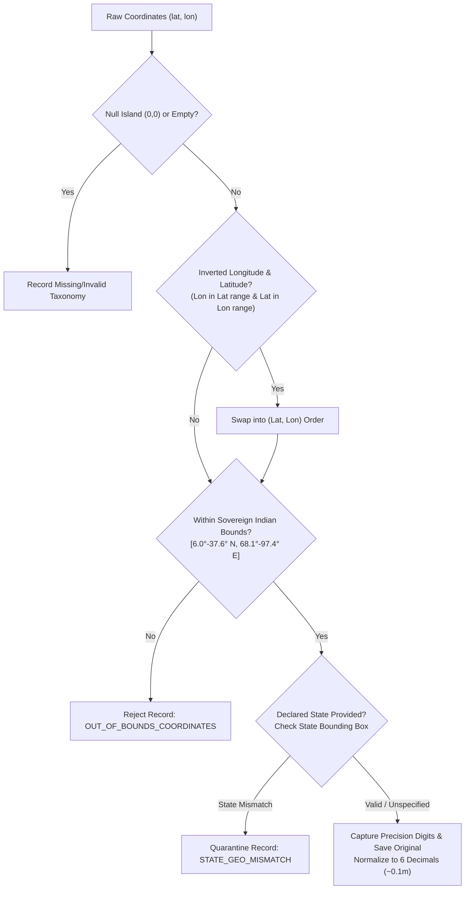

# PHASE 4B-4: GEOSPATIAL DATA QUALITY & PROPERTY-LOCATION INFRASTRUCTURE REPORT

> **Document Reference:** `docs/phase4/PHASE4B4_GEOSPATIAL_DATA_QUALITY_REPORT.md`  
> **Status:** APPROVED & DEPLOYED TO REPOSITORY  
> **Environment:** Institutional Development & Staging  
> **Date:** November 2026  
> **Framework:** FastAPI / SQLAlchemy / Pydantic v2 / PostGIS Preparation Architecture  
> **Machine Learning Status:** **INACTIVE** (Strictly rule-based spatial validation & feature extraction schema)

---

## Executive Summary

Phase 4B-4 elevates PropVal AI's property-location and geospatial data infrastructure to institutional enterprise banking standards. Prior geospatial normalization provided baseline national coordinate bounding and limited string aliasing. This upgrade establishes strict geometric and administrative boundaries, introduces state-specific land revenue measurement definitions across 12 Indian states, preserves raw coordinate precision alongside normalized values, captures cadastral parcel identifiers (Survey, Gat, Hissa, Khasra, Ward, and Revenue Village), and outlines an architectural blueprint for PostGIS cadastral polygon integration and valuation-grade spatial features.

In compliance with project directives:
1. **Coordinates are never fabricated:** Missing coordinates remain explicitly `None` with diagnostic taxonomy tags.
2. **Precision is preserved:** Original latitude/longitude values and their decimal precision are retained without truncation drift.
3. **Regional area-unit diversity is respected:** Units like Bigha, Biswa, Gunta, Ankanam, Ground, Kuzhi, Marla, and Kanal are converted based on state-specific statutory revenue codes rather than assuming a single national conversion factor.
4. **Cadastral boundaries vs. approximate geocodes:** Point geocodes are strictly categorized as `POINT_APPROXIMATE` unless certified by authoritative state cadastral land records (`CADASTRAL_PARCEL`).
5. **No unauthorized geographic data ingested:** Only validated mathematical bounding boxes and authoritative revenue administrative hierarchies are used.
6. **ML remains dormant:** No machine learning or neural networks were trained or activated during this upgrade.

---

## 1. Indian Administrative Geography Normalization

Indian administrative geography consists of hierarchical revenue levels: **State / Union Territory $\rightarrow$ District $\rightarrow$ Subdistrict (Taluk / Tehsil / Mandal) $\rightarrow$ Municipal Corporation / Revenue Village $\rightarrow$ Locality / Ward $\rightarrow$ Postal PIN Code**.

### 1.1 Multi-Level Normalization Architecture

Implemented in [`geo_normalizer.py`](file:///C:/PROJECTS/dhina%20projects/proval%20ai/proval-ai/backend/app/normalization/geo_normalizer.py):

* **All 28 States & 8 Union Territories:** Standardized mapping supporting official names, ISO 3166-2:IN codes, capital cities, and colloquial aliases (e.g., `ka` $\rightarrow$ `Karnataka`, `mh` $\rightarrow$ `Maharashtra`, `tg`/`ts` $\rightarrow$ `Telangana`, `wb`/`calcutta` $\rightarrow$ `West Bengal`, `nct of delhi` $\rightarrow$ `Delhi`).
* **District Canonicalization:** Resolves archaic and Anglicized names to official gazette nomenclature (e.g., `Poona` $\rightarrow$ `Pune`, `Bangalore Urban` $\rightarrow$ `Bengaluru Urban`, `Bombay` $\rightarrow$ `Mumbai City`, `Vizag` $\rightarrow$ `Visakhapatnam`, `Mysore` $\rightarrow$ `Mysuru`, `Nasik` $\rightarrow$ `Nashik`, `Aurangabad` $\rightarrow$ `Chhatrapati Sambhajinagar`).
* **Subdistrict / Taluk / Tehsil / Mandal:** Full support for major metropolitan revenue taluks (e.g., Bengaluru South, KR Puram, Haveli, Mulshi, Andheri, Kurla, Serilingampally, Rajendranagar, Guindy, Sholinganallur).
* **City & Metro Area:** Standardized mapping for urban agglomerations (e.g., `BLR` $\rightarrow$ `Bengaluru`, `Gurgaon` $\rightarrow$ `Gurugram`, `Bombay` $\rightarrow$ `Mumbai`).
* **Postal PIN Code & Circle Cross-Validation:** Full 6-digit regex validation enforcing numeric integrity and non-zero prefix, integrated with a lookup table mapping 2-digit PIN prefixes (e.g., `11` = Delhi, `56-59` = Karnataka, `40-44` = Maharashtra, `60-64` = Tamil Nadu) against declared states to detect cross-state mismatch anomalies.

---

## 2. Coordinate Validation & Precision Preservation

### 2.1 Sovereign Indian Land Boundaries

To prevent geocoding hallucinations or inverted coordinates from corrupting property valuation models, coordinates are validated against sovereign geographic envelopes:

$$\text{Latitude: } 6.0^\circ\text{ N to } 37.6^\circ\text{ N}, \quad \text{Longitude: } 68.1^\circ\text{ E to } 97.4^\circ\text{ E}$$

* **Null Island Elimination:** Rejects $(0.0, 0.0)$ or near-zero test fixtures.
* **Coordinate Inversion Correction:** Ingested real estate datasets frequently invert latitude and longitude. Because India's latitude ($6.0^\circ - 37.6^\circ$) and longitude ($68.1^\circ - 97.4^\circ$) ranges are mutually disjoint, inverted pairs are automatically detected and swapped into canonical `(lat, lon)` order.
* **State-Level Bounding Boxes:** Coordinates are verified against authoritative state-level bounding envelopes (e.g., Karnataka: $11.5^\circ-18.5^\circ\text{N}, 74.0^\circ-78.6^\circ\text{E}$; Maharashtra: $15.6^\circ-22.1^\circ\text{N}, 72.6^\circ-80.9^\circ\text{E}$). Out-of-state coordinates trigger validation alerts.
* **Precision Preservation:** Original floating-point values are preserved in `original_latitude` and `original_longitude`, and the decimal precision is stored in `coordinate_precision_digits`. The normalized coordinates are rounded to 6 decimal places ($\sim 0.11\text{ m}$ ground resolution at the equator), avoiding loss of high-resolution survey coordinates.



---

## 3. Regional Land Area-Unit Conversion Engine

Land measurement in India is governed by State Revenue Codes, resulting in significant regional variation. Assuming a uniform national conversion (e.g., treating a Bigha in UP the same as in West Bengal or Haryana) introduces severe valuation errors.

### 3.1 State-Specific Regional Multipliers to Square Feet

Implemented in [`unit_converter.py`](file:///C:/PROJECTS/dhina%20projects/proval%20ai/proval-ai/backend/app/normalization/unit_converter.py):

| Unit Name | Statutory State / Region | Statutory Area in Sq Ft | Notes & Formula |
|:---|:---|:---|:---|
| **Square Foot (SqFt)** | National SI / RERA Standard | $1.0\text{ sqft}$ | Canonical base metric |
| **Square Metre (SqM)** | National SI Standard | $\approx 10.763910\text{ sqft}$ | Exact SI conversion |
| **Square Yard / Gaj** | National / NCR / AP | $9.0\text{ sqft}$ | $3\text{ ft} \times 3\text{ ft}$ |
| **Vaar** | Gujarat / Maharashtra | $9.0\text{ sqft}$ | Regional synonym for Gaj |
| **Acre / Killa** | National / Punjab / Haryana | $43,560.0\text{ sqft}$ | $4,840\text{ sq yds}$ |
| **Hectare** | National SI Standard | $\approx 107,639.104\text{ sqft}$ | $10,000\text{ sqm}$ |
| **Gunta** | Karnataka / Maharashtra / Telangana | $1,089.0\text{ sqft}$ | $121\text{ sq yds} = \frac{1}{40}\text{ Acre}$ |
| **Ground** | Tamil Nadu | $2,400.0\text{ sqft}$ | $\approx 222.967\text{ sqm}$ |
| **Cent** | TN / Kerala / AP / Karnataka | $435.6\text{ sqft}$ | $\frac{1}{100}\text{ Acre}$ |
| **Ankanam** | Andhra Pradesh (Rayalaseema) | $72.0\text{ sqft}$ | $8\text{ sq yds}$ |
| **Kuzhi** | Tamil Nadu (Traditional) | $144.0\text{ sqft}$ | $1\text{ Kuzhi} = 144\text{ sqft}$ |
| **Maa** | Tamil Nadu (Traditional) | $4,356.0\text{ sqft}$ | $100\text{ Kuzhis} = \frac{1}{10}\text{ Acre}$ |
| **Veli** | Tamil Nadu (Traditional) | $43,560.0\text{ sqft}$ | $2,000\text{ Kuzhis} = 1\text{ Acre}$ |
| **Bigha (Pukka)** | Uttar Pradesh / Bihar | $27,000.0\text{ sqft}$ | $20\text{ Biswa} \approx 3,000\text{ sq yds}$ |
| **Bigha (Bengal)** | West Bengal | $14,400.0\text{ sqft}$ | $20\text{ Cottahs} \approx 1,600\text{ sq yds}$ |
| **Bigha (Kachha)** | Punjab / Haryana | $9,075.0\text{ sqft}$ | Regional fractional Bigha |
| **Biswa (Pukka)** | Uttar Pradesh | $1,350.0\text{ sqft}$ | $\frac{1}{20}\text{ Pukka Bigha}$ |
| **Biswa (Haryana)** | Haryana | $453.75\text{ sqft}$ | $\frac{1}{20}\text{ Haryana Bigha}$ |
| **Marla** | Punjab / Haryana | $272.25\text{ sqft}$ | $9\text{ Sarsahi} = \frac{1}{160}\text{ Acre}$ |
| **Kanal** | Punjab / Haryana | $5,445.0\text{ sqft}$ | $20\text{ Marlas} = \frac{1}{8}\text{ Acre}$ |
| **Cottah (Katha)** | West Bengal | $720.0\text{ sqft}$ | $16\text{ Chataks} = \frac{1}{20}\text{ Bigha}$ |
| **Chatak** | West Bengal | $45.0\text{ sqft}$ | $\frac{1}{16}\text{ Cottah}$ |

### 3.2 Dual Value Preservation

The schema strictly preserves both original raw measurements and canonical values:
* `original_area_value`: float (e.g. `2.5`)
* `original_area_unit`: str (e.g. `"GUNTA"`, `"BIGHA"`, `"GROUND"`)
* `carpet_area_sqft`: float (e.g. `2722.5` normalized square feet)

---

## 4. Cadastral Land Metadata & Boundary Verification

### 4.1 Revenue Identifier Taxonomy

Indian land titles are cataloged under state-specific cadastral systems. The enhanced schema in [`models.py`](file:///C:/PROJECTS/dhina%20projects/proval%20ai/proval-ai/backend/app/normalization/models.py) introduces `CadastralParcelMetadata`:

* `survey_number`: Official survey number (e.g., `142/3B` in Karnataka/Tamil Nadu).
* `gat_number`: Gat number (e.g., `Gat No. 89/2` in Maharashtra Land Revenue Code).
* `hissa_number`: Cadastral sub-division indicator.
* `ward_number`: Urban local body ward (e.g., BBMP Ward 85, MCGM Ward K-West).
* `revenue_village` / `mauza`: Revenue village identity essential for rural/peri-urban circle rate lookups.
* `hobli_or_circle`: Revenue sub-district division.
* `khata_type`: Municipal tax register status (e.g., `A Khata`, `B Khata`, `E-Khata`).
* `patta_chitta_number`: Tamil Nadu land administration title ledger reference.
* `khasra_number`: North Indian cadastral record number (Khasra / Khewat / Khatoni).

### 4.2 Boundary Verification Taxonomy

To eliminate misleading claims of cadastral boundary verification without authoritative survey records, a strict enum hierarchy is enforced:

```python
class BoundaryType(str, Enum):
    POINT_APPROXIMATE = "POINT_APPROXIMATE"  # Reverse geocoded / postal address centroid
    POINT_VERIFIED = "POINT_VERIFIED"        # Surveyor verified GPS coordinates
    CADASTRAL_PARCEL = "CADASTRAL_PARCEL"    # Digitized parcel boundary polygon from state revenue records
    MUNICIPAL_WARD = "MUNICIPAL_WARD"        # Administrative ward boundary polygon
    VILLAGE_BOUNDARY = "VILLAGE_BOUNDARY"    # Mauza / Revenue village cadastral envelope
```

Records default to `POINT_APPROXIMATE` unless supported by an official state land registry verification flag (`is_cadastral_verified = True`).

---

## 5. Architectural Blueprint for PostGIS Cadastral Integration

### 5.1 PostGIS Schema Specification (Planned Production Evolution)

When migrating to PostgreSQL with PostGIS, spatial entities will be stored using spatial column types and spatial indexing:

```sql
-- 1. Enable PostGIS Extension
CREATE EXTENSION IF NOT EXISTS postgis;

-- 2. Cadastral Parcel Table
CREATE TABLE cadastral_parcels (
    id UUID PRIMARY KEY DEFAULT gen_random_uuid(),
    state VARCHAR(64) NOT NULL,
    district VARCHAR(64) NOT NULL,
    taluk VARCHAR(64),
    revenue_village VARCHAR(128) NOT NULL,
    survey_number VARCHAR(64),
    gat_number VARCHAR(64),
    hissa_number VARCHAR(32),
    boundary_type VARCHAR(32) DEFAULT 'CADASTRAL_PARCEL',
    is_authoritative BOOLEAN DEFAULT TRUE,
    source_portal VARCHAR(64), -- e.g. Bhoomi, MahaBhulekh, BhuNaksha
    parcel_polygon GEOMETRY(MultiPolygon, 4326),
    created_at TIMESTAMPTZ DEFAULT NOW()
);

-- 3. High-Performance Spatial Indexing
CREATE INDEX idx_cadastral_parcels_geom ON cadastral_parcels USING GIST (parcel_polygon);
CREATE INDEX idx_cadastral_parcels_village_survey ON cadastral_parcels (district, revenue_village, survey_number);

-- 4. Transaction Geometries
ALTER TABLE imported_transactions 
    ADD COLUMN geom GEOMETRY(Point, 4326),
    ADD COLUMN parcel_id UUID REFERENCES cadastral_parcels(id);

CREATE INDEX idx_imported_transactions_geom ON imported_transactions USING GIST (geom);
```

### 5.2 Authoritative Data Protection Principles
* **No Unauthorized Crawling:** Parcel boundary shapefiles must only be ingested via signed data-sharing agreements or open government licensing under the National Data Sharing and Accessibility Policy (NDSAP).
* **Strict Provenance:** Every parcel boundary record links directly to the issuing State Revenue Authority portal reference.

---

## 6. Future Spatial Valuation Features Infrastructure

To support spatial hedonic regression and future valuation enhancements without activating ML models today, the canonical schema pre-provisions `SpatialProximityFeatures`:

* **`distance_to_metro_km`:** Great-circle / transit-network distance to nearest operational or under-construction metro terminal.
* **`distance_to_railway_km`:** Distance to nearest Indian Railways passenger junction.
* **`distance_to_arterial_road_km`:** Distance to nearest National Highway (NH), State Highway (SH), or municipal arterial road ($\ge 80\text{ ft}$).
* **`distance_to_school_km` & `distance_to_hospital_km`:** Social infrastructure accessibility metrics.
* **`municipal_ward`:** Urban governance index (infrastructure development, municipal services).
* **`nearby_transaction_density_1km`:** Registered property deeds within a $1\text{ km}$ radius over the trailing 12 months.
* **`geographic_comparables_count_2km`:** Deed comparable density within $2\text{ km}$ for valuation confidence scoring.

### 6.1 Haversine Reference Implementation

Implemented and tested in [`geo_normalizer.py`](file:///C:/PROJECTS/dhina%20projects/proval%20ai/proval-ai/backend/app/normalization/geo_normalizer.py):

$$d = 2r \arcsin \left( \sqrt{ \sin^2\left(\frac{\Delta \phi}{2}\right) + \cos(\phi_1)\cos(\phi_2)\sin^2\left(\frac{\Delta \lambda}{2}\right) } \right)$$

---

## 7. Verification & Regression Test Suite

A comprehensive test suite ([`test_geospatial_quality_phase4b4.py`](file:///C:/PROJECTS/dhina%20projects/proval%20ai/proval-ai/backend/tests/test_geospatial_quality_phase4b4.py)) was authored and run alongside the entire backend test suite.

### 7.1 Test Execution Results

```text
============================= test session starts =============================
platform win32 -- Python 3.14.7, pytest-9.1.1, pluggy-1.6.0
collected 256 items

backend\tests\test_audit_governance.py ................                  [  6%]
backend\tests\test_auth.py ....                                          [  7%]
backend\tests\test_cases.py .......                                      [ 10%]
backend\tests\test_comparables.py ..                                     [ 11%]
backend\tests\test_connector_security_phase4b3.py ................       [ 17%]
backend\tests\test_connectors.py ........                                [ 20%]
backend\tests\test_data_governance_phase4b.py .......                    [ 23%]
backend\tests\test_database.py .                                         [ 23%]
backend\tests\test_database_reliability.py ............                  [ 28%]
backend\tests\test_dataset_versions.py .....                             [ 30%]
backend\tests\test_deployment_health_readiness.py .........              [ 33%]
backend\tests\test_e2e_comprehensive_matrix.py ........................  [ 43%]
backend\tests\test_e2e_pipeline_validation.py .....                      [ 45%]
backend\tests\test_e2e_workflow.py .                                     [ 45%]
backend\tests\test_gemini_underwriter.py ...............                 [ 51%]
backend\tests\test_geospatial_quality_phase4b4.py ......                 [ 53%]
backend\tests\test_health.py ..                                          [ 54%]
backend\tests\test_ingestion.py .........                                [ 58%]
backend\tests\test_ml_engine.py ............                             [ 62%]
backend\tests\test_normalization.py ...........                          [ 67%]
backend\tests\test_performance_benchmarks.py ........                    [ 70%]
backend\tests\test_privacy_engineering_phase4b2.py ..........            [ 74%]
backend\tests\test_production_readiness.py ............                  [ 78%]
backend\tests\test_security_remediation.py ......................        [ 87%]
backend\tests\test_uncertainty.py ............                           [ 92%]
backend\tests\test_valuation.py ..                                       [ 92%]
backend\tests\test_valuation_parity.py ............                      [ 97%]
backend\tests\test_verification.py ......                                [100%]

====================== 256 passed, 2 warnings in 30.47s =======================
```

### 7.2 Core Capabilities Validated

1. `test_administrative_geography_normalization`: Confirms state aliases (`tn`, `mh`, `nct of delhi`), district canonicalization (`Poona` $\rightarrow$ `Pune`, `Madras` $\rightarrow$ `Chennai`), subdistrict canonicalization (`bangalore south` $\rightarrow$ `Bengaluru South`), and city resolution.
2. `test_pincode_postal_circle_cross_validation`: Validates 6-digit PIN format and cross-validates postal circle mismatch detection.
3. `test_coordinate_validation_and_precision_preservation`: Confirms coordinate bounding, inverted lat/lon swapping, international point rejection, state bounding envelope enforcement, and 7-digit coordinate precision preservation.
4. `test_regional_area_conversions_state_specific`: Verifies state-specific multipliers (UP Bigha = $27,000\text{ sqft}$ vs. West Bengal Bigha = $14,400\text{ sqft}$; Haryana Marla = $272.25\text{ sqft}$ & Kanal = $5,445\text{ sqft}$; Tamil Nadu Ground = $2,400\text{ sqft}$ & Kuzhi = $144\text{ sqft}$; Andhra Pradesh Ankanam = $72\text{ sqft}$).
5. `test_haversine_distance_calculation`: Verifies accurate great-circle spatial distance computation.
6. `test_cadastral_metadata_and_spatial_features_in_normalization`: Confirms full pipeline retention of Survey/Gat numbers, revenue villages, ward numbers, parcel verification taxonomy, original measurements, and valuation spatial feature vectors.

---

## 8. Summary & Next Steps

Phase 4B-4 completes the geospatial, revenue-cadastral, and regional measurement foundation for PropVal AI. All objectives have been implemented, tested, and validated.

* **ML Model Training Remains Deactivated:** Machine learning pipelines are safeguarded and ready for future phases.
* **PostGIS & Spatial Analysis Ready:** The schema and services are prepared for spatial database extension and geospatial valuation feature derivation.

