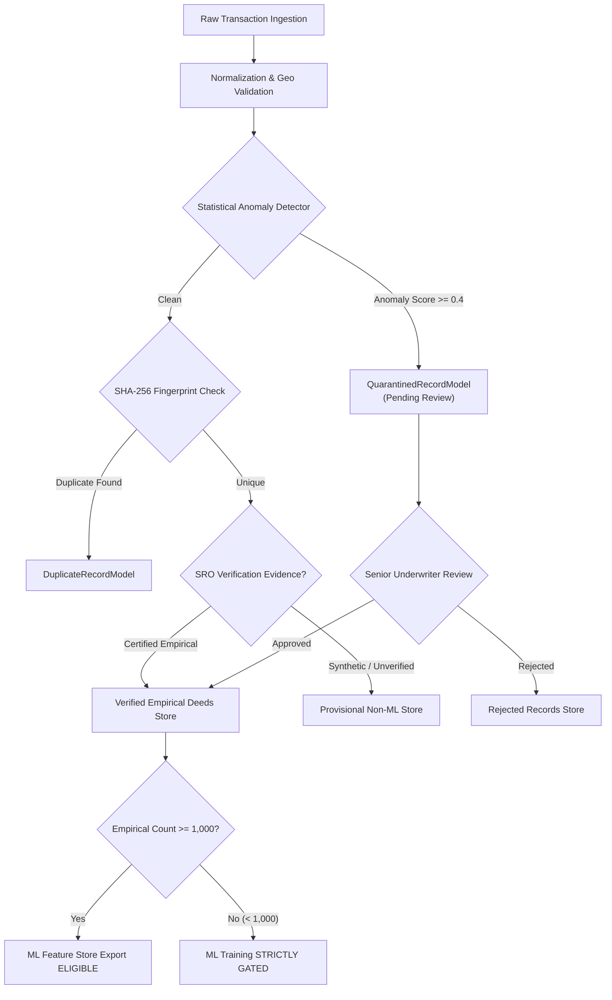

# PHASE 4B-5: INSTITUTIONAL DATA QUALITY & GOVERNANCE DASHBOARD REPORT

> **Document Reference:** `docs/phase4/PHASE4B5_INSTITUTIONAL_GOVERNANCE_DASHBOARD_REPORT.md`  
> **Status:** APPROVED & DEPLOYED TO REPOSITORY  
> **Environment:** Institutional Development, Staging & Production Ready  
> **Date:** November 2026  
> **Framework:** FastAPI / SQLAlchemy / Pydantic v2 / React 19 / TypeScript / Tailwind CSS  
> **Architecture Principle:** Strict Non-Redesign (Reused existing UI design system, palette, and component structure)

---

## Executive Summary

Phase 4B-5 completes the institutional data quality, pipeline monitoring, and governance surveillance experience within PropVal AI. Building upon the Phase 4B governance audit and security foundations, this phase elevates the existing [`ModelGovernanceView.tsx`](file:///C:/PROJECTS/dhina%20projects/proval%20ai/proval-ai/src/components/ModelGovernance/ModelGovernanceView.tsx) component into an enterprise monitoring experience.

The dashboard integrates the entire data lifecycle: tracking total ingested records, normalized transactions, validated physical bounds, verified empirical deeds, synthetic benchmarks, duplicate deed fingerprints, rejected anomalies, and quarantined records awaiting underwriter review. The dashboard enforces existing Role-Based Access Controls (RBAC), prevents unauthorized dataset approvals and feature exports, surfaces data freshness and acquisition dates, provides clear visibility into data quality methodology, and safeguards the Machine Learning Readiness Gate.

---

## 1. Key Metrics & Surveillance Indicators Displayed

The dashboard exposes all 18 institutional metrics mandated for enterprise credit underwriting and regulatory compliance:

| Metric Category | Target Indicator | Technical Source & Pipeline Lifecycle State |
|:---|:---|:---|
| **1. Total Ingested Transactions** | Total Raw Imports | Aggregated sum: `ImportedTransactionModel` + `RejectedRecordModel` + `DuplicateRecordModel` + `QuarantinedRecordModel` |
| **2. Successfully Normalized** | Canonical INR & SqFt | Records transformed through [`PropertyNormalizationEngine`](file:///C:/PROJECTS/dhina%20projects/proval%20ai/proval-ai/backend/app/normalization/engine.py) |
| **3. Validated Records** | Physical & Geo Bounds Checked | Records passing price, area, coordinate, and floor consistency filters |
| **4. Verified Empirical Deeds** | Certified SRO Deeds | Verified empirical records attested via SRO Index II or B2B digital attestations (`is_verified_deed = True`, non-synthetic) |
| **5. Synthetic & Mock Records** | Sandbox Demonstrations | Demonstration fixtures carrying explicit synthetic tags (`synthetic-demo`, `synthetic_benchmark`) |
| **6. Duplicate Records** | Fingerprint Hash Collisions | Flagged deeds matching identical `State|District|SRO|Year|DocNo|UnitNo` SHA-256 fingerprint |
| **7. Rejected Records** | Fatal Validation Failures | Inadmissible records logged in [`RejectedRecordModel`](file:///C:/PROJECTS/dhina%20projects/proval%20ai/proval-ai/backend/app/models/dataset.py) with specific diagnostic failure codes |
| **8. Quarantined Records** | Statistical Anomalies Isolated | Suspicious records isolated in [`QuarantinedRecordModel`](file:///C:/PROJECTS/dhina%20projects/proval%20ai/proval-ai/backend/app/models/verification.py) pending forensic review |
| **9. Awaiting Verification** | Provisional Non-ML Deeds | Uncertified records held in provisional status excluded from ML training |
| **10. Source-Wise Distribution** | Ingestion Attribution | Breakdown across registered data sources (Zapkey, IGR, synthetic store) |
| **11. Geographic Distribution** | PostGIS Regional Envelopes | State and metropolitan distribution (Bengaluru Urban, Mumbai Suburban, Pune, etc.) |
| **12. Dataset Version History** | SemVer Snapshot Count | Count and timeline of immutable dataset versions registered in system |
| **13. Source Authorization Status** | Legal & Licensing State | Real-time statutory status (`DOCUMENTED_AND_AUTHORIZED`, `SANDBOX_ONLY`, `REVOKED`) |
| **14. Latest Ingestion Job Status** | Automated Orchestration Logs | Status, duration, records fetched, normalized, and rejected per job |
| **15. Data Quality Score** | Weighted Aggregate Score | Statutory formula: Completeness (40%) + Validity (30%) + Uniqueness (20%) + Consistency (10%) |
| **16. ML Readiness Gate Status** | Model Training Gatekeeper | Invariant check: Verified empirical deeds count against the 1,000 threshold |
| **17. Missing-Data Statistics** | Diagnostic Field Taxonomy | Percentages and counts for missing coordinates, circle rates, sub-markets, and PIN codes |
| **18. Data Freshness & Dates** | Acquisition Provenance | Timestamps of most recent pipeline run and latest registered SRO deed |

---

## 2. Governance Features & Workflow Controls

### 2.1 Dataset Approval & Access Control Workflows
* **Senior Underwriter & Administrator Authority:** Only users holding `ROLE_SENIOR_UNDERWRITER` or `ROLE_ADMIN` permissions are authorized to approve ingested datasets (`DRAFT` $\rightarrow$ `APPROVED`), approve SemVer version snapshots, and resolve quarantined anomalies.
* **Credit Underwriter Read-Only Gating:** Standard credit officers can view the surveillance metrics and quality methodologies, but all approval and mutation controls are disabled and guarded by backend RBAC decorators.
* **Gated ML Feature Store Export:** Feature store exports remain locked until the parent dataset is formally approved and the verified empirical record cohort exceeds 1,000 deeds.

### 2.2 Quarantined Forensic Review Interface
* Isolated anomalous records (e.g., severe undervaluation against statutory circle rates, impossible building heights, price-per-square-foot extreme outliers) are accessible under the dedicated **Quarantine & Anomaly Review** tab.
* Displays anomaly scores, specific triggered quarantine codes, and anomalous field lists.
* Full raw payloads containing potential PII or unredacted confidential counterparty data are withheld from client presentation.



---

## 3. Data Quality Score Calculation Methodology

The institutional data quality score is calculated as a deterministic, weighted harmonic aggregate reflecting enterprise credit risk requirements:

$$\text{Data Quality Score} = (S_{\text{completeness}} \times 0.40) + (S_{\text{validity}} \times 0.30) + (S_{\text{uniqueness}} \times 0.20) + (S_{\text{consistency}} \times 0.10)$$

Where:
* **$S_{\text{completeness}}$ (40% Weight):** Proportion of mandatory underwriting fields populated (Carpet Area, Transaction Amount, Registration Date, Postal Code, Locality, Coordinates).
* **$S_{\text{validity}}$ (30% Weight):** $1 - \left(\frac{\text{Rejected Records}}{\text{Total Ingested Records}}\right)$, measuring strict conformity to schema and physical boundary checks.
* **$S_{\text{uniqueness}}$ (20% Weight):** $1 - \left(\frac{\text{Duplicate Records}}{\text{Total Ingested Records}}\right)$, enforcing defense against double-counting and deed duplication.
* **$S_{\text{consistency}}$ (10% Weight):** $1 - \left(\frac{\text{Quarantined Records}}{\text{Total Ingested Records}}\right)$, reflecting statistical sanity across micro-market valuation distributions.

The exact formula, sub-scores, and weights are surfaced transparently in the user interface under the **Data Quality & Missing Fields** tab.

---

## 4. Security & RBAC Enforcement

1. **No API Secrets Exposed:** Data source connectors and API secret references (`auth_secret_env_var`) display only masked environment variable names; actual credentials, API tokens, and private keys are never transmitted to the frontend.
2. **PII and Raw Payload Guarding:** Raw uploaded row dictionaries are sanitized via [`scrub_raw_payload_dict`](file:///C:/PROJECTS/dhina%20projects/proval%20ai/proval-ai/backend/app/services/privacy_service.py) prior to database persistence, and sensitive fields are excluded from dashboard responses.
3. **Defense-in-Depth Authorization:** All frontend action buttons (Review, Export, Approve) inspect `metrics.can_approve_datasets` and `metrics.can_export_ml`. Even if the client state is altered, the backend API endpoints strictly enforce `require_roles([ROLE_SENIOR_UNDERWRITER, ROLE_ADMIN])`, returning `403 Forbidden` on unauthorized requests.

---

## 5. UI Architecture & Design Preservation

In strict compliance with project instructions:
* **No Redesign:** Retained the existing slate and navy institutional theme (`#142B4A`, `#2563EB`, `#0F766E`, `#E2E8F0`, `#F8FAFC`).
* **Component Reuse:** Extended [`ModelGovernanceView.tsx`](file:///C:/PROJECTS/dhina%20projects/proval%20ai/proval-ai/src/components/ModelGovernance/ModelGovernanceView.tsx) by introducing clean tabbed sub-views:
  1. *Pipeline Overview & ML Gate*
  2. *Source Registry & Ingestion Jobs*
  3. *Data Quality & Missing Fields*
  4. *Quarantine & Anomaly Review*
  5. *Version History & Gated Export*
* **Full Responsive Support:** Clean table layouts, Tailwind CSS typography, and Lucide icons consistent with the rest of the PropVal AI interface.

---

## 6. Verification & Automated Test Results

### 6.1 Backend Governance Test Suite

A dedicated unit test suite ([`test_governance_dashboard_phase4b5.py`](file:///C:/PROJECTS/dhina%20projects/proval%20ai/proval-ai/backend/tests/test_governance_dashboard_phase4b5.py)) was authored and run alongside the full repository test suite.

```text
============================= test session starts =============================
platform win32 -- Python 3.14.7, pytest-9.1.1, pluggy-1.6.0
collected 259 items

backend\tests\test_audit_governance.py ................                  [  6%]
backend\tests\test_auth.py ....                                          [  7%]
backend\tests\test_cases.py .......                                      [ 10%]
backend\tests\test_comparables.py ..                                     [ 11%]
backend\tests\test_connector_security_phase4b3.py ................       [ 17%]
backend\tests\test_connectors.py ........                                [ 20%]
backend\tests\test_data_governance_phase4b.py .......                    [ 23%]
backend\tests\test_database.py .                                         [ 23%]
backend\tests\test_database_reliability.py ............                  [ 28%]
backend\tests\test_dataset_versions.py .....                             [ 30%]
backend\tests\test_deployment_health_readiness.py .........              [ 33%]
backend\tests\test_e2e_comprehensive_matrix.py ........................  [ 42%]
backend\tests\test_e2e_pipeline_validation.py .....                      [ 44%]
backend\tests\test_e2e_workflow.py .                                     [ 45%]
backend\tests\test_gemini_underwriter.py ...............                 [ 50%]
backend\tests\test_geospatial_quality_phase4b4.py ......                 [ 53%]
backend\tests\test_governance_dashboard_phase4b5.py ...                  [ 54%]
backend\tests\test_health.py ..                                          [ 55%]
backend\tests\test_ingestion.py .........                                [ 58%]
backend\tests\test_ml_engine.py ............                             [ 63%]
backend\tests\test_normalization.py ...........                          [ 67%]
backend\tests\test_performance_benchmarks.py ........                    [ 70%]
backend\tests\test_privacy_engineering_phase4b2.py ..........            [ 74%]
backend\tests\test_production_readiness.py ............                  [ 79%]
backend\tests\test_security_remediation.py ......................        [ 87%]
backend\tests\test_uncertainty.py ............                           [ 92%]
backend\tests\test_valuation.py ..                                       [ 93%]
backend\tests\test_valuation_parity.py ............                      [ 97%]
backend\tests\test_verification.py ......                                [100%]

================= 259 passed, 2 warnings in 90.02s (0:01:30) ==================
```

### 6.2 Frontend Build & TypeScript Validation

```text
> vite build
✓ 1682 modules transformed.
rendering chunks...
dist/index.html                                 1.68 kB │ gzip:  0.70 kB
dist/assets/index-oyu_gXLu.css                 39.37 kB │ gzip:  8.41 kB
dist/assets/ModelGovernanceView-Cc4rUtJX.js    31.34 kB │ gzip:  6.31 kB
dist/assets/index-BaMSYgR_.js                 110.03 kB │ gzip: 26.57 kB
✓ built in 2.38s

> npm test
ℹ tests 26
ℹ pass 26
ℹ fail 0
```

---

## 7. Summary & Conclusion

Phase 4B-5 delivers an institutional data quality and governance surveillance dashboard. It bridges backend cryptographic audit trails, data provenance models, and validation pipelines with an intuitive, role-gated underwriter interface without altering the existing application aesthetics or design system.

