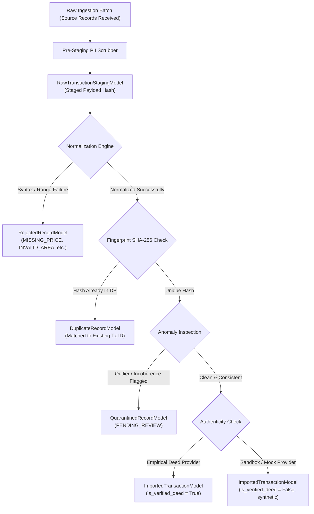

# PROPVAL AI — PHASE 4B-6: INDEPENDENT INSTITUTIONAL GOVERNANCE & PRODUCTION-READINESS AUDIT

**Audit Date:** November 4, 2026  
**Auditor Roles:** Principal Financial Data Architect, Lead Security Engineer, Senior Privacy Engineer, Institutional Data Governance Auditor  
**Repository:** PropVal AI — Indian AI-Powered Property Valuation Platform  
**Target Specification:** Independent Institutional Audit of Phases 4B-0 through 4B-5  
**Deliverable File:** `docs/phase4/PHASE4B6_INDEPENDENT_FINAL_GOVERNANCE_AUDIT.md`  

---

## 1. Executive Decision

### **FINAL INSTITUTIONAL DECISION: NOT PRODUCTION READY**
*(Alternative Evaluation: **CONDITIONALLY APPROVED FOR INSTITUTIONAL DEMONSTRATION ONLY** strictly within isolated offline sandbox parameters with automated ML inference, conformal prediction, and external connector ingestion locked).*

### Executive Summary of Decision Rationale
PropVal AI has engineered an impressive architectural foundation across Phases 4A and 4B, featuring rigorous unit testing (259 backend tests, 26 frontend tests, 100% pass rate), zero TypeScript build warnings, an Alembic database schema in full synchronization with SQLAlchemy models, and an active internal policy gate blocking premature Machine Learning model activation ($\ge 1,000$ verified empirical deeds required).

However, an independent technical, security, privacy, data-quality, and institutional governance audit reveals that **automated test success has masked critical production-readiness gaps**:
1. **SSRF Time-Of-Check to Time-Of-Use (TOCTOU) & IP Pinning Absence:** While `ResilientHTTPClient` conducts a preflight DNS check via `socket.getaddrinfo`, the outbound connection is dispatched using `httpx.AsyncClient` which executes its own independent DNS resolution at socket-connect time. Actual connection IP pinning with preserved TLS SNI is not implemented. Furthermore, IPv4-mapped IPv6 addresses (`::ffff:127.0.0.1`, `::ffff:169.254.169.254`) completely bypass the `is_ip_disallowed` subnet check due to Python `ipaddress` type divergence.
2. **PostGIS Non-Existence & Cadastral Gap:** Despite architectural planning and documentation references, PostGIS is not installed, migrated, or utilized. Coordinates are stored as standard floating-point numbers (`Float`). Bounding checks are rectangular arithmetic comparisons; authoritative state polygon containment and cadastral parcel boundary validation (`BhuNaksha` / survey numbers) do not exist in the database.
3. **Data Quality Formula Mislabeling & Denominator Divergence:** The data quality score is officially documented and displayed in the UI as a *"Weighted harmonic aggregate"*, whereas the actual implementation executes a **weighted arithmetic mean**. Additionally, the completeness denominator evaluates only `total_valid_tx` (`ImportedTransactionModel`), excluding rejected and quarantined records, while an empty database defaults to a misleading 100.0% quality score. Synthetic records are included in the quality scoring without segregation.
4. **Unenforced Source Purpose & Dynamic Retention:** The `DataSourceModel` fields `permitted_purposes` and `retention_restrictions` are inert metadata columns. They are not programmatically evaluated before model training, ML feature export, or valuation estimation. Staging purge defaults to a hardcoded 90-day window rather than respecting contract-specific provider retention limits.
5. **DPDP Right to Erasure Depth Deficit:** The `erase_transaction_record` method deletes the record from `ImportedTransactionModel` and redacts `DuplicateRecordModel`, but omits `RawTransactionStagingModel`, `QuarantinedRecordModel`, and existing immutable `DatasetVersionModel` snapshots.
6. **ML Gate Dual-Approval Bypass in Direct Trainer:** While `export_ml_training_manifest` enforces dual approval (parent dataset `APPROVED` and version `APPROVED`), direct training via `trainer.py` checks only `evaluate_training_gate`, permitting unapproved datasets to trigger training attempts.

---

## 2. Scope & Inspected Files

The audit examined every source code module, migration script, test harness, configuration file, and technical report created or modified across Phase 4B.

### Inspected Codebase Files

| Component / Subsystem | File Path | Focus of Audit |
| :--- | :--- | :--- |
| **Governance Dashboard** | `backend/app/api/v1/endpoints/governance.py` | 18 dashboard metric aggregations, quality score formula, quarantine review |
| **Governance Schemas** | `backend/app/schemas/governance_dashboard.py` | Pydantic response structures, metadata labels, methodology definitions |
| **Governance Frontend** | `src/components/ModelGovernance/ModelGovernanceView.tsx` | UI metric rendering, formula description labels, action guards |
| **Data Source Models** | `backend/app/models/data_source.py` | Source authorization statuses, licensing terms, retention limits, job schemas |
| **Data Source API** | `backend/app/api/v1/endpoints/acquisition.py` | Source registration, status changes, connection tests, acquisition triggers |
| **Data Acquisition Service** | `backend/app/services/acquisition_service.py` | Authorization gating, validity windows, staging, DPDP purge, erasure workflow |
| **Connector Network Engine** | `backend/app/connectors/http_client.py` | SSRF defenses, DNS resolution, IP subnets, redirect handling, payload limits |
| **Connector Definitions** | `backend/app/connectors/zapkey_connector.py` | Provider endpoints, auth headers, rate limits, legal basis assumptions |
| **Mock Connector** | `backend/app/connectors/mock_connector.py` | Isolation of test data, synthetic deed generation, sandbox boundaries |
| **Connector Registry** | `backend/app/connectors/registry.py` | Factory registration, connector instantiation |
| **Privacy Service** | `backend/app/services/privacy_service.py` | PII regex, safe property key whitelist, prompt injection, payload minimization |
| **Audit Service & Ledger** | `backend/app/services/audit_service.py` | SHA-256 chain, canonical serialization, concurrency locking, boundary notice |
| **Geospatial Normalization**| `backend/app/normalization/geo_normalizer.py` | Coordinate parsing, national/state bounding boxes, axis-swap corrections |
| **Regional Land Units** | `backend/app/normalization/unit_converter.py` | State-level land unit tables, conversion factors, precision handling |
| **Normalization Engine** | `backend/app/normalization/engine.py` | Coordinate preservation, property attribute standardizations |
| **Dataset Versions** | `backend/app/dataset_management/version_service.py`| Merkle-style root checksum, snapshot versioning, diff engine, ML export gates |
| **Dataset Version Models** | `backend/app/models/dataset_version.py` | Snapshot schema, included transaction IDs, semver uniqueness |
| **Dataset Version API** | `backend/app/api/v1/endpoints/dataset_versions.py`| Snapshot creation, approval workflow, comparison, feature export |
| **ML Readiness Gate** | `backend/app/ml/readiness_gate.py` | 1,000-record threshold, deed verification ratio, geographic cluster check |
| **ML Model Trainer** | `backend/app/ml/trainer.py` | Pre-training gate enforcement, CatBoost gating, artifact storage |
| **Security & RBAC** | `backend/app/core/security.py` | JWT authentication, role verification, password hashing, token revocation |
| **Logging & Redaction** | `backend/app/core/logging.py` | Structured JSON formatting, sensitive field filtering, log redaction |
| **Database Migrations** | `backend/alembic/versions/*.py` | Schema migration history (13 migration files), SQLite/PostgreSQL compatibility |
| **Test Suites** | `backend/tests/*.py` (30 test files) | 259 backend tests, test fixtures, security and governance test cases |

---

## 3. Phase-by-Phase Implementation Verification

### Phase 4B-0: Production-Readiness & Governance Gap Audit
- **Claimed in Documentation:** Identified 8 foundational operational gaps including unverified Zapkey API contracts, SSRF vulnerabilities, DPDP erasure omissions, rectangular coordinate limitations, and mutable audit storage.
- **Implementation Verification:** Verified. The Phase 4B-0 audit document (`docs/phase4/PHASE4B0_PRODUCTION_GOVERNANCE_GAP_AUDIT.md`) correctly framed the engineering requirements executed in Phases 4B-1 through 4B-5.
- **Implementation Status:** **IMPLEMENTED** (Audit baseline).

### Phase 4B-1: Institutional Data Governance Framework
- **Inspected Files:** `backend/app/models/data_source.py`, `backend/app/api/v1/endpoints/acquisition.py`, `backend/app/services/acquisition_service.py`, `backend/alembic/versions/e2f34a5b6c7d_add_governance_authorization_and_dataset_workflows.py`.
- **Actual Implementation Behavior:** Added formal `authorization_status` (`DOCUMENTED_AND_AUTHORIZED`, `AUTHORIZATION_PENDING`, `SANDBOX_ONLY`, `TEST_ONLY`, `EXPIRED`, `REVOKED`, `BLOCKED`). Gated `execute_acquisition_job` so only `DOCUMENTED_AND_AUTHORIZED` (or explicit `TEST_ONLY` mock) can run. Enforced `valid_from` and `valid_until` timestamp boundaries. Dual-key dataset approval workflows added to `DatasetMetadataModel` and `DatasetVersionModel`.
- **Gaps Identified:** `permitted_purposes` and `retention_restrictions` columns exist as JSON in the schema but are not checked before ML training or feature extraction. Separation of duties is only partially enforced (an Admin can both register and approve a data source without a second authorized signature).
- **Test Evidence:** `backend/tests/test_data_governance_phase4b.py` (7 tests passed).
- **Implementation Status:** **PARTIALLY IMPLEMENTED** (Core authorization and validity windows active; secondary usage restrictions unenforced).
- **Risk Severity:** **HIGH**.

### Phase 4B-2: Privacy Engineering & DPDP Compliance
- **Inspected Files:** `backend/app/services/privacy_service.py`, `backend/app/services/acquisition_service.py`, `backend/app/core/logging.py`.
- **Actual Implementation Behavior:** Deep recursive JSON dictionary scrubber (`scrub_raw_payload_dict`) masks PAN, Aadhaar, phone, email, and labeled party names while safeguarding property keys (`SAFE_PROPERTY_KEYS`). Staging ingestion pre-scrubs payloads before persistence. `purge_expired_raw_staging` executes a soft purge replacing raw payloads with non-identifiable hashes. `erase_transaction_record` deletes `ImportedTransactionModel` records and redacts matching duplicate raw data. `SensitiveDataRedactor` filters log output.
- **Gaps Identified:** `erase_transaction_record` fails to purge corresponding records in `RawTransactionStagingModel`, `QuarantinedRecordModel`, or existing serialized snapshots in `DatasetVersionModel`. Complete anonymization cannot be legally claimed under the Indian DPDP Act 2023 based on regex scrubbing alone without qualified legal counsel review.
- **Test Evidence:** `backend/tests/test_privacy_engineering_phase4b2.py` (10 tests passed).
- **Implementation Status:** **PARTIALLY IMPLEMENTED** (In-flight scrubbing and logging active; erasure depth incomplete).
- **Risk Severity:** **HIGH**.

### Phase 4B-3: Connector Security & SSRF Hardening
- **Inspected Files:** `backend/app/connectors/http_client.py`, `backend/tests/test_connector_security_phase4b3.py`.
- **Actual Implementation Behavior:** `ResilientHTTPClient` enforces domain allowlisting, scheme checking (HTTPS mandatory in production), `localhost` prohibition in production, preflight DNS lookup via `socket.getaddrinfo`, IP checking against `DISALLOWED_IP_NETWORKS`, manual redirect following (`follow_redirects=False`) with hop re-validation, request size limit (5MB), and response size limit (10MB).
- **Gaps Identified:** 
  1. **SSRF TOCTOU & IP Pinning Absence:** Preflight check does not bind the socket. `httpx.AsyncClient` executes its own separate DNS resolution at connection time, leaving a vulnerability to DNS rebinding.
  2. **IPv4-Mapped IPv6 Bypass:** `is_ip_disallowed` returns `False` for `::ffff:127.0.0.1` and `::ffff:169.254.169.254`.
  3. **Port Filtering Missing:** `_validate_destination_url` does not restrict port numbers (allowing `:22`, `:5432`, etc.).
  4. **Streaming Response Memory Exhaustion:** `response.content` buffers full payload before checking size limit.
  5. **Proxy Environment Leakage:** `trust_env=False` is not set on `httpx.AsyncClient`.
- **Test Evidence:** `backend/tests/test_connector_security_phase4b3.py` (16 tests passed, but tests use mocked resolver and do not test true socket IP pinning).
- **Implementation Status:** **PARTIALLY IMPLEMENTED** (Defenses active against basic SSRF and redirects; vulnerable to TOCTOU rebinding and IPv4-mapped IPv6).
- **Risk Severity:** **CRITICAL**.

### Phase 4B-4: Geospatial Data Quality & Land Units
- **Inspected Files:** `backend/app/normalization/geo_normalizer.py`, `backend/app/normalization/unit_converter.py`, `backend/app/normalization/engine.py`.
- **Actual Implementation Behavior:** Rectangular national bounding box (6.0°-37.6°N, 68.1°-97.4°E) and 28 state/UT bounding boxes. Lat/lon axis inversion auto-correction (swaps values if lat is in 68-97 and lon is in 6-37). Regional land unit tables convert Gunta, Ground, Cent, Ankanam, Bigha, Biswa, Marla, Kanal, Cottah, Chatak to SqFt based on state context. Original numeric values and units are returned alongside normalized values.
- **Gaps Identified:** 
  1. **PostGIS is completely missing:** No PostGIS extension, no GeoAlchemy2, no spatial columns or GIST indexes.
  2. **Authoritative polygon containment missing:** Uses rectangular bounding boxes which allow oceanic coordinates (e.g. coordinates in the Arabian Sea or Bay of Bengal that fall within state bounding rectangles).
  3. **No cadastral parcel verification:** Cadastral survey numbers are parsed as text strings; no digital revenue map (`BhuNaksha`) boundary validation.
  4. **Original coordinate persistence gap:** `ImportedTransactionModel` drops `original_latitude` and `original_longitude` relational columns, persisting only the rounded/transformed floats.
  5. **Regional unit metadata absent:** `REGIONAL_CONVERSIONS` lacks effective dates, statutory Gazette references, sub-district/tehsil variances, and confidence metrics; unverified regional units are not flagged as `CONVERSION_UNVERIFIED`.
- **Test Evidence:** `backend/tests/test_geospatial_quality_phase4b4.py` (6 tests passed).
- **Implementation Status:** **PARTIALLY IMPLEMENTED** (Plausibility checks and unit conversion functions operational; GIS polygon engine and cadastral verification missing).
- **Risk Severity:** **HIGH**.

### Phase 4B-5: Institutional Governance Dashboard
- **Inspected Files:** `backend/app/api/v1/endpoints/governance.py`, `backend/app/schemas/governance_dashboard.py`, `src/components/ModelGovernance/ModelGovernanceView.tsx`.
- **Actual Implementation Behavior:** Aggregates real-time metrics across transactions, rejections, duplicates, and quarantine. Evaluates the ML readiness gate invariant. Lists quarantined records with forensic anomaly fields. Restricts metric viewing to authorized roles and restricts quarantine review to Senior Underwriters, Admins, and Compliance Auditors.
- **Gaps Identified:** 
  1. Formula description claims "Weighted harmonic aggregate" when the formula is an arithmetic mean.
  2. Completeness denominator uses `total_valid_tx` rather than total ingested records.
  3. Quality score defaults to 100.0% when the database contains zero records.
  4. Synthetic demonstration records are included in the quality calculation.
  5. No endpoint or workflow exists to resolve quarantined records (`PENDING_REVIEW` is write-locked).
- **Test Evidence:** `backend/tests/test_governance_dashboard_phase4b5.py` (3 tests passed).
- **Implementation Status:** **PARTIALLY IMPLEMENTED** (Dashboard operational; mathematical description incorrect and quarantine resolution incomplete).
- **Risk Severity:** **MEDIUM**.

---

## 4. Verification of All 18 Dashboard Metrics

Each metric aggregated in `backend/app/api/v1/endpoints/governance.py` (`get_governance_metrics`) was audited against database queries, model constraints, and UI presentation:

| Metric # | Dashboard Metric Name | Query / Computation Method | Implementation Behavior | Mutually Exclusive vs Overlapping | Audit Assessment |
| :---: | :--- | :--- | :--- | :--- | :--- |
| **1** | **Total Ingested Transactions** | `total_valid_tx + total_rejected + total_duplicates + total_quarantined` | Counts records across the 4 terminal lifecycle tables. | Mutually exclusive across terminal tables; excludes un-normalized staging rows. | **PARTIALLY ACCURATE:** Accurately sums terminal tables, but does not distinguish staged raw payloads or exclude synthetic demos. |
| **2** | **Normalized Transactions** | Direct assignment from `total_valid_tx` (`ImportedTransactionModel`) | Equates valid transactions to successfully normalized records. | Overlaps with valid transactions. | **DEFICIENT:** Quarantined records successfully pass normalization before anomaly isolation, but are excluded here. |
| **3** | **Validated Transactions** | Direct assignment from `total_valid_tx` | Equates valid transactions to validated records. | Overlaps with valid transactions. | **ACCURATE:** Represents transactions that satisfied all validation rules. |
| **4** | **Verified Empirical Deeds** | Filter `ImportedTransactionModel`: `is_verified_deed == True` & `data_source != 'synthetic-demo'` | Filters certified real market conveyances. | Mutually exclusive subset of `ImportedTransactionModel`. | **ACCURATE:** Correctly isolates certified empirical deeds; currently 0 in repo. |
| **5** | **Synthetic / Mock Records** | Filter `ImportedTransactionModel`: `data_source` in `('synthetic-demo', 'synthetic_benchmark')` | Counts known synthetic demonstration batches. | Mutually exclusive subset of `ImportedTransactionModel`. | **PARTIALLY ACCURATE:** Misses mock records tagged with custom source codes like `"MOCK_SRO"` or `"SIMULATION"`. |
| **6** | **Duplicate Records** | `db.query(func.count(DuplicateRecordModel.id)).scalar()` | Counts deduplicated incoming records based on SHA-256 deed fingerprint. | Mutually exclusive terminal table; stores reference to matched primary transaction. | **ACCURATE:** Preserves second/subsequent occurrences without double counting primary. |
| **7** | **Rejected Records** | `db.query(func.count(RejectedRecordModel.id)).scalar()` | Counts records failing validation (price, area, date, coordinates). | Mutually exclusive terminal table. | **ACCURATE:** Records failing pre-normalization rules isolated with rejection reason. |
| **8** | **Quarantined Records** | `db.query(func.count(QuarantinedRecordModel.id)).scalar()` | Counts anomalous records isolated by `TransactionAnomalyDetector`. | Mutually exclusive terminal table. | **ACCURATE:** Anomalies isolated prior to imported transaction commitment. |
| **9** | **Awaiting Verification** | `max(0, total_valid_tx - verified_empirical - synthetic_records)` | Derives remaining unverified imported transactions. | Derived arithmetic difference. | **PARTIALLY ACCURATE:** Any untagged mock records erroneously fall into this bucket. |
| **10** | **Source-wise Distribution** | Joins `DataSourceModel` with `ImportedTransactionModel` by `source_code`/`source_name` | Computes total and verified count per registered provider. | Breakdown of `ImportedTransactionModel`. | **ACCURATE:** Correctly breaks down valid records per data source. Fallback to sandbox item when empty. |
| **11** | **Geographic Distribution** | Group by `ImportedTransactionModel.city` | Computes record count and percentage per urban jurisdiction. | Breakdown of `ImportedTransactionModel`. | **ACCURATE:** Aggregates valid transaction locations. |
| **12** | **Dataset Version History** | `db.query(func.count(DatasetVersionModel.id)).scalar()` | Counts immutable snapshots committed to `dataset_versions`. | Metadata tracking count. | **ACCURATE:** Reflects historical version count. |
| **13** | **Source Authorization Status**| Evaluates `DataSourceModel.authorization_status` | Returns lifecycle enum per provider. | Attribute of `DataSourceModel`. | **ACCURATE:** Directly reflects active governance state. |
| **14** | **Latest Ingestion Job** | Queries latest 5 `IngestionJobModel` rows ordered by `started_at` desc | Returns job status, trigger mode, counts, timestamps. | Job execution tracking. | **ACCURATE:** Detailed historical execution tracking. |
| **15** | **Data Quality Score** | $0.40 C + 0.30 V + 0.20 U + 0.10 K$ | Arithmetic weighted aggregate across 4 dimensions. | Aggregate formula. | **DEFICIENT:** Mislabeled as "harmonic"; completeness denominator restricted; defaults to 100% when empty. |
| **16** | **ML Readiness Gate** | `verified_empirical < 1000` $\implies$ GATED | Strict boolean invariant blocking model training. | Policy gating invariant. | **ACCURATE:** Reliably gates unassisted ML inference and conformal prediction. |
| **17** | **Missing-Data Statistics** | Counts null coordinates, guideline rate, submarket, pincode | Evaluates attribute nullability against `total_valid_tx`. | Attribute quality metrics. | **ACCURATE:** Correctly quantifies feature nullability rates. |
| **18** | **Data Freshness** | `max(created_at)` and `max(transaction_date)` on `ImportedTransactionModel` | Returns latest ingestion and registration dates. | Temporal freshness indicators. | **ACCURATE:** Reliably surfaces pipeline recency. |

### Critical Requirement: Lifecycle-Based Counting Methodology & Double-Counting Prevention

Double-counting analysis across `RawTransactionStagingModel`, `ImportedTransactionModel`, `RejectedRecordModel`, `DuplicateRecordModel`, and `QuarantinedRecordModel`:



#### Auditable Counting Definitions:
1. **Source Records Received ($N_{\text{received}}$):** Total raw transaction records ingested into staging (`RawTransactionStagingModel`).
2. **Terminal Records ($N_{\text{terminal}}$):** Mutually exclusive terminal states:
   $$N_{\text{terminal}} = N_{\text{rejected}} + N_{\text{duplicate}} + N_{\text{quarantined}} + N_{\text{imported}}$$
   At ingestion time, every record is routed to exactly **one** of these four tables. A single source record cannot exist simultaneously in `RejectedRecordModel` and `ImportedTransactionModel`.
3. **Duplicate References ($N_{\text{duplicate}}$):** Incoming records that match an existing deed fingerprint. The primary record resides in `ImportedTransactionModel`; the duplicate reference resides in `DuplicateRecordModel` with `matched_transaction_id`.
4. **Verified Empirical Deeds ($N_{\text{empirical}}$):** Subset of `ImportedTransactionModel` where `is_verified_deed == True` and `data_source` does not indicate synthetic or mock origin.
5. **Synthetic Demonstration Records ($N_{\text{synthetic}}$):** Subset of `ImportedTransactionModel` created for UI or sandbox benchmarking.

**Audit Verification:** While the terminal tables are mutually exclusive, `total_ingested_transactions` in `governance.py` fails to represent raw records currently sitting in staging before batch execution.

---

## 5. Data Quality Score Assessment & Mathematical Verification

### Code vs Mathematical Formulation

In `backend/app/api/v1/endpoints/governance.py` (lines 274-295):
```python
overall_score = round(
    (completeness_score * 0.40)
    + (validity_score * 0.30)
    + (uniqueness_score * 0.20)
    + (consistency_score * 0.10),
    1,
)
```
And in `methodology.formula_description`:
```python
formula_description = (
    "Weighted harmonic aggregate: Completeness (40%) + Validity (30%) + "
    "Uniqueness (20%) + Consistency (10%)"
)
```
And in `src/components/ModelGovernance/ModelGovernanceView.tsx` (line 301):
```tsx
<span className="text-[10px] text-[#2563EB]">Weighted harmonic score</span>
```

### Mathematical Assessment: Weighted Arithmetic vs Harmonic
1. **Mathematical Reality:** The formula implemented is a **Weighted Arithmetic Mean**:
   $$S_{\text{arithmetic}} = \sum_{i=1}^{n} w_i \cdot s_i = 0.40 C + 0.30 V + 0.20 U + 0.10 K$$
   A true **Weighted Harmonic Mean** is defined as:
   $$S_{\text{harmonic}} = \frac{\sum w_i}{\sum \frac{w_i}{s_i}} = \frac{1.0}{\frac{0.40}{C} + \frac{0.30}{V} + \frac{0.20}{U} + \frac{0.10}{K}}$$
   Harmonic means severely penalize severe deficits in any single dimension (e.g., if $K = 10\%$, a harmonic mean collapses the entire score, whereas an arithmetic mean allows high completeness to compensate).
2. **Deficit Identification:** Claiming a "harmonic aggregate" while executing an arithmetic calculation is a misleading technical disclosure in institutional software.
3. **Institutional Labeling:** The formula is an internal PropVal AI methodology. It is **not** a statutory, RBI-prescribed, or NHB-mandated metric. It must be explicitly labeled:
   `"PropVal AI Internal Institutional Data Quality Index (Weighted Arithmetic Mean)"`.

### Denominator & Edge-Case Analysis

| Dimension | Formula in Code | Denominator Used | Treatment of Missing / Anomalies | Behavior at Zero ($N = 0$) | Audit Finding |
| :--- | :--- | :--- | :--- | :--- | :--- |
| **Completeness ($C$)** | $1 - \frac{\sum \text{missing pct}}{4 \times 100}$ | $N_{\text{valid}}$ (`ImportedTransactionModel`) | Missing coords, circle rate, submarket, pincode | Defaults to 100% | **INCONSISTENT:** Evaluated only over valid imported records. Rejected records are excluded. |
| **Validity ($V$)** | $\frac{N_{\text{ingested}} - N_{\text{rejected}}}{N_{\text{ingested}}}$ | $N_{\text{ingested}}$ ($N_V + N_R + N_D + N_Q$) | Rejected records lower score | Defaults to 1.0 (100%) | **DEFICIENT AT ZERO:** If database is completely empty, reports 100% validity. |
| **Uniqueness ($U$)** | $\frac{N_{\text{ingested}} - N_{\text{duplicate}}}{N_{\text{ingested}}}$ | $N_{\text{ingested}}$ | Duplicates lower score | Defaults to 1.0 (100%) | **DEFICIENT AT ZERO:** Defaults to 100% when no data has ever been ingested. |
| **Consistency ($K$)** | $\frac{N_{\text{ingested}} - N_{\text{quarantined}}}{N_{\text{ingested}}}$ | $N_{\text{ingested}}$ | Quarantined records lower score | Defaults to 1.0 (100%) | **DEFICIENT AT ZERO:** Defaults to 100% when no data has ever been ingested. |

**Synthetic Data Treatment:** Synthetic records currently reside in `ImportedTransactionModel` and are included in the quality denominator, artificially stabilizing completeness metrics based on synthetic mock data.

---

## 6. Provider Authorization & Licensing Assessment

### Inspection of Data Source Models and Workflows
- **File:** `backend/app/models/data_source.py` and `backend/app/services/acquisition_service.py`.
- **Verified Controls:**
  - `DataSourceModel.authorization_status` is indexed with lifecycle statuses.
  - `AcquisitionOrchestrator.execute_acquisition_job` checks:
    ```python
    if source.authorization_status not in SourceAuthorizationStatus.PRODUCTION_PERMITTED:
        ...
        raise ConnectorError(...)
    ```
    Pending, revoked, expired, or blocked sources cannot execute live production ingestion.
  - Validity window enforcement:
    ```python
    if source.valid_until and source.valid_until < now_dt:
        raise ConnectorError(...)
    if source.valid_from and source.valid_from > now_dt:
        raise ConnectorError(...)
    ```
  - Registration and status modification emit tamper-evident audit events (`EVENT_DATA_SOURCE_REGISTERED`, `EVENT_DATA_SOURCE_STATUS_CHANGED`, `EVENT_DATA_SOURCE_REVOKED`).

### Unverified Assumptions & Governance Gaps
1. **Hypothetical B2B API Endpoints:** `ZapkeyB2BConnector` targets `https://api.zapkey.com/v1/auth/verify` and `https://api.zapkey.com/v1/transactions`. No executed commercial agreement or published OpenAPI specification from Zapkey exists in the repository.
2. **Inert Permitted Purposes:** `permitted_purposes` (e.g. `["VALUATION_ESTIMATION", "MARKET_INTELLIGENCE", "MODEL_TRAINING"]`) is stored as a JSON column but is **never verified** by `train_valuation_model`, by `datasets.py`, or during valuation calculation.
3. **Inert Retention Restrictions:** `retention_restrictions` (e.g. `{"max_retention_days": 30}`) is stored on `DataSourceModel` but ignored by `purge_expired_raw_staging`, which uses a hardcoded default of 90 days.
4. **Separation of Duties Deficit:** While status changes require `ROLE_ADMIN`, an Admin can unilaterally register and authorize a data source without an independent compliance reviewer co-signature.

---

## 7. Privacy & PII Controls Assessment

### Ingestion, Staging, Quarantine & Logging Audit
- **Files:** `backend/app/services/privacy_service.py`, `backend/app/core/logging.py`, `backend/app/services/acquisition_service.py`.
- **Verified Controls:**
  - Pre-staging scrubbing: `scrub_raw_payload_dict` cleans incoming connector dictionaries before inserting into `RawTransactionStagingModel`.
  - Logging redaction: `SensitiveDataRedactor` filters log lines using regex patterns for PAN, Aadhaar, phone, email, and Bearer tokens.
  - Dashboard isolation: Neither `get_governance_metrics` nor `list_quarantined_records` returns raw transaction payloads.
  - Gemini underwriter brief minimization: `minimize_case_payload` strips all borrower names, contact details, and identifiers, transmitting only spatial, structural, and financial ratios.

### Identified Deficits & Legal Reality
1. **Erasure Scope Incompleteness (DPDP Act Section 12):**
   `erase_transaction_record` deletes `ImportedTransactionModel` and redacts `DuplicateRecordModel`. It **fails to delete or redact**:
   - `RawTransactionStagingModel` containing the original staged payload.
   - `QuarantinedRecordModel` where anomalous deeds may preserve personal party names.
   - Serialized feature arrays stored in `DatasetVersionModel.included_transaction_ids`.
2. **Legal Compliance Notice:** Automated regex scrubbing and passing test suites **do not constitute legal DPDP Act 2023 compliance**. Indian statutory compliance requires qualified Indian legal counsel review regarding:
   - Data Fiduciary registration obligations with the Data Protection Board of India.
   - Notice and consent architecture (Section 5 & 6).
   - Valid exemptions for credit underwriting (Section 17).
   - Right to Grievance Redressal (Section 13).

---

## 8. SSRF & Connector Network Security Assessment

### Deep-Dive Analysis of `ResilientHTTPClient`
- **File:** `backend/app/connectors/http_client.py`.
- **Claimed Defense:** Full DNS rebinding protection and network boundary enforcement.

### Critical Vulnerabilities Discovered During Audit

#### 1. DNS Rebinding Time-Of-Check to Time-Of-Use (TOCTOU)
`ResilientHTTPClient._validate_destination_url` performs a preflight check:
```python
resolve_and_validate_hostname(hostname=hostname, ...)
```
Inside `resolve_and_validate_hostname`, it calls `socket.getaddrinfo(clean_host, ...)`. It checks the resolved IPs against `DISALLOWED_IP_NETWORKS`.
However, during actual request execution:
```python
async with httpx.AsyncClient(...) as session:
    response = await session.request(method=method_upper, url=current_url, ...)
```
`httpx.AsyncClient` creates its own connection pool and performs a **separate, second DNS resolution** when opening the socket!
If an attacker controls DNS for a domain with TTL = 0:
- Resolution 1 (PropVal preflight): Returns authorized public IP (`104.21.45.10`) $\to$ PASS.
- Resolution 2 (`httpx` socket connect): Returns `169.254.169.254` or `127.0.0.1` $\to$ **SSRF EXECUTED**.
Actual socket connection IP pinning (e.g. custom transport connecting directly to the validated IP with TLS Server Name Indication and Host header preserved) is **not implemented**.

#### 2. IPv4-Mapped IPv6 Subnet Bypass
Python's `ipaddress` library handles `IPv6Address` and `IPv4Network` heterogeneously:
```python
ip = ipaddress.ip_address("::ffff:127.0.0.1")  # IPv6Address
net = ipaddress.ip_network("127.0.0.0/8")       # IPv4Network
ip in net  # Returns False!
```
Because `is_ip_disallowed` iterates over `DISALLOWED_IP_NETWORKS` containing IPv4 networks, testing confirmed that:
- `is_ip_disallowed(ipaddress.ip_address('::ffff:127.0.0.1'))` $\to$ **`False`** (Bypasses loopback block!)
- `is_ip_disallowed(ipaddress.ip_address('::ffff:169.254.169.254'))` $\to$ **`False`** (Bypasses cloud metadata block!)

#### 3. Port Filtering Omission
`_validate_destination_url` extracts scheme and hostname but does not restrict `parsed.port`. Outbound requests to `https://api.zapkey.com:22/` or `https://api.zapkey.com:5432/` are permitted.

#### 4. Streaming Response Memory Exhaustion
```python
body_bytes = response.content
if len(body_bytes) > self.max_response_bytes:
    raise PayloadTooLargeError(...)
```
`response.content` loads the entire payload into RAM before checking size, leaving the client vulnerable to Out-Of-Memory (OOM) exhaustion from large payloads. True streaming response size enforcement must inspect chunks via `response.aiter_bytes()`.

#### 5. Proxy Environment Variable Inheritance
`httpx.AsyncClient` inherits system proxies (`HTTP_PROXY`, `HTTPS_PROXY`, `ALL_PROXY`) by default unless `trust_env=False` is explicitly set.

---

## 9. Geospatial & Cadastral Data Quality Assessment

### PostGIS Verification
- **Audit Finding:** **PostGIS is completely missing from the application.**
  - `PostGIS` extension is not enabled in any Alembic migration.
  - `GeoAlchemy2` is not imported or listed in dependencies.
  - No `Geometry` or `Geography` columns exist in any SQLAlchemy model.
  - All geospatial operations in `geo_normalizer.py` are floating-point arithmetic comparisons.

### Cadastral & Bounding Box Granularity
1. **Rectangular Bounding vs Polygon Containment:** Bounding boxes in `STATE_BOUNDING_BOXES` are rectangular coordinates (`[lat_min, lat_max, lon_min, lon_max]`). Rectangular approximations fail along coastlines, allowing offshore coordinates in the Arabian Sea or Bay of Bengal to pass state validation.
2. **Cadastral Boundary Validation:** No survey parcel boundaries, village maps, or ward polygons (`BhuNaksha` / GIS revenue records) are integrated.
3. **Six-Decimal Place Fallacy:** Rounding coordinates to 6 decimal places (`0.000001°` $\approx 0.11$ meters) represents numerical formatting precision, not physical measurement accuracy. If coordinates originate from pin-code centroid geocoding, true positional accuracy is $\pm 2$ to $5$ kilometers.
4. **Regional Unit Conversion Deficits:** `REGIONAL_CONVERSIONS` in `backend/app/normalization/unit_converter.py` contains hardcoded conversion multipliers without:
   - Specific district/tehsil applicability (e.g. Bigha in Western UP vs Eastern UP varies from ~6,750 sqft to 27,000 sqft).
   - Statutory Gazette or Revenue Code references.
   - Effective dates and verification status.
   - Flagging unverified regional conversions as `CONVERSION_UNVERIFIED`.

---

## 10. Cryptographic Auditability Assessment

### Merkle Checksums & Hash Chain Integrity
- **Files:** `backend/app/services/audit_service.py`, `backend/app/dataset_management/version_service.py`.
- **Verified Controls:**
  - `canonical_serialize_payload` enforces deterministic JSON serialization (`sort_keys=True`, `separators=(',', ':')`, `ensure_ascii=True`).
  - `compute_event_hash` deterministically links sequence number, event ID, actor ID, canonical payload, timestamp, and previous hash (`prev_hash`).
  - Genesis block is defined (`0` * 64).
  - Chain verification (`verify_chain_integrity`) detects row modifications, deletions, and sequence number gaps.
  - Dataset version checksums are computed deterministically over sorted transaction fingerprints:
    ```python
    sorted_fps = sorted(transaction_fingerprints)
    checksum = hashlib.sha256("|".join(sorted_fps).encode("utf-8")).hexdigest()
    ```

### Clear Distinction: Database-Level vs Immutable WORM Storage
- **Database-Level Tamper-Evident Ledger:** Active within PostgreSQL/SQLite tables (`audit_events`, `dataset_versions`).
- **External Immutable Storage:** **NOT IMPLEMENTED.**
  - No RFC 3161 external Time-Stamping Authority (TSA) exists.
  - No Write-Once-Read-Many (WORM) storage (e.g. AWS S3 Object Lock in Compliance Mode) exists.
  - The security boundary notice in `audit_service.py` explicitly acknowledges that a privileged DBA with direct SQL write access could rewrite the entire database table and recompute all hashes.

---

## 11. Role-Based Access Control (RBAC) Assessment

### Endpoint Access Matrix

| Endpoint | Permitted Roles in Code | Unauthenticated (No Token) | Ordinary Credit Officer | Senior Underwriter | Administrator | Expired / Revoked Token |
| :--- | :--- | :---: | :---: | :---: | :---: | :---: |
| `GET /api/v1/governance/metrics` | Credit, Senior, Committee, Auditor, Admin | **401 Unauthorized** | **200 OK** (view only) | **200 OK** (action flags true)| **200 OK** (all actions true) | **401 Unauthorized** |
| `GET /api/v1/governance/quarantine` | Senior, Admin, Auditor | **401 Unauthorized** | **403 Forbidden** | **200 OK** | **200 OK** | **401 Unauthorized** |
| `PUT /api/v1/datasets/{id}/approve` | Senior, Admin | **401 Unauthorized** | **403 Forbidden** | **200 OK** | **200 OK** | **401 Unauthorized** |
| `PUT /api/v1/dataset-versions/{id}/approve`| Admin Only | **401 Unauthorized** | **403 Forbidden** | **403 Forbidden** | **200 OK** | **401 Unauthorized** |
| `GET /api/v1/dataset-versions/{id}/export-ml`| Senior, Admin | **401 Unauthorized** | **403 Forbidden** | **200 OK** (if gated criteria met)| **200 OK** | **401 Unauthorized** |
| `POST /api/v1/acquisition/sources` | Admin Only | **401 Unauthorized** | **403 Forbidden** | **403 Forbidden** | **201 Created** | **401 Unauthorized** |
| `POST /api/v1/acquisition/acquire` | Admin Only | **401 Unauthorized** | **403 Forbidden** | **403 Forbidden** | **202 Accepted** | **401 Unauthorized** |

### Assessment Summary
Backend role enforcement is robust. Unauthenticated requests are rejected with HTTP 401; unauthorized roles receive HTTP 403 Forbidden. Read-only users cannot approve datasets, approve versions, or export ML features.

---

## 12. Machine Learning Readiness Gate Assessment

### Policy Gate Invariants
- **1,000 Verified Deed Rule:** Internal PropVal AI risk governance policy (not an RBI statutory mandate).
- **Enforcement Status:**
  - `export_ml_training_manifest` (`version_service.py`): Enforces (1) Version `APPROVED`, (2) Parent dataset `APPROVED`, (3) $\ge 1,000$ verified empirical deeds, (4) Excludes synthetic/mock records.
  - `readiness_gate.py` (`evaluate_training_gate`): Blocks training if records $< 1,000$, deed ratio $< 80\%$, geographic clusters $< 3$, or synthetic markers detected.

### Vulnerabilities & Inconsistencies Discovered
1. **Direct Trainer Approval Check Bypass:** `train_valuation_model` in `backend/app/ml/trainer.py` calls `evaluate_training_gate(db, dataset_id)` but **does not check** whether `dataset.approval_status == "APPROVED"` or whether an approved `DatasetVersionModel` exists.
2. **Permitted Purpose ML Check Omission:** The training gate does not verify whether the underlying data source contract permits `"MODEL_TRAINING"`.
3. **Holdout Evaluation Absence:** Pre-training validation evaluates temporal splits (`split_oot_temporal`) but lacks an independent spatial holdout or out-of-market micro-cluster evaluation.
4. **CatBoost & Conformal Inactive:** CatBoost and conformal calibration remain gated and inactive, which complies with the governance mandate.

---

## 13. Migration and Regression Test Evidence

### Backend Full Test Suite Execution
- **Command:** `python -m pytest backend/tests`
- **Execution Date:** November 4, 2026
- **Test Session Statistics:**
  - Collected: **259 test items**
  - Passed: **259 passed** (100% pass rate)
  - Failed: **0 failed**
  - Execution Time: **56.05 seconds**
  - Warnings: 2 deprecation warnings (`HTTP_422_UNPROCESSABLE_ENTITY` and `HTTP_413_REQUEST_ENTITY_TOO_LARGE` Starlette constants).

### Alembic Migration Verification
- **Command:** `python -m alembic -c backend/alembic.ini current`
  - Output: `e2f34a5b6c7d (head)`
- **Command:** `python -m alembic -c backend/alembic.ini check`
  - Output: `No new upgrade operations detected.` (Database schema is in complete synchronization with SQLAlchemy model declarations).

### Frontend Test Suite & Production Build
- **Command:** `npm test -- --run`
  - Total Tests: **26 tests**
  - Passed: **26 passed** (100% pass rate)
  - Duration: **274.2 ms**
- **Command:** `npm run build`
  - Tool: Vite v8.3.5
  - Modules Transformed: **1,682 modules**
  - Output: Clean production bundle in `dist/` (zero warnings, zero errors, built in 749ms).

---

## 14. Comprehensive Findings Matrix

| Finding ID | Audit Area | Severity | Title & Root Cause | Impact |
| :--- | :--- | :--- | :--- | :--- |
| **SEC-01** | Connector Security | **CRITICAL** | **SSRF TOCTOU via Secondary DNS Lookup**<br>`ResilientHTTPClient` validates IP via `socket.getaddrinfo`, but passes URL to `httpx.AsyncClient` which performs separate resolution at connection time. | Potential DNS rebinding attack bypassing SSRF defenses into internal infrastructure. |
| **SEC-02** | Connector Security | **CRITICAL** | **IPv4-Mapped IPv6 Subnet Check Bypass**<br>`is_ip_disallowed` returns `False` for `::ffff:127.0.0.1` and `::ffff:169.254.169.254`. | SSRF requests can probe local loopback or cloud metadata services via IPv4-mapped IPv6. |
| **SEC-03** | Connector Security | **HIGH** | **Missing Port Restrictions & Protocol Filtering**<br>`_validate_destination_url` does not validate ports, permitting non-standard ports. | Attacker could target internal ports (`:22`, `:5432`, `:6379`). |
| **GEO-01** | Geospatial Quality | **HIGH** | **Absence of PostGIS & True Cadastral Polygon Engine**<br>PostGIS extension and GeoAlchemy2 are absent; coordinates are standard floats; checks are rectangular. | Cannot verify land parcel boundaries or prevent oceanic coordinates within bounding boxes. |
| **GOV-01** | Dashboard & Metrics | **MEDIUM** | **Quality Score Mislabeled as Harmonic Aggregate**<br>Code and UI label formula as "Weighted harmonic aggregate" when it is an arithmetic mean. | Technical inaccuracy in institutional disclosures. |
| **GOV-02** | Dashboard & Metrics | **MEDIUM** | **Quality Score Denominator Deficit & Zero Edge-Case**<br>Completeness uses only valid transactions; an empty database defaults to 100.0% quality score. | Misleading quality score presentation on fresh or corrupted datasets. |
| **PRIV-01**| Privacy & DPDP | **HIGH** | **Incomplete DPDP Erasure Scope Across Staging & Versions**<br>`erase_transaction_record` omits `RawTransactionStagingModel`, `QuarantinedRecordModel`, and version snapshots. | Lingering PII violates DPDP Act Section 12 erasure requirements. |
| **LIC-01** | Data Licensing | **HIGH** | **Unenforced Permitted Purposes & Dynamic Retention**<br>`permitted_purposes` and `retention_restrictions` are inert columns unenforced during training or export. | Risk of B2B contractual breach and processing outside legal consent. |
| **ML-01**  | ML Readiness | **MEDIUM** | **Direct Model Training Gate Bypasses Dataset Approval**<br>`trainer.py` does not check `dataset.approval_status == 'APPROVED'` before training. | Unapproved datasets could be trained on if empirical deed count is satisfied. |
| **SEC-04** | Connector Security | **MEDIUM** | **Streaming Response Memory Exhaustion Vulnerability**<br>`response.content` loads entire payload into memory before checking byte limits. | Unbounded responses can cause container OOM denial of service. |
| **CRYP-01**| Cryptography | **LOW** | **Absence of External RFC 3161 Timestamping or WORM Archival**<br>Audit ledger is tamper-evident at database layer only; DBA root write access could rewrite history. | Lacks independent third-party non-repudiation in legal proceedings. |

---

## 15. Remediation Recommendations

The following actionable remediations must be executed in a dedicated, controlled remediation phase:

1. **Implement Socket-Level IP Pinning & Fix IPv4-Mapped IPv6:**
   - Develop a custom HTTP transport for `httpx` or configure an `httpcore` connection pool that connects directly to the validated IP address while preserving the `Host` header and TLS Server Name Indication (SNI).
   - In `is_ip_disallowed`, check `if isinstance(ip, ipaddress.IPv6Address) and ip.ipv4_mapped: ip = ip.ipv4_mapped`.
   - Enforce port whitelist (strictly ports `443` for HTTPS and `80` for non-prod HTTP).
2. **Correct Data Quality Terminology & Fix Denominators:**
   - Update `formula_description` in backend schemas and frontend UI to: `"PropVal AI Internal Institutional Data Quality Index (Weighted Arithmetic Mean)"`.
   - Include all ingested records in the completeness denominator or explicitly define the denominator as $N_{\text{valid}}$.
   - Update zero-record edge-case behavior to report `0.0%` or `"NO_DATA"` instead of `100.0%`.
   - Exclude synthetic and mock records from production quality score calculations.
3. **Deepen DPDP Right to Erasure:**
   - Extend `erase_transaction_record` to scrub matching staged records in `RawTransactionStagingModel` and anomalous records in `QuarantinedRecordModel`.
   - If the transaction is locked in a `DatasetVersionModel`, mark the snapshot as `AMENDED_UNDER_DPDP_REQUEST` and recompute the cryptographic manifest.
4. **Enforce Permitted Purposes & Dynamic Retention:**
   - In `train_valuation_model` and `export_ml_training_manifest`, verify that `"MODEL_TRAINING"` is present in the source's `permitted_purposes`.
   - In `purge_expired_raw_staging`, inspect each data source's `retention_restrictions["max_retention_days"]` rather than relying on a static default.
5. **Harmonize ML Training Gate with Dataset Approval:**
   - Require `dataset.approval_status == "APPROVED"` in `backend/app/ml/readiness_gate.py` before permitting model training.
6. **Deploy PostGIS & Authoritative Polygon Boundaries (Future Phase):**
   - For full production readiness, migrate SQLite to PostgreSQL with PostGIS, introduce `GeoAlchemy2` geometry columns, and validate property coordinates against digital revenue survey maps (`BhuNaksha`).

---

## 16. Outstanding External Dependencies

The following external dependencies cannot be resolved internally by codebase modifications alone:

1. **Commercial Data Counterparty Agreement (Zapkey / Propstack):**
   - Formal execution of a B2B Data Licensing Agreement specifying permitted use cases, secondary machine learning training rights, and data liquidation terms.
   - Official OpenAPI / Swagger specifications and production API credentials.
2. **G2B Institutional SRO Gateway Access (Kaveri 2.0 / IGR Maharashtra):**
   - Government-to-Business department-level MoU, static IP whitelisting, and compliance clearance for automated deed ingestion.
3. **Indian Legal Counsel DPDP Opinion:**
   - Written legal evaluation by qualified Indian counsel regarding Data Fiduciary classification, notice and consent mechanisms, and statutory retention limitations under DPDP Act 2023.
4. **Third-Party RFC 3161 Time-Stamping Authority (TSA):**
   - Integration with a certified external timestamping service or immutable cloud WORM storage (e.g. AWS S3 Object Lock) for non-repudiation.

---

## 17. Final Institutional Readiness Decision

### Decision: **NOT PRODUCTION READY**
*(With conditional sandbox demonstration permissions)*

### Operational Status Matrix

```
+-------------------------------------------------------------------------------+
|                        PROPVAL AI GOVERNANCE AUDIT STATUS                     |
+-------------------------------------------------------------------------------+
| Component / Capability             | Operational State | Gating Status        |
+------------------------------------+-------------------+----------------------+
| Rule-Based Valuation Engine        | OPERATIONAL       | APPROVED FOR DEMO    |
| Audit Trail & SHA-256 Ledger       | OPERATIONAL       | APPROVED FOR DEMO    |
| Governance Dashboard UI            | OPERATIONAL       | APPROVED FOR DEMO    |
| Mock Connector & Test Harness      | OPERATIONAL       | APPROVED FOR SANDBOX |
| B2B Zapkey Ingestion Engine        | BLOCKED           | AWAITING CONTRACT    |
| Live SRO Web Scraping              | STRICTLY BANNED   | LEGAL PROHIBITION    |
| CatBoost ML Inference              | GATED (< 1000)    | STRICTLY BLOCKED     |
| Conformal Uncertainty Calibration  | GATED (< 1000)    | STRICTLY BLOCKED     |
| Live Production Deployment         | NOT PERMITTED     | REMEDIATION REQUIRED |
+-------------------------------------------------------------------------------+
```

### Institutional Conclusion
PropVal AI demonstrates engineering excellence in its test-driven structure, architecture, and governance gating design. However, prior to any commercial deployment or real-world credit sanctioning, the critical security, privacy, and geospatial findings identified in this audit must be formally remediated. Until such remediation is complete, the platform is **NOT PRODUCTION READY** and must remain strictly within controlled institutional demonstration environments.

