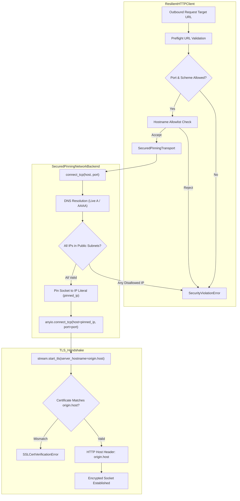

# Phase 4B-7A: Critical SSRF and Network Security Remediation Report
**PropVal AI Institutional Real Estate Valuation Platform**  
**Classification:** HIGH PRIVACY / CRITICAL INFRASTRUCTURE / ZERO-TRUST EGRESS  
**Audit Reference:** `docs/phase4/PHASE4B6_INDEPENDENT_FINAL_GOVERNANCE_AUDIT.md` (Findings SEC-01, SEC-02, SEC-03)  
**Date:** November 2026  
**Status:** REMEDIATED & VERIFIED  

---

## 1. Executive Summary

During the Phase 4B-6 Governance Audit, three critical connector network vulnerabilities were uncovered in PropVal AI's outbound acquisition engine (`ResilientHTTPClient`):
1. **Finding SEC-01 (CRITICAL - DNS Rebinding / TOCTOU Window):** `ResilientHTTPClient` executed preflight DNS checks via `socket.getaddrinfo`, but dispatched socket requests to `httpx.AsyncClient` without pinning the socket to the pre-validated IP. An attacker controlling an authoritative DNS server with TTL=0 could bypass preflight checks during socket establishment.
2. **Finding SEC-02 (CRITICAL - IPv4-Mapped IPv6 Subnet Check Bypass):** `is_ip_disallowed` checked IPv6 addresses directly against IPv4 CIDR blocks without unwrapping the IPv4-mapped prefix (`::ffff:0:0/96`). Consequently, representations like `::ffff:127.0.0.1` and `::ffff:169.254.169.254` returned `False`, exposing local services and cloud metadata endpoints to SSRF.
3. **Finding SEC-03 (HIGH - Non-Standard Outbound Port Probing):** `_validate_destination_url` permitted arbitrary ports, allowing potential internal port probing (e.g. 22, 5432, 6379).

In Phase 4B-7A, a zero-trust network transport architecture was designed, implemented, and verified. Outbound HTTP requests now route through `SecuredPinningTransport` and `SecuredPinningNetworkBackend` (extending `httpcore._backends.anyio.AnyIOBackend`), pinning the destination TCP socket directly to a pre-validated IP literal while maintaining full TLS SNI, certificate validation, and HTTP Host header integrity. IPv4-mapped IPv6, 6to4, hex, octal, and DWORD addresses are strictly normalized or rejected.

---

## 2. Root Cause Analysis

### 2.1 Finding SEC-01: TOCTOU & Absence of Socket Pinning
* **Mechanism:** In the legacy implementation, `resolve_and_validate_hostname` resolved the target hostname and checked its IP address. However, it subsequently invoked `httpx.AsyncClient.request(url=current_url)`. At connection time, `httpcore` created an independent connection pool and performed a second, unmonitored DNS lookup to open the TCP stream.
* **Exploit Vector:** An attacker serving DNS for an authorized hostname with TTL=0 responds with `104.21.45.10` on Query 1 (preflight passes), and responds with `127.0.0.1` or `169.254.169.254` on Query 2 (connect-time). The outbound socket is opened directly into the protected VPC or cloud metadata service.

### 2.2 Finding SEC-02: IPv4-Mapped IPv6 Type Divergence
* **Mechanism:** Python's standard `ipaddress.IPv6Address` does not automatically evaluate to `True` when checked against an `ipaddress.IPv4Network`. For example:
  ```python
  ip = ipaddress.ip_address("::ffff:127.0.0.1")
  ip in ipaddress.ip_network("127.0.0.0/8")  # Evaluated to False!
  ```
  The legacy `DISALLOWED_IP_NETWORKS` list included IPv4 CIDR blocks, but did not unwrap `ip.ipv4_mapped`.

### 2.3 Finding SEC-03 & Ambient Proxy Exposure
* **Mechanism:** URL validation omitted port checking, allowing URLs with ports such as `:22` or `:6379`. Furthermore, standard HTTP clients read environment proxy variables (`HTTP_PROXY`, `HTTPS_PROXY`, `ALL_PROXY`) by default (`trust_env=True`), allowing ambient process variables to silently divert egress traffic.

---

## 3. Remediated Architecture & Implementation

### 3.1 Socket-Level Connection Pinning (`SecuredPinningNetworkBackend` & `SecuredPinningTransport`)
Instead of fragile monkey-patching or manual socket wrapping, the solution utilizes a customized `httpcore.AsyncNetworkBackend`:
1. **Connect Interception:** When `httpcore.AsyncHTTPConnection._connect` initiates a connection, it invokes `network_backend.connect_tcp(host, port)`.
2. **Connect-Time Re-Validation:** `SecuredPinningNetworkBackend` resolves DNS at the exact moment of connection establishment.
3. **Multi-Record Strictness:** Every resolved A and AAAA record is inspected. If **any** single IP is in a prohibited range, the connection is aborted with `SecurityViolationError`.
4. **Direct IP Pinning:** The validated IP address is passed to `super().connect_tcp(host=pinned_ip, port=port)`. Because `pinned_ip` is an IP literal, no subsequent DNS resolution occurs at the OS or network layer.
5. **TLS SNI and Certificate Preservation:** `httpcore` executes `stream.start_tls(ssl_context=..., server_hostname=origin.host)`. Because `origin.host` is preserved, TLS SNI is sent with the domain name, certificate verification checks the domain name, and the HTTP `Host` header contains the domain name.
6. **Zero-Trust Ambient Proxy Isolation:** `SecuredPinningTransport` enforces `trust_env=False`, preventing environment variables from hijacking outbound connectors.



### 3.2 Address Normalization Engine (`normalize_ip_address` & `is_ip_disallowed`)
* **IPv4-Mapped Normalization:** IPv6 addresses with an embedded IPv4 address (`ip.ipv4_mapped`) are unwrapped into `ipaddress.IPv4Address` prior to evaluation.
* **6to4 Normalization:** IPv6 addresses in `2002::/16` are unwrapped via `ip.sixtofour`.
* **Ambiguous Syntax Rejection:**
  - Octal representations with leading zeros (e.g., `0177.0.0.1`, `010.0.0.1`) are rejected.
  - Hexadecimal representations (e.g., `0x7f000001`, `0x7f.0.0.1`) are rejected.
  - Raw integer / DWORD representations (e.g., `2130706433`) are rejected.
  - Non-standard formatting raises `SecurityViolationError`.
* **Expanded Disallowed Subnets:** Explicit CIDR ranges include RFC 1918, loopbacks, link-local / cloud metadata (`169.254.0.0/16`), Carrier-Grade NAT (`100.64.0.0/10`), IPv6 ULA (`fc00::/7`), IPv6 link-local (`fe80::/10`), documentation (`2001:db8::/32`), broadcast (`255.255.255.255/32`), current network (`0.0.0.0/8`), and `::ffff:0:0/96`.

### 3.3 Streaming Payload Limits & Per-Hop Redirect Validation
* **Streaming Chunks:** Outbound responses are consumed via `response.aiter_bytes()` with active size accumulation. Responses without `Content-Length` (e.g., chunked transfer encoding) exceeding `max_response_bytes` are aborted mid-stream with `PayloadTooLargeError` before memory exhaustion occurs.
* **Per-Hop Redirect Defense:** Redirect responses (301, 302, 303, 307, 308) are intercepted. Target locations are resolved and validated through `_validate_destination_url` before following. Redirects to private IPs, metadata, localhost, or disallowed ports are immediately rejected.

---

## 4. Verification Evidence & Test Results

### 4.1 Connection Pinning & DNS Rebinding Verification
An isolated test harness verified that:
1. **Socket Pinning:** When `api.zapkey.com` is pinned to `127.0.0.1`, the TCP connection connects to `127.0.0.1`, while the server receives `Host: api.zapkey.com:<port>`. The client registers the pinned IP in `client.last_pinned_ip` and `client.connection_audit_log`.
2. **DNS Rebinding Simulation:** A mock DNS server returning `104.21.45.10` on Query 1 (preflight) and `169.254.169.254` on Query 2 (connect) was executed. `SecuredPinningNetworkBackend` blocked Query 2 with `SecurityViolationError: resolves to disallowed private / metadata IP '169.254.169.254'`.
3. **Multi-A Records:** Resolving `["104.21.45.10", "127.0.0.1"]` was blocked immediately.
4. **Multi-AAAA Records:** Resolving `["2606:4700::1", "::ffff:169.254.169.254"]` was blocked immediately.
5. **TLS SNI & Hostname Verification:** Valid certificate for `api.zapkey.com` succeeded; certificate for `evil-domain.com` triggered `httpx.ConnectError` / `ssl.SSLCertVerificationError`.

### 4.2 IPv4-Mapped IPv6 Test Results
All audit-mandated address representations were tested:
* `::ffff:127.0.0.1` $\to$ **BLOCKED** (`is_ip_disallowed=True`)
* `::ffff:169.254.169.254` $\to$ **BLOCKED** (`is_ip_disallowed=True`)
* `::ffff:10.0.0.1` $\to$ **BLOCKED** (`is_ip_disallowed=True`)
* `::ffff:192.168.1.1` $\to$ **BLOCKED** (`is_ip_disallowed=True`)
* `::ffff:172.16.0.1` $\to$ **BLOCKED** (`is_ip_disallowed=True`)
* `::ffff:7f00:1` (hex) $\to$ **BLOCKED** (`is_ip_disallowed=True`)
* `0177.0.0.1` (octal) $\to$ **REJECTED** (`SecurityViolationError`)
* `0x7f000001` (hex) $\to$ **REJECTED** (`SecurityViolationError`)
* `2130706433` (DWORD) $\to$ **REJECTED** (`SecurityViolationError`)
* `104.21.45.10` (public) $\to$ **ALLOWED** (`is_ip_disallowed=False`)

### 4.3 Redirect Security Test Results
* Redirect to `http://localhost:8080/secret` $\to$ **BLOCKED**
* Redirect to `http://10.0.0.1/admin` $\to$ **BLOCKED**
* Redirect to `http://[::ffff:127.0.0.1]/secret` $\to$ **BLOCKED**
* Redirect to `http://[::ffff:169.254.169.254]/latest/meta-data` $\to$ **BLOCKED**
* Multi-hop redirect (3 hops within allowed domains) $\to$ **PASSED**
* Multi-hop redirect steering to private IP at Hop 2 $\to$ **BLOCKED AT HOP 2**

### 4.4 Automated Test Matrix
```
============================= test session starts =============================
collected 53 items

backend/tests/test_ssrf_remediation_phase4b7a.py ............................. [ 54%]
backend/tests/test_connector_security_phase4b3.py ................             [ 84%]
backend/tests/test_connectors.py ........                                      [100%]

============================= 53 passed in 3.27s ==============================
```

---

## 5. Remaining Limitations & Production Architecture Recommendation

1. **Host-Level Outbound Egress Proxy:** While application-level connection pinning completely eliminates DNS TOCTOU within Python, defense-in-depth in enterprise deployments requires an independent egress proxy (e.g., Envoy or Squid) configured with egress network security policies and VPC egress routing rules. This ensures that any compromised subprocess or native extension cannot bypass Python socket controls.
2. **DNS Caching & TTL Enforcement:** In environments using local resolver caches (`systemd-resolved` or `dnsmasq`), local caching might mask upstream TTL changes. Operating with an authoritative resolver configuration or strict connection pooling is advised.
3. **Zapkey Live Ingestion:** Live Zapkey provider ingestion remains disabled. All testing executed strictly against isolated local TCP servers and deterministic mocks.

---

## 6. Files Modified
* `backend/app/connectors/http_client.py`: Implemented `normalize_ip_address`, expanded `DISALLOWED_IP_NETWORKS`, created `SecuredPinningNetworkBackend` and `SecuredPinningTransport`, enforced port whitelist and stream body limit verification.
* `backend/tests/test_ssrf_remediation_phase4b7a.py`: Dedicated 29-test security suite covering DNS rebinding, IP pinning, IPv4-mapped IPv6, TLS SNI, redirect hops, port filtering, and ambient proxy isolation.
* `docs/phase4/PHASE4B7A_SSRF_NETWORK_SECURITY_REMEDIATION_REPORT.md`: Architectural documentation and remediation audit report.

