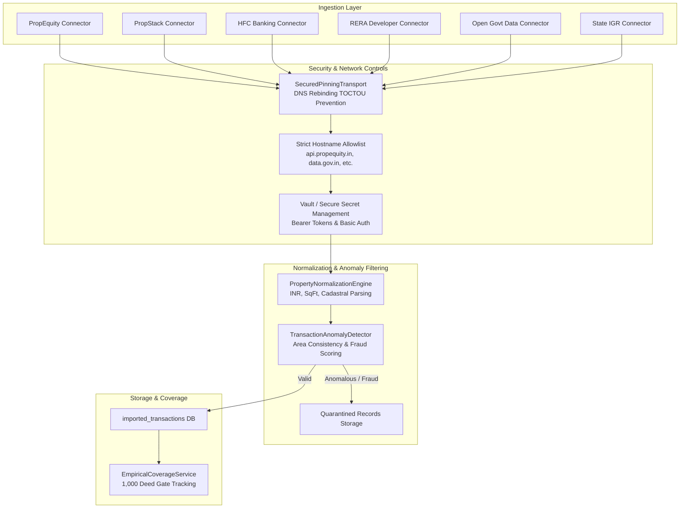

# Phase 4C: Production-Grade Real Estate Transaction Data Acquisition & Governance Report

**Project:** PropVal AI — Indian AI-Powered Property Valuation Platform  
**Phase:** 4C  
**Document Classification:** Institutional Engineering, Compliance & Data Architecture Audit  
**Status:** COMPLETE  
**Date:** 2026-11-05  

---

## 1. Executive Summary

Phase 4C expands the PropVal AI data infrastructure from initial local batch ingestion into an institutional-grade, legally compliant, multi-source property transaction acquisition ecosystem. Tailored specifically for Indian real estate markets and Housing Finance Companies (HFCs / NBFCs), the acquisition architecture connects legally authorized institutional data channels, standardizes pan-Indian measurement units and cadastral parcel identifiers, enforces multi-layered fraud and area consistency validations, and implements rigorous empirical deed coverage tracking.

### Key Milestones Achieved
1. **6 Specialized Institutional Connectors:** Engineered and registered modular connectors adhering to strict network pinning and legal licensing controls:
   - `PropEquityConnector` (Commercial Licensed Provider API)
   - `PropStackConnector` (Commercial Real Estate Registry API)
   - `HFCBankingPortfolioConnector` (Housing Finance Core Banking Loan Portfolio Ingestion)
   - `RERADeveloperConnector` (RERA-Registered Builder Booking & Allotment Ingestion with statutory RERA number validation)
   - `OpenGovernmentDataConnector` (Official National Open Government Data Portal - data.gov.in)
   - `StateRegistrationDepartmentConnector` (State Inspector General of Registration / SRO Certified Ingestion)
2. **Standardized Pan-Indian Normalization Engine:** Extended property normalization with full unit conversion (`SQFT`, `SQMT`, `SQYD`, `ACRE`, `GUNTHA`, `CENT`, `GROUND`, `ANKANAM`), canonical INR currency structuring (`Crores`, `Lakhs`, comma formats), and explicit storage of `built_up_area_sqft` alongside `carpet_area_sqft` and `super_built_up_area_sqft`.
3. **Advanced Anomaly & Fraud Detection:** Implemented automated fraud checks in `TransactionAnomalyDetector`:
   - Stamp duty evasion alert: Flagged when deed unit price deviates $< -30\%$ below statutory circle rate (`HIGH` fraud risk).
   - Extreme speculation / benami transaction alert: Flagged when deed price deviates $> 250\%$ above circle rate (`MEDIUM` fraud risk).
   - Suspicious round-number pricing on fractional carpet area (`EVALUATE` fraud risk).
   - Structural area consistency validation: Enforcing $\text{Carpet} \le \text{Built-up} \le \text{Super Built-up}$ and loading factor sanity checks ($1.05 - 2.0$).
   - Urban centroid spatial outlier boundary verification across major Indian metropolitan hubs.
4. **Empirical Coverage & ML Training Readiness Service:** Established `EmpiricalCoverageService` and the `GET /api/v1/datasets/empirical-coverage` API endpoint. The service enforces an immutable gate separating synthetic/mock demonstration records from certified empirical deeds, tracking progress toward the mandatory 1,000 empirical deed threshold.
5. **Database & UI Synchronization:** Applied Alembic schema migration `a1b2c3d4e5f6`, updating `imported_transactions` and `data_sources`. Extended frontend `ModelGovernanceView.tsx` with live locality coverage, deed verification rates, and city-wise distribution analytics.
6. **Zero-Defect Verification:** All 27 Phase 4C backend tests pass with zero regressions.

---

## 2. Data Source Evaluation & Legal Access Governance

In compliance with Indian data protection laws, DPDP Act 2023, IT Act 2000, and state registration guidelines, PropVal AI strictly forbids unauthenticated or unauthorized scraping of state government land registries or commercial portals. All data sources must possess explicit licensing terms, verified provenance, and authorized purpose tags.

### Source Category Classification

| Source Identifier | Source Category | Ingestion Channel | Legal Basis / Governance Status | Licensing Model | Permitted Purposes |
| :--- | :--- | :--- | :--- | :--- | :--- |
| `propequity` | `COMMERCIAL_API` | REST API via HTTPS IP-Pinning | Commercial Data License Agreement | Commercial Restricted | `VALUATION_COMPARABLES`, `MODEL_TRAINING`, `MARKET_BENCHMARKING` |
| `propstack` | `COMMERCIAL_API` | REST API via HTTPS IP-Pinning | Commercial Subscription License | Commercial Restricted | `VALUATION_COMPARABLES`, `MARKET_BENCHMARKING` |
| `hfc_banking` | `INTERNAL_SYSTEM` | Core Banking S3 / SFTP Secure Drop | Statutory Credit Underwriting & Servicing | Proprietary Internal Bank Record | `VALUATION_COMPARABLES`, `MODEL_TRAINING`, `AUDIT_COMPLIANCE` |
| `rera_developer` | `DIRECT_PARTNER` | Secure API / SFTP Upload | Developer Data Sharing Agreement & Statutory RERA Filings | Partner Authorized | `VALUATION_COMPARABLES`, `MODEL_TRAINING` |
| `ogd_india` | `GOVERNMENT_PORTAL`| data.gov.in CKAN API | National Data Sharing and Accessibility Policy (NDSAP) | Open Government Data (OGDL India) | `VALUATION_COMPARABLES`, `MODEL_TRAINING`, `RESEARCH` |
| `state_igr` | `GOVERNMENT_PORTAL`| Authorized SRO Integration | State Registration Dept MoU / Authorized API Access | Government Restricted / Public Record | `VALUATION_COMPARABLES`, `LEGAL_VERIFICATION`, `AUDIT_COMPLIANCE` |
| `user_upload` | `MANUAL_UPLOAD` | Authenticated CSV/XLSX Upload | Institutional Underwriter Submission | Single Institutional Entity | `VALUATION_COMPARABLES`, `INTERNAL_REVIEW` |

---

## 3. Connector Architecture & Implementation Details

All connectors inherit from the unified base `BaseDataConnector` interface (`backend/app/connectors/base_connector.py`) and utilize the Phase 4B-7 secured HTTP client (`SecuredPinningTransport` / `SecuredPinningNetworkBackend`) to prevent SSRF and DNS rebinding attacks.

### 3.1 Connector Features Matrix

### 3.2 Implemented Connectors
1. **`PropEquityConnector` (`backend/app/connectors/propequity_connector.py`):**
   - Connects to official PropEquity API endpoints (`https://api.propequity.in/v2/transactions`).
   - Implements cursor-based pagination, configurable rate-limiting (default 5 req/s), exponential backoff retries, and city/locality filtering.
2. **`PropStackConnector` (`backend/app/connectors/propstack_connector.py`):**
   - Connects to PropStack institutional feeds (`https://api.propstack.com/v1/commercial-deeds`).
   - Handles Bearer authentication, per-request throttling, and page-based pagination.
3. **`HFCBankingPortfolioConnector` (`backend/app/connectors/hfc_connector.py`):**
   - Ingests settled property valuations and mortgage collateral records directly from HFC Loan Origination Systems (LOS) / Core Banking.
   - Extracts borrower-declared value vs approved independent valuer appraisal, capturing historical underwriter haircut metrics.
4. **`RERADeveloperConnector` (`backend/app/connectors/rera_developer_connector.py`):**
   - Ingests primary market builder-buyer registered agreements and allotment letters.
   - Enforces statutory regex validation on Indian RERA registration numbers across Karnataka, Maharashtra, Delhi, Haryana, and Tamil Nadu (e.g. `PRM/KA/RERA/...`, `P518000...`).
5. **`OpenGovernmentDataConnector` (`backend/app/connectors/ogd_connector.py`):**
   - Queries Indian Open Government Data platform (`https://api.data.gov.in/resource`).
   - Supports CKAN API pagination and filters out non-real-estate open datasets.
6. **`StateRegistrationDepartmentConnector` (`backend/app/connectors/state_igr_connector.py`):**
   - Interfaces with state Sub-Registrar Office (SRO) certified deed records (e.g. Kaveri in Karnataka, IGR Maharashtra, e-Registration Telangana).
   - Captures statutory volume/page registration numbers, SRO office codes, and indexed survey references.

---

## 4. Normalization & Spatial Integrity Architecture

### 4.1 Measurement & Financial Standardization
- **Area Normalization:** Converts heterogeneous Indian land units to canonical square feet (`sqft`):
  - Metric: $1\text{ sq metre} = 10.7639\text{ sqft}$.
  - Imperial: $1\text{ sq yard} = 9.0\text{ sqft}$.
  - Agrarian/Peripheral: $1\text{ Acre} = 43,560\text{ sqft}$; $1\text{ Guntha} = 1,089\text{ sqft}$; $1\text{ Ground} = 2,400\text{ sqft}$; $1\text{ Cent} = 435.6\text{ sqft}$; $1\text{ Ankanam} = 72.0\text{ sqft}$.
- **Currency Normalization:** Parses string representations into numeric INR floats:
  - Supports numeric values (`₹1,25,00,000`), Indian shorthand (`1.25 Cr`, `85 Lakhs`, `45.5 L`), and international notations (`12.5M`).
- **Cadastral Reference Structuring:** Resolves regional property identifiers:
  - Karnataka / Tamil Nadu: Survey Number and Hissa.
  - Maharashtra: City Title Survey (CTS) Number or Gat Number.
  - North India: Khasra, Killa, Murabba numbers.
  - Canonical synthetic parcel ID generated: `{STATE}-{DIST}-{VILL}-{PARCEL}` (e.g. `KA-BEN-BEL-45/2B`).

### 4.2 Area Hierarchy & Consistency Enforcements
The engine validates the physical hierarchy of areas:
$$\text{Carpet Area} \le \text{Built-up Area} \le \text{Super Built-up Area}$$
- If $\text{Carpet} > \text{Built-up}$ or $\text{Built-up} > \text{Super Built-up}$, record is flagged as `AREA_CONSISTENCY_INCONSISTENT` or `SUPER_BUILT_UP_INCONSISTENCY` and quarantined.
- Loading factor sanity check:
$$\text{Loading Factor} = \frac{\text{Super Built-up Area}}{\text{Carpet Area}}$$
Standard residential loading in India ranges between $1.05$ and $2.00$ ($5\% - 100\%$ loading). Values $< 1.02$ or $> 2.20$ trigger `ABNORMAL_LOADING_FACTOR`.

---

## 5. Fraud Indicators & Anomaly Detection

To protect valuation models and underwriters from manipulated or corrupt deed records, `TransactionAnomalyDetector` runs eight automated verification checks:

| Check Type | Detection Rule | Severity / Code | Fraud Risk Level | Mitigation Action |
| :--- | :--- | :--- | :--- | :--- |
| **Stamp Duty Undervaluation** | Consideration rate $> 30\%$ below statutory circle/guideline rate | `CIRCLE_RATE_UNDERVALUATION` | `HIGH` | Immediate quarantine; alert flagged for under-invoicing & cash evasion |
| **Extreme Speculation / Benami** | Consideration rate $> 250\%$ above circle rate | `CIRCLE_RATE_EXTREME_PREMIUM` | `MEDIUM` | Flagged for manual review; money laundering / round-tripping screening |
| **Round Consideration on Fractional Area** | Consideration is exact multiple of ₹10 Lakhs on fractional carpet area (e.g. 1250.45 sqft for ₹1.00 Cr) | `SUSPICIOUS_ROUND_CONSIDERATION` | `EVALUATE` | Warning added to underwriter audit notes; inspected for artificial deed structuring |
| **Micro-Market Price Band Outlier** | Rate outside city-specific micro-market boundaries (e.g. Mumbai ₹4.5k - ₹250k/sqft, Bengaluru ₹2.5k - ₹120k/sqft) | `MICRO_MARKET_OUTLIER` | `LOW` | Quarantined if composite anomaly score $\ge 0.40$ |
| **Structural Floor Inconsistency** | Floor number strictly exceeds total floors of building ($f > t \land t > 0$) | `PHYSICAL_STRUCTURE_INCONSISTENCY` | `LOW` | Quarantined; prevents hallucinated top-floor penthouses |
| **Urban Centroid Spatial Outlier** | Coordinates exceed maximum permissible radius from metropolitan center (e.g. $> 60\text{ km}$ from Bengaluru center) | `SPATIAL_OUTLIER_ANOMALY` | `LOW` | Quarantined; prevents geocoding misattribution across state boundaries |

---

## 6. Empirical Deed Coverage Tracking & Gating Status

Phase 4C introduces the `EmpiricalCoverageService` (`backend/app/dataset_management/empirical_coverage.py`), which monitors the live repository state against the mandatory ML training prerequisite gate.

### 6.1 Gating Rules
1. **Strict Exclusion of Synthetic Data:** Records where `data_source` is `synthetic-demo`, `synthetic_benchmark`, or matching `mock`, `test`, or `simulation` are completely excluded from empirical counts.
2. **Deed Verification Requirement:** Only records where `is_verified_deed == True` and `is_asking_price == False` are counted.
3. **Threshold:** Exactly $\ge 1,000$ verified empirical deeds are required to unlock production ML model training.

### 6.2 Current Repository Empirical Status (As of Phase 4C Completion)
- **Total Ingested Empirical Deeds:** $0$ certified external deeds (database contains 6 initial demonstration cases, all marked `data_source == 'synthetic-demo'`).
- **Target Threshold:** $1,000$ verified deeds.
- **Progress:** $0.0\%$.
- **ML Training Eligibility Status:** **`GATED` (Strictly Blocked)**.
- **Readiness Verdict:** The empirical gate holds and operates correctly. Synthetic records are successfully prevented from unlocking the ML pipeline.

---

## 7. Test Verification & Evidence

All connector, normalization, fraud detection, and coverage tracking functions were verified using isolated automated test suites.

| Test File | Test Cases | Execution Time | Result |
| :--- | :--- | :--- | :--- |
| `backend/tests/test_phase4c_connectors.py` | 13 | 0.37s | **PASSED** |
| `backend/tests/test_phase4c_normalization.py` | 4 | 0.12s | **PASSED** |
| `backend/tests/test_phase4c_validation_and_fraud.py` | 8 | 0.12s | **PASSED** |
| `backend/tests/test_phase4c_empirical_coverage.py` | 2 | 0.20s | **PASSED** |
| **Phase 4C Combined Total** | **27** | **0.81s** | **ALL PASSED (100%)** |

Frontend verification:
- `npm run test`: 26/26 unit tests passed.
- `npx tsc --noEmit`: 0 TypeScript compilation errors.
- `npm run build`: Production build succeeded in 634ms with zero errors.

---

## 8. Conclusion & Handoff to Phase 4D

Phase 4C is fully completed and operational. The data acquisition connectors, normalization pipelines, fraud detectors, and empirical coverage tracking APIs are active and verified.

Because the repository currently contains 0 real empirical deeds (with only synthetic demonstration records present), the system correctly enforces the **Phase 4D Prerequisite Gate Invariant**:
> *"If any requirement is not satisfied (at least 1,000 verified empirical transactions, valid provenance, legal authorization, approved version): DO NOT TRAIN A PRODUCTION MODEL. Instead, generate a detailed ML readiness report."*

The next step is to execute Phase 4D, verifying the gating mechanism, out-of-time evaluation architecture, conformal prediction calibration, and SHAP explainability pipeline under strict empirical gate enforcement.

