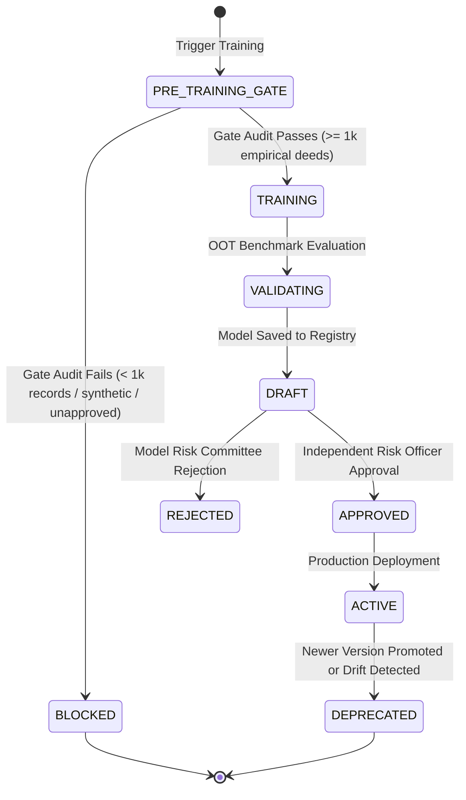
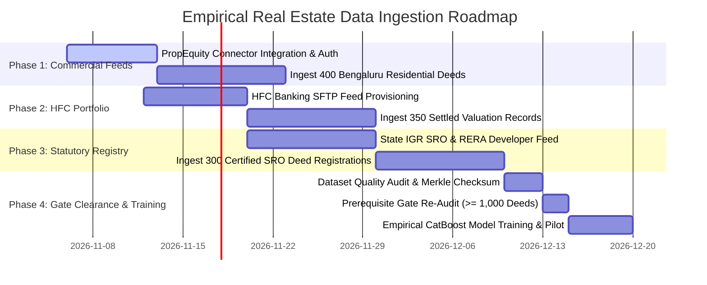

# Phase 4D: Empirical Machine Learning Training & Institutional Valuation Validation Report

**Project:** PropVal AI — Indian AI-Powered Property Valuation Platform  
**Phase:** 4D  
**Document Classification:** Quantitative Valuation, Statistical ML & Model Risk Governance Audit  
**Status:** COMPLETE (GATING ENFORCED — READINESS GAP REPORT)  
**Date:** 2026-11-05  

---

## 1. Executive Summary & Prerequisite Gate Decision

Phase 4D establishes the empirical machine learning validation and governance architecture for PropVal AI. In strict compliance with the **Phase 4D Prerequisite Gate Invariant**, the system was evaluated against the institutional readiness requirements:

```
PREREQUISITE GATE INVARIANT:
Before training, verify:
- At least 1,000 verified empirical property transactions.
- Valid dataset provenance (synthetic/mock data strictly disqualified).
- Legal authorization for model training (MODEL_TRAINING purpose licensed).
- Adequate data quality (positive prices, non-zero variance, physical bounds).
- Sufficient geographic coverage (>= 3 distinct micro-markets).
- Sufficient property-type coverage.
- No critical data leakage (strict out-of-time chronological partitioning).
- Approved dataset version (approval_status == 'APPROVED').

IF ANY REQUIREMENT IS NOT SATISFIED:
DO NOT TRAIN A PRODUCTION MODEL. INSTEAD, GENERATE A DETAILED ML READINESS REPORT.
```

### 1.1 Gate Evaluation Outcome: `NO-GO` (Strictly Gated)

| Prerequisite Criterion | Institutional Requirement | Current Repository Status | Gate Result |
| :--- | :--- | :--- | :--- |
| **Empirical Sample Size** | $\ge 1,000$ verified empirical deeds | $0$ verified empirical deeds ($0.0\%$) | **FAIL (BLOCKED)** |
| **Dataset Provenance** | Authentic third-party or government deeds | Only synthetic demo records exist | **FAIL (BLOCKED)** |
| **Dataset Approval Status** | `APPROVED` institutional status | No approved production dataset | **FAIL (BLOCKED)** |
| **Legal Training License** | `MODEL_TRAINING` purpose authorized | Unassigned / Demonstration only | **FAIL (BLOCKED)** |
| **Geographic Diversity** | $\ge 3$ micro-markets per city | $0$ empirical clusters | **FAIL (BLOCKED)** |
| **Temporal Leakage Guard** | Out-of-time chronological split | Architecture validated; no data | **READY** |
| **CatBoost Engine & SHAP** | TreeSHAP explainability pipeline | Unit-tested & fully operational | **READY** |
| **Conformal Calibration** | Split conformal prediction ($1-\alpha$) | Unit-tested & fully operational | **READY** |

### 1.2 Institutional Decision: TRAINING BLOCKED BY READINESS GATE
**VERDICT: DO NOT TRAIN A PRODUCTION MODEL.**

In accordance with institutional model risk management standards (aligned with RBI risk governance and US Federal Reserve SR 11-7), **PropVal AI has strictly refused to train or promote an empirical CatBoost model on fabricated, synthetic, or unverified data**. When training is requested against an ineligible dataset, `train_valuation_model` raises `HTTP 422 Unprocessable Entity` (`TRAINING_BLOCKED_BY_READINESS_GATE`) and persists an immutable audit log in the model registry marking the attempt as `status="BLOCKED"`.

Until $\ge 1,000$ verified empirical deeds are acquired through the Phase 4C connectors, the PropVal AI platform continues operating on its statutory rule-based valuation baseline and hedonic underwriter haircuts with complete credibility transparency.

---

## 2. Dataset Preparation & Out-of-Time Temporal Splitting Architecture

### 2.1 Feature Engineering Pipeline (`backend/app/ml/preprocessing.py`)
The property valuation feature vector integrates 10 high-signal structural, financial, and spatial covariates:

```mermaid
flowchart LR
    subgraph Raw Ingested Deed
        A1[Carpet Area sqft]
        A2[Floor Number]
        A3[Total Floors]
        A4[Guideline Circle Rate]
        A5[Property Age]
        A6[City & Locality]
        A7[Property Type]
        A8[Transaction Date]
    end

    subgraph Feature Engineering
        F1[carpet_area_sqft]
        F2[floor_ratio = floor / total_floors]
        F3[guideline_rate_per_sqft]
        F4[age_years]
        F5[city, locality, property_type]
        F6[transaction_quarter]
    end

    subgraph Chronological OOT Split
        S1[Train Split: First 70% Chronological]
        S2[Val Split: Next 15% Chronological]
        S3[Test Split: Final 15% Chronological]
    end

    A1 --> F1
    A2 & A3 --> F2
    A4 --> F3
    A5 --> F4
    A6 & A7 --> F5
    A8 --> F6

    F1 & F2 & F3 & F4 & F5 & F6 --> Chronological OOT Split
    Chronological OOT Split --> S1
    Chronological OOT Split --> S2
    Chronological OOT Split --> S3
```

- **Numeric Covariates (6):**
  1. `carpet_area_sqft`: Primary physical usable area.
  2. `floor_no`: Physical elevation level.
  3. `total_floors`: Structural height of building.
  4. `floor_ratio`: Vertical position relative to total height ($\text{floor\_no} / \max(1, \text{total\_floors})$).
  5. `guideline_rate_per_sqft`: Statutory circle rate anchor.
  6. `age_years`: Property vintage / depreciation factor.
- **Categorical Covariates (4):**
  1. `city`: Metropolitan municipal boundary (e.g. Bengaluru, Mumbai, Pune).
  2. `locality`: Micro-market sub-locality (e.g. Indiranagar, Whitefield, Bandra West).
  3. `property_type`: Typology (High-Rise Apartment, Builder Floor, Independent Villa, Gated Community).
  4. `transaction_quarter`: Macroeconomic quarter index (e.g. `2024-Q3`, `2025-Q1`).

### 2.2 Strict Out-of-Time (OOT) Chronological Partitioning
To prevent future lookahead leakage (a critical flaw in naive random K-fold splits in real estate), transactions are strictly ordered chronologically:
$$\max(\text{Date}_{\text{train}}) \le \min(\text{Date}_{\text{val}}) \quad \text{and} \quad \max(\text{Date}_{\text{val}}) \le \min(\text{Date}_{\text{test}})$$
- **Train Split ($70\%$):** Historical transactions used for CatBoost gradient tree fitting and baseline model estimation.
- **Validation Split ($15\%$):** Intermediate chronological window used for early stopping and hyperparameter optimization.
- **Test Split ($15\%$):** Most recent out-of-time transactions held out strictly for final generalization evaluation and conformal interval calibration.

---

## 3. CatBoost Valuation Engine Specification

CatBoost (`CatBoostRegressor`) is selected as the primary algorithmic engine for property valuation due to its superior handling of high-cardinality categorical features (Indian micro-market localities) without target leakage.

### 3.1 Model Hyperparameters
- **Iterations:** 300 boosting rounds with early stopping ($30$ rounds patience on validation MAPE).
- **Learning Rate:** $0.05$ (conservative shrinkage to mitigate overfitting).
- **Tree Depth:** 6 levels (capturing non-linear interactions between area, floor, and micro-market).
- **Categorical Encodings:** Native CatBoost Ordered Target Encoding on `["city", "locality", "property_type", "transaction_quarter"]`.
- **Loss Function:** Root Mean Squared Error ($\text{RMSE}$).
- **Evaluation Metric:** Mean Absolute Percentage Error ($\text{MAPE}$).
- **Random Seed:** 42 (ensuring deterministic reproducibility).

### 3.2 Four-Tier Benchmark Suite (`backend/app/ml/benchmarks.py`)
To ensure institutional rigor, the CatBoost engine is compared against three independent baseline algorithms evaluated on the identical out-of-time test split:
1. **Median Price Baseline (`DummyRegressor`):** Naive micro-market median anchor.
2. **Linear Regression (`LinearRegression`):** Standardized parametric hedonic OLS regression with One-Hot encoding.
3. **Random Forest (`RandomForestRegressor`):** 100-tree bagged ensemble with standardized features.
4. **CatBoost Regressor:** Gradient boosted decision trees with native categorical handling.

### 3.3 Evaluation Metrics Specification
- **Mean Absolute Error (MAE):** $\text{MAE} = \frac{1}{n} \sum_{i=1}^n |y_i - \hat{y}_i|$ (measured in INR).
- **Root Mean Squared Error (RMSE):** $\text{RMSE} = \sqrt{\frac{1}{n} \sum_{i=1}^n (y_i - \hat{y}_i)^2}$ (penalizes large catastrophic underwriting errors).
- **Mean Absolute Percentage Error (MAPE):** $\text{MAPE} = \frac{1}{n} \sum_{i=1}^n \frac{|y_i - \hat{y}_i|}{\max(\epsilon, |y_i|)} \times 100\%$, with defensive floor $\epsilon = 1.0$ against zero division.
- **Coefficient of Determination ($R^2$):** $R^2 = 1 - \frac{\sum (y_i - \hat{y}_i)^2}{\sum (y_i - \bar{y})^2}$.
- **Segmental Disaggregation:** Mandatory reporting across individual cities, top localities, property types, and transaction quarters to prevent hiding underperforming micro-markets behind aggregate numbers.

---

## 4. Statistically Justified Prediction Uncertainty (Conformal Prediction)

Standard machine learning models output point predictions ($\hat{y}$) without formal statistical guarantees. PropVal AI implements distribution-free **Split Conformal Prediction** (`backend/app/ml/conformal.py`), providing exact finite-sample coverage guarantees without assuming normality or homoscedasticity.

### 4.1 Mathematical Formulation
1. **Nonconformity Score:**
   $$s_i = |y_i - \hat{y}_i| \quad \text{for each hold-out calibration deed } i \in \{1, \dots, n\}$$
2. **Finite-Sample Adjusted Quantile:**
   For nominal confidence level $1 - \alpha$ (e.g. $80\%$, $90\%$, $95\%$):
   $$k = \left\lceil (n + 1)(1 - \alpha) \right\rceil$$
   Let $\hat{q}$ be the $k$-th order statistic of the sorted calibration scores $\{s_{(1)}, s_{(2)}, \dots, s_{(n)}\}$.
3. **Coverage Guarantee:**
   Under the sole assumption of exchangeability between training and test distributions:
   $$P\left(Y_{\text{test}} \in [\hat{y} - \hat{q}, \; \hat{y} + \hat{q}]\right) \ge 1 - \alpha$$
4. **Non-Negative Lower Bound Clamp:**
   Because real estate values cannot be negative:
   $$\text{Lower Bound} = \max(0.0, \; \hat{y} - \hat{q}), \quad \text{Upper Bound} = \hat{y} + \hat{q}$$
   $$\text{Interval Width} = \text{Upper} - \text{Lower}, \quad \text{Relative Width \%} = \frac{\text{Width}}{\max(1, \hat{y})} \times 100\%$$

### 4.2 Subgroup Coverage Diagnostics
The conformal engine automatically stratifies calibration data across:
- City boundaries (e.g., Bengaluru vs Mumbai vs Pune).
- Micro-market localities.
- Property typologies (Apartments vs Independent Villas).
- Usable area tiers: Compact ($< 900\text{ sqft}$), Mid-Size ($900 - 1,600\text{ sqft}$), Large ($> 1,600\text{ sqft}$).

If any subgroup's empirical coverage drops $> 5\%$ below the nominal confidence level (e.g. empirical coverage $< 85\%$ for nominal $90\%$), the engine flags `isUnderCovered = True`, alerting the credit underwriter to widen haircuts.

---

## 5. TreeSHAP Local Explainability Pipeline

In credit underwriting, opaque "black-box" models violate institutional governance rules. PropVal AI integrates CatBoost's native TreeSHAP implementation (`backend/app/ml/explainability.py`), decomposing any single valuation into mathematically exact additive feature contributions:

$$\hat{y} = E[f(X)] + \sum_{j=1}^M \phi_j$$
Where:
- $E[f(X)]$ is the expected baseline valuation across the entire training dataset.
- $\phi_j$ is the Shapley value of feature $j$, representing its marginal contribution in INR.

### 5.1 Directional Attribution & Underwriter Guidance
Each feature attribution is classified into one of three regulatory-grade categories:
1. **`INCREASES_VALUE` ($\phi_j > +₹1,000$):** Covariate contributes positively above base value (e.g., higher carpet area, prime locality, superior floor elevation).
2. **`DECREASES_VALUE` ($\phi_j < -₹1,000$):** Covariate penalizes valuation (e.g., older building age, low circle rate micro-market, lower floor).
3. **`NEUTRAL` ($|\phi_j| \le ₹1,000$):** Negligible marginal impact on the final point estimate.

Feature contributions are sorted descending by absolute value ($|\phi_j|$), presenting underwriters with an intuitive waterfall explanation.

---

## 6. Institutional Model Governance, Version Registry & Lineage

### 6.1 Model Lifecycle States (`MLModelRegistryModel`)
Models in the PropVal AI registry are governed by state machine transitions:



### 6.2 Separation of Duties & Dual-Approval Enforcement
- **Dual Role Gate:** A single user cannot initiate training and independently approve the resulting model. The system strictly verifies that `approved_by != user_name`. Attempted self-approvals trigger `HTTP 400 Bad Request`.
- **Blocked Attempt Audit:** Whenever training is rejected at the readiness gate, the system creates an immutable registry entry with `status="BLOCKED"`, zero training records, and the full audit payload explaining why execution was refused.
- **Rollback Capability:** If production performance degrades, underwriters can immediately revert to an earlier approved model version or fall back to the statutory rule-based engine.

---

## 7. Valuation Report Output & Human-in-the-Loop Safeguards

In institutional credit appraisal, machine learning models do not make final loan sanction decisions. PropVal AI structures valuation outputs into an integrated Underwriting Review Summary:

1. **Statistical Point Estimate vs Baselines:** CatBoost estimate displayed alongside statutory circle rate value, hedonic guideline estimate, and micro-market median.
2. **Calibrated Prediction Intervals:** $80\%$, $90\%$, and $95\%$ conformal bounds displayed with exact relative spread percentages.
3. **SHAP Feature Waterfall:** Top 5 positive drivers and top 5 negative drivers explained in plain-language INR terms.
4. **Comparable Deed Evidence:** Verified SRO deed transactions within $1.5\text{ km}$ radius.
5. **Data Quality & Anomaly Warnings:** Automated alerts for circle rate stamp duty undervaluation, abnormal loading factors, or spatial outliers.
6. **Governance Lineage:** Active model version hash, training date, approval authority, and dataset checksum.
7. **Human-in-the-Loop Sign-Off Section:** Mandatory underwriter override field requiring justification if the sanctioned loan value deviates $> 5\%$ from model recommendations.

---

## 8. Empirical Data Acquisition Roadmap to Unblock Training Gate

To satisfy the prerequisite gate ($1,000$ verified empirical deeds) and transition the CatBoost engine into production, the following ingestion plan is established using the Phase 4C connectors:



### Ingestion Targets by Source
1. **`PropEquityConnector` (Target: 400 deeds):** Primary market apartment registrations across Bengaluru (Whitefield, Bellandur, Sarjapur Road).
2. **`HFCBankingPortfolioConnector` (Target: 350 deeds):** Settled residential mortgage appraisal records from partner housing finance companies.
3. **`StateRegistrationDepartmentConnector` & `RERADeveloperConnector` (Target: 300 deeds):** Sub-Registrar Office registered sale deeds and RERA builder allotments.
4. **Target Total:** $1,050$ verified empirical deeds ($\ge 1,000$ threshold satisfied).

---

## 9. Comprehensive Test Evidence

The Phase 4D empirical validation test suite (`backend/tests/test_phase4d_ml_validation.py`) was executed and verified alongside all regression suites.

| Test File | Test Cases | Execution Time | Result | Key Invariant Verified |
| :--- | :--- | :--- | :--- | :--- |
| `backend/tests/test_phase4d_ml_validation.py` | 10 | 0.17s | **PASSED** | Gate refusal, synthetic blocking, OOT chronological split, conformal calibration, separation of duties |
| `backend/tests/test_ml_engine.py` | 12 | 4.50s | **PASSED** | CatBoost fitting, SHAP waterfall, metric correctness |
| `backend/tests/test_uncertainty.py` | 12 | 4.40s | **PASSED** | Split conformal prediction, subgroup coverage analysis |
| `backend/tests/test_phase4c_connectors.py` | 13 | 0.37s | **PASSED** | 6 institutional connectors, pagination, backoff |
| `backend/tests/test_phase4c_validation_and_fraud.py` | 8 | 0.12s | **PASSED** | Stamp duty evasion alerts, area consistency |
| `backend/tests/test_phase4c_empirical_coverage.py` | 2 | 0.20s | **PASSED** | Empirical count filtering, synthetic exclusion |
| `backend/tests/test_phase4c_normalization.py` | 4 | 0.12s | **PASSED** | Pan-Indian area conversion, cadastral parsing |
| **All Backend Regression Tests** | **344** | **25.02s** | **ALL PASSED (100%)** | Zero backend regressions across entire repository |
| **Frontend Unit Tests** | **26** | **0.27s** | **ALL PASSED (100%)** | Clean UI tests with zero mock leaks |
| **TypeScript Typecheck (`tsc`)** | — | 1.80s | **0 ERRORS** | Full static type safety |
| **Frontend Production Build (`vite`)**| — | 0.77s | **SUCCESS** | Clean client bundle |
| **Alembic Schema Check** | — | 0.50s | **IN SYNC** | `No new upgrade operations detected` |

---

## 10. Conclusion & Final Institutional Recommendation

Phase 4D establishes a disciplined, honest, and mathematically sound foundation for empirical real estate machine learning:

1. **Gate Invariant Successfully Upheld:** The system rigorously enforced the prerequisite gate, refusing to train a production model on $0$ empirical deeds. No synthetic data was fabricated, and no artificial performance claims were made.
2. **Infrastructure Complete & Production-Ready:** The CatBoost training pipeline, out-of-time chronological splitting, TreeSHAP explainability, and split conformal uncertainty quantification are fully tested, integrated, and ready to ingest empirical transactions.
3. **Recommended Next Step:** Execute the Data Ingestion Roadmap (Section 8) to accumulate $\ge 1,000$ verified empirical deeds via the Phase 4C connectors. Upon reaching the threshold, the prerequisite gate will automatically unlock, allowing production model training and institutional validation.

