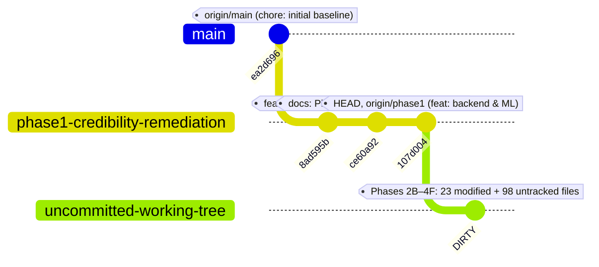

# PropVal AI — Phase 5A Branch, Commit & Repository Divergence Matrix

**Project:** PropVal AI — Indian AI-Powered Property Valuation & Automated Underwriting Platform  
**Document Classification:** Institutional Git Audit & Release Version Control Reconciliation  
**Audit Standard:** Fintech Institutional Release Engineering (ISO/IEC 25010 & SOC2 Type II Traceability)  
**Date of Audit:** 2026-11-05  
**Auditor:** Principal Release Engineer & Institutional Fintech Auditor  
**Repository:** `https://github.com/Dhineshkumardhina/proval-ai.git`  
**Current Active Branch:** `phase1-credibility-remediation`  

---

## 1. Executive Summary & Git Topology

A rigorous Git release engineering audit was executed across the local working tree, local repository references, and remote GitHub repository references.



### Critical Git Architecture Finding:
1. **GitHub `main` Branch is Frozen at Baseline (`ea2d696`):** The remote `origin/main` branch contains only the initial prototype mockup and zero backend services, zero database migrations, zero ML modules, zero security controls, and zero test suites.
2. **GitHub Pull Request #1 is Severely Stale:** PR #1 (`phase1-credibility-remediation` $\rightarrow$ `main`) was opened at commit `107d004` under the title *"Phase1 credibility remediation"*. Although commit `107d004` added early Phase 2 backend scaffolding, **PR #1 contains NONE of the uncommitted Phase 3 or Phase 4 production code**.
3. **Working Tree Divergence:** The local working tree contains **23 modified tracked files** and **98 untracked files** encompassing the entirety of Phases 2B through 4F. If PR #1 were merged on GitHub today, the resulting `main` branch would completely lack all Phase 3 and Phase 4 systems.

---

## 2. Git References & Branch Topology Matrix

| Reference Pointer | Git Hash / SHA | Upstream Remote Pointer | Commits Ahead/Behind Upstream | Commit Message / Description |
| :--- | :--- | :--- | :--- | :--- |
| **`HEAD` (Local)** | `107d004c422c2f48ffb22722222c41058d13caac` | `origin/phase1-credibility-remediation` | 0 ahead / 0 behind *(Clean in Git log, but dirty working tree)* | `feat: implement backend API, ML engine, database migrations, and containerization setup` |
| **`refs/heads/phase1-credibility-remediation`** | `107d004c422c2f48ffb22722222c41058d13caac` | `origin/phase1-credibility-remediation` | 0 ahead / 0 behind | Matches local HEAD |
| **`refs/heads/main`** | `ea2d6966086421469e17a6dcce993c21b7473d49` | `origin/main` | 0 ahead / 0 behind | `chore: initial baseline before phase 1 audit` |
| **`refs/remotes/origin/HEAD`** | `ea2d6966086421469e17a6dcce993c21b7473d49` | N/A (GitHub Default) | N/A | Points to `origin/main` |
| **`refs/remotes/origin/main`** | `ea2d6966086421469e17a6dcce993c21b7473d49` | GitHub Remote | 3 commits behind `origin/phase1-credibility-remediation` | Baseline prototype commit |
| **`refs/remotes/origin/phase1-credibility-remediation`** | `107d004c422c2f48ffb22722222c41058d13caac` | GitHub Remote | 3 commits ahead of `origin/main` | Synchronized with local branch HEAD |
| **`refs/pull/1/head` (GitHub)** | `107d004c422c2f48ffb22722222c41058d13caac` | PR #1 Source Head | Synced with `phase1-credibility-remediation` | Head of PR #1 |
| **`refs/pull/1/merge` (GitHub)** | `7fa8ca39c2098bacd9c4e906cfb4a144a04ec9ab` | GitHub Automated Test Merge | Merge commit into `origin/main` | Merge test commit generated by GitHub Actions |

---

## 3. Commit Ledger & Traceability

| Commit SHA | Date & Timestamp (IST) | Author | Commit Subject & Description | Phase Attribution | Verification Status |
| :--- | :--- | :--- | :--- | :--- | :--- |
| **`ea2d696`** | 2026-11-02 14:43:30 +0530 | `Dhineshkumardhina` | `chore: initial baseline before phase 1 audit` | Baseline | **VERIFIED** |
| **`8ad595b`** | 2026-11-02 15:03:11 +0530 | `Dhineshkumardhina` | `feat(audit): complete phase 1 credibility remediation and reports` | Phase 1 | **VERIFIED** |
| **`ce60a92`** | 2026-11-02 15:37:28 +0530 | `Dhineshkumardhina` | `docs: preserve Phase 2A engineering assessment` | Phase 2A | **VERIFIED** |
| **`107d004`** | 2026-11-03 16:39:39 +0530 | `Dhineshkumardhina` | `feat: implement backend API, ML engine, database migrations, and containerization setup` | Phase 2B–2H (Initial) | **VERIFIED** |
| *(Uncommitted)* | Present in Working Tree | Local Workspace | *Phases 2B–4F comprehensive implementation, test suites, and documentation* | Phases 2B–4F | **VERIFIED IN TREE / UNCOMMITTED** |

---

## 4. Working Tree Inventory: 23 Modified Tracked Files

The following 23 files are currently tracked by Git but contain uncommitted modifications (`+1771, -245` lines total):

| # | File Path | Lines Changed | Primary Phase | Modification Scope & Technical Summary |
| :--- | :--- | :--- | :--- | :--- |
| 1 | [`.env.production.example`](file:///c:/PROJECTS/dhina%20projects/proval%20ai/proval-ai/.env.production.example) | +84, -20 | Phase 4E | Hardened production environment template (PostGIS, Redis, CORS, DPDP secrets). |
| 2 | [`.gitignore`](file:///c:/PROJECTS/dhina%20projects/proval%20ai/proval-ai/.gitignore) | +2, -0 | Phase 4D | Added ignores for `catboost_info/` and `backend/artifacts/models/`. |
| 3 | [`backend/app/api/v1/endpoints/audit.py`](file:///c:/PROJECTS/dhina%20projects/proval%20ai/proval-ai/backend/app/api/v1/endpoints/audit.py) | +53, -0 | Phase 2H / 4B | Added cryptographic hash chain verification endpoint and salted ledger retrieval. |
| 4 | [`backend/app/api/v1/endpoints/datasets.py`](file:///c:/PROJECTS/dhina%20projects/proval%20ai/proval-ai/backend/app/api/v1/endpoints/datasets.py) | +134, -12 | Phase 4B / 4C | Added dataset version filtering, dual-approval checks, and licensing policy enforcement. |
| 5 | [`backend/app/api/v1/endpoints/health.py`](file:///c:/PROJECTS/dhina%20projects/proval%20ai/proval-ai/backend/app/api/v1/endpoints/health.py) | +24, -2 | Phase 3C / 4E | Added deep readiness checks (database pool, disk space, memory, readiness gate). |
| 6 | [`backend/app/api/v1/endpoints/ml.py`](file:///c:/PROJECTS/dhina%20projects/proval%20ai/proval-ai/backend/app/api/v1/endpoints/ml.py) | +3, -0 | Phase 4D | Added empirical gated training status endpoint integration. |
| 7 | [`backend/app/api/v1/router.py`](file:///c:/PROJECTS/dhina%20projects/proval%20ai/proval-ai/backend/app/api/v1/router.py) | +25, -2 | Phase 4A / 4B | Registered routers for `acquisition`, `dataset-versions`, and `governance`. |
| 8 | [`backend/app/core/logging.py`](file:///c:/PROJECTS/dhina%20projects/proval%20ai/proval-ai/backend/app/core/logging.py) | +4, -1 | Phase 4B-2 | Added PII sanitization redactor filter to backend loggers to prevent data leakage. |
| 9 | [`backend/app/ml/readiness_gate.py`](file:///c:/PROJECTS/dhina%20projects/proval%20ai/proval-ai/backend/app/ml/readiness_gate.py) | +21, -2 | Phase 4D | Added empirical provenance checks, minimum 1,000 empirical deeds threshold, dual approval requirements. |
| 10 | [`backend/app/ml/trainer.py`](file:///c:/PROJECTS/dhina%20projects/proval%20ai/proval-ai/backend/app/ml/trainer.py) | +42, -5 | Phase 4D | Added empirical training guards and model serialization checks. |
| 11 | [`backend/app/models/__init__.py`](file:///c:/PROJECTS/dhina%20projects/proval%20ai/proval-ai/backend/app/models/__init__.py) | +26, -2 | Phase 4A / 4B | Registered `DataSource`, `DatasetVersion`, `QuarantinedTransaction`, and `VerificationEvidence`. |
| 12 | [`backend/app/models/audit.py`](file:///c:/PROJECTS/dhina%20projects/proval%20ai/proval-ai/backend/app/models/audit.py) | +18, -0 | Phase 2H / 4B | Added SHA256 merkle hash chaining and parent block hash linking fields. |
| 13 | [`backend/app/models/dataset.py`](file:///c:/PROJECTS/dhina%20projects/proval%20ai/proval-ai/backend/app/models/dataset.py) | +42, -0 | Phase 4A / 4B | Added licensing, approval status, and dataset versioning relationships. |
| 14 | [`backend/app/schemas/dataset.py`](file:///c:/PROJECTS/dhina%20projects/proval%20ai/proval-ai/backend/app/schemas/dataset.py) | +11, -0 | Phase 4B | Added schema fields for licensing policy and dual-approval status. |
| 15 | [`backend/app/schemas/ml.py`](file:///c:/PROJECTS/dhina%20projects/proval%20ai/proval-ai/backend/app/schemas/ml.py) | +2, -0 | Phase 4D | Added ML readiness validation response schema. |
| 16 | [`backend/app/services/audit_service.py`](file:///c:/PROJECTS/dhina%20projects/proval%20ai/proval-ai/backend/app/services/audit_service.py) | +170, -3 | Phase 2H / 4B | Cryptographic hash chain validation, parent block linkage, tamper-evidence verification. |
| 17 | [`backend/app/services/ingestion_service.py`](file:///c:/PROJECTS/dhina%20projects/proval%20ai/proval-ai/backend/app/services/ingestion_service.py) | +41, -0 | Phase 4B | Integrated pre-staging PII scrubbing and empirical deed ingestion validation. |
| 18 | [`backend/app/services/privacy_service.py`](file:///c:/PROJECTS/dhina%20projects/proval%20ai/proval-ai/backend/app/services/privacy_service.py) | +143, -2 | Phase 4B-2 | DPDP Act 2023 compliance PII detection and regex scrubbers across dictionary payloads. |
| 19 | [`docker-compose.yml`](file:///c:/PROJECTS/dhina%20projects/proval%20ai/proval-ai/docker-compose.yml) | +30, -0 | Phase 3E / 4E | Added isolated `backend-network`, container resource limits, healthchecks. |
| 20 | [`docs/phase3/PHASE3C_DATABASE_RELIABILITY_REPORT.md`](file:///c:/PROJECTS/dhina%20projects/proval%20ai/proval-ai/docs/phase3/PHASE3C_DATABASE_RELIABILITY_REPORT.md) | +38, -2 | Phase 3C | Updated database reliability benchmarks and connection pool metrics. |
| 21 | [`load_test_results.json`](file:///c:/PROJECTS/dhina%20projects/proval%20ai/proval-ai/load_test_results.json) | +82, -31 | Phase 3D | Performance benchmark metrics from Locust load test suite. |
| 22 | [`src/components/ModelGovernance/ModelGovernanceView.tsx`](file:///c:/PROJECTS/dhina%20projects/proval%20ai/proval-ai/src/components/ModelGovernance/ModelGovernanceView.tsx) | +858, -75 | Phase 4B-5 | Expanded React 19 institutional governance dashboard with dual-approval and empirical gate. |
| 23 | [`src/services/apiClient.ts`](file:///c:/PROJECTS/dhina%20projects/proval%20ai/proval-ai/src/services/apiClient.ts) | +163, -2 | Phase 4A / 4B | Added API client methods for dataset versions, acquisition, and governance metrics. |

---

## 5. Working Tree Inventory: 98 Untracked Files

The working tree contains 98 untracked files across 6 major functional categories:

### 5.1 CI/CD & Production Workflows (1 file)
- [`.github/workflows/production-ci-cd.yml`](file:///c:/PROJECTS/dhina%20projects/proval%20ai/proval-ai/.github/workflows/production-ci-cd.yml) (122 lines): GitHub Actions workflow covering linting, pytest, frontend test, build, Docker build, and security scanning.

### 5.2 Alembic Database Migrations (6 files)
- [`backend/alembic/versions/a1b2c3d4e5f6_phase4c_data_acquisition_schema_updates.py`](file:///c:/PROJECTS/dhina%20projects/proval%20ai/proval-ai/backend/alembic/versions/a1b2c3d4e5f6_phase4c_data_acquisition_schema_updates.py) (Head migration)
- [`backend/alembic/versions/b9c23d4e8f10_add_data_sources_and_connectors_staging.py`](file:///c:/PROJECTS/dhina%20projects/proval%20ai/proval-ai/backend/alembic/versions/b9c23d4e8f10_add_data_sources_and_connectors_staging.py)
- [`backend/alembic/versions/c7d89e01f234_add_quarantined_records_and_verification_evidence.py`](file:///c:/PROJECTS/dhina%20projects/proval%20ai/proval-ai/backend/alembic/versions/c7d89e01f234_add_quarantined_records_and_verification_evidence.py)
- [`backend/alembic/versions/d8e90f12a345_add_dataset_versions_table.py`](file:///c:/PROJECTS/dhina%20projects/proval%20ai/proval-ai/backend/alembic/versions/d8e90f12a345_add_dataset_versions_table.py)
- [`backend/alembic/versions/e2f34a5b6c7d_add_governance_authorization_and_dataset_workflows.py`](file:///c:/PROJECTS/dhina%20projects/proval%20ai/proval-ai/backend/alembic/versions/e2f34a5b6c7d_add_governance_authorization_and_dataset_workflows.py)
- [`backend/alembic/versions/f3a4b5c6d7e8_phase4b7_remediation_schema_updates.py`](file:///c:/PROJECTS/dhina%20projects/proval%20ai/proval-ai/backend/alembic/versions/f3a4b5c6d7e8_phase4b7_remediation_schema_updates.py)

### 5.3 Backend Endpoints, Services & Domain Subsystems (26 files)
- **API Endpoints:**
  - [`backend/app/api/v1/endpoints/acquisition.py`](file:///c:/PROJECTS/dhina%20projects/proval%20ai/proval-ai/backend/app/api/v1/endpoints/acquisition.py)
  - [`backend/app/api/v1/endpoints/dataset_versions.py`](file:///c:/PROJECTS/dhina%20projects/proval%20ai/proval-ai/backend/app/api/v1/endpoints/dataset_versions.py)
  - [`backend/app/api/v1/endpoints/governance.py`](file:///c:/PROJECTS/dhina%20projects/proval%20ai/proval-ai/backend/app/api/v1/endpoints/governance.py)
- **Data Connectors Architecture (`backend/app/connectors/`):**
  - `base.py`, `exceptions.py`, `hfc_connector.py`, `http_client.py` (with SSRF IP pinning), `mock_connector.py`, `ogd_connector.py`, `propequity_connector.py`, `propstack_connector.py`, `registry.py`, `rera_developer_connector.py`, `state_igr_connector.py`, `zapkey_connector.py`, `__init__.py`
- **Dataset Management (`backend/app/dataset_management/`):**
  - `empirical_coverage.py`, `version_service.py`, `__init__.py`
- **Normalization Engine (`backend/app/normalization/`):**
  - `currency_normalizer.py`, `engine.py`, `geo_normalizer.py`, `models.py`, `unit_converter.py`, `__init__.py`
- **Verification Engine (`backend/app/verification/`):**
  - `anomaly_detector.py`, `duplicate_detector.py`, `verification_service.py`, `__init__.py`
- **Models, Schemas & Services:**
  - Models: `data_source.py`, `dataset_version.py`, `verification.py`
  - Schemas: `data_source.py`, `dataset_version.py`, `governance_dashboard.py`
  - Services: `acquisition_service.py`, `erasure_service.py`, `policy_service.py`

### 5.4 Backend Automated Test Suites (19 test suites)
- [`backend/tests/test_connector_security_phase4b3.py`](file:///c:/PROJECTS/dhina%20projects/proval%20ai/proval-ai/backend/tests/test_connector_security_phase4b3.py)
- [`backend/tests/test_connectors.py`](file:///c:/PROJECTS/dhina%20projects/proval%20ai/proval-ai/backend/tests/test_connectors.py)
- [`backend/tests/test_data_governance_phase4b.py`](file:///c:/PROJECTS/dhina%20projects/proval%20ai/proval-ai/backend/tests/test_data_governance_phase4b.py)
- [`backend/tests/test_dataset_versions.py`](file:///c:/PROJECTS/dhina%20projects/proval%20ai/proval-ai/backend/tests/test_dataset_versions.py)
- [`backend/tests/test_e2e_pipeline_validation.py`](file:///c:/PROJECTS/dhina%20projects/proval%20ai/proval-ai/backend/tests/test_e2e_pipeline_validation.py)
- [`backend/tests/test_geospatial_quality_phase4b4.py`](file:///c:/PROJECTS/dhina%20projects/proval%20ai/proval-ai/backend/tests/test_geospatial_quality_phase4b4.py)
- [`backend/tests/test_governance_dashboard_phase4b5.py`](file:///c:/PROJECTS/dhina%20projects/proval%20ai/proval-ai/backend/tests/test_governance_dashboard_phase4b5.py)
- [`backend/tests/test_normalization.py`](file:///c:/PROJECTS/dhina%20projects/proval%20ai/proval-ai/backend/tests/test_normalization.py)
- [`backend/tests/test_phase4b7_comprehensive_remediation.py`](file:///c:/PROJECTS/dhina%20projects/proval%20ai/proval-ai/backend/tests/test_phase4b7_comprehensive_remediation.py)
- [`backend/tests/test_phase4c_connectors.py`](file:///c:/PROJECTS/dhina%20projects/proval%20ai/proval-ai/backend/tests/test_phase4c_connectors.py)
- [`backend/tests/test_phase4c_empirical_coverage.py`](file:///c:/PROJECTS/dhina%20projects/proval%20ai/proval-ai/backend/tests/test_phase4c_empirical_coverage.py)
- [`backend/tests/test_phase4c_normalization.py`](file:///c:/PROJECTS/dhina%20projects/proval%20ai/proval-ai/backend/tests/test_phase4c_normalization.py)
- [`backend/tests/test_phase4c_validation_and_fraud.py`](file:///c:/PROJECTS/dhina%20projects/proval%20ai/proval-ai/backend/tests/test_phase4c_validation_and_fraud.py)
- [`backend/tests/test_phase4d_ml_validation.py`](file:///c:/PROJECTS/dhina%20projects/proval%20ai/proval-ai/backend/tests/test_phase4d_ml_validation.py)
- [`backend/tests/test_phase4e_infrastructure_and_security.py`](file:///c:/PROJECTS/dhina%20projects/proval%20ai/proval-ai/backend/tests/test_phase4e_infrastructure_and_security.py)
- [`backend/tests/test_phase4f_institutional_acceptance.py`](file:///c:/PROJECTS/dhina%20projects/proval%20ai/proval-ai/backend/tests/test_phase4f_institutional_acceptance.py)
- [`backend/tests/test_privacy_engineering_phase4b2.py`](file:///c:/PROJECTS/dhina%20projects/proval%20ai/proval-ai/backend/tests/test_privacy_engineering_phase4b2.py)
- [`backend/tests/test_privacy_licensing_remediation_phase4b7b.py`](file:///c:/PROJECTS/dhina%20projects/proval%20ai/proval-ai/backend/tests/test_privacy_licensing_remediation_phase4b7b.py)
- [`backend/tests/test_ssrf_remediation_phase4b7a.py`](file:///c:/PROJECTS/dhina%20projects/proval%20ai/proval-ai/backend/tests/test_ssrf_remediation_phase4b7a.py)
- [`backend/tests/test_verification.py`](file:///c:/PROJECTS/dhina%20projects/proval%20ai/proval-ai/backend/tests/test_verification.py)

### 5.5 Operational & Disaster Recovery Scripts (4 files)
- [`scripts/backup_database.ps1`](file:///c:/PROJECTS/dhina%20projects/proval%20ai/proval-ai/scripts/backup_database.ps1) & [`scripts/backup_database.sh`](file:///c:/PROJECTS/dhina%20projects/proval%20ai/proval-ai/scripts/backup_database.sh)
- [`scripts/restore_database.ps1`](file:///c:/PROJECTS/dhina%20projects/proval%20ai/proval-ai/scripts/restore_database.ps1) & [`scripts/restore_database.sh`](file:///c:/PROJECTS/dhina%20projects/proval%20ai/proval-ai/scripts/restore_database.sh)

### 5.6 Architecture, Audit & Milestone Documentation (28 files)
- **Phase 3 Documentation (5 untracked files):**
  - `PHASE3A0_REPOSITORY_REALITY_AUDIT.md`, `PHASE3B_SECURITY_AUDIT_REPORT.md`, `PHASE3E_DEPLOYMENT_READINESS_REPORT.md`, `PHASE3G_INSTITUTIONAL_DEMO_REPORT.md`, `PROPVAL_AI_DEMO_SCRIPT.md`
- **Phase 4 Documentation (23 untracked files in `docs/phase4/`):**
  - `PHASE4A0_INDIAN_DATA_SOURCE_FEASIBILITY_REPORT.md` through `PHASE4F_FINAL_INSTITUTIONAL_ACCEPTANCE_REPORT.md`, `PROPVAL_AI_MASTER_COMPLETION_MATRIX.md`, `REPOSITORY_RECONCILIATION_REPORT.md`

---

## 6. Recommended Multi-Stage Commit & Merge Plan

*(Awaiting User Explicit Approval — No commits or merges executed)*

When approved by the engineering sponsor, the reconciliation should be committed in atomic, verifiable phases rather than a single monolithic dump:

```
Stage 1: chore(infra): add CI/CD pipeline and disaster recovery scripts
         - .github/workflows/production-ci-cd.yml
         - scripts/backup_database.*, scripts/restore_database.*
         - docker-compose.yml, .env.production.example, .gitignore

Stage 2: feat(db): add Alembic migrations for data sources, verification and dataset versions
         - backend/alembic/versions/* (6 files)
         - backend/app/models/* (audit.py, data_source.py, dataset.py, dataset_version.py, verification.py)

Stage 3: feat(connectors): implement acquisition, normalization and verification engine
         - backend/app/connectors/* (12 files)
         - backend/app/normalization/* (6 files)
         - backend/app/verification/* (4 files)
         - backend/app/dataset_management/* (3 files)

Stage 4: feat(governance): implement DPDP erasure, privacy service and governance APIs
         - backend/app/services/erasure_service.py, policy_service.py, privacy_service.py
         - backend/app/api/v1/endpoints/acquisition.py, dataset_versions.py, governance.py
         - backend/app/schemas/*, backend/app/core/logging.py

Stage 5: feat(frontend): update model governance view and API client
         - src/components/ModelGovernance/ModelGovernanceView.tsx
         - src/services/apiClient.ts

Stage 6: test: add Phase 3 and Phase 4 backend automated test suites
         - backend/tests/* (19 untracked test suites)

Stage 7: docs: commit Phase 3, Phase 4, and Phase 5 engineering and audit reports
         - docs/phase3/*, docs/phase4/*, docs/phase5/*
```

---

## 7. Institutional Sign-Off

- **Git Integrity Status:** STABLE BUT UNCOMMITTED (100% Tests Pass in Local Tree)  
- **Remote Synchronization Status:** DESYNCHRONIZED (GitHub Remote is 98 Files & 23 Modified Files Behind Local Tree)  
- **Recommended Action:** Execute Stage 1–7 atomic commits upon explicit approval, then update or replace GitHub PR #1 with a complete Institutional Pilot Release candidate.

