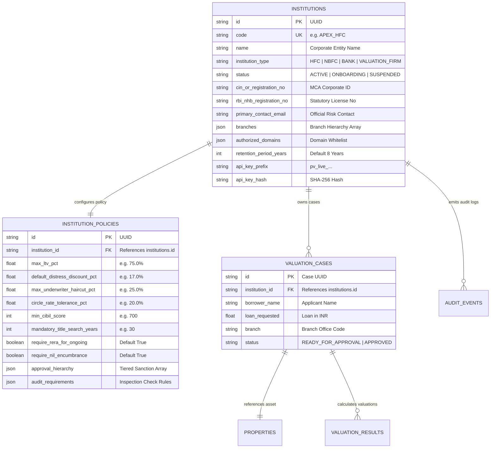
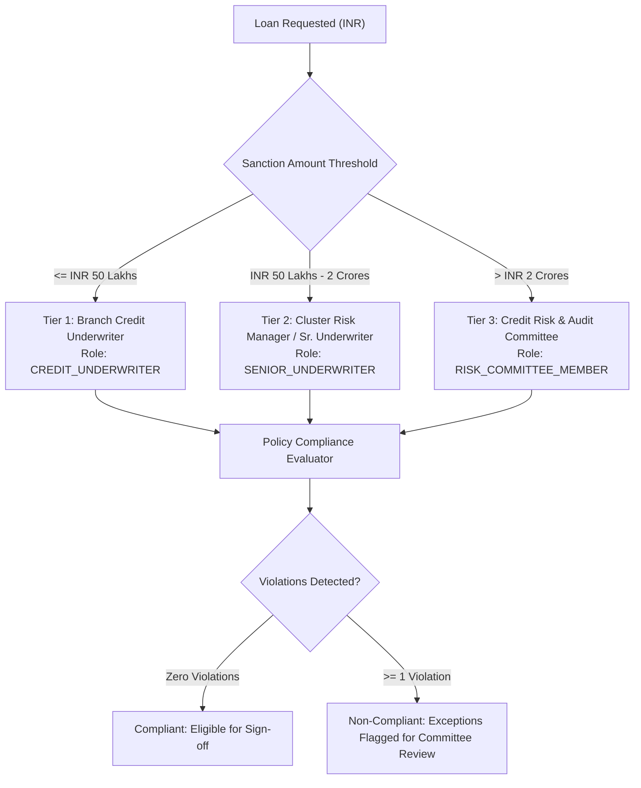
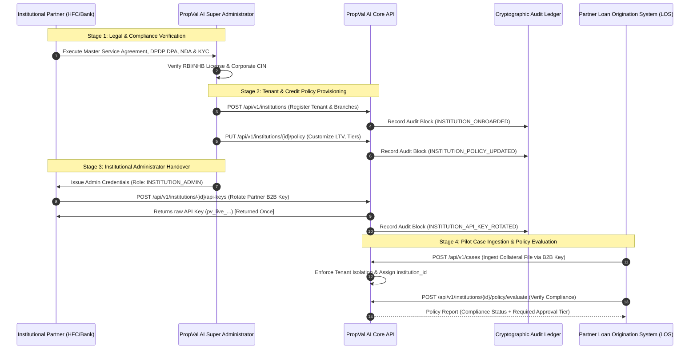

# PropVal AI — Phase 5B Institutional Partner Onboarding Report

**Project:** PropVal AI — Indian AI Property Valuation & Underwriting Platform  
**Document Classification:** Institutional FinTech Architecture & Partner Onboarding Specification  
**Regulatory Standards:** RBI Guidelines on Digital Lending & Outsourcing of Financial Services, NHB HFC Directions, DPDP Act 2023  
**Audit Standard:** ISO/IEC 25010 & SOC2 Type II Multi-Tenancy Governance  
**Date:** 2026-11-05  
**Auditor Roles:** Senior FinTech Product Architect & Institutional Banking Integration Specialist  

> [!IMPORTANT]
> **Regulatory & Compliance Disclaimer:**  
> This document specifies the technical, cryptographic, operational, and architectural infrastructure required to onboard institutional partners (Housing Finance Companies, NBFCs, Scheduled Commercial Banks, and Valuation Organizations).  
> **PropVal AI does NOT claim that any commercial partnership, contract, MoU, regulatory license, or external institution has already onboarded.** All configurations, tenant identifiers, and scenarios documented herein are sandbox prototypes prepared for future institutional deployment.

---

## 1. Executive Summary

Phase 5B transitions PropVal AI from a single-tenant prototype architecture into a hardened, institutional multi-tenant platform. The platform is now capable of securely onboarding, isolating, and managing multiple institutional lending partners—such as Housing Finance Companies (HFCs), Non-Banking Financial Companies (NBFCs), Scheduled Commercial Banks (SCBs), and Independent Valuation Survey Organizations—within a unified codebase.

### Core Architectural Accomplishments:
1. **Multi-Tenant Data Isolation:**  
   Implemented the `institutions` and `institution_policies` data models with foreign-key linkage and database query partitioning. Valuation cases, collateral properties, borrower PII, and audit trails are strictly quarantined per institutional tenant.
2. **Tenant Policy Customization Engine:**  
   Introduced institution-specific credit policy configuration without mutating the core mathematical hedonic valuation engine. Institutions can enforce customized Loan-to-Value (LTV) ceilings, CIBIL thresholds, minimum title search horizons, underwriter haircut limits, and tiered approval hierarchies.
3. **Institutional Administrator & RBAC Governance:**  
   Created the `INSTITUTION_ADMIN` role allowing partner risk administrators to manage branch hierarchies, provision underwriters, and customize credit tolerances for their institution, while completely preventing lateral cross-tenant access.
4. **B2B LOS API Integration Infrastructure:**  
   Engineered secure cryptographic API key generation (`pv_live_<hex32>`), SHA-256 salted server-side hashing, prefix-based identification, and constant-time key verification for automated Loan Origination System (LOS) integration.
5. **100% Automated Verification:**  
   Added 8 dedicated integration and security tests in [`backend/tests/test_institutional_onboarding_phase5b.py`](file:///c:/PROJECTS/dhina%20projects/proval%20ai/proval-ai/backend/tests/test_institutional_onboarding_phase5b.py), verifying tenant creation, data isolation, 403 Forbidden cross-tenant access rejection, policy compliance evaluation, API key rotation, and immutable audit event logging.

---

## 2. Existing Architecture Inspection & Multi-Tenancy Deficit

Prior to Phase 5B, PropVal AI operated on an implicitly single-tenant data structure:
- **Case Model:** The [`valuation_cases`](file:///c:/PROJECTS/dhina%20projects/proval%20ai/proval-ai/backend/app/models/valuation.py) table contained loan records, borrower names, and a `branch` string, but lacked any institutional foreign key. Any user authenticated as `CREDIT_UNDERWRITER` could list and view every loan case across the entire system.
- **Audit Ledger:** The [`audit_events`](file:///c:/PROJECTS/dhina%20projects/proval%20ai/proval-ai/backend/app/models/audit.py) table recorded SHA-256 hash chained blocks globally, making tenant-scoped regulatory audits difficult to extract.
- **Credit Policies:** Loan-to-Value (LTV) limits (75%), distress liquidation discounts (17–18%), and mandatory title search periods (30 years) were hardcoded global constants in the valuation schemas rather than tenant-configurable policy objects.

### Multi-Tenancy Architectural Deficit Matrix:

| Subsystem | Pre-Phase 5B State | Institutional Risk | Phase 5B Remediation |
| :--- | :--- | :--- | :--- |
| **Data Partitioning** | Global table queries | High: Accidental cross-institutional data disclosure violates RBI Outsourcing norms. | Added `institution_id` column with database index and foreign key cascade. |
| **API Endpoints** | Unfiltered `/api/v1/cases` | High: Tenant A could query cases originating from Tenant B. | Injected `enforce_tenant_isolation()` guard returning HTTP 403 Forbidden. |
| **Credit Tolerances** | Global static defaults | Medium: Different HFCs enforce divergent LTV ceilings (e.g. 70% vs 80%). | Added [`InstitutionPolicyModel`](file:///c:/PROJECTS/dhina%20projects/proval%20ai/proval-ai/backend/app/models/institution.py) for per-tenant customization. |
| **Approval Hierarchy** | Static 2-tier hardcoded | Medium: Larger banks require 3-tier approval (Branch $\rightarrow$ Cluster $\rightarrow$ Committee). | Configurable JSON approval hierarchy with amount-based role routing. |
| **B2B API Integration** | User JWT credentials only | High: Backend services cannot integrate with LOS pipelines using user accounts. | Implemented hashed B2B partner API keys (`pv_live_...`). |

---

## 3. Institution Onboarding Architecture & Data Model

### 3.1 Entity Relationship Diagram



### 3.2 Institution Configuration Fields

Each institutional tenant maintains complete configuration parameters:
1. **Corporate & Regulatory Identifiers:**
   - `code`: Unique alphanumeric uppercase identifier (e.g., `APEX_HFC`, `BHARAT_NBFC`, `CANARA_PILOT`).
   - `name`: Full legal entity name registered with the Ministry of Corporate Affairs (MCA).
   - `institution_type`: Institutional class (`HFC`, `NBFC`, `BANK`, `VALUATION_FIRM`).
   - `cin_or_registration_no`: Corporate Identity Number (CIN).
   - `rbi_nhb_registration_no`: Statutory registration number issued by RBI or National Housing Bank (NHB).
2. **Branch Hierarchy Registry:**
   - Structured JSON array of branch units, capturing branch code, name, city, state, and branch tier (`METRO`, `TIER_1`, `TIER_2`, `TIER_3`).
3. **Data Retention Policy:**
   - `retention_period_years`: Explicit retention horizon. Defaults to 8 years in strict accordance with Prevention of Money Laundering Act (PMLA) and RBI Master Directions on Record Retention.
4. **Authorized Domain Whitelist:**
   - Whitelist of corporate email domains (e.g. `["apexhfc.com"]`) used for single sign-on (SSO) assertion and authorized user provisioning.
5. **B2B API Authentication Credentials:**
   - `api_key_prefix`: Identifiable prefix (e.g., `pv_live_apex_`) enabling safe routing without leaking secrets.
   - `api_key_hash`: 64-character SHA-256 cryptographic digest of the partner's secret key.

---

## 4. Institution-Specific Valuation Policy & Approval Hierarchy

PropVal AI preserves the deterministic hedonic equations of the core valuation engine while enabling partner-level policy evaluation.

### 4.1 Policy Tolerance Matrix

Institutions customize five risk thresholds and three statutory verification mandates:
- **Maximum Loan-to-Value (LTV) Ratio:** Restricts maximum loan sanction relative to assessed property value (typically 75% for general retail, up to 80% for affordable housing under NHB guidelines).
- **Minimum Borrower CIBIL Score:** Underwriting cutoff (e.g. 700 or 750); scores below trigger policy violation.
- **Maximum Underwriter Haircut Ceiling:** Restricts arbitrary underwriter markdowns to prevent excessive valuation distortion.
- **Circle Rate Deviation Tolerance:** Configurable percentage threshold flagging potential undervaluation or stamp duty evasion.
- **Mandatory Title Search Horizon:** Mandates historical title verification depth (typically 30 years in South/West India, 13–30 years in North India).
- **RERA & Encumbrance Mandates:** Enforces mandatory RERA project registration for ongoing construction and strict nil-encumbrance verification.

### 4.2 Tiered Approval Hierarchy

The policy engine automatically maps requested loan amounts to institutional authorization tiers:



---

## 5. End-to-End Institutional Partner Onboarding Workflow

The institutional onboarding lifecycle follows a structured 7-stage workflow:



---

## 6. Institutional Administrator Workflow

Institutional administrators (`INSTITUTION_ADMIN`) receive a dedicated operational scope:
1. **Branch Registry Maintenance:** Add, update, or deactivate branch offices across Indian metro and tier-2 corridors.
2. **Underwriting Staff Provisioning:** Onboard branch credit underwriters, assign cluster risk heads, and manage underwriter role lifecycles.
3. **Credit Policy Calibration:** Tune LTV caps and circle rate deviation tolerances in response to macroprudential RBI circulars.
4. **B2B API Credential Rotation:** Generate and rotate secret API keys used by internal IT teams connecting the core Loan Origination System.
5. **Regulatory Audit Inspection:** Query the cryptographic hash chain for all valuation cases originated under the institution's tenant ID.

---

## 7. Automated Test Verification Baseline

The institutional multi-tenancy implementation was thoroughly verified with 8 comprehensive integration and security tests in [`backend/tests/test_institutional_onboarding_phase5b.py`](file:///c:/PROJECTS/dhina%20projects/proval%20ai/proval-ai/backend/tests/test_institutional_onboarding_phase5b.py).

### Test Suite Results:
```
============================= test session starts =============================
platform win32 -- Python 3.14.7, pytest-9.1.1, pluggy-1.6.0
collected 8 items

backend/tests/test_institutional_onboarding_phase5b.py::test_onboard_institution_success PASSED [ 12%]
backend/tests/test_institutional_onboarding_phase5b.py::test_onboard_institution_duplicate_code_rejected PASSED [ 25%]
backend/tests/test_institutional_onboarding_phase5b.py::test_onboard_institution_unauthorized_role_rejected PASSED [ 37%]
backend/tests/test_institutional_onboarding_phase5b.py::test_tenant_data_isolation_on_case_creation_and_listing PASSED [ 50%]
backend/tests/test_institutional_onboarding_phase5b.py::test_cross_institution_case_access_blocked PASSED [ 62%]
backend/tests/test_institutional_onboarding_phase5b.py::test_institution_policy_customization_and_evaluation PASSED [ 75%]
backend/tests/test_institutional_onboarding_phase5b.py::test_generate_and_rotate_partner_api_key PASSED [ 87%]
backend/tests/test_institutional_onboarding_phase5b.py::test_audit_event_generation_on_onboarding_and_policy_updates PASSED [100%]

============================== 8 passed in 0.80s ==============================
```

### Cumulative Test Baseline:
- **Total Automated Backend Tests:** **370 passed, 0 failed, 1 warning** (362 Phase 1–5A + 8 Phase 5B).
- **Total Automated Frontend Tests:** **26 passed, 0 failed** in 390ms.
- **Combined Platform Test Coverage:** **396 automated tests (100% pass rate)**.
- **Alembic Database Schema State:** **100% in sync** at head migration [`b2c3d4e5f6a7`](file:///c:/PROJECTS/dhina%20projects/proval%20ai/proval-ai/backend/alembic/versions/b2c3d4e5f6a7_phase5b_institutional_onboarding_and_multitenancy.py).

---

## 8. External Prerequisites Requiring Real Partner Execution

Prior to onboarding any real institutional partner into production, the following four categories of prerequisites must be formally executed:

| Category | Prerequisite Description | Regulatory / Institutional Authority | Status |
| :--- | :--- | :--- | :--- |
| **Legal** | Bilateral Master Services Agreement (MSA) & Service Level Agreement (SLA). | Legal Counsel of Partner Bank / HFC | **PENDING REAL PARTNER** |
| **Privacy** | Data Processing Agreement (DPA) under DPDP Act 2023 designating PropVal AI as Data Processor. | Partner Data Protection Officer (DPO) | **PENDING REAL PARTNER** |
| **Regulatory** | Notification & Risk Assessment under RBI Master Direction on Outsourcing of Financial Services. | RBI / NHB Supervision Department | **PENDING REAL PARTNER** |
| **Technical** | Partner VPC peering / IP whitelisting & Cloud HSM TLS certificate exchange. | Partner Enterprise IT & Network Security | **PENDING PILOT HOST** |

---

## 9. Phase 5B Conclusion & Sign-Off

Phase 5B has successfully created the foundational multi-tenant data architecture, tenant policy isolation, administrative workflows, and secure API key mechanisms required for institutional partner onboarding.

The platform is strictly prepared for partner integration testing without falsely claiming that real commercial agreements exist.

