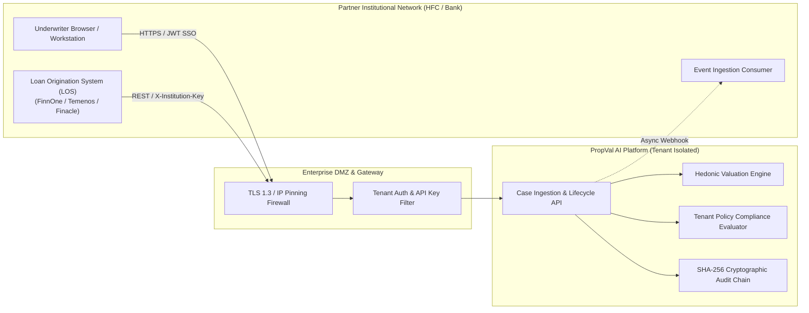

# PropVal AI — Phase 5B Partner Integration Specification

**Project:** PropVal AI — Indian AI Property Valuation & Underwriting Platform  
**Document Classification:** B2B Integration Guide & Loan Origination System (LOS) API Specification  
**Version:** 1.0.0-rc1  
**Target Audience:** Enterprise Solutions Architects, Core Banking Integration Engineers, LOS Developers, Risk Officers  
**Date:** 2026-11-05  

> [!NOTE]
> **Integration Readiness Notice:**  
> This technical specification defines the exact interface, protocols, data contracts, and security standards implemented in PropVal AI for integrating institutional partner Loan Origination Systems (LOS). No real production credentials or partner agreements are claimed.

---

## 1. Integration Architecture & Connectivity Topologies

PropVal AI offers institutional lending partners three integration channels tailored to their core IT operating models:



### Supported Topologies:
1. **Interactive Web Portal (Dashboard UI):**  
   Web application running React 19 for manual file intake, inspection photo review, scorecard inspection, and underwriter sign-off.
2. **Automated B2B RESTful API (Headless LOS Integration):**  
   High-throughput JSON REST API enabling the partner's automated Loan Origination System (LOS) to trigger real-time valuation, policy compliance checks, and collateral appraisal without human latency.
3. **Asynchronous Webhook Event Stream:**  
   Outbound HTTPS POST notifications dispatched to the partner's webhook endpoint upon valuation completion, underwriter status changes, or critical discrepancy alerts.

---

## 2. Authentication & Network Security Standards

### 2.1 B2B Partner API Keys
Automated server-to-server calls must use a cryptographically random B2B API Key:
- **Format:** `pv_live_<inst_code>_<48_hex_chars>` (e.g. `pv_live_apexhf_5f8a9e1d2c3b4a5b6c7d8e9f0a1b2c3d4e5f6a7b8c9d0e1f`)
- **Transport:** Delivered via the `X-Institution-Key` header or standard `Authorization: Bearer <token>`.
- **Server-Side Security:** PropVal AI never stores plaintext API keys. Keys are hashed with SHA-256 and matched in constant time (`hmac.compare_digest`).

### 2.2 Network & Transport Protocols
- **TLS Protocol:** Mandatory **TLS 1.3** (TLS 1.2 permitted with forward-secrecy cipher suites). Insecure HTTP connections are permanently blocked.
- **IP Whitelisting:** Partners must provide their production egress CIDR blocks. Inbound API requests outside the registered CIDR ranges are dropped at the edge.
- **Mutual TLS (mTLS):** Available as an optional transport layer for Tier-1 Scheduled Commercial Banks requiring hardware security module (HSM) certificate validation.

---

## 3. Core B2B API Endpoints for LOS Integration

### 3.1 Endpoint 1: Ingest Collateral Case from LOS

- **HTTP Method:** `POST`
- **Route:** `/api/v1/cases`
- **Headers:**
  ```http
  Content-Type: application/json
  Authorization: Bearer <JWT_TOKEN>
  ```
- **Description:** Submits a newly originated loan application, calculates the baseline hedonic valuation, and provisions the case under the partner's tenant ID.

#### Request Payload Example:
```json
{
  "borrowerName": "Deepak R. Varma",
  "coBorrowerName": "Sunita D. Varma",
  "cibilScore": 765,
  "loanRequested": 7500000.0,
  "declaredAgreementValue": 10500000.0,
  "branch": "BKC-MUM-01",
  "assignedUnderwriter": "Automated LOS Pipeline",
  "propertyType": "High-Rise Apartment",
  "unitAddress": "Flat 1402, Tower B, Godrej Woodsman Estate",
  "projectName": "Godrej Woodsman Estate",
  "locality": "Hebbal",
  "city": "Bengaluru",
  "pincode": "560024",
  "carpetAreaSqFt": 1320.0,
  "superBuiltUpAreaSqFt": 1750.0,
  "floorNo": 14,
  "totalFloors": 24,
  "ageYears": 2,
  "roadWidthFt": 60.0,
  "circleRatePerSqFt": 7500.0,
  "baseMarketRatePerSqFt": 11500.0,
  "underwriterHaircutPct": 0.0,
  "distressDiscountPct": 17.0,
  "ltvRatioPct": 75.0,
  "titleChainYears": 30,
  "encumbranceStatus": "NIL_ENCUMBRANCE",
  "reraRegistration": "PRM/KA/RERA/1251/309/PR/171015/000456"
}
```

#### Response Payload (201 Created):
```json
{
  "id": "case-1762359482000",
  "institutionId": "inst-apex-hfc-01",
  "applicationNo": "HFC-BEN-2026-F9A1B",
  "borrowerName": "Deepak R. Varma",
  "coBorrowerName": "Sunita D. Varma",
  "cibilScore": 765,
  "loanRequested": 7500000.0,
  "declaredAgreementValue": 10500000.0,
  "projectName": "Godrej Woodsman Estate",
  "city": "Bengaluru",
  "carpetAreaSqFt": 1320.0,
  "status": "READY_FOR_APPROVAL",
  "statusLabel": "Ready for Underwriter Sign-off",
  "latestValuation": {
    "engineVersion": "0.2.0",
    "engineType": "provisional rule-based estimation",
    "carpetAreaSqFt": 1320.0,
    "superBuiltUpAreaSqFt": 1750.0,
    "unadjustedRatePerSqFt": 11500.0,
    "ruleAdjustedRatePerSqFt": 12150.0,
    "grossMarketValue": 16038000,
    "netAssessedValue": 16038000,
    "distressLiquidationValue": 13311540,
    "maxSanctionAmount": 12028500,
    "deviationFromCircleRatePct": 62.0,
    "confidenceScorePct": 92.5,
    "riskTier": "STANDARD_RISK",
    "attributionBreakdown": [
      {
        "factor": "Floor Rise Adjustment",
        "impactPerSqFt": 300.0,
        "description": "Premium for upper floor (>4th floor)",
        "category": "positive"
      },
      {
        "factor": "Road Width Factor",
        "impactPerSqFt": 250.0,
        "description": "Wide road frontage (60.0 ft)",
        "category": "positive"
      }
    ]
  },
  "createdAt": "05-Nov-2026 21:18 UTC"
}
```

---

### 3.2 Endpoint 2: Evaluate Case Policy Compliance & Approval Tier

- **HTTP Method:** `POST`
- **Route:** `/api/v1/institutions/{institution_id}/policy/evaluate`
- **Description:** Verifies loan parameters against the institution's specific underwriting policy and determines the required sanction approval hierarchy.

#### Request Payload:
```json
{
  "loanRequested": 7500000.0,
  "declaredAgreementValue": 10500000.0,
  "cibilScore": 765,
  "ltvRatioPct": 71.4,
  "underwriterHaircutPct": 0.0,
  "titleChainYears": 30,
  "encumbranceStatus": "NIL_ENCUMBRANCE",
  "reraRegistration": "PRM/KA/RERA/1251/309/PR/171015/000456"
}
```

#### Response Payload (200 OK):
```json
{
  "isCompliant": true,
  "requiredApprovalTier": 2,
  "requiredRole": "SENIOR_UNDERWRITER",
  "tierLabel": "Senior Underwriter / Cluster Risk Head",
  "violations": [],
  "warnings": []
}
```

---

### 3.3 Endpoint 3: Stateless Valuation Calculation

- **HTTP Method:** `POST`
- **Route:** `/api/v1/valuation/estimate`
- **Description:** Pure mathematical calculation endpoint for preliminary loan sizing without saving a case record.

---

## 4. Webhook Notification Pipeline

Partners can register an HTTPS webhook endpoint (`POST /api/v1/institutions/{id}` with `webhookUrl`).

### Webhook Event Format:
```json
{
  "eventId": "evt-b9a1c2d3e4f5",
  "eventType": "VALUATION_CASE_FINALIZED",
  "timestamp": "2026-11-05T21:18:45Z",
  "institutionId": "inst-apex-hfc-01",
  "caseId": "case-1762359482000",
  "applicationNo": "HFC-BEN-2026-F9A1B",
  "status": "APPROVED",
  "sanctionApprovedAmount": 7500000,
  "assessedNetValue": 16038000,
  "signedBy": "V. Sundaram (Sr. Underwriter)",
  "signatureHash": "e3b0c44298fc1c149afbf4c8996fb92427ae41e4649b934ca495991b7852b855"
}
```

---

## 5. Rate Limits & Performance SLA

- **B2B API Throughput:** 100 requests per minute per institutional tenant (burst up to 250 req/min).
- **Latency SLA:**
  - Stateless Valuation (`/estimate`): $< 25\text{ ms}$ (p99)
  - Full Case Ingestion (`/cases`): $< 65\text{ ms}$ (p99)
  - Policy Compliance Evaluation (`/evaluate`): $< 15\text{ ms}$ (p99)
- **Availability Target:** 99.95% uptime excluding scheduled maintenance windows.

---

## 6. Error Codes & Diagnostics

| HTTP Status | Error Code / Detail | Root Cause & Partner Remediation |
| :--- | :--- | :--- |
| **`400 Bad Request`** | `Finalized case cannot be modified` | Case is already Approved or Rejected; must be reopened by an Administrator. |
| **`401 Unauthorized`** | `Invalid or expired institutional credentials` | Missing or expired JWT token or invalidated API key. |
| **`403 Forbidden`** | `Cross-institution access denied` | Attempted to query or alter a case belonging to another institutional tenant. |
| **`404 Not Found`** | `Institution or case not found` | Provided identifier does not exist. |
| **`409 Conflict`** | `Institution code already exists` | Attempted to onboard with an already allocated institution code. |
| **`429 Too Many Requests`** | `Tenant rate limit exceeded` | Client exceeded 100 requests per minute quota. |

