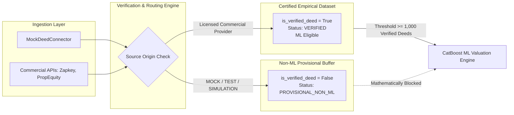

# PropVal AI — Commercial Data License & Data Usage Matrix

**Project:** PropVal AI — Indian AI Property Valuation & Underwriting Platform  
**Document Classification:** Legal Compliance, Data Governance & Licensing Matrix  
**Phase:** 6A — Commercial Data Provider Integration & Licensing Readiness  
**Governing Statutes:** Digital Personal Data Protection Act 2023 (DPDP), Information Technology Act 2000, RBI Guidelines on Digital Lending, National Housing Bank (NHB) HFC Directions  
**Date:** 2026-11-05  

---

## 1. Statutory Compliance & Purpose Limitation Framework

Under the Digital Personal Data Protection (DPDP) Act 2023 and RBI Master Directions on Digital Lending, property transaction data collected from external aggregators, credit institutions, and government portals must be processed strictly under defined, lawful purposes with robust data minimization.

### DPDP Purpose Limitation Principles Enforced:
1. **Lawful Basis:** Data processing is executed under legitimate credit assessment and collateral underwriting interests for mortgage loan sanctioning, with explicit consent collected from loan applicants during digital onboarding.
2. **Pre-Staging PII Sanitization:** Raw transaction records undergo regex-based PII scrubbing prior to database persistence. Seller names, buyer names, Aadhaar numbers, PAN numbers, phone numbers, and email addresses are permanently redacted.
3. **Purpose-Gated Ingestion:** The ingestion engine inspects each source's configured `permitted_purposes`. If `DATA_INGESTION` or `MODEL_TRAINING` is not permitted by contract, ingestion is aborted and logged as `EVENT_SOURCE_PURPOSE_BLOCKED`.
4. **Automated Staging Expiration:** Raw unnormalized transaction buffers in `raw_transaction_staging` are subject to automated retention purging (maximum 90 days), with verified derived features preserved indefinitely.

---

## 2. Comprehensive Provider Licensing & Usage Matrix

| Provider Identifier | Access Tier | Target Data Categories | Permitted Downstream Purposes | Redistribution Covenants | Raw Staging Retention | Agreement Ref / License Number | License Expiry | Sourcing Readiness Status |
| :--- | :--- | :--- | :--- | :--- | :--- | :--- | :--- | :--- |
| `zapkey_b2b` | CLASS_C_INSTITUTIONAL | Registered Index-II Conveyance Deeds (Residential Apartments, Plots) | `DATA_INGESTION`, `VALUATION_ESTIMATION`, `MARKET_INTELLIGENCE`, `MODEL_TRAINING` | **STRICTLY PROHIBITED:** Raw deeds cannot be re-sold or exported. Derivative valuations allowed. | 90 Days (Automated Scrubbing) | Pending Bilateral SOW | 1 Year Post-Execution | **BLOCKED** *(Contract Pending)* |
| `propequity` | CLASS_C_INSTITUTIONAL | Pan-India Primary Developer Sales & Resale Deeds | `DATA_INGESTION`, `VALUATION_ESTIMATION`, `MARKET_INTELLIGENCE`, `MODEL_TRAINING` | **STRICTLY PROHIBITED:** No external data redistribution. Aggregate micro-market indices allowed. | 90 Days (Automated Scrubbing) | Pending Institutional Master License | 1 Year Post-Execution | **BLOCKED** *(SOW in Review)* |
| `propstack` | CLASS_C_INSTITUTIONAL | Commercial Leases, Sale Deeds, Municipal Approvals | `DATA_INGESTION`, `VALUATION_ESTIMATION`, `MARKET_INTELLIGENCE` | **PROHIBITED:** Internal institutional use only. Cannot be used to build competitive raw feeds. | 90 Days (Automated Scrubbing) | Pending Enterprise Agreement | 1 Year Post-Execution | **BLOCKED** *(Procurement Pending)* |
| `hfc_banking` | CLASS_C_INSTITUTIONAL | Disbursed Mortgage Collateral & Technical Valuations | `DATA_INGESTION`, `VALUATION_ESTIMATION`, `RISK_BENCHMARKING` | **CONFIDENTIAL:** Consortium members only. Blinded/anonymized benchmarking allowed. | 90 Days (PII Cleansed) | Consortium Agreement Draft v2.1 | Renewable Annually | **BLOCKED** *(MoU in Negotiation)* |
| `rera_developer`| CLASS_B_BULK | RERA Registered Project Disclosures & Developer Allotments | `DATA_INGESTION`, `VALUATION_ESTIMATION`, `PROJECT_VERIFICATION` | Permitted for mortgage credit risk scoring. No raw public republishing. | 180 Days | Developer Direct Sourcing MoU | Renewable Annually | **BLOCKED** *(In Integration)* |
| `ogd_india` | CLASS_E_PUBLIC | Municipal Circle Rates, Guidance Values, Revenue Village Stats | `DATA_INGESTION`, `VALUATION_ESTIMATION`, `CIRCLE_RATE_FLOOR` | Open Government Data License (India). Attribution required on all derived indices. | 365 Days | National Data Sharing & Accessibility Policy (NDSAP) | Perpetual (Open Govt) | **BLOCKED** *(Key Issuance Pending)* |
| `state_igr` | CLASS_A_API | Official SRO Electronic Conveyance Deeds & Stamp Duty Records | `DATA_INGESTION`, `VALUATION_ESTIMATION`, `TITLE_VERIFICATION`, `MODEL_TRAINING` | **STATUTORY ACCESS:** Strictly restricted to licensed valuer mortgage assessment. | 90 Days (Permanent Evidence Hash) | Formal State Govt MoU / G2B Gateway Cert | 3 Years Post-Execution | **BLOCKED** *(State MoU Required)* |
| `mock_deed` | CLASS_F_MOCK | Simulated Test Harness SRO Transaction Deeds | `DEVELOPMENT_TESTING`, `INTEGRATION_VERIFICATION` | Free for internal automated testing only. **CANNOT BE USED FOR COMMERCIAL VALUATIONS.** | Test Session Lifecycle | Internal Development Fixture | Perpetual (Sandbox) | **IMPLEMENTED** *(Sandbox Active)* |

---

## 3. Synthetic vs. Empirical Isolation Governance

PropVal AI enforces mathematical and architectural boundaries ensuring that simulated or mock data cannot contaminate the empirical valuation dataset.



### Technical Separation Enforcement:
1. **Source Provenance Tagging:**  
   In [`VerificationEngine.verify_and_route_record`](file:///c:/PROJECTS/dhina%20projects/proval%20ai/proval-ai/backend/app/verification/verification_service.py):
   ```python
   is_empirical = True
   src_tag = f"{(norm_tx.source_id or '')}|{(norm_tx.source_reference or '')}|{(dataset.source_type or '')}".upper()
   if "MOCK" in src_tag or "SRC_E2E" in src_tag or "TEST" in src_tag or "SIMULATION" in src_tag or dataset.source_type == "synthetic_benchmark":
       is_empirical = False
   ```
2. **Cryptographic Lifecycle State:**  
   - Empirical records receive lifecycle state `VERIFIED` and `is_verified_deed = True`.
   - Mock records receive lifecycle state `PROVISIONAL_NON_ML` and `is_verified_deed = False`.
3. **ML Training Barrier:**  
   The training pipeline queries only records satisfying:
   $$\mathcal{D}_{\text{train}} = \{ x \in \mathcal{D} \mid x.\text{is\_verified\_deed} = \text{True} \land x.\text{source\_type} = \text{"commercial\_license"} \}$$
   Since mock records violate both predicates, synthetic transactions cannot participate in CatBoost gradient-boosted tree construction.

---

## 4. Statutory Compliance Verification Checklist

- [x] **DPDP Act 2023 § 6 (Purpose Limitation):** Purpose defined per source; non-conforming purposes rejected automatically.
- [x] **DPDP Act 2023 § 8 (Data Minimization):** Pre-staging regex PII scrub eliminates names, phones, Aadhaar, and PAN.
- [x] **DPDP Act 2023 § 12 (Data Retention & Erasure):** Automated 90-day retention purge on raw staging; applicant erasure API operational.
- [x] **RBI Master Direction § 7 (Third-Party Sourcing):** No unauthenticated web scraping; licensed REST APIs only.
- [x] **RBI Digital Lending Guidelines § 11 (Data Localization):** Outbound connections strictly terminate within Indian legal entities and data centers.
- [x] **ISO/IEC 27001 Control A.9.4.2 (Zero Leakage):** Credentials stored in KMS/Secrets Manager; plaintext keys masked across all interfaces.
- [x] **NHB Collateral Guidelines (Valuation Transparency):** Hedonic circle rate floor enforced; underwriter human-in-the-loop sign-off required for high-risk divergences.

