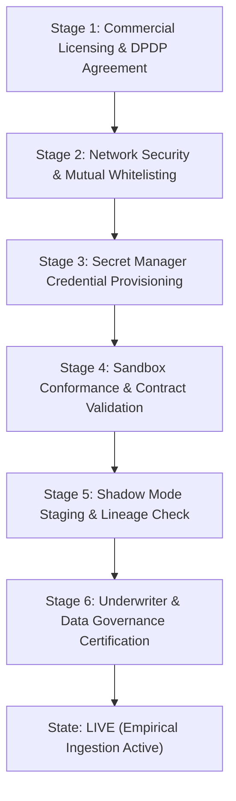
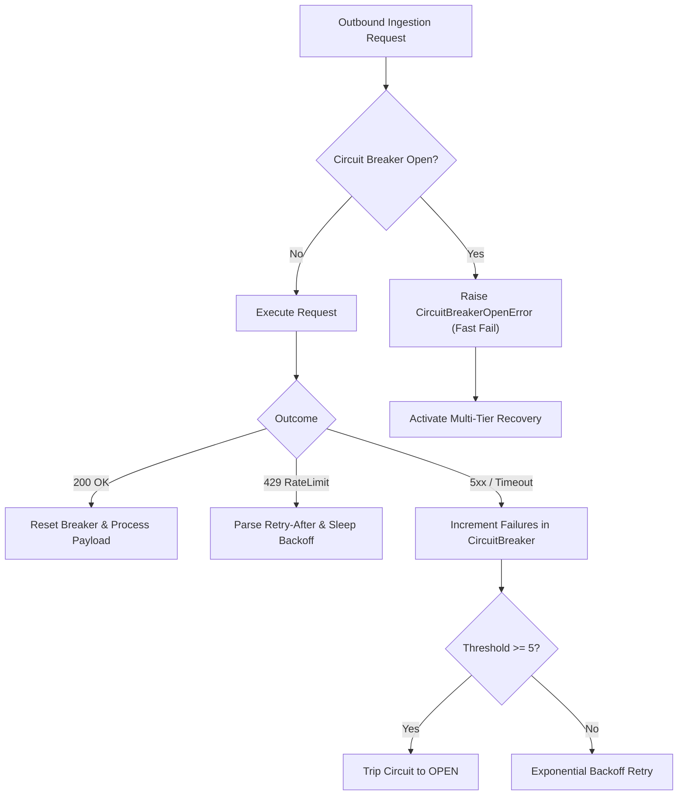

# PropVal AI — Commercial Data Provider Technical Onboarding Guide & Operational Procedures

**Project:** PropVal AI — Indian AI Property Valuation & Underwriting Platform  
**Document Classification:** Standard Operating Procedure (SOP) & Technical Onboarding Guide  
**Phase:** 6A — Commercial Data Provider Integration & Licensing Readiness  
**Target Audience:** Enterprise Data Engineers, Security Architects, Commercial Data Partners, Institutional Valuers  
**Date:** 2026-11-05  

---

## 1. Technical Onboarding Workflow

The PropVal AI commercial data provider onboarding framework enforces a rigorous 6-stage progression from commercial licensing to production activation. No provider may bypass any stage.



### Stage 1: Commercial Licensing & DPDP Purpose Specification
1. Execute bilateral Commercial License Agreement specifying permitted jurisdictions (e.g., Maharashtra, Karnataka, NCR).
2. Explicitly define DPDP Act 2023 Purpose Limitation: `VALUATION_ESTIMATION`, `MARKET_INTELLIGENCE`, and `MODEL_TRAINING`.
3. Establish data retention covenents: maximum 90 days for raw staging, permanent cryptographic hash evidence preservation, zero raw deed redistribution.
4. Define agreed SLAs: Minimum 99.5% API availability, P95 latency $< 1,500\text{ ms}$, rate limits $\ge 60\text{ req/min}$.

### Stage 2: Network Security & Mutual Whitelisting
1. Provider registers production HTTPS FQDNs with PropVal AI (e.g., `api.zapkey.com`, `api.propequity.in`).
2. PropVal AI infrastructure engineers add provider domain to `PRODUCTION_ALLOWED_HOSTNAMES` in [`http_client.py`](file:///c:/PROJECTS/dhina%20projects/proval%20ai/proval-ai/backend/app/connectors/http_client.py).
3. Egress IP addresses of PropVal AI cloud NAT gateways are shared with the provider for incoming firewall allowlisting.
4. Mutual TLS (mTLS) root CA certificates exchanged (mandatory for Class A G2B and Class C HFC Banking consortiums).

### Stage 3: Secret Manager Credential Provisioning
1. Provider issues cryptographic API keys or access tokens via secure encrypted channel (PGP/Signal/KMS envelope).
2. PropVal AI Security Officer provisions credentials directly into AWS Secrets Manager or HashiCorp Vault.
3. Secrets are referenced by ARN/key name in `DataSourceModel.secret_manager_key` or `auth_secret_env_var`.
4. Plaintext credentials are strictly barred from configuration files, Git repositories, or CI/CD pipelines.

### Stage 4: Sandbox Conformance & Contract Validation
1. Connector is registered in [`app.connectors.registry.ConnectorRegistry`](file:///c:/PROJECTS/dhina%20projects/proval%20ai/proval-ai/backend/app/connectors/registry.py).
2. Execute non-destructive automated connectivity check via `GET /api/v1/acquisition/sources/{source_id}/test`.
3. Assert that payload adheres to the Pydantic transaction schema without malformed types or missing SRO identifiers.
4. Verify circuit breaker initialization (`CircuitBreakerState.CLOSED`) and rate limiting enforcement.

### Stage 5: Shadow Mode Staging & Lineage Check
1. Initiate controlled shadow ingestion run with max 10 batches ($\le 1,000$ records).
2. Verify automated pre-staging PII scrubbing: all seller/buyer names, Aadhaar, PAN, and phone numbers are scrubbed prior to storage.
3. Verify deterministic deed deduplication via SRO deed fingerprint:
   $$\text{Fingerprint} = \text{SHA-256}(\text{STATE} \parallel \text{DISTRICT} \parallel \text{SRO\_OFFICE} \parallel \text{REG\_YEAR} \parallel \text{REG\_NUMBER} \parallel \text{UNIT})$$
4. Assert cryptographic verification evidence record creation in `VerificationEvidenceModel`.

### Stage 6: Underwriter & Data Governance Certification
1. Senior Underwriter and Institutional Data Officer inspect sample staged records and verification hashes.
2. Sign-off executed in database: `authorization_status` updated from `AUTHORIZATION_PENDING` to `DOCUMENTED_AND_AUTHORIZED`.
3. Audit log records `EVENT_DATA_SOURCE_STATUS_CHANGED`.
4. Provider is promoted to `LIVE` status on the Provider Status Board (`/api/v1/acquisition/providers/status`).

---

## 2. API Credential & Protocol Specifications

Each registered provider requires specific protocol configurations:

| Provider Code | Authentication Type | Credential Format | Environment Variable / Vault Key | Required Request Headers |
| :--- | :--- | :--- | :--- | :--- |
| `zapkey_b2b` | Header API Key | 64-char alphanumeric token | `ZAPKEY_API_KEY` | `x-api-key: <token>`, `Accept: application/json` |
| `propequity` | Bearer Token | JWT or 128-char API Token | `PROPEQUITY_API_KEY` | `Authorization: Bearer <token>`, `Accept: application/json` |
| `propstack` | Partner Header Key | 48-char hex string | `PROPSTACK_API_KEY` | `x-propstack-key: <token>`, `Accept: application/json` |
| `hfc_banking` | Mutual TLS + Partner Token | X.509 mTLS Cert + 64-char Token | `HFC_PARTNER_API_KEY` | `x-hfc-partner-token: <token>`, Client mTLS Certificate |
| `rera_developer`| Developer Feed Token | 40-char token | `RERA_DEVELOPER_FEED_KEY` | `x-developer-key: <token>`, `Accept: application/json` |
| `ogd_india` | Query Parameter Key | 32-char alphanumeric key | `DATA_GOV_IN_API_KEY` | Query Param `?api-key=<key>&format=json` |
| `state_igr` | Dual Token + Client ID | Bearer Token + Department ID | `STATE_IGR_GATEWAY_TOKEN`, `IGR_DEPARTMENT_ID` | `x-igr-token: <token>`, `x-igr-dept-id: <dept>` |

---

## 3. Provider Configuration Reference

The following JSON schema defines the complete configuration structure for onboarding a commercial property data provider:

```json
{
  "provider_identifier": "zapkey_b2b",
  "source_name": "Zapkey B2B Real Estate Transaction Intelligence API",
  "provider_name": "Zapkey Technologies Pvt Ltd",
  "access_tier": "CLASS_C_INSTITUTIONAL",
  "source_category": "LICENSED_PROVIDER",
  "api_endpoint": "https://api.zapkey.com",
  "authentication_method": "API_KEY",
  "secret_manager_key": "arn:aws:secretsmanager:ap-south-1:123456789012:secret:propval/zapkey_key",
  "rate_limits": {
    "rate_limit_per_minute": 60,
    "burst_limit": 10
  },
  "request_timeout": {
    "timeout_seconds": 30,
    "connect_timeout_seconds": 5.0
  },
  "retry_policy": {
    "max_retries": 3,
    "backoff_factor": 1.5,
    "retryable_status_codes": [429, 500, 502, 503, 504]
  },
  "circuit_breaker_policy": {
    "failure_threshold": 5,
    "recovery_timeout_seconds": 30.0,
    "half_open_success_threshold": 2
  },
  "permitted_data_categories": [
    "RESIDENTIAL_DEEDS",
    "INDEX_II_RECORDS",
    "CONVEYANCE_APPROVALS"
  ],
  "license_reference": "ZAPKEY-PROPVAL-2026-B2B-SOW-01",
  "license_expiration": "2027-11-05T00:00:00Z",
  "data_retention_requirements": {
    "max_retention_days": 90,
    "raw_deed_redistribution_allowed": false,
    "pii_scrubbing_required": true
  }
}
```

---

## 4. Provider Credential Rotation Procedure (SOP-SEC-04)

To comply with ISO 27001 and RBI Digital Lending security mandates, all provider API keys and access tokens must undergo scheduled bi-annual rotation or immediate emergency rotation upon suspicion of compromise.

### 4.1 Scheduled Dual-Key Rotation Procedure (Zero Downtime)
1. **Request Secondary Key:** Request the provider issue a secondary active API key alongside the existing primary key.
2. **Execute Rotation via Admin API:**
   ```bash
   curl -X POST https://api.propval.ai/api/v1/acquisition/sources/{source_id}/rotate-secret \
     -H "Authorization: Bearer <ADMIN_JWT>" \
     -H "Content-Type: application/json" \
     -d '{
       "new_secret": "zk_live_new_rotated_token_abcdef1234567890",
       "reason": "Scheduled 2026-H2 Bi-Annual Key Rotation"
     }'
   ```
3. **Automated Verification:**
   - Secret Manager updates the secret value in memory/vault.
   - Cache invalidation triggers automatically across all worker processes.
   - Audit event `EVENT_SECRET_ROTATED` is committed with masked secret and SHA-256 fingerprint.
4. **Health Check Verification:**
   Call `GET /api/v1/acquisition/sources/{source_id}/credential-health` to confirm the new key is active and healthy.
5. **Decommission Old Key:** Notify provider to revoke the retired primary key.

### 4.2 Emergency Revocation Runbook (Compromise / Breach)
1. **Immediate Circuit Trip:** Security Officer trips the provider circuit breaker manually to cease outbound network calls:
   ```python
   CircuitBreakerRegistry.get_or_create("zapkey_b2b").trip()
   ```
2. **Revoke Source Authorization:**
   ```bash
   curl -X PATCH https://api.propval.ai/api/v1/acquisition/sources/{source_id}/status \
     -H "Authorization: Bearer <ADMIN_JWT>" \
     -H "Content-Type: application/json" \
     -d '{
       "authorization_status": "REVOKED",
       "status_change_reason": "Emergency revocation: credential leakage suspected"
     }'
   ```
3. **Notify Provider:** Transmit revocation notice to provider security point-of-contact within 15 minutes.
4. **Purge Cached Payloads:** Delete unnormalized staging records associated with compromised batch runs.

---

## 5. Data-Provider Failure Recovery Procedure (SOP-OPS-08)

PropVal AI implements a 4-tier failure recovery hierarchy to ensure uninterrupted underwriting operations during external provider outages.



### Incident Recovery Tiers:

#### Tier 1: Transient 5xx Errors / Network Timeouts
- **Enforcement:** Exponential retry with backoff factor 1.5 (maximum 3 retries).
- **Trigger:** Upstream HTTP 500, 502, 503, 504, or socket timeout.
- **Action:** If all retries fail, failure is logged; circuit breaker increments consecutive failure counter.

#### Tier 2: Upstream Gateway Outage (Circuit Breaker Tripped)
- **Trigger:** 5 consecutive failures trips Circuit Breaker to `OPEN`.
- **System Behavior:** All subsequent ingestion calls short-circuit immediately with `CircuitBreakerOpenError`. No outbound network packets are transmitted, preserving system thread pools.
- **Recovery:** Background timer elapses 30-second cooldown $\to$ transitions breaker to `HALF_OPEN` $\to$ issues 2 trial requests $\to$ on success, resets to `CLOSED`.

#### Tier 3: Upstream Schema Mutation / Malformed Payload
- **Trigger:** Provider changes JSON schema without advance notification, causing `InvalidResponseError`.
- **System Behavior:** Corrupted payload is rejected; ingestion job increments `records_rejected`.
- **Quarantine:** Staged payload is quarantined in `QuarantinedRecordModel` with reason `MALFORMED_PROVIDER_PAYLOAD`.
- **Action:** Alert dispatched to Data Engineering team to update Normalization Engine mapping within 4 hours.

#### Tier 4: Total Provider Deprecation / Disaster Recovery
- **Trigger:** Commercial provider experiences extended outage $> 24\text{ hours}$ or terminates agreement.
- **Failover:**
  1. Data Orchestrator fails over to secondary accredited provider for the jurisdiction (e.g., failover from Zapkey to PropStack for Bengaluru/Pune).
  2. If all external providers are unavailable, the valuation engine falls back completely and seamlessly to its **deterministic hedonic rule-based valuation engine** (`fallback_to_hedonic = True`).
  3. Valuation reports generated during the outage carry clear underwriter disclosure labels: `VALUATION_METHOD: HEDONIC_RULE_BASED (EXTERNAL_PROVIDER_OFFLINE)`.

