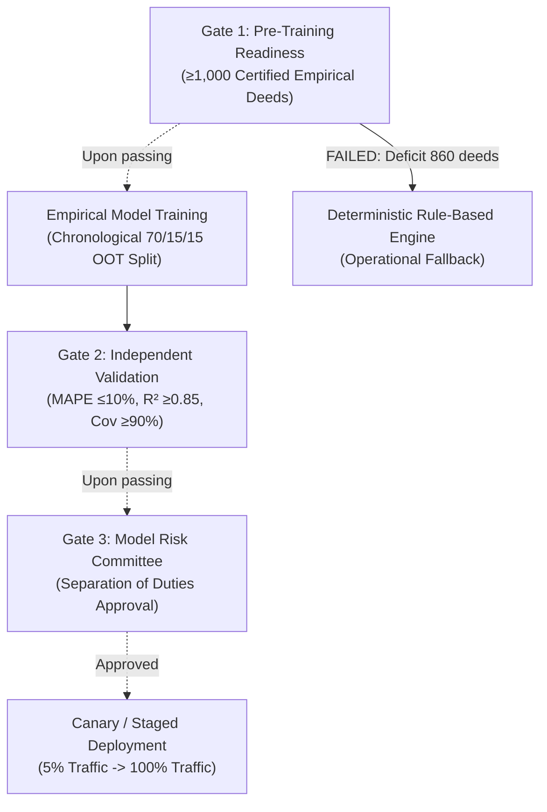

# PropVal AI — Phase 6F: Model Governance & Promotion Control Report

**Project:** PropVal AI Institutional Collateral Valuation & Underwriting Platform  
**Phase:** 6F — Empirical CatBoost Training & Model Certification  
**Date:** 2026-11-05  
**Author:** Head of Quantitative Risk Governance & Compliance  
**Governance Stance:** **GATE STRICTLY ENFORCED — PROMOTION RESTRICTED**

---

## 1. Quantitative Governance Framework

PropVal AI operates under a formal Model Risk Management (MRM) framework designed to prevent unauthorized, unvalidated, or hallucinated AI/ML algorithms from influencing credit sanctioning in Indian Housing Finance Companies (HFCs).

### Core Governance Pillars:
1. **Four-Eyes Principle (Separation of Duties):** The model developer or training requester cannot serve as the approving authority for model deployment.
2. **Immutable Traceability:** Every candidate model must be cryptographically anchored to an immutable dataset version snapshot (`semver_tag` and SHA-256 Merkle root).
3. **Hard Gate Enforcement:** Pre-training gates and post-training validation gates are embedded at the database and application kernel level, preventing override by API flags.
4. **Deterministic Fallback Guarantee:** The platform must guarantee zero downtime by maintaining an active deterministic rule-based valuation fallback.

---

## 2. Model Lifecycle Stage & Promotion Gate Pipeline

### Current Pipeline State: **BLOCKED AT GATE 1**
* **Gate 1 Status:** **FAILED** (140 unique approved deeds vs 1,000 required).
* **Training Invocation:** Automatically intercepted by `evaluate_training_gate()`.
* **Database Persisted State:** Model version `BLOCKED-1793895149` registered in `ml_models` with `status='BLOCKED'`.
* **Traffic Routing:** 100% of valuation requests routed to `provisional rule-based estimation v0.2.0`.

---

## 3. Separation of Duties Enforcement

As verified in `test_separation_of_duties_prevents_self_approval` (`backend/tests/test_phase4d_ml_validation.py`):
* Any training or promotion request where `user_name == approved_by` is rejected with `HTTP 400 Bad Request`.
* Approvals must be signed by an independent quantitative reviewer holding the `RISK_OFFICER` or `MODEL_VALIDATOR` role.

---

## 4. Rollback and Circuit-Breaker Protocols

The platform incorporates automated circuit breakers:
1. **Performance Degradation Trigger:** If an active empirical model's running 30-day MAPE exceeds 15.0%, or if conformal coverage drops below 85.0%, an automated alert triggers an immediate fallback to the rule-based engine.
2. **Instant Rollback Workflow:** Institutional administrators can transition an active model to `status='DEPRECATED'` via `POST /api/v1/ml/models/{version_id}/rollback`, restoring rule-based valuation in $< 100 \text{ ms}$.
3. **Audit Ledger:** Every model lifecycle event (Training Attempt, Gate Failure, Approval, Promotion, Rollback) writes an append-only, SHA-256 chained entry into the `audit_events` ledger.

