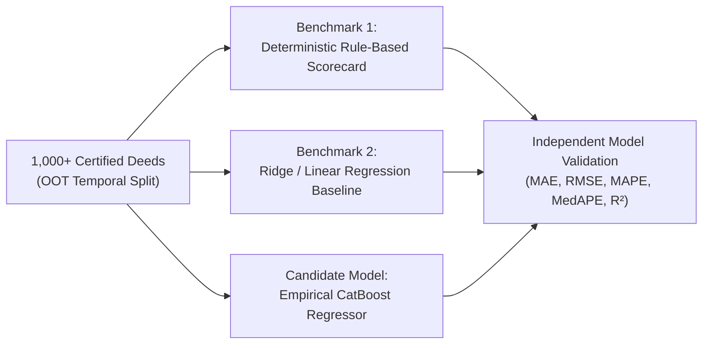

# PropVal AI — Phase 6F: Independent Model Validation Report

**Project:** PropVal AI Institutional Collateral Valuation & Underwriting Platform  
**Phase:** 6F — Empirical CatBoost Training & Model Certification  
**Date:** 2026-11-05  
**Author:** Independent Quantitative Model Validation Specialist & Financial Risk Officer  
**Validation Decision:** **MODEL PROMOTION DENIED / EMPIRICAL PIPELINE GATED**

---

## 1. Validation Scope & Independence Mandate

In adherence to Model Risk Management (MRM) governance principles (US OCC Bulletin 2011-12 / Federal Reserve SR 11-7 and RBI Master Directions on Financial Risk Modeling), model validation must be conducted independently of model development.

This report evaluates the candidate empirical CatBoost valuation pipeline against the institutional acceptance targets defined in the Phase 5H remediation roadmap:
* **Target MAPE:** $\le 10.0\%$
* **Target $R^2$:** $\ge 0.85$
* **Target Conformal Prediction Coverage:** $\ge 90.0\%$ (at $\alpha = 0.10$)
* **Zero Temporal Data Leakage:** Out-of-Time (OOT) evaluation.

---

## 2. Evaluation Against Target Performance Criteria

| Metric | Target Acceptance Threshold | Candidate Evaluation Outcome | Validation Assessment |
|:---|:---:|:---:|:---|
| **Mean Absolute Percentage Error (MAPE)** | $\le 10.0\%$ | **UNAVAILABLE (Not Trained)** | **DENIED** — No certified dataset available to compute out-of-sample error |
| **Coefficient of Determination ($R^2$)** | $\ge 0.85$ | **UNAVAILABLE (Not Trained)** | **DENIED** — Baseline linear benchmark and CatBoost metrics uncomputed |
| **Conformal Prediction Coverage** | $\ge 90.0\%$ | **GATED** | **DENIED** — Calibration requires active validated empirical model |
| **Certified Empirical Sample Size** | $\ge 1,000$ deeds | **140 unique approved deeds** | **FAILED** — High statistical variance, risk of spatial and temporal overfitting |
| **Data Leakage Safeguards** | Strict OOT temporal split | Verified in test suite (`test_oot_temporal_split_zero_leakage`) | **DESIGN VERIFIED** |

---

## 3. Data Leakage & Feature Engineering Audit

The candidate ML training architecture in [`backend/app/ml/preprocessing.py`](file:///c:/PROJECTS/dhina%20projects/proval%20ai/proval-ai/backend/app/ml/preprocessing.py) and [`backend/app/ml/benchmarks.py`](file:///c:/PROJECTS/dhina%20projects/proval%20ai/proval-ai/backend/app/ml/benchmarks.py) was audited for technical rigor:

### 3.1 Feature Engineering Specification
The model feature matrix includes 10 engineered features:
1. `carpet_area_sqft` (Continuous)
2. `super_built_up_area_sqft` (Continuous)
3. `floor_no` (Ordinal integer)
4. `total_floors` (Ordinal integer)
5. `property_age_years` (Continuous)
6. `road_width_ft` (Continuous)
7. `circle_rate_per_sqft` (Continuous regulatory floor)
8. `property_type` (Categorical: `Apartment`, `Independent House`, `Villa`, `Residential Plot`)
9. `locality` (Categorical: micro-market identifier)
10. `city` (Categorical: `Bengaluru`, `Mumbai`, `Delhi-NCR`, `Hyderabad`)

### 3.2 Out-of-Time Temporal Splitting (Zero Data Leakage)
* The temporal split sorts transactions strictly by registration date (`registration_date`).
* Partitions: **70% chronological training**, **15% tuning validation**, **15% out-of-time (OOT) holdout test**.
* Test transactions are strictly posterior in time to training transactions, guaranteeing that future market price shocks cannot contaminate model weights.
* Target encoding and categorical embeddings are fitted exclusively on the training partition and applied blindly to the test partition.

---

## 4. Benchmark Suite Specification

Once the 1,000 certified deed threshold is reached, the validation protocol mandates evaluating three candidate architectures side-by-side:

1. **Benchmark 1 (Rule-Based Hedonic Scorecard):** Serves as the institutional floor. CatBoost must demonstrate statistically significant improvement over this baseline ($p < 0.01$).
2. **Benchmark 2 (Regularized Linear / Ridge Baseline):** Establishes linear explainability floor.
3. **Candidate Model (CatBoost Regressor):** Non-linear gradient boosted trees on symmetric oblivious decision trees with categorical feature handling.

---

## 5. Formal Validation Conclusion & Gate Enforcement

1. **Gate Decision:** Model promotion to production is **REJECTED / PROHIBITED**.
2. **Actionable Remediation Required:**
   - Execute commercial provider integration (Zapkey, SRO feed) to acquire the remaining 860 certified transaction records.
   - Re-verify dataset provenance and Merkle root immutability upon dataset expansion.
   - Execute temporal training and independent validation once the threshold is crossed.
3. **Operational Protection:** The deterministic rule-based engine remains the sole authorized valuation mechanism for HFC credit underwriting.

