# PropVal AI — Phase 6H: Final Production Readiness Decision

**Project:** PropVal AI Institutional Collateral Valuation & Underwriting Platform  
**Phase:** 6H — Independent External Security Assessment & Final Production Readiness Audit  
**Date:** 2026-11-06  
**Authority:** Joint Independent Audit Committee, Head of Quantitative Risk, and Chief Technology Officer  

---

## 1. Formal Readiness Classification

In accordance with institutional financial technology governance standards, exactly one classification has been designated:

```
╔════════════════════════════════════════════════════════════════════════════════════╗
║                                                                                    ║
║                 FINAL CLASSIFICATION:                                              ║
║                                                                                    ║
║         ★  READY FOR CONTROLLED INSTITUTIONAL PILOT  ★                            ║
║                                                                                    ║
╚════════════════════════════════════════════════════════════════════════════════════╝
```

---

## 2. Evidence-Based Justification & Scorecard

The classification is supported by empirical verification across software, data, security, and infrastructure tiers:

### 2.1 Criteria Successfully Achieved
* **Core Application Software:** 100% functional across FastAPI backend and React 18 frontend. All **451 backend tests** and **26 frontend tests** pass cleanly.
* **Institutional Multi-Tenancy:** Hardened via database-native PostgreSQL **Row-Level Security (RLS)** with transaction-scoped fail-closed isolation, verified on real PostgreSQL 18.6.
* **Authentication & RBAC:** Cryptographically signed JWT tokens, timing-safe bcrypt password hashing, and strict role-based access controls active.
* **Tamper-Evident Audit Ledger:** SHA-256 cryptographic chaining verified across 691 event blocks with zero broken links.
* **Digital Personal Data Protection (DPDP) Compliance:** PII redactor scrubs Aadhaar and PAN numbers across logs, traces, and tables. Right-to-erasure workflows operational.
* **Disaster Recovery Preparedness:** Multi-region AWS architecture designed (Mumbai $\rightarrow$ Hyderabad); automated database restoration timed at **0.0378 seconds** (RTO target $\le 60 \text{ min}$).
* **Dependency Health:** OpenTelemetry stack harmonized (`1.45.2`), `pip check` clean (0 conflicts), and `pip-audit` clean (0 known CVEs).
* **Valuation Engine Transparency:** Deterministic hedonic scorecard engine (`v0.2.0`) delivers consistent, rule-based collateral appraisal with human underwriter approval workflows.

### 2.2 Critical Blockers Preventing "Production Ready" Classification
1. **Certified Dataset Volume Deficit:** The database contains 140 unique approved deeds against the 1,000 threshold required for empirical CatBoost ML training.
2. **Pending Commercial Provider Agreements:** Commercial data agreements (e.g. Zapkey) and live API credentials remain in staging pending corporate execution.
3. **Pending Live AWS Cloud Deployment:** Terraform and Kubernetes configurations are validated, but live deployment into an institutional AWS tenant remains `BLOCKED (CREDENTIALS_PENDING)`.
4. **Pending External CERT-In VAPT:** Internal security controls are validated, but formal third-party external penetration testing has not yet been executed.

---

## 3. Terms, Scope & Guardrails of the Controlled Institutional Pilot

The **Controlled Institutional Pilot** is authorized under the following operational boundaries:

1. **Target Participants:** Up to 3 accredited Housing Finance Companies (HFCs) or retail lending institutions.
2. **Valuation Engine Mode:** All valuation calculations must operate under **Deterministic Hedonic Scorecard Mode** (`provisional rule-based estimation v0.2.0`). No claims of empirical AI/ML derivation may be presented to loan committees.
3. **Mandatory Human-in-the-Loop:** Every valuation case is classified as **advisory**. Final collateral valuation and LTV sanctions require explicit sign-off by a designated institutional credit officer.
4. **Data Isolation:** Pilot institutions will operate in isolated tenant partitions enforced by PostgreSQL native Row-Level Security.
5. **Continuous Audit:** All user actions, valuation recalculations, and approval transitions will be recorded in the tamper-evident SHA-256 audit ledger.

---

## 4. Roadmap from Controlled Pilot to Full Production Readiness

```mermaid
flowchart LR
    Current["CURRENT STATE:\nControlled Institutional Pilot\n(Rule-Based Valuation Active)"]
    Step1["Step 1:\nSign Commercial Provider Contracts\n(Zapkey Live API Keys)"]
    Step2["Step 2:\nDeploy AWS Cloud Infrastructure\n(Mumbai ap-south-1 & Hyderabad ap-south-2)"]
    Step3["Step 3:\nAcquire & Certify 1,000+ Deeds\n(SRO Index II Registrations)"]
    Step4["Step 4:\nTrain & Validate CatBoost ML\n(MAPE ≤10%, Conformal Cov ≥90%)"]
    Step5["Step 5:\nExternal CERT-In Empanelled VAPT\n(Clean Audit Certificate)"]
    Production["FINAL STATE:\nFull Production Deployment\n(Commercial General Availability)"]

    Current --> Step1
    Step1 --> Step2
    Step2 --> Step3
    Step3 --> Step4
    Step4 --> Step5
    Step5 --> Production
```



### Transition Milestones:
1. **Milestone A:** Provision institutional AWS production tenant; deploy Terraform modules and EKS clusters in Mumbai (`ap-south-1`) and Hyderabad (`ap-south-2`).
2. **Milestone B:** Execute commercial data agreements; activate live provider ingestion to ingest and certify $\ge 1,000$ empirical deeds.
3. **Milestone C:** Execute out-of-time temporal CatBoost training; achieve validation targets (MAPE $\le 10\%$, $R^2 \ge 0.85$, conformal coverage $\ge 90\%$).
4. **Milestone D:** Commission third-party CERT-In empanelled penetration testing; remediate all findings and receive formal certification.
5. **Milestone E:** Convene Institutional Risk Governance Committee to grant **Production Ready** certification.

