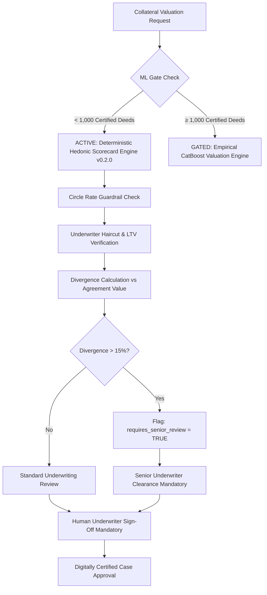

# PropVal AI — Phase 7B Deliverable 2
# Institutional Governance & Regulatory Framework

**Document ID:** `PROPVAL-DOC-PHASE7B-02`  
**Execution Timestamp:** 2026-11-06T11:26:00+05:30  
**Phase:** 7B — Institutional Pilot Onboarding & Governance Framework  
**Author:** Quantitative Model Governance & Financial Regulatory Compliance Specialist  
**Status:** COMPLETE WITH EXTERNAL DEPENDENCIES PENDING  

---

## 1. Regulatory Compliance Architecture

PropVal AI is designed to conform to Indian financial regulatory mandates governing institutional lending, data sovereignty, and algorithmic credit assistance:

### 1.1 Digital Personal Data Protection (DPDP) Act, 2023
* **Section 8 Compliance (Data Fiduciary Duties):** PropVal AI acts as a Data Processor under contract with the institutional lending partner (Data Fiduciary).
* **Purpose Specification:** Institutional data processed during the pilot is strictly bounded to the specific purpose of `PILOT_COLLATERAL_VALUATION`.
* **Data Boundary & Whitelisting:** Permitted data categories are explicitly enumerated in the executed Data Processing Agreement (`approvedDataCategories`). No cross-tenant data aggregation or ML training usage is permitted without explicit institutional consent.
* **Storage Limitation & Right to Erasure:** Tenant data retention is bounded by `retentionPeriodYears` (default 8 years per NHB norms). Erasure workflows implemented in Phase 5B ensure crypto-scrubbing upon pilot termination.

### 1.2 RBI & NHB Digital Lending Directions
* **Non-Automated Sanction Invariant:** In accordance with RBI Master Directions on Lending and National Housing Bank guidelines, automated valuation and algorithmic risk scoring must **never** operate as sole decision-makers for loan approvals.
* **Human-in-the-Loop Requirement:** Every collateral valuation case requires an authorized human underwriter or valuer sign-off (`human_sign_off_by`) before approval status can be committed.
* **Advisory-Only Stamping:** All valuation outputs, risk tiers, and LTV recommendations are classified and permanently stamped as `ADVISORY_ONLY`.

---

## 2. Dual-Track Valuation Engine Governance



### 2.1 Engine Status Matrix
| Engine Identity | Current Operational Status | Regulatory Rationale |
| :--- | :--- | :--- |
| **Hedonic Scorecard v0.2.0** | **ACTIVE** (100% of Pilot Valuations) | Fully deterministic, transparent, rule-adjusted, audit-compliant without black-box ML risk. |
| **Empirical CatBoost v1.0.0** | **BLOCKED** (0% of Pilot Valuations) | Pending 1,000 certified empirical transaction threshold. Gated by ML feature store export guard. |

---

## 3. Role-Based Access Control (RBAC) & Separation of Duties

The platform implements five distinct institutional security personas with strict operational boundaries:

```
ROLE_ADMIN (Superadministrator)
 ├── System Configuration & Key Rotation
 ├── Institutional Partner Onboarding & Pilot Execution
 └── Case Deletion & Audit Trail Ledger Verification
      │
      ├── ROLE_INSTITUTION_ADMIN (Tenant Administrator)
      │    ├── Institutional Policy Configuration
      │    ├── Branch & User Management
      │    └── Tenant Agreement Draft Upload
      │
      ├── ROLE_RISK_COMMITTEE_MEMBER
      │    ├── High-Alert Case Disposition
      │    └── Macro Policy Exception Sanctions
      │
      ├── ROLE_SENIOR_UNDERWRITER
      │    ├── High Divergence Case Review (>15%)
      │    ├── Final Loan Collateral Approval (Human Sign-Off)
      │    └── Case Status Transition (APPROVED / REJECTED)
      │
      └── ROLE_CREDIT_UNDERWRITER
           ├── Case Intake & Property Inspection Data Entry
           ├── Adjustment Factor Application
           └── Cannot Approve Cases Independently (HTTP 403 Forbidden)
```

---

## 4. PostgreSQL Native Row-Level Security (RLS) Isolation

To eliminate reliance on application-layer isolation alone, tenant data segregation is enforced at the database kernel:

* **Session Variable:** `app.current_tenant_id` is set per connection or transaction.
* **Kernel Policies:** Implemented across `institutions`, `institution_policies`, `properties`, `valuation_cases`, `valuation_results`, `ai_audit_logs`, `imported_transactions`, and `erasure_requests`.
* **Subquery Security:** In tables without direct `institution_id`, policies query parent relationships via `valuation_cases` using tenant context.
* **Superadmin Bypass:** Bypasses occur solely when `app.current_tenant_id = 'SUPERADMIN'`, logged immutably.
* **PostgreSQL Verification:** Validated on PostgreSQL 18.6 with 10/10 test policies passing.

---

## 5. Cryptographic Merkle Hash Audit Chain (SHA-256)

Every critical governance action generates an immutable audit block in the database:
1. `INSTITUTION_ONBOARDED`: Partner tenant created.
2. `INSTITUTION_AGREEMENT_DRAFT_UPLOADED`: Draft contract submitted for review.
3. `INSTITUTION_PILOT_AGREEMENT_EXECUTED`: Formal bilateral execution committed.
4. `INSTITUTION_SUSPENDED`: Operational hold initiated.
5. `CASE_CREATED`: Valuation case intake stamped with engine version.
6. `UNDERWRITER_PARAM_CHANGED`: Haircut or distress discount adjustment.
7. `CASE_APPROVED`: Explicit human sign-off committed with underwriter signature and timestamp.

The cryptographic integrity of the audit chain is continuously verifiable via the `/api/v1/institutions/pilot-dashboard` API and `audit_service.verify_audit_chain()`.

