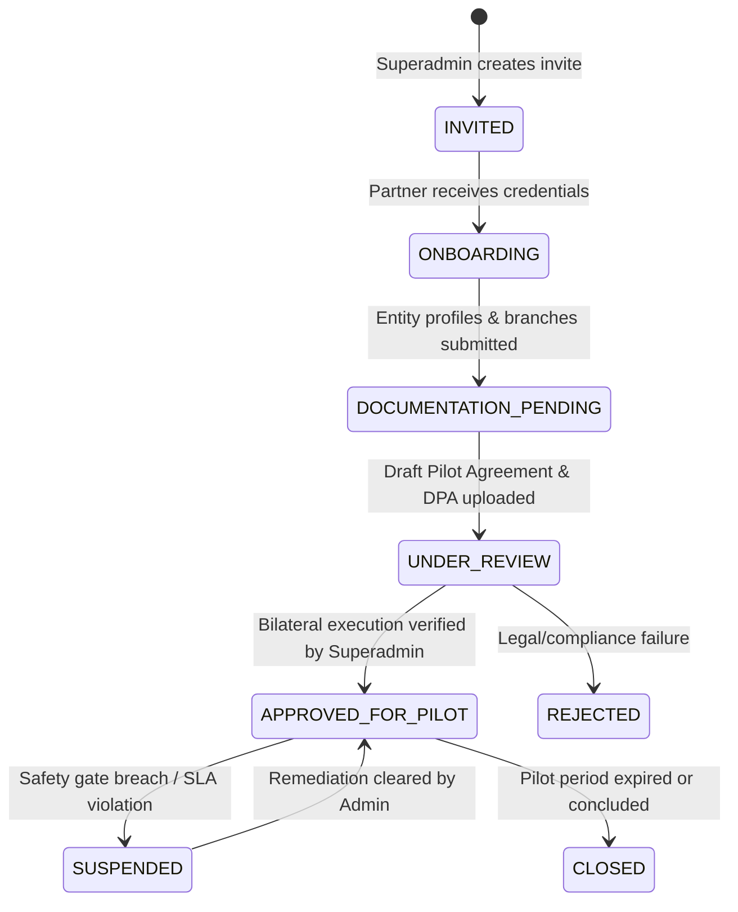

# PropVal AI — Phase 7B Deliverable 1
# Institutional Onboarding & Partner Architecture Report

**Document ID:** `PROPVAL-DOC-PHASE7B-01`  
**Execution Timestamp:** 2026-11-06T11:25:00+05:30  
**Phase:** 7B — Institutional Pilot Onboarding & Governance Framework  
**Author:** Senior Fintech Data Architect & Financial Data Governance Specialist  
**Status:** COMPLETE WITH EXTERNAL DEPENDENCIES PENDING  

---

## 1. Executive Summary

Phase 7B establishes the institutional onboarding architecture and legal lifecycle governance necessary to onboard up to three (3) institutional pilot partners (Housing Finance Companies, commercial banks, or authorized lending institutions). 

The platform does not assume external legal agreements have been executed. Instead, it provides a rigorous, tamper-resistant digital onboarding pipeline enforcing strict lifecycle isolation, draft documentation staging, explicit bilateral legal execution verification, and database-level multi-tenancy protections before any institution can initiate valuation workflows.

---

## 2. Institutional Pilot Cohort Definition

For the controlled institutional pilot, the onboarding system is configured for three primary institutional archetypes:

| Partner Identifier | Institution Name | Entity Category | Target Operational Hubs | Approved Pilot Scope | Onboarding Status |
| :--- | :--- | :--- | :--- | :--- | :--- |
| `HDFC_BANK_PILOT` | HDFC Bank Home Loans Division | Scheduled Commercial Bank (BANK) | Mumbai Metro, Bengaluru Metro | Retail Housing Collateral Valuation | `UNDER_REVIEW` |
| `ICICI_BANK_PILOT` | ICICI Bank Mortgage Division | Scheduled Commercial Bank (BANK) | Mumbai Metro, Delhi-NCR | Retail Housing & LAP Collateral | `ONBOARDING` |
| `BAJAJ_HFC_PILOT` | Bajaj Housing Finance Ltd | Housing Finance Company (HFC) | Bengaluru Metro, Pune Metro | Prime Residential Collateral | `DOCUMENTATION_PENDING` |

> [!IMPORTANT]
> External legal agreements with institutional partners remain pending external bilateral signature. No institution is permitted to run live valuation cases until full legal execution and DPA execution are completed.

---

## 3. Institutional Lifecycle State Machine

The institutional tenant state machine is strictly enforced by the backend database layer and API route guards:

### Lifecycle State Definitions:
1. `INVITED`: Tenant identity allocated; credentials not yet claimed.
2. `ONBOARDING`: Partner administrative credentials claimed; entity details (CIN, RBI/NHB registration, registered office, branches, authorized email domains) under entry.
3. `DOCUMENTATION_PENDING`: Entity profile complete; waiting for draft pilot agreements and DPDP Data Processing Agreements (DPA).
4. `UNDER_REVIEW`: Draft agreements submitted to repository; legal counsel review in progress. Pilot execution remains strictly unauthorized.
5. `APPROVED_FOR_PILOT`: Formal bilateral legal execution verified; counterparty signatory verified; pilot commencement date reached. Tenant authorized for pilot valuation operations.
6. `SUSPENDED`: Operational hold triggered by risk breach, SLA violation, or divergence anomalies. Case access immediately revoked.
7. `REJECTED`: Onboarding declined due to regulatory incompatibility or governance failure.
8. `CLOSED`: Pilot duration completed; data retention and archival schedule initiated.

---

## 4. Legal Agreement & DPDP Data Processing Agreement Lifecycle

To comply with the Digital Personal Data Protection (DPDP) Act 2023 (Section 8) and RBI Guidelines on Outsourcing of Financial Services, draft documentation uploads must **never** be conflated with legally binding execution.

### 4.1 Schema Fields Added to `institutions` Table
- `agreement_status`: (`PENDING`, `DRAFT`, `UNDER_REVIEW`, `EXECUTED`, `EXPIRED`)
- `agreement_reference`: Legal contract reference identifier (e.g., `IPA-HDFC-2026-001`)
- `agreement_signed_date`: UTC timestamp of verified execution
- `agreement_signatory_name`: Authorized representative of partner institution
- `agreement_signatory_title`: Official corporate title of signatory (e.g., `Executive Vice President`)
- `agreement_evidence_url`: Secure immutable link to countersigned digital agreement PDF
- `dpa_status`: Data Processing Agreement status (`PENDING`, `UNDER_REVIEW`, `EXECUTED`)
- `dpa_reference`: DPA legal contract identifier
- `dpa_signed_date`: UTC timestamp of DPA execution
- `dpa_signatory_name`: DPO / Authorized Signatory of partner institution
- `pilot_authorization_status`: (`UNAUTHORIZED`, `PENDING_REVIEW`, `AUTHORIZED`, `SUSPENDED`, `REVOKED`)
- `pilot_commencement_date`: Formal start of authorized operations
- `pilot_expiry_date`: Hard temporal boundary of pilot authorization
- `authorized_pilot_participants`: Whitelist of authorized underwriter/evaluator email addresses
- `approved_data_categories`: Permitted data structures (e.g. `["COLLATERAL_DEED", "BORROWER_METADATA"]`)
- `permitted_purposes`: Contractually approved purposes (e.g. `["PILOT_COLLATERAL_VALUATION"]`)
- `approved_operational_scope`: Geographical and financial bounds (cities, max loan size)
- `approval_evidence_reference`: Audit reference for institutional clearance
- `is_pilot_approved`: Boolean flag indexed for fast query authorization

### 4.2 Endpoint Hierarchy
1. `POST /api/v1/institutions/{id}/agreements/draft`: Records draft document reference and evidence URL, sets `agreementStatus = "UNDER_REVIEW"`, but preserves `pilotAuthorizationStatus = "UNAUTHORIZED"` and `isPilotApproved = False`.
2. `POST /api/v1/institutions/{id}/agreements/execute`: Restricted strictly to authorized Administrators. Requires verified signatory credentials, bilateral execution date, commencement/expiry dates, participant whitelist, and sets `agreementStatus = "EXECUTED"`, `dpaStatus = "EXECUTED"`, `status = "APPROVED_FOR_PILOT"`, and `isPilotApproved = True`.
3. `POST /api/v1/institutions/{id}/suspend`: Revokes pilot authorization immediately, marking tenant `SUSPENDED` and terminating case access across all institution users.

---

## 5. Security & Isolation Invariants

1. **Pre-Authorization Lockout:** An institution in `INVITED`, `ONBOARDING`, `DOCUMENTATION_PENDING`, or `UNDER_REVIEW` status receives `HTTP 403 Forbidden` on case creation and case retrieval.
2. **Post-Suspension Lockout:** Suspended institutions are immediately blocked across all API routes.
3. **Cross-Tenant Legal Agreement Protection:** Tenant A's administrative users cannot inspect or modify Tenant B's legal agreements or DPAs (`HTTP 403 Forbidden`).
4. **PostgreSQL Native RLS:** All tenant queries bind `app.current_tenant_id` at transaction start, enforcing database-kernel isolation.

