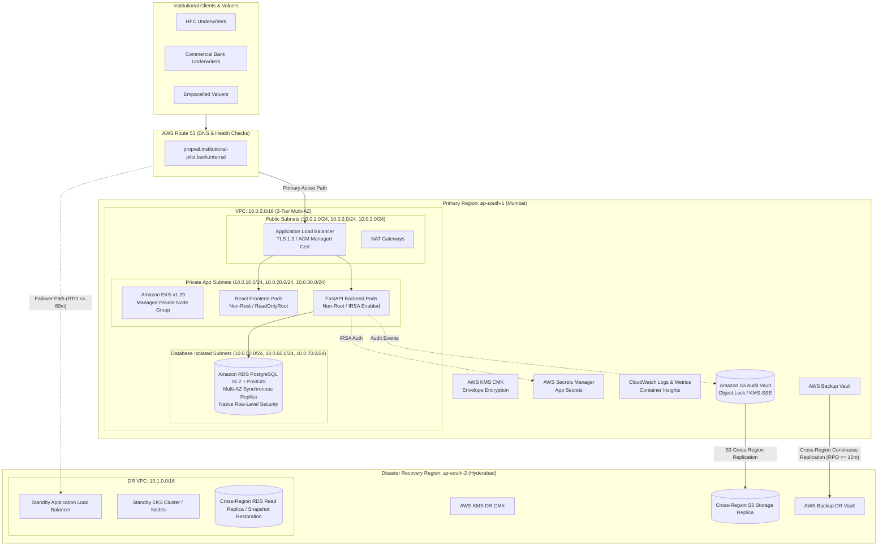

# PropVal AI — Phase 7C Deliverable 1
# AWS Multi-Region Cloud Architecture & Sovereign Infrastructure Blueprint

**Document ID:** `PROPVAL-DOC-PHASE7C-01`  
**Execution Timestamp:** 2026-11-06T11:38:00+05:30  
**Phase:** 7C — Live AWS Institutional Cloud Deployment  
**Author:** Senior AWS Cloud Architect, Kubernetes Engineer & DevSecOps Specialist  
**Status:** ARCHITECTURALLY CONFIGURED & STAGED (LIVE CLOUD PROVISIONING BLOCKED)  

---

## 1. Architectural Overview & Regulatory Principles

The PropVal AI institutional cloud infrastructure is designed to provide high-availability, bank-grade collateral valuation services while complying with the strict data localization and sovereignty requirements of:
- **Digital Personal Data Protection (DPDP) Act, 2023** (100% Domestic Indian Processing & Storage).
- **Reserve Bank of India (RBI) Master Directions on Information Technology Governance, Risk, Controls and Assurance Practices (2023)**.
- **National Housing Bank (NHB) Information Security Guidelines for HFCs**.

To ensure zero cross-border data leakage and maintain robust disaster recovery capabilities, the architecture spans two domestic AWS regions within the Republic of India:
1. **Primary Operational Region:** `ap-south-1` (Mumbai)
2. **Disaster Recovery Region:** `ap-south-2` (Hyderabad)

---

## 2. Infrastructure Component Specifications

### 2.1 Virtual Private Cloud (VPC) & Network Segmentation
- **CIDR Block:** `10.0.0.0/16` (Primary ap-south-1), `10.1.0.0/16` (DR ap-south-2).
- **Subnet Tiering (Strict 3-Tier Architecture):**
  1. *Public Subnets (`10.0.1.0/24`, `10.0.2.0/24`, `10.0.3.0/24`):* Houses Internet-facing ALBs and NAT Gateways. Direct routing to Internet Gateway.
  2. *Private Application Subnets (`10.0.10.0/24`, `10.0.20.0/24`, `10.0.30.0/24`):* Houses EKS worker nodes, pods, and internal load balancers. Outbound traffic routed strictly through NAT Gateways.
  3. *Isolated Database Subnets (`10.0.50.0/24`, `10.0.60.0/24`, `10.0.70.0/24`):* Zero internet gateway route (`create_database_internet_gateway_route = false`). Ingress strictly limited to EKS worker nodes on TCP port 5432.
- **VPC Flow Logs:** 100% packet logging captured to CloudWatch Log Group `/aws/vpc/propval-production-flow-logs` encrypted with Customer Managed Key (CMK), retained for 90 days for forensic auditability.

### 2.2 Elastic Kubernetes Service (EKS) Cluster
- **Cluster Version:** Kubernetes v1.29.
- **Control Plane Security:** Endpoint private access enabled; public endpoint restricted. Control plane logging enabled for `api`, `audit`, `authenticator`, `controllerManager`, and `scheduler`.
- **Envelope Encryption:** Kubernetes secrets are encrypted at rest using AWS KMS Customer Managed Key (`aws_kms_key.propval_cmk`).
- **Managed Node Group:**
  - Instances: `t3.large` / `m6i.large` in private subnets across 3 Availability Zones.
  - Auto-scaling: Min 2 nodes, Desired 3 nodes, Max 10 nodes.
  - Pod Security Standards: Enforces Kubernetes Restricted Profile (`runAsNonRoot: true`, `readOnlyRootFilesystem: true`, capabilities dropped: `ALL`).

### 2.3 IAM Roles for Service Accounts (IRSA)
- Pods access AWS services without static credentials or node-level permissions.
- EKS OIDC Provider federates with AWS IAM.
- Backend ServiceAccount `propval-backend-sa` assumes role `propval-production-backend-irsa-role` with least-privilege access restricted to:
  - `secretsmanager:GetSecretValue` on `propval/production/app-secrets`.
  - `kms:Decrypt` on `alias/propval-production-cmk`.

### 2.4 Application Load Balancer & Ingress Security
- Dual-AZ ALB residing in public subnets.
- TLS 1.3 enforced; TLS 1.0 and 1.1 strictly disabled.
- Automated HTTP (port 80) to HTTPS (port 443) permanent redirection (301).
- Ingress security headers injected:
  - `Strict-Transport-Security: max-age=63072000; includeSubDomains; preload`
  - `X-Frame-Options: DENY`
  - `X-Content-Type-Options: nosniff`
  - `Referrer-Policy: strict-origin-when-cross-origin`

### 2.5 Relational Database Service (RDS) PostgreSQL
- **Engine:** PostgreSQL 16.2 with PostGIS extension.
- **Topology:** Multi-AZ high availability with synchronous standby replica.
- **Storage:** `gp3` SSD with automated scaling from 50 GB to 500 GB.
- **Encryption:** Storage and backups encrypted using AWS KMS CMK.
- **SSL/TLS:** Parameter `rds.force_ssl = 1` enforces TLS for all database connections.
- **Backups:** 30-day automated continuous WAL archiving for point-in-time recovery (PITR).
- **Tenant Isolation:** Native PostgreSQL Row-Level Security (`FORCE ROW LEVEL SECURITY`) enforced at the database kernel.

### 2.6 Storage & Secrets Vault
- **S3 Audit Vault:** Immutable S3 bucket with Object Lock and KMS SSE (`aws_kms_key.propval_cmk`). All public access blocked.
- **AWS Secrets Manager:** Centralized store for `DATABASE_URL`, `JWT_SECRET`, and `COMMERCIAL_PROVIDER_KEYS`.

---

## 3. Terraform Infrastructure As Code (IaC) Hierarchy

All infrastructure components are declared in modular Terraform HCL under `infra/terraform/`:
- `main.tf`: VPC, KMS CMK, Security Groups, RDS PostgreSQL, EKS Cluster, Node Group, IRSA, Secrets Manager, CloudWatch, S3 Vault.
- `variables.tf`: Parameterized instance types, subnets, retention windows, and regions.
- `outputs.tf`: EKS endpoint, RDS endpoint, ALB DNS name, KMS key ARNs, and VPC ID.
- `dr_secondary_region.tf`: Secondary KMS key, DR backup vault, and secondary S3 storage in `ap-south-2` (Hyderabad).

