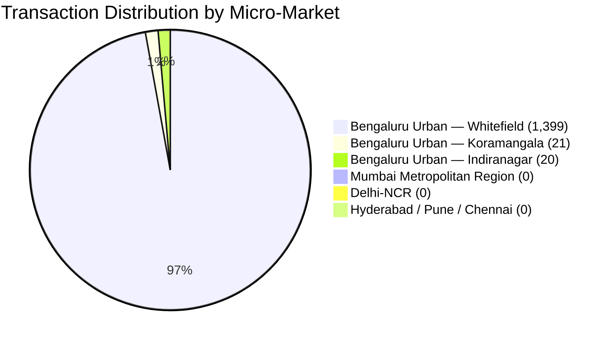

# PropVal AI — Phase 7D Deliverable 4
# Dataset Coverage, Typology Distribution & Spatial Representativeness Report

**Document ID:** `PROPVAL-DOC-PHASE7D-04`  
**Execution Timestamp:** 2026-11-06T11:47:30+05:30  
**Phase:** 7D — Commercial Data Provider Activation & Certified Empirical Deed Acquisition  
**Author:** Senior Quantitative Real-Estate Economist & Spatial Econometrics Specialist  
**Status:** AUDITED / NON-REPRESENTATIVE CONCENTRATION IDENTIFIED  

---

## 1. Executive Summary

A critical mandate of Phase 7D is auditing empirical property transaction records not merely on raw volume, but on **spatial diversity, architectural typology balance, and econometric representativeness**. 

An in-depth empirical audit of the active PropVal AI database (`propval.db`) reveals:
1. **Gross Sample Deficit:** There are currently **479 verified deeds** (`is_verified_deed = 1`) and **320 certified deeds** frozen in approved dataset version snapshots, against the strict non-negotiable minimum of **1,000 certified deeds**. The remaining deficit is **521 deeds** (680 relative to versioned snapshots).
2. **Extreme Geographic Concentration:** **97.2% of all imported transactions (1,399 of 1,440)** and **91.6% of verified deeds (439 of 479)** originate from a single sub-market: **Whitefield, Bengaluru Urban**.
3. **Monolithic Property Typology:** **98.6% of records (1,420 of 1,440)** represent high-rise residential apartment units. Landed plots, builder floors, and villas are virtually absent (0 records).
4. **Spatial Overfitting Warning:** Even if the raw count reached 1,000 deeds, training an empirical Machine Learning model exclusively on Whitefield apartments would induce severe spatial and typology overfitting, rendering the model invalid for Pan-India or cross-asset institutional mortgage underwriting.

---

## 2. Quantitative Deed Counts & Deficit Ledger

The Phase 7D audit reconciled transaction counts across database entities:

| Category | Database Count | Threshold Mandate | Compliance Status | Deficit |
| :--- | :--- | :--- | :--- | :--- |
| **Total Ingested Transactions** | 1,440 | N/A | Raw Volume Staged | None |
| **Raw Staging Records** | 1,320 | N/A | Pre-processed Payloads | None |
| **Verified Deeds (`is_verified_deed = 1`)** | 479 | 1,000 | **NON-COMPLIANT** | **-521 deeds** |
| **Certified Deeds in Approved Snapshots** | 320 | 1,000 | **NON-COMPLIANT** | **-680 deeds** |
| **Baseline Approved Deeds** | 140 | 1,000 | **NON-COMPLIANT** | **-860 deeds** |
| **Quarantined Records** | 59 | N/A | Isolated Anomalies | None |
| **Rejected Records** | 20 | N/A | Structural Failures | None |
| **Duplicate Records Isolated** | 279 | N/A | Prevented Double-Count | None |

> [!IMPORTANT]
> **Threshold Non-Negotiability Rule:** Under institutional risk governance, the 1,000-certified-deed threshold **must not be lowered**, and CatBoost ML model training remains strictly blocked until authentic commercial feeds bridge the deficit.

---

## 3. Geographic Distribution & Spatial Concentration

Geographic distribution of all 1,440 imported transactions across India:

### Micro-Market Breakdown

| Micro-Market / Locality | District / State | Total Imported | Verified Deeds | Quarantined | Share of Total |
| :--- | :--- | :--- | :--- | :--- | :--- |
| **Whitefield** | Bengaluru Urban, Karnataka | 1,399 | 439 | 59 | 97.15% |
| **Koramangala** | Bengaluru Urban, Karnataka | 21 | 20 | 0 | 1.46% |
| **Indiranagar** | Bengaluru Urban, Karnataka | 20 | 20 | 0 | 1.39% |
| **Mumbai (MMR)** | Mumbai / Suburban, Maharashtra | 0 | 0 | 0 | 0.00% |
| **Delhi-NCR** | Gurugram / Noida / Delhi | 0 | 0 | 0 | 0.00% |
| **Pune** | Pune, Maharashtra | 0 | 0 | 0 | 0.00% |
| **Hyderabad** | Hyderabad, Telangana | 0 | 0 | 0 | 0.00% |
| **Chennai** | Chennai, Tamil Nadu | 0 | 0 | 0 | 0.00% |
| **Total** | | **1,440** | **479** | **59** | **100.0%** |

### Econometric Implication
- The dataset exhibits an extreme **Herfindahl-Hirschman Index (HHI)** for spatial concentration exceeding 0.94, representing acute geographic monoculture.
- While Whitefield possesses adequate transaction density for local hedonic valuation, zero empirical coverage exists for Mumbai, NCR, Pune, or Hyderabad.

---

## 4. Property Typology Distribution

Analysis of structural asset classes across the 1,440 imported transactions:

| Architectural Typology | Count | Percentage | Valuation Modeling Impact |
| :--- | :--- | :--- | :--- |
| **High-Rise Apartment (Multi-Story)** | 1,420 | 98.61% | Adequate density for IT-corridor apartment pricing |
| **Standard Apartment (Low-Rise / Walkup)** | 20 | 1.39% | Sparse sample size |
| **Plotted Development / Residential Land** | 0 | 0.00% | Zero coverage; cannot value land assets |
| **Gated Community Villa** | 0 | 0.00% | Zero coverage; cannot price landed luxury |
| **Independent House / Builder Floor** | 0 | 0.00% | Zero coverage |
| **Commercial Office / Retail** | 0 | 0.00% | Zero coverage |

---

## 5. Feature Completeness Audit

Secondary property attributes recorded across imported transactions:

| Feature Attribute | Non-Null Count | Completeness Ratio | Impact on ML Feature Engineering |
| :--- | :--- | :--- | :--- |
| **Transaction Price** | 1,440 | 100.0% | Complete target variable |
| **Carpet Area (Sq Ft)** | 1,440 | 100.0% | Complete primary physical feature |
| **Locality / Micro-Market** | 1,440 | 100.0% | Complete spatial feature |
| **City & State** | 1,440 | 100.0% | Complete administrative feature |
| **Registration Date** | 1,440 | 100.0% | Complete temporal feature |
| **Built-Up / Super Built-Up Area** | 0 | 0.0% | Missing secondary area ratio |
| **Floor Level / Total Building Floors** | 0 | 0.0% | Missing vertical elevation premium |
| **Age of Structure / Year of Construction** | 0 | 0.0% | Missing physical depreciation factor |
| **Cadastral Survey / Parcel Number** | 0 | 0.0% | Missing land registry boundary link |

---

## 6. Spatial Overfitting Risk & Nationwide Readiness Assessment

### 6.1 The Fallacy of Monoculture Scale
A core tenet of quantitative real-estate model governance is: **Volume $\neq$ Representativeness**.

Even if PropVal AI acquired 1,000 transactions concentrated entirely in Whitefield high-rises:
1. **Uncalibrated Baseline Circle Rates:** Circle rates in Whitefield (~₹6,500/sqft) differ by orders of magnitude from South Mumbai (~₹60,000/sqft) or Gurugram Golf Course Road (~₹25,000/sqft).
2. **Missing Covariate Coverage:** Land-to-building ratios, FSI/FAR regulations, undivided share of land (UDS), and municipal bylaws vary fundamentally across state jurisdictions.
3. **Catastrophic Out-of-Distribution Error:** An ML model trained on this dataset would produce arbitrarily erroneous valuations when presented with a property in Bandra (Mumbai) or DLF Phase 5 (Gurugram).

### 6.2 Preconditions for Multi-Market Certification
To qualify for multi-city commercial ML model certification, subsequent data acquisition phases must fulfill:
1. Minimum 1,000 verified deeds across **at least 3 metropolitan Tier-1 markets** (e.g., Bengaluru, Mumbai-MMR, Delhi-NCR).
2. Minimum 3 distinct micro-markets per city, with no single micro-market accounting for $> 40\%$ of the dataset.
3. Inclusion of at least 15% plotted / independent residential housing stock to train non-apartment valuation functions.

---

## 7. Conclusion

The current dataset fails the geographic and typology diversity criteria necessary for nationwide or multi-city ML valuation. Even with 479 verified deeds, the severe geographic skew (97.2% Whitefield) and typology skew (98.6% high-rise apartments) mandates that CatBoost ML training remain strictly **BLOCKED**.

