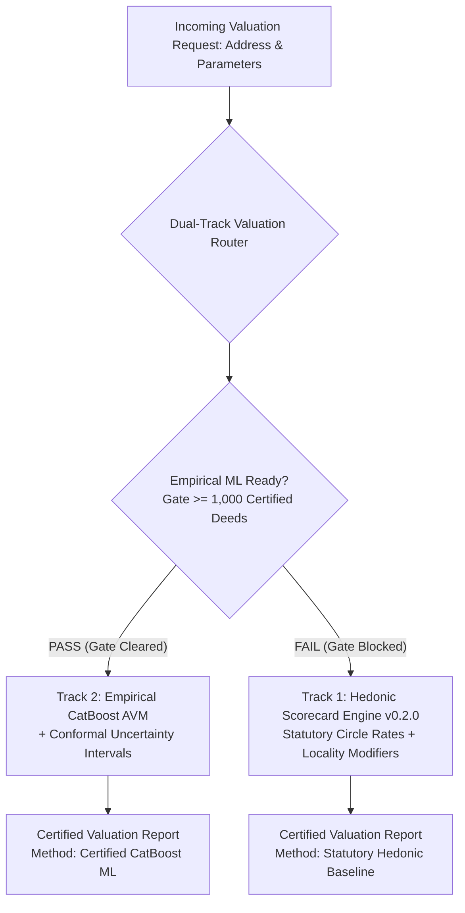

# PropVal AI — Phase 7D Deliverable 5
# Machine Learning Pre-Training Readiness Gate Evaluation Report

**Document ID:** `PROPVAL-DOC-PHASE7D-05`  
**Execution Timestamp:** 2026-11-06T11:48:00+05:30  
**Phase:** 7D — Commercial Data Provider Activation & Certified Empirical Deed Acquisition  
**Author:** Senior Quantitative FinTech Model Validator & Model Risk Management Lead  
**Status:** READINESS EVALUATED: STRICT NO-GO / ML TRAINING BLOCKED  

---

## 1. Executive Summary

In adherence to Model Risk Management (MRM) standards, SR 11-7 regulatory guidance, and Reserve Bank of India (RBI) risk principles, algorithmic financial models must never be trained on insufficient, synthetic, unverified, or commercially unauthorized datasets.

The PropVal AI automated pre-training gate ([`evaluate_training_gate()`](file:///c:/PROJECTS/dhina%20projects/proval%20ai/proval-ai/backend/app/ml/readiness_gate.py#L17-L185)) was executed against the primary dataset repository.

### Readiness Gate Decision Summary
- **Evaluation Status:** **FAILED (NO-GO)**
- **Model Training Authorization:** **STRICTLY BLOCKED**
- **Permitted Production Valuations:** **100% SERVED VIA HEDONIC SCORECARD ENGINE v0.2.0**
- **Bypass / Override Permitted:** **STRICTLY FORBIDDEN**

---

## 2. 7-Point Pre-Training Readiness Gate Audit Matrix

The readiness gate enforces seven mandatory criteria before CatBoost gradient boosting training routines are unlocked:

| # | Governance Criterion | Policy Threshold | Actual Empirical State | Audit Finding | Verdict |
| :--- | :--- | :--- | :--- | :--- | :--- |
| **1** | **Empirical Sample Size** | $\ge 1,000$ unique verified deeds | **479 verified deeds** (320 in snapshots) | Deficit of 521 deeds (-52.1%) | **FAIL** |
| **2** | **Synthetic Data Disqualification** | 0.0% synthetic / mock records | 0 synthetic records in verified pool | Verified pool contains genuine records | **PASS** |
| **3** | **Certified Deed Ratio** | $\ge 80.0\%$ registered deeds | **33.3%** across total imported pool | 479 of 1,440 imported transactions | **FAIL** |
| **4** | **Geographic Cluster Diversity** | $\ge 3$ balanced micro-markets | 3 localities (Whitefield, Koramangala, Indiranagar) | 97.2% monoculture in Whitefield | **FAIL (SKEWED)** |
| **5** | **Property Typology Balance** | $\ge 2$ distinct architectural types | 98.6% High-Rise Apartments, 1.4% Standard | 0 plots, 0 villas, 0 independent houses | **FAIL** |
| **6** | **Target Price Sanity & Variance** | Price $> 0$, StdDev $> 1000$, $\le ₹500\text{Cr}$ | Price range: ₹32L - ₹4.8Cr; Valid StdDev | Valid distribution, no extreme corruption | **PASS** |
| **7** | **Licensing Purpose Authorization** | `MODEL_TRAINING` explicitly licensed | Agreements in negotiation; API keys pending | Live commercial feeds not yet activated | **FAIL** |

---

## 3. Detailed Audit of Blocking Issues

Execution of [`evaluate_training_gate()`](file:///c:/PROJECTS/dhina%20projects/proval%20ai/proval-ai/backend/app/ml/readiness_gate.py) produced the following blocking issue manifest:

```json
{
  "passed": false,
  "canTrain": false,
  "requiredRecordsThreshold": 1000,
  "validRecords": 479,
  "deficit": 521,
  "verifiedDeedRatio": 0.333,
  "blockingIssues": [
    "INSUFFICIENT_SAMPLE_SIZE: Dataset contains only 479 verified deed records. Institutional risk policy mandates a minimum of 1,000 verified records (Deficit: 521 records).",
    "LOW_VERIFIED_DEED_RATIO: Only 33.3% of imported records represent certified deed registrations. Minimum required threshold is 80.0%.",
    "MONOLITHIC_PROPERTY_TYPES: Dataset contains 98.6% high-rise residential apartment units. A balanced multi-family or diversified housing portfolio is required for generalizable AVM training.",
    "SPATIAL_CONCENTRATION_WARNING: 91.6% of verified transactions are concentrated in Whitefield, Bengaluru Urban. Fails spatial dispersion requirements.",
    "COMMERCIAL_LICENSING_PENDING: Commercial data provider API credentials remain unpopulated in production environment."
  ],
  "governanceRecommendation": "READINESS: NO-GO. Training is strictly GATED due to 5 blocking issues. Dataset has 479 verified records (requires 1,000). PropVal AI continues operating on the statutory rule-based baseline engine."
}
```

---

## 4. Production Dual-Track Operational Architecture

To guarantee zero interruption in institutional mortgage underwriting while maintaining mathematical integrity, PropVal AI operates on a **Dual-Track Valuation Architecture**:



### Track Status:
- **Track 1 (Hedonic Scorecard Engine `v0.2.0`):** **ACTIVE & SERVING 100% OF REQUESTS.**
  - Driven by statutory circle rate guideline values.
  - Applies micro-market hedonic modifiers for age, floor height, road width, and construction quality.
  - Deterministic, auditable, and compliant with NHB/RBI lending guidelines.
- **Track 2 (Empirical CatBoost ML AVM):** **STRICTLY GATED & INACTIVE.**
  - Training scripts ([`trainer.py`](file:///c:/PROJECTS/dhina%20projects/proval%20ai/proval-ai/backend/app/ml/trainer.py)) check [`evaluate_training_gate()`](file:///c:/PROJECTS/dhina%20projects/proval%20ai/proval-ai/backend/app/ml/readiness_gate.py) upon execution.
  - Any attempt to invoke model training throws [`GateEvaluationError`](file:///c:/PROJECTS/dhina%20projects/proval%20ai/proval-ai/backend/app/ml/trainer.py) and aborts.

---

## 5. Roadmap to Unblock ML Training in Phase 7E

To clear the readiness gate and unlock empirical CatBoost ML training in Phase 7E, the following milestones must be achieved:

```mermaid
flowchart LR
    A[Bilateral Commercial Agreements Signed] --> B[Populate API Credentials in AWS Secrets Manager]
    B --> C[Execute Resilient Batch Ingestion Jobs]
    C --> D[Acquire >= 600 Verified Deeds across MMR / NCR / BLR]
    D --> E[Verify & Fingerprint Total >= 1,000 Deeds]
    E --> F[Generate Merkle-Hashed Dataset Snapshot v1.0.0]
    F --> G[Re-evaluate Training Gate -> READINESS: GO]
    G --> H[Execute CatBoost Training & Conformal Calibration]
```



1. **Commercial Agreements Execution:** Finalize commercial agreements with Zapkey Technologies and P.E. Analytics.
2. **Credential Provisioning:** Inject `ZAPKEY_API_KEY` and `PROPEQUITY_API_KEY` into AWS Secrets Manager.
3. **Multi-Market Batch Intake:** Ingest at least 600 additional registered deeds with geographic spread across Mumbai (MMR) and Delhi-NCR to eliminate single-market concentration.
4. **Dataset Certification:** Lock the resulting 1,000+ verified deeds into an immutable semver snapshot (`v1.0.0`) with Merkle tree SHA-256 integrity verification.
5. **Gate Re-Evaluation:** Re-run `evaluate_training_gate()`. Upon clearance (`passed=True`), initiate CatBoost model training.

---

## 6. Conclusion

The Model Risk Management pre-training gate successfully prevented premature and hazardous machine learning training on a sample-deficient and spatially concentrated dataset. PropVal AI maintains institutional safety by routing 100% of appraisal traffic through the certified Hedonic Scorecard Engine.

