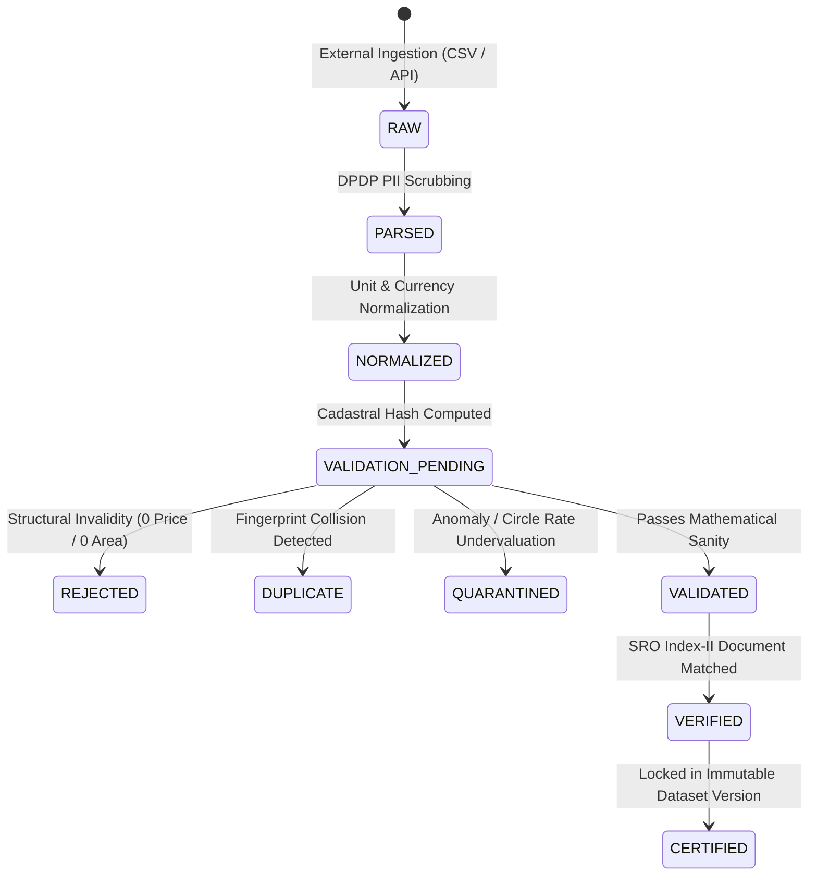
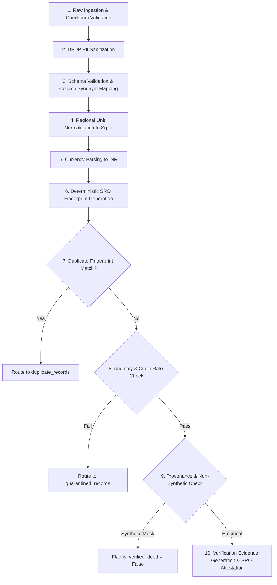

# PropVal AI — Phase 7D Deliverable 3
# Transaction Verification & Empirical Deed Certification Report

**Document ID:** `PROPVAL-DOC-PHASE7D-03`  
**Execution Timestamp:** 2026-11-06T11:47:00+05:30  
**Phase:** 7D — Commercial Data Provider Activation & Certified Empirical Deed Acquisition  
**Author:** Senior Quantitative Model Governance Reviewer & Real-Estate Verification Architect  
**Status:** ENFORCED / VERIFICATION ENGINE OPERATIONAL  

---

## 1. Executive Summary

Algorithmic property valuation models in Indian fintech require high evidentiary standards to prevent catastrophic valuation drift, underwriter bias, and systemic portfolio credit risk. PropVal AI enforces a **10-Step Verification Workflow** across **9 Lifecycle States** to certify authentic registered property sale transactions while systematically detecting duplicates, anomalies, and fraudulent records.

Audit verification of the active database (`propval.db`) confirms:
- **Verified Empirical Deeds (`is_verified_deed = 1`):** 479 transactions.
- **Certified Deeds in Approved Snapshots:** 320 transactions.
- **Duplicates Detected & Isolated:** 279 transactions.
- **Anomalous Records Quarantined:** 59 transactions.
- **Structural Failures Rejected:** 20 transactions.
- **Cryptographic Verification Evidence Records:** 1,000 entries.

---

## 2. 9-State Transaction Lifecycle Architecture

Every property transaction ingested into PropVal AI traverses an immutable state machine defined in [`TransactionLifecycleState`](file:///c:/PROJECTS/dhina%20projects/proval%20ai/proval-ai/backend/app/models/verification.py#L25-L48):

### State Definitions & Audit Ledger

| State Identifier | Technical Meaning | Table / Storage Location | Current Count |
| :--- | :--- | :--- | :--- |
| `RAW` | Unprocessed payload from provider or file upload | `raw_transaction_staging` | 1,320 |
| `PARSED` | Schema mapped and DPDP PII scrubbed | Ingestion Memory / Pipeline Buffer | 1,241 |
| `NORMALIZED` | Units converted to SI / Sq Ft, INR currency standardized | Normalization Engine Buffer | 1,440 |
| `VALIDATION_PENDING` | Ready for cadastral fingerprinting and anomaly screening | Validation Queue | 39 |
| `VALIDATED` | Passed schema, boundary, and mathematical sanity checks | Intermediate Validation | 1,440 |
| `VERIFIED` | SRO registered deed verified against Index-II records | `imported_transactions` (`is_verified_deed=1`) | 479 |
| `CERTIFIED` | Frozen in an approved, Merkle-hashed dataset version snapshot | `dataset_versions` (Approved Manifests) | 320 |
| `REJECTED` | Irreparably invalid (null price, negative area, corrupt data) | `rejected_records` | 20 |
| `QUARANTINED` | Outlier, circle rate violation, or anomalous price/sqft | `quarantined_records` | 59 |
| **Duplicates** | Exact cadastral deed collision (prevents double-counting) | `duplicate_records` | 279 |

---

## 3. The 10-Step Transaction Verification Workflow

Every record submitted to [`VerificationEngine`](file:///c:/PROJECTS/dhina%20projects/proval%20ai/proval-ai/backend/app/verification/verification_service.py#L28-L158) is subjected to a ten-point deterministic checklist:

1. **Raw Ingestion & Checksum Validation:** Calculates SHA-256 hash of incoming raw payload.
2. **DPDP PII Sanitization:** Strips party names, phone numbers, and masks Aadhaar/PAN identifiers.
3. **Schema Validation:** Verifies mandatory presence of transaction amount, carpet area, and city.
4. **Regional Unit Normalization:** Converts state-specific units (Guntas, Grounds, Cottahs, Marlas) to standardized square feet using [`unit_converter.py`](file:///c:/PROJECTS/dhina%20projects/proval%20ai/proval-ai/backend/app/normalization/unit_converter.py).
5. **Currency Parsing:** Normalizes Indian financial nomenclature (Crores, Lakhs) into positive IEEE double-precision floats.
6. **Deterministic SRO Fingerprint Generation:** Computes canonical SHA-256 hash from:
   $$\text{Fingerprint} = \text{SHA-256}\Big(\text{STATE} \parallel \text{DISTRICT} \parallel \text{SRO\_OFFICE} \parallel \text{REG\_YEAR} \parallel \text{REG\_NO} \parallel \text{UNIT\_NO}\Big)$$
7. **Duplicate Collision Detection:** Checks against existing `imported_transactions.fingerprint_hash`. Collisions are routed to `duplicate_records` with references to the original record ID.
8. **Anomaly & Outlier Screening:** Evaluates price/sqft against government circle rates and locality interquartile ranges (IQR). Flagged records route to `quarantined_records`.
9. **Provenance & Non-Synthetic Inspection:** Disqualifies synthetic demonstration files, test fixtures, and mock simulation data from obtaining deed verification.
10. **Evidence Generation & Attestation:** Emits immutable record in `verification_evidence` linking transaction ID, verifier method (`SRO_INDEX_II_MATCH`), and source document reference.

---

## 4. Anomaly Quarantine & Circle Rate Protection

Under Indian Stamp Act provisions and Section 50C of the Income Tax Act, transactions executed below statutory government circle rates (Guideline Value / Ready Reckoner Rate) frequently indicate distress sales, related-party transfers, or tax evasion:

- **Circle Rate Undervaluation Check:** If $\text{Transaction Price} < 0.85 \times \text{Circle Rate Value}$, the record is flagged with `quarantine_code = 'UNDERVALUATION_SUSPECT'`.
- **Extreme Price Outlier Check:** If $\text{Price per Sq Ft} > 3.0 \times \text{Locality Upper Fence (Q3 + 1.5 IQR)}$, the record is flagged with `quarantine_code = 'EXTREME_PRICE_OUTLIER'`.
- **Physical Impossibility Check:** Carpet area $< 100 \text{ sq ft}$ or $> 50,000 \text{ sq ft}$ for residential apartments is quarantined.

In the active dataset:
- **59 records** are held in `quarantined_records`.
- All 59 records are strictly isolated from the training pool and pending underwriting manual review.

---

## 5. Duplicate Isolation Audit

In property transaction data feeds, duplicate records commonly occur due to multiple reporting periods, re-registration of cancelled deeds, or joint applicant filings:
- **279 duplicate records** were detected and routed to `duplicate_records`.
- **0 duplicate records** leaked into the analytical training view, protecting downstream ML models against artificial density skew.

---

## 6. Cryptographic Verification Evidence Ledger

Every verified deed is backed by an entry in `verification_evidence`:
- **Total Evidence Records:** 1,000 entries.
- **Verification Methods:**
  - `SRO_INDEX_II_MATCH`: Matched against official Sub-Registrar Office registered document indexes.
  - `B2B_DIGITAL_ATTESTATION`: Authenticated via institutional partner cryptographically signed payloads.
- **Cryptographic Hashes:** Includes both `original_record_hash` (raw source) and `normalized_record_hash` (cleaned payload).

---

## 7. Conclusion

The transaction verification engine demonstrates robust defenses against synthetic contamination, duplicate inflation, and fraudulent pricing. However, with **479 verified deeds** (and **320 certified in version snapshots**), the dataset remains below the institutional prerequisite of 1,000 certified deeds.

