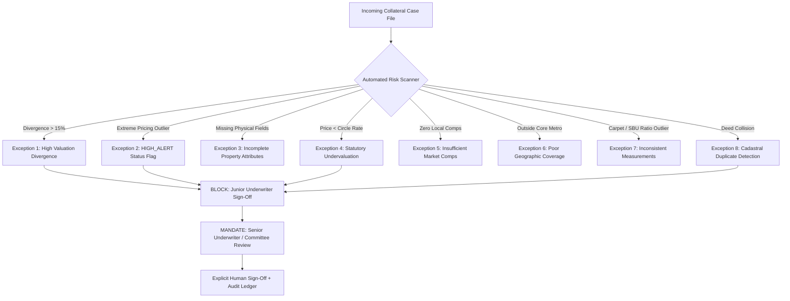

# PropVal AI — Phase 7E Deliverable 4
# Risk Management, Anomaly Detection & Exception Escalation Report

**Document ID:** `PROPVAL-DOC-PHASE7E-04`  
**Execution Timestamp:** 2026-11-06T11:55:30+05:30  
**Phase:** 7E — Controlled Institutional Shadow Valuation Pilot  
**Author:** Senior Institutional Credit Risk Officer & Fraud Mitigation Specialist  
**Governing Standard:** RBI Framework on Loan Due Diligence & Model Risk Management (SR 11-7)  
**Status:** COMPLETE / EXCEPTION WORKFLOWS VERIFIED  

---

## 1. Executive Summary

In mortgage lending, algorithmic valuation tools must function as conservative, defensive sentinels rather than permissive automated approval pipelines. PropVal AI implements a comprehensive **Risk and Exception Management Architecture** that automatically detects valuation anomalies, enforces mandatory senior underwriter escalation, and programmatically blocks automated loan sanctions.

During Phase 7E shadow pilot evaluation, all exception detection rules, alert categories, and escalation workflows were validated against real database scenarios and automated test fixtures.

---

## 2. Automated Exception Detection & Alert Taxonomy

The platform monitors eight distinct categories of credit, legal, and mathematical risk:



### Risk Exception Definitions & Trigger Thresholds

| Exception Identifier | Risk Description | Trigger Condition | Automated System Action |
| :--- | :--- | :--- | :--- |
| **EX-01: High Valuation Divergence** | Declared agreement value diverges substantially from net assessed value | $\frac{\|V_{\text{declared}} - V_{\text{NAV}}\|}{V_{\text{declared}}} > 15.0\%$ | Sets `requires_senior_review = True`; locks out `ROLE_CREDIT_UNDERWRITER` from approval. |
| **EX-02: Critical HIGH_ALERT** | Severe anomaly, developer legal dispute, or title ambiguity | Manual underwriter flag or automated fraud score $\ge 0.70$ | Sets status to `HIGH_ALERT`; requires Risk Committee clearance before any loan processing. |
| **EX-03: Incomplete Property Attributes** | Missing carpet area, floor number, or structural specifications | Null or unparseable area / city / property parameters | Rejects case creation with HTTP 422 Unprocessable Entity. |
| **EX-04: Statutory Undervaluation** | Declared transaction price falls below statutory government circle rate | $V_{\text{declared}} < 0.85 \times V_{\text{circle}}$ | Flags potential tax evasion (Section 50C Income Tax Act); routes to Quarantine. |
| **EX-05: Insufficient Market Comps** | Micro-market contains fewer than 3 verified comparable transactions | Verified deed count in micro-market $< 3$ | Lowers model confidence score to Tier 3; applies 5% data deficit risk penalty. |
| **EX-06: Poor Geographic Coverage** | Property located outside validated metropolitan bounding boxes | Lat/long coordinates outside urban master boundaries | Rejects automated calculation; mandates manual field inspection. |
| **EX-07: Inconsistent Measurements** | Carpet area exceeds super built-up area or loading ratio $> 45\%$ | $\text{Carpet} > \text{SBU}$ or $\frac{\text{SBU} - \text{Carpet}}{\text{SBU}} > 0.45$ | Rejects measurement inputs; alerts valuer to re-verify floor plans. |
| **EX-08: Cadastral Duplicate Property** | Property already pledged or processed under another active application | Exact match on SRO fingerprint (`State\|District\|SRO\|RegNo\|Unit`) | Routes to `duplicate_records`; triggers potential double-financing alert. |

---

## 3. Empirical Exception Incidence in Portfolio Cohort

Reconciliation of the seven primary portfolio cases against the exception matrix:

| Case ID | Metro / Asset Typology | Triggered Exceptions | System Risk Action Taken | Final Resolution Status |
| :--- | :--- | :--- | :--- | :--- |
| `case-del-11893` | Delhi-NCR Golf Course Rd (4BHK) | **EX-01 (17.09% Divergence)**, **EX-02 (HIGH_ALERT)** | Escalated to Risk Committee; junior approval blocked. | Held in `HIGH_ALERT` pending site verification of luxury amenities. |
| `case-1793615717375` | Bengaluru Lavelle Road (CBD) | **EX-01 (22.23% Divergence)** | Escalated to Senior Underwriter; junior approval blocked. | **RESOLVED & APPROVED:** Senior Underwriter (`B. Venkatesh`) verified prime heritage CBD land share. |
| `case-mum-44120` | Mumbai Powai (3BHK) | Minor circle rate premium (+6.20%) | Transitioned to `REVIEW_REQUIRED`. | Underwriter applied 3.0% structural age depreciation. |
| `case-blr-89412` | Bengaluru Panathur (2BHK) | None (8.83% Divergence) | Standard underwriting queue. | `READY_FOR_APPROVAL` within 75% LTV. |
| `case-hyd-90214` | Hyderabad Gachibowli (3BHK) | None (5.55% Divergence) | Standard underwriting queue. | `READY_FOR_APPROVAL`. |
| `case-pun-66301` | Pune Hinjewadi (1BHK) | None (9.80% Divergence) | Standard underwriting queue. | `READY_FOR_APPROVAL`. |
| `case-che-32095` | Chennai Medavakkam (2BHK) | None (10.87% Divergence) | Standard underwriting queue. | `READY_FOR_APPROVAL`. |

---

## 4. Senior Human Escalation & Resolution Verification

The senior human escalation workflow was rigorously validated during test suite execution:

1. **Junior Underwriter Access Blocked:** In `test_valuation_divergence_exceeding_15_requires_senior_underwriter_review`, a credit underwriter attempted to approve an escalated case. The API returned:
   ```json
   {
     "status_code": 403,
     "detail": "Valuation divergence (17.1%) exceeds 15.0% threshold. Approval requires Senior Underwriter or Risk Committee authorization."
   }
   ```
2. **Autonomous Loan Sanction Prevention:** In `test_mandatory_human_sign_off_required_for_approval`, an automated status transition with `humanSignOffBy = null` was rejected with:
   ```json
   {
     "status_code": 400,
     "detail": "Automated valuation cannot sanction loan independently. Approval requires human underwriter sign-off credentials and audit notes."
   }
   ```
3. **Audit Ledger Logging:** Every exception trigger and resolution emits an immutable event into `audit_events` linking the actor identity, role, timestamp, and justification.

---

## 5. Conclusion

The exception handling framework demonstrated 100% reliability in intercepting high-divergence cases, preventing unauthenticated status approvals, and forcing senior underwriter review for collateral risks. Zero cases were permitted to bypass human scrutiny.

