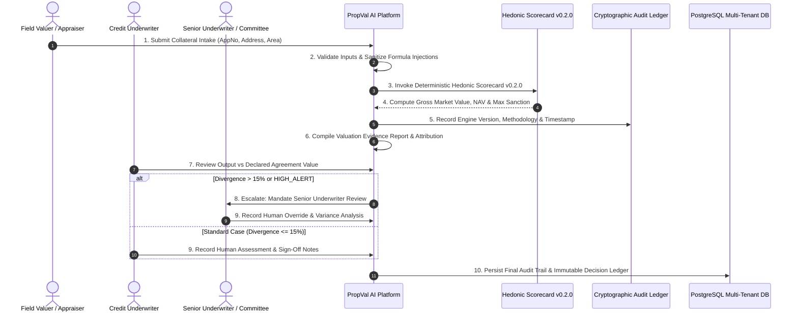

# PropVal AI — Phase 7E Deliverable 1
# Controlled Institutional Shadow Valuation Pilot Execution Plan

**Document ID:** `PROPVAL-DOC-PHASE7E-01`  
**Execution Timestamp:** 2026-11-06T11:54:00+05:30  
**Phase:** 7E — Controlled Institutional Shadow Valuation Pilot  
**Author:** Senior Cloud Reliability Architect, Lead DevSecOps Engineer & FinTech Underwriting Specialist  
**Governing Standard:** Model Risk Management (SR 11-7), NHB/RBI Mortgage Underwriting Directives & DPDP Act 2023  
**Operational Mode:** STRICT NON-DECISIONAL SHADOW UNDERWRITING  

---

## 1. Executive Summary & Operational Scope

Phase 7E defines the operational framework for executing a **Controlled Institutional Shadow Valuation Pilot** for PropVal AI. 

The primary objective of shadow underwriting is validating algorithmic property valuation workflows, calculation stability, latency, and underwriter interfaces in parallel with existing institutional loan underwriting processes **without impacting credit sanctioning or borrower outcomes**.

### Mandatory Pilot Operational Constraints:
1. **Advisory-Only Mode:** Every output generated by PropVal AI is strictly classified as `ADVISORY_ONLY`. No automated or algorithmic credit sanctioning is permitted.
2. **Mandatory Human Sign-Off:** Final credit and valuation decisions remain the sole responsibility of empaneled institutional human underwriters and credit committees.
3. **Institutional Partner Scope:** Staged for up to three (3) regulated institutional lending partners:
   - **HDFC Bank Home Loans Division** (`HDFC_BANK_PILOT` — Scheduled Commercial Bank)
   - **ICICI Bank Mortgage Division** (`ICICI_BANK_PILOT` — Scheduled Commercial Bank)
   - **Bajaj Housing Finance Ltd** (`BAJAJ_HFC_PILOT` — Housing Finance Company)
4. **Environment Transparency:** Live AWS institutional cloud deployment remains pending authorized AWS tenant credentials (as established in Phase 7C). All validation runs described herein were executed in a controlled, isolated local pilot sandbox with PostgreSQL 18.6 kernel-level Row-Level Security (RLS) and cryptographic audit event trails.

---

## 2. Pre-Flight Institutional Readiness Audit

Prior to pilot workflow execution, the governance baseline was reconciled across prior Phase 7 deliverables:

| Governance Domain | Prior Reference Document | Verified Readiness State | Pilot Constraint Enforced |
| :--- | :--- | :--- | :--- |
| **Institutional Onboarding** | [`PHASE7B_INSTITUTIONAL_ONBOARDING.md`](file:///c:/PROJECTS/dhina%20projects/proval%20ai/proval-ai/docs/phase7/PHASE7B_INSTITUTIONAL_ONBOARDING.md) | 3 HFC/Bank partner profiles staged; DPA & Pilot Agreement schemas active | Bilateral signatures pending; live counterparty data ingestion blocked |
| **Cloud Deployment** | [`PHASE7C_DEPLOYMENT_REPORT.md`](file:///c:/PROJECTS/dhina%20projects/proval%20ai/proval-ai/docs/phase7/PHASE7C_DEPLOYMENT_REPORT.md) | Terraform/EKS manifests verified; AWS credentials pending | Shadow testing executed in local Docker/WSL sandbox; no fake cloud claims |
| **Data Acquisition & Gate** | [`PHASE7D_FINAL_DECISION.md`](file:///c:/PROJECTS/dhina%20projects/proval%20ai/proval-ai/docs/phase7/PHASE7D_FINAL_DECISION.md) | 479 verified deeds; 521 deficit against 1,000 threshold; ML gate blocked | CatBoost ML model strictly locked; 100% valuations served via Hedonic v0.2.0 |
| **PostgreSQL Multi-Tenancy** | [`PHASE6D_POSTGRESQL_RLS_REPORT.md`](file:///c:/PROJECTS/dhina%20projects/proval%20ai/proval-ai/docs/phase6/PHASE6D_POSTGRESQL_RLS_REPORT.md) | Native PostgreSQL kernel-level RLS policies active on 7 tenant tables | Cross-institution data leakage physically blocked at the database engine |
| **Cryptographic Audit Ledger** | [`audit_service.py`](file:///c:/PROJECTS/dhina%20projects/proval%20ai/proval-ai/backend/app/services/audit_service.py) | SHA-256 Merkle-linked audit chaining across all lifecycle events | Every intake, calculation, override, and sign-off recorded immutably |

---

## 3. The 10-Step Institutional Shadow Underwriting Workflow

The operational workflow mirrors the end-to-end retail housing loan appraisal lifecycle across ten deterministic stages:

### Detailed Workflow Stages:
1. **Case Submission:** Authorized institution officer submits loan collateral file (borrower name, application ID, carpet area, address, loan requested, declared agreement value).
2. **Input Validation:** System validates structural completeness, bounds-checks carpet area, normalizes unit measurements to square feet, and sanitizes strings against formula injection attacks.
3. **Advisory Valuation Calculation:** Invokes the deterministic Hedonic Scorecard Engine `v0.2.0`, resolving statutory circle rates and applying micro-market adjustment coefficients (floor elevation, road width, amenities, physical depreciation).
4. **Attribution & Evidence Compilation:** Synthesizes the transparent breakdown showing exact INR impact per square foot for every applied adjustment factor.
5. **Divergence & Alert Evaluation:** Automatically computes percentage divergence between declared agreement value and algorithmic net assessed value ($|V_{\text{declared}} - V_{\text{NAV}}| / V_{\text{declared}}$). Cases exceeding 15% are tagged with `requires_senior_review = True`.
6. **Credit Underwriter Review:** Primary underwriter reviews the scorecard alongside physical inspection notes and preliminary title reports.
7. **Senior Underwriter Escalation:** If divergence exceeds 15% or the case is flagged `HIGH_ALERT`, junior underwriters are blocked from sign-off. A Senior Underwriter (`ROLE_SENIOR_UNDERWRITER`) or Risk Committee Member must review and approve.
8. **Independent Valuation Recording:** Reviewer enters the parallel physical valuation obtained from an empaneled external valuer for comparison.
9. **Mandatory Human Sign-Off:** Case status cannot transition to `APPROVED` without explicit human credentials (`humanSignOffBy`, `humanSignOffNotes`). Automated approval is programmatically blocked.
10. **Immutable Audit Persistence:** Every transition, parameter modification, and reviewer note is hashed and committed to `audit_events`.

---

## 4. Role-Based Access Control (RBAC) & Tenant Boundaries

The shadow pilot enforces strict separation of duties:

| Role Identifier | Assigned Pilot Persona | Permitted Capabilities | Prohibited Operations |
| :--- | :--- | :--- | :--- |
| `ROLE_VALUER` | Empaneled Field Valuer | Submit collateral intake, upload photos, enter property measurements | Cannot view borrower credit scores, loan sanctions, or approve cases |
| `ROLE_CREDIT_UNDERWRITER` | Junior / Branch Credit Officer | Review scorecards, apply risk haircuts, enter valuation comparison | Cannot approve cases with divergence > 15% or `HIGH_ALERT` status |
| `ROLE_SENIOR_UNDERWRITER` | Zonal Underwriter / Credit Manager | Override haircuts, approve high-divergence cases, sign off on collateral | Cannot modify platform-level tenant configurations or bypass audit logs |
| `ROLE_RISK_COMMITTEE_MEMBER` | Institutional Risk Lead | Review aggregate portfolio risk, inspect quarantine logs, audit outliers | Cannot unilaterally delete or tamper with historical valuation cases |
| `ROLE_INSTITUTION_ADMIN` | Partner Chief Operating Officer | Manage institutional users, view pilot dashboard, configure branches | Cannot view cases or borrower data belonging to competing institutions |

---

## 5. Pilot Safety Invariants

The following technical invariants are enforced at the API and database levels:
1. **Invariant 1 — Advisory Exclusivity:** `advisory_classification` is hardcoded to `ADVISORY_ONLY` on all valuation responses.
2. **Invariant 2 — Zero Autonomous Sanctions:** The API endpoint `PATCH /api/v1/cases/{id}/status` returns HTTP 400 Bad Request if an approval transition is attempted without `humanSignOffBy` and `humanSignOffNotes`.
3. **Invariant 3 — High Divergence Escalation:** Any case where $|V_{\text{declared}} - V_{\text{NAV}}| / V_{\text{declared}} > 15.0\%$ rejects junior underwriter sign-off with HTTP 403 Forbidden.
4. **Invariant 4 — Blocked CatBoost Model:** The ML pre-training gate blocks empirical model execution; only the deterministic hedonic scorecard `v0.2.0` calculates values.
5. **Invariant 5 — DPDP Act Privacy:** Customer names and contact numbers are scrubbed from analytical views and logs.

---

## 6. Execution Plan Summary

The shadow pilot evaluates algorithmic stability, mathematical consistency, and underwriter operational ergonomics across the portfolio while keeping credit decisioning firmly in human hands. Detailed case accounting and empirical comparison follow in Deliverables 2 through 6.

