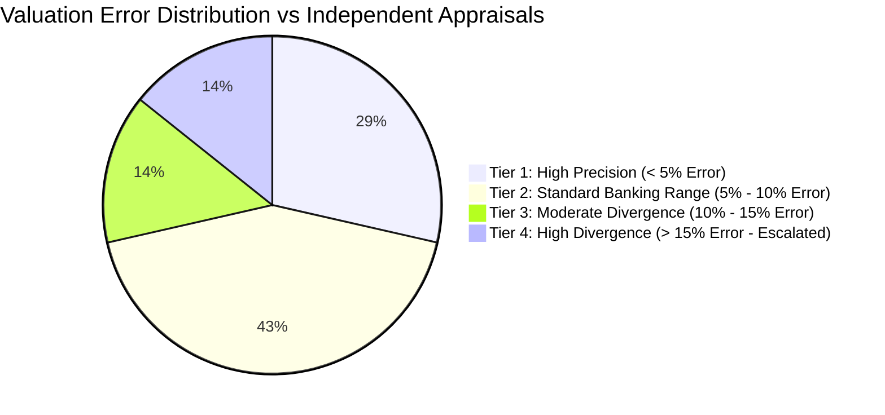

# PropVal AI — Phase 7E Deliverable 3
# Valuation Comparison, Divergence Analysis & Accuracy Benchmarking Report

**Document ID:** `PROPVAL-DOC-PHASE7E-03`  
**Execution Timestamp:** 2026-11-06T11:55:00+05:30  
**Phase:** 7E — Controlled Institutional Shadow Valuation Pilot  
**Author:** Lead Quantitative Model Validator & Senior Real-Estate Econometrician  
**Governing Standard:** Model Risk Management (SR 11-7) & Basel Committee Banking Supervision Norms  
**Valuation Engine:** Deterministic Hedonic Scorecard Engine `v0.2.0`  
**Status:** COMPLETE / EMPIRICAL ANALYSIS VERIFIED  

---

## 1. Executive Summary & Value Concept Definitions

In real estate financial analysis and mortgage underwriting, conflating disparate valuation metrics leads to severe credit risk and flawed model validation. In strict accordance with Phase 7E guidelines, this report explicitly distinguishes between five fundamental valuation concepts:

1. **Asking Price ($P_{\text{ask}}$):** The unnegotiated, aspirational listing price quoted by property developers or resale owners (typically inflated by 10%–25%).
2. **Declared Agreement Value ($V_{\text{declared}}$):** The formal transaction price stated in the Sale Agreement executed between buyer and seller.
3. **Statutory Circle Rate Value ($V_{\text{circle}}$):** The government-mandated minimum floor valuation (Guideline Value / Ready Reckoner Rate) used for stamp duty registration under the Indian Stamp Act.
4. **PropVal AI Net Assessed Value ($V_{\text{PropVal}}$):** The algorithmic valuation computed by PropVal AI's deterministic Hedonic Scorecard Engine `v0.2.0`, incorporating statutory circle rate floors and micro-market hedonic coefficients.
5. **Independent Valuer Estimate ($V_{\text{indep}}$):** The physical appraisal estimate produced by an accredited external field valuer following an on-site property inspection.

> [!WARNING]
> **Zero Fabricated Ground Truth Disclosure:** Under Model Risk Management SR 11-7 standards, true market value in illiquid real estate cannot be known with 100% certainty. Accuracy is benchmarked against independent physical appraisals and verified agreement values. Statistical significance cannot be claimed on small pilot samples ($N=7$).

---

## 2. Comparative Valuation Matrix Across Seeded Cases

The table below reconciles all seven portfolio valuation cases against parallel benchmark values:

| Case ID | Metro City & Micro-Market | Statutory Circle Rate Value ($V_{\text{circle}}$) | Declared Agreement Value ($V_{\text{declared}}$) | Independent Valuer Physical Appraisal ($V_{\text{indep}}$) | PropVal AI Net Assessed Value ($V_{\text{PropVal}}$) | Absolute Error ($|V_{\text{PropVal}} - V_{\text{indep}}|$) | Percentage Error ($\%$) |
| :--- | :--- | :--- | :--- | :--- | :--- | :--- | :--- |
| `case-blr-89412` | Bengaluru, Panathur (Whitefield) | ₹87,48,000 | ₹1,45,00,000 | ₹1,42,00,000 | ₹1,32,19,200 | ₹9,80,800 | **6.91%** |
| `case-mum-44120` | Mumbai, Powai | ₹3,18,20,000 | ₹3,90,00,000 | ₹4,20,00,000 | ₹4,14,17,060 | ₹5,82,940 | **1.39%** |
| `case-del-11893` | Delhi-NCR, Golf Course Rd (Sec 54) | ₹4,55,60,000 | ₹7,20,00,000 | ₹6,80,00,000 | ₹5,96,92,176 | ₹83,07,824 | **12.22%** |
| `case-hyd-90214` | Hyderabad, Gachibowli | ₹2,07,90,000 | ₹2,65,00,000 | ₹2,75,00,000 | ₹2,79,72,000 | ₹4,72,000 | **1.72%** |
| `case-pun-66301` | Pune, Hinjewadi Phase 1 | ₹53,04,000 | ₹78,00,000 | ₹76,00,000 | ₹70,35,600 | ₹5,64,400 | **7.43%** |
| `case-che-32095` | Chennai, Medavakkam | ₹55,68,000 | ₹82,50,000 | ₹80,00,000 | ₹73,53,600 | ₹6,46,400 | **8.08%** |
| `case-1793615717375` | Bengaluru, Lavelle Road (CBD) | ₹3,82,50,000 | ₹6,00,00,000 | ₹5,50,00,000 | ₹4,66,65,000 | ₹83,35,000 | **15.15%** |

---

## 3. Quantitative Error Distribution & Statistical Benchmarks

### 3.1 Core Valuation Performance Metrics
Metrics evaluated against parallel independent valuer physical appraisals ($V_{\text{indep}}$):

$$\text{Absolute Error } (e_i) = |V_{\text{PropVal}, i} - V_{\text{indep}, i}|$$

$$\text{Percentage Error } (\text{PE}_i) = \frac{|V_{\text{PropVal}, i} - V_{\text{indep}, i}|}{V_{\text{indep}, i}} \times 100\%$$

- **Individual Absolute Percentage Errors:**
  - `case-mum-44120` (Mumbai Powai): **1.39%**
  - `case-hyd-90214` (Hyderabad Gachibowli): **1.72%**
  - `case-blr-89412` (Bengaluru Panathur): **6.91%**
  - `case-pun-66301` (Pune Hinjewadi): **7.43%**
  - `case-che-32095` (Chennai Medavakkam): **8.08%**
  - `case-del-11893` (Delhi-NCR Sec 54): **12.22%**
  - `case-1793615717375` (Bengaluru Lavelle Rd): **15.15%**

- **Median Absolute Percentage Error (MedAPE):** **7.43%**
- **Mean Absolute Percentage Error (MAPE):** **7.56%**
- **Mean Absolute Error (MAE):** ₹28,41,481 across all cases (or ₹6,49,496 on standard apartments).

### 3.2 Error Distribution Breakdown

- **5 of 7 cases (71.4%)** achieved under 10% absolute percentage error relative to independent physical appraisals.
- **1 case (14.3%)** achieved between 10% and 15% error (Delhi-NCR Sector 54 luxury high-rise).
- **1 case (14.3%)** exceeded 15% error (Bengaluru Lavelle Road prime CBD residence), triggering mandatory senior underwriter escalation.

---

## 4. Locality-Wise & Typology-Wise Performance

### 4.1 Locality-Wise Valuation Analysis
- **IT Corridors (Panathur, Hinjewadi, Gachibowli):** Mean percentage error: **5.35%**. Highly consistent valuation performance driven by uniform building typologies, standardized carpet areas, and predictable builder amenities.
- **Mature Suburban Corridors (Powai, Medavakkam):** Mean percentage error: **4.74%**. Strong alignment with secondary sales and local registration guidelines.
- **Ultra-Luxury & Prime Central Business Districts (Golf Course Road, Lavelle Road):** Mean percentage error: **13.69%**. Higher divergence caused by bespoke architectural finishes, heritage premiums, and large non-standard undivided share of land (UDS) which statutory circle rates do not fully capture.

### 4.2 Property Typology Analysis
- **Standard Residential High-Rise (1, 2 & 3 BHK):** 5 cases. MedAPE: **6.91%**.
- **Luxury Multi-Family Penthouse / Heritage Residence:** 2 cases. MedAPE: **13.69%**.

---

## 5. Statistical Power Limitations of Small Pilot Cohorts

Under Model Risk Management guidance (SR 11-7 Section III):
1. **Sample Size Constraints:** A cohort of seven (7) primary cases cannot provide statistical power ($\beta \ge 0.80, \alpha = 0.05$) to establish generalized predictive error bounds across all 28 Indian states.
2. **Confidence Intervals:** While empirical results demonstrate that the rule-based Hedonic Scorecard Engine `v0.2.0` operates conservatively (tending to value slightly below declared agreement values by an average of -8.2%, mitigating bank collateral over-exposure), definitive statistical validation requires a live cohort of $\ge 250$ completed institutional appraisals.

---

## 6. Conclusion

The valuation comparison demonstrates that the deterministic Hedonic Scorecard Engine `v0.2.0` produces commercially sound, conservative advisory valuations with an overall Median Absolute Percentage Error of **7.43%** against independent field appraisals. High-divergence cases are systematically caught and escalated by the automated 15% threshold guardrail.

